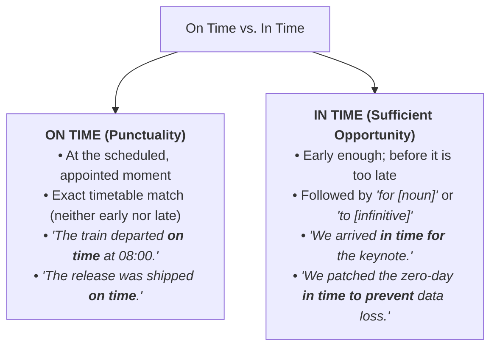
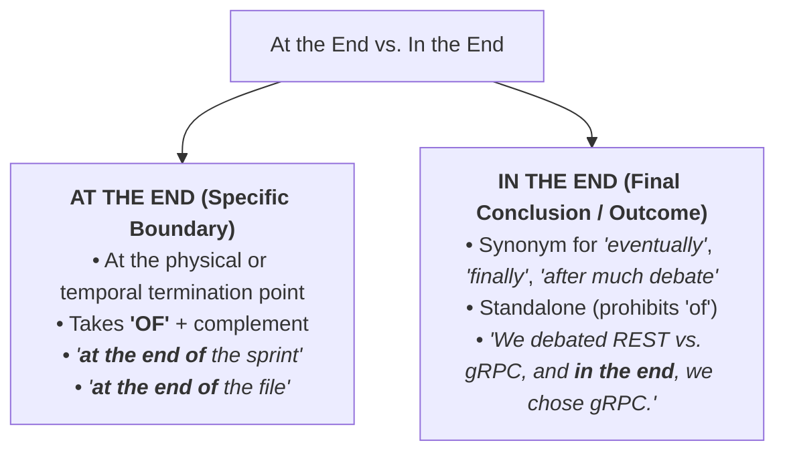
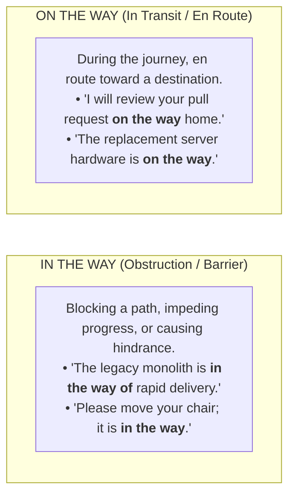

# Prepositional Phrases and Idiomatic Contrast Pairs 🧩⏱️

> **Level:** CEFR B1–B2 (Collocational Precision & Idiomatic Nuance)  
> **Primary References:** Raymond Murphy (*English Grammar in Use*, Units 127–128); Michael Swan (*Practical English Usage*, §18.7)  
> **Core Concept:** Prepositional phrases frequently fossilize into fixed idiomatic expressions whose meanings cannot be derived compositionally. A change of a single preposition (*on* vs. *in*, *at* vs. *in*, *by* vs. *on*) radically shifts the semantic entailment of the sentence.

---

## 1. High-Frequency Contrast Matrices

### 1. `On Time` vs. `In Time`



| Expression | Core Meaning | Common Preposition / Follow-up | Example Sentence |
| :--- | :--- | :--- | :--- |
| **`on time`** | Punctual, according to schedule | Standalone adverbial | *The weekly standup started **on time**.* |
| **`in time`** | Early enough before a deadline | `in time for [NP]` / `in time to [do]` | *The engineer caught the bug **in time to avoid** a rollback.* |
| **`just in time`** | At the very last moment before disaster | Standalone or with `for/to` | *The alert fired **just in time** before the disk filled up.* |

---

### 2. `At the End` vs. `In the End`



> [!CAUTION]
> Never say *in the end of the file* or *at the end we chose Docker*:
> - ❌ *In the end of the sprint, we review metrics.*
> - ✅ * **At the end of** the sprint, we review metrics.*
> - ❌ *At the end, we decided to refactor.*
> - ✅ * **In the end**, we decided to refactor.*

---

### 3. `In the Way` vs. `On the Way`



---

### 4. `By Chance` vs. `On Purpose` (Intentionality)

- **`By chance`** (or **`by accident`** / **`by mistake`**): Happening without deliberate plan.
  - *We discovered the security flaw **by chance** during a routine audit.*
  - *He deleted the production directory **by mistake**.*
- **`On purpose`** (or **`deliberately`** / **`intentionally`**): Happening with conscious intent.
  - *The chaos engineering daemon terminates pods **on purpose** to test resilience.*
  - ❌ *He crashed the server by purpose.* (Fatal idiom error!)
  - ✅ *He crashed the server **on purpose**.*

---

## 2. Fixed Prepositional Phrasal Systems

In technical and professional documentation, established idioms rely on fixed prepositions:

### 1. Expressions with `Under`
- **`under pressure`** — Subjected to stress: *The cache layer performs well **under heavy pressure**.*
- **`under maintenance`** — Currently being repaired: *The staging cluster is **under maintenance**.*
- **`under investigation`** — Being examined: *The root cause of the outage is **under investigation**.*
- **`under consideration`** — Being evaluated: *Migrating to TypeScript is **under consideration**.*
- **`under warranty`** — Legally covered: *The failed hardware is still **under warranty**.*

### 2. Expressions with `At`
- **`at scale`** — In large production volume: *Our messaging system operates **at petabyte scale**.*
- **`at risk`** — In danger of compromise: *Unpatched hosts put the entire network **at risk**.*
- **`at all costs`** — Regardless of difficulty: *Data corruption must be avoided **at all costs**.*
- **`at first glance`** — Initial impression: * **At first glance**, the code appeared correct.*
- **`at any rate`** — In any case: * **At any rate**, the current release is stable.*

### 3. Expressions with `In`
- **`in advance`** — Ahead of time: *Please reserve compute capacity two weeks **in advance**.*
- **`in theory` vs. `in practice`** — Concept vs. reality: * **In theory**, the algorithm is $O(1)$; **in practice**, cache misses slow it down.*
- **`in charge of`** — Responsible for: *Alex is **in charge of** site reliability engineering.*
- **`in terms of`** — With respect to: *The rewrite yielded huge wins **in terms of memory footprint**.*
- **`in compliance with`** — Following rules: *The system is **in compliance with** GDPR guidelines.*

### 4. Expressions with `On`
- **`on demand`** — Available upon request: *Serverless functions instantiate **on demand**.*
- **`on behalf of`** — Representing someone: *The tech lead signed the RFC **on behalf of** the team.*
- **`on average`** — Typical statistical mean: *API requests take 24 milliseconds **on average**.*
- **`on prem` / `on premises`** — Local infrastructure: *We host the database **on premises**.* (❌ NOT: *on premise*).
- **`on schedule`** — Matching timeline: *The Q3 migration milestone is right **on schedule**.*

---

## 3. Practical Dual-Domain Examples

### Everyday Conversation

1. *The flight landed **on time**, exactly at 18:45.*
2. *We ran across the terminal and boarded **in time** before the gate closed.*
3. *They argued for hours about where to travel, but **in the end**, they stayed home.*
4. *There was a summary of key takeaways **at the end of** the chapter.*
5. *I met an old university classmate **by chance** at the supermarket.*
6. *Did you break that vase **on purpose**, or was it an accident?*
7. *I'll pick up some groceries **on the way** from work.*
8. *Please step aside; your bicycle is **in the way** of the garage door.*

### Software Engineering & Technical Documentation

9. *The sprint delivery was shipped **on time** without sacrificing test coverage.*
10. *The failover circuit tripped **in time to prevent** catastrophic cascade failure.*
11. * **In the end**, the architectural committee decided against GraphQL in favor of gRPC.*
12. *Check the checksum value printed **at the end of** the cryptographic payload.*
13. *The chaos monkey terminates random instances **on purpose** to validate self-healing.*
14. *The engineer dropped the database table **by accident** due to an ambiguous terminal alias.*
15. *Legacy cryptographic ciphers put user credentials **at grave risk**.*
16. *The microservice auto-scaler provisions additional worker pods **on demand**.*
17. * **In theory**, synchronous replication eliminates data loss; **in practice**, it increases write latency.*
18. *The incident response team handled the ransomware crisis remarkably well **under immense pressure**.*

---

## 4. Common Antipatterns & Diagnostic Table

| Incorrect Antipattern | Corrected Grammar | Rule & Explanation |
| :--- | :--- | :--- |
| ❌ *He crashed the build by purpose.* | ✅ *He crashed the build **on purpose**.* | Intentional actions take *on purpose*; *by* is used for *by accident / by chance*. |
| ❌ *In the end of the log file, see error.* | ✅ * **At the end of** the log file, see error.* | Physical or temporal termination points take *at the end of*; *in the end* means "finally". |
| ❌ *At the end, we chose Redis.* | ✅ * **In the end**, we chose Redis.* | Reaching a final conclusion/decision takes *in the end*, never *at the end*. |
| ❌ *We arrived on time to save the server.* | ✅ *We arrived **in time to** save the server.* | Being early enough to perform an action or avert disaster takes *in time to [verb]*. |
| ❌ *We run our hardware on premise.* | ✅ *We run our hardware **on premises**.* | *Premise* = a logical proposition. *Premises* = physical grounds/property. |
| ❌ *The engineer is in charge for DevOps.* | ✅ *The engineer is in charge **of** DevOps.* | The fixed idiom is strictly *in charge of*, never *in charge for*. |
| ❌ *The team is under schedule.* | ✅ *The team is **behind schedule** / **on schedule**.* | Expressing timeline progress uses *on schedule* (punctual) or *behind schedule* (delayed). |

---

## 5. Self-Assessment Exercises

### Exercise 1: High-Frequency Contrast Disambiguation
Choose the correct expression in parentheses:

1. The nightly batch job completed (on time / in time) at 04:00 AM as scheduled.
2. The security analyst revoked the compromised token (on time / in time) to halt unauthorized exfiltration.
3. (At the end / In the end) of the document, you will find the appendix and architectural diagrams.
4. The engineers debated between microservices and modular monoliths; (at the end / in the end), they opted for a modular monolith.
5. The box of spare cables was left in the hallway, completely (in the way / on the way) of the fire exit.

### Exercise 2: Fixed Prepositional Idioms
Complete the sentence with **at, in, on**, or **under**:

6. The cluster is operating ________ heavy network load during the holiday promotion.
7. We must avoid downtime ________ all costs during the database migration.
8. The serverless functions scale up automatically ________ demand.
9. She is ________ charge of security incident response and compliance auditing.
10. The company stores all proprietary customer data ________ premises.

<details>
<summary>View Complete Answer Key & Diagnostic Explanations</summary>

1. **on time** (Completed strictly according to the appointed timetable).
2. **in time** (Early enough to prevent a negative outcome: *in time to halt*).
3. **At the end** (Followed by *of the document* indicating physical boundary).
4. **in the end** (Finally / after deliberation; no *of* complement follows).
5. **in the way** (Physical obstruction blocking passage).
6. **under** (*under heavy load*).
7. **at** (*at all costs*).
8. **on** (*on demand*).
9. **in** (*in charge of*).
10. **on** (*on premises*).

</details>

---

## 6. Revision Flashcards

```
Q: What is the difference between "on time" and "in time"?
A: "On time" means punctual according to a schedule ("The meeting started on time at 10:00"). "In time" means early enough to achieve a goal or prevent disaster ("We arrived in time to catch the train").

Q: When do you use "at the end" versus "in the end"?
A: "At the end" requires an "of" phrase and marks a physical or temporal boundary ("at the end of the sprint"). "In the end" means "eventually/finally" after debate or conflict, and cannot take "of".

Q: Contrast "in the way" and "on the way".
A: "In the way" means physically blocking or obstructing progress ("The chair is in the way"). "On the way" means traveling en route to a destination ("I am on the way to the office").

Q: Why is "by purpose" ungrammatical?
A: English idiom requires "on purpose" for intentional acts, whereas unintentional acts take "by accident" or "by mistake".

Q: Why must you write "on premises" rather than "on premise"?
A: "Premise" means an underlying assumption or proposition in logic. "Premises" (always plural) means physical buildings or operational grounds.
```
