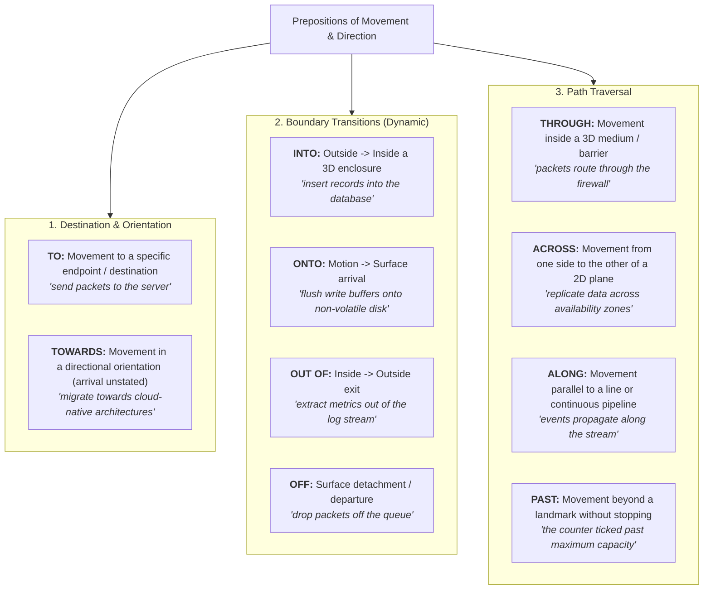
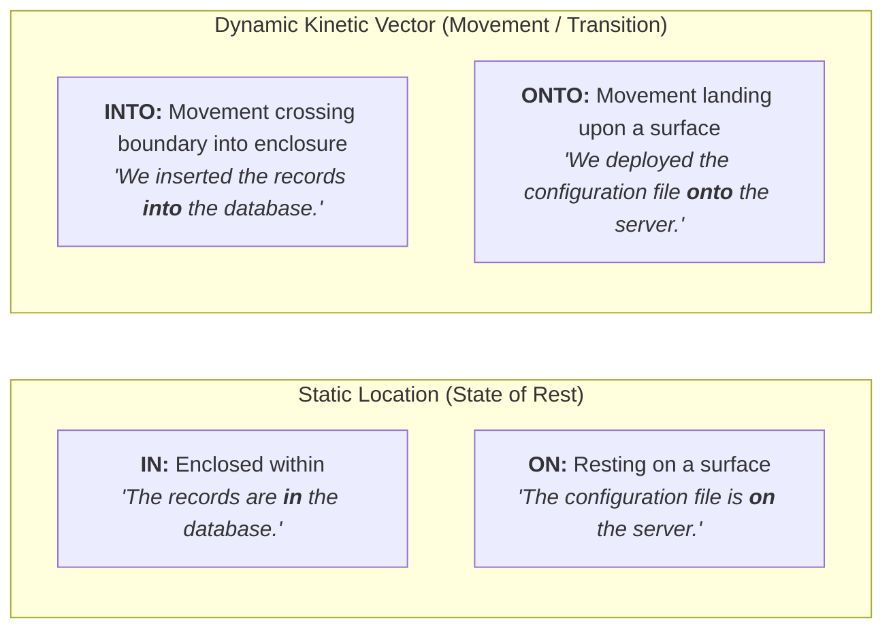
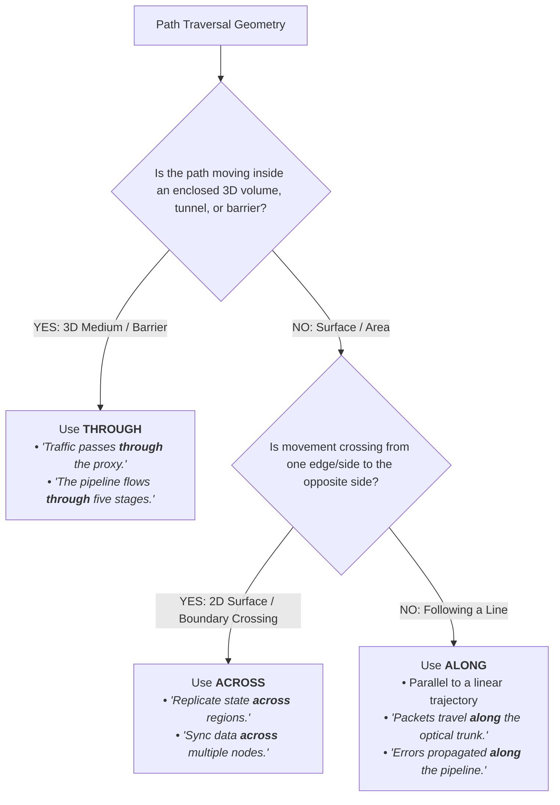

# Prepositions of Movement and Direction: To, Into, Onto, Towards, Through, Across 🚀🏹

> **Level:** CEFR A2–B2 (Dynamic Vectors & Kinetic Transitions)  
> **Primary References:** Raymond Murphy (*English Grammar in Use*, Units 126–128); Michael Swan (*Practical English Usage*, §18.6)  
> **Core Concept:** Unlike static prepositions of location, prepositions of movement encode **kinetic trajectories, directional vectors, and boundary transitions**. They describe movement toward a destination (*to*), orientation without guaranteed arrival (*towards*), penetration into an enclosed volume (*into*), landing upon a surface (*onto*), or transversal passage (*through, across*).

---

## 1. The Kinetic Vector Taxonomy



---

## 2. Dynamic vs. Static Prepositions: `In` vs. `Into` & `On` vs. `Onto`

A frequent source of ambiguity in technical documentation is conflating **static rest** with **kinetic transition**:



### Contrast Table

| Static Position (No Movement) | Kinetic Transition (Movement / Transformation) |
| :--- | :--- |
| *The data lives **in** the distributed cache.* | *The worker thread serializes objects **into** the cache.* |
| *The binary is currently **on** the host.* | *Copy the compiled binary **onto** the staging host.* |
| *He was sitting **in** the server room.* | *He walked **into** the server room.* |
| *The cat jumped and is now **on** the table.* | *The cat jumped **onto** the table.* |

> [!NOTE]
> In informal spoken English, *in* and *on* are sometimes substituted for *into* and *onto* (*Jump in the car!*). However, in **technical architecture documentation, API specifications, and formal prose**, strict kinetic distinction is mandatory to eliminate semantic ambiguity.

---

## 3. Path Traversal: `Through` vs. `Across` vs. `Along`

Understanding the geometry of movement paths is essential for describing network topology and data processing pipelines:



### 1. `Through` (3D Enclosure / Barrier Penetration)
- *Incoming HTTP requests pass **through** the web application firewall (WAF).*
- *The thread iterates **through** the entire array of telemetry records.*
- *He walked **through** the security checkpoint.*

### 2. `Across` (2D Boundary / Geographic Spans)
- *We deploy database clusters **across** three separate AWS availability zones.*
- *The company expanded its operations **across** fifteen European countries.*
- *The fiber optic cable stretches **across** the Atlantic Ocean.*

### 3. `Along` (Linear Alignment)
- *They laid fiber optic conduits **along** the railway corridor.*
- *Trace the execution path **along** the control flow graph.*

---

## 4. `To` vs. `Towards` (Toward)

- **`To`** denotes a **fixed destination or terminal goal**:
  - *The packet traveled **to** the destination IP address.* (Arrival is accomplished or designated).
  - *She drove **to** the office.*
- **`Towards` (US: `Toward`)** denotes **directional orientation**, without guaranteeing arrival or establishing a terminus:
  - *The robot rolled **towards** the wall, but stopped short.*
  - *Our team is actively moving **towards** continuous deployment.* (A directional strategic trend).

---

## 5. Practical Dual-Domain Examples

### Everyday Conversation

1. *She walked **into** the coffee shop and ordered a cappuccino.*
2. *The dog leapt **onto** the sofa as soon as we entered the room.*
3. *We took a scenic drive **along** the Mediterranean coastline.*
4. *They hiked **through** the dense forest until they reached the summit.*
5. *He walked **across** the pedestrian bridge to reach the stadium.*
6. *She looked **towards** the stage when the music started playing.*
7. *The train pulled **out of** the station precisely on time.*
8. *He accidentally knocked his glass **off** the kitchen counter.*

### Software Engineering & Technical Documentation

9. *The ingress gateway routes decrypted traffic **to** the internal authentication cluster.*
10. *The ETL pipeline streams raw JSON payloads **into** Snowflake data warehouses.*
11. *The provisioning script deploys compiled Go binaries **onto** target Linux hosts.*
12. *All inbound API requests must first pass **through** our rate-limiting filter.*
13. *The database engine replicates write-ahead logs **across** multi-region clusters.*
14. *The background worker pulls failed webhook events **out of** the dead-letter queue.*
15. *High-priority messages are pushed **onto** the Redis sorted set.*
16. *The software industry is transitioning rapidly **towards** serverless event-driven paradigms.*
17. *Unused container instances are dropped **off** the autoscaling group during low-traffic hours.*
18. *The pointer walked **past** the allocated buffer boundary, triggering a segmentation fault.*

---

## 6. Common Antipatterns & Diagnostic Table

| Incorrect Antipattern | Corrected Grammar | Rule & Explanation |
| :--- | :--- | :--- |
| ❌ *Insert the user record in the database.* | ✅ *Insert the user record **into** the database.* | Dynamic kinetic movement into a container requires *into*, not *in*. |
| ❌ *Copy the SSL certificate in the host.* | ✅ *Copy the SSL certificate **onto** the host.* | Movement arriving on an operating system/server platform requires *onto*. |
| ❌ *The requests pass across the firewall.* | ✅ *The requests pass **through** the firewall.* | A firewall acts as a 3D filtering barrier/medium; movement uses *through*. |
| ❌ *The packet went until the destination.* | ✅ *The packet went **to** the destination.* | *Until* is strictly temporal; spatial destinations take *to*. |
| ❌ *Extract the metrics outside of the logs.* | ✅ *Extract the metrics **out of** the logs.* | Dynamic exit or derivation from within an enclosed source takes *out of*. |
| ❌ *He jumped in the pool.* | ✅ *He jumped **into** the pool.* | Dynamic kinetic motion crossing from air into water requires *into*. |
| ❌ *We arrived to the data center.* | ✅ *We arrived **at** the data center.* | Verbs of arrival take *at* or *in*, never *to*. |

---

## 7. Self-Assessment Exercises

### Exercise 1: Dynamic vs. Static Prepositions
Choose between **in / into** or **on / onto**:

1. The data analyst loaded the CSV files ________ the analytical database.
2. The compiled binary resides ________ the local filesystem `/usr/local/bin`.
3. The load balancer redirected the user ________ a secure checkout page.
4. The sysadmin deployed the hotfix patch ________ all staging servers.
5. All transaction details are safely recorded ________ the ledger.

### Exercise 2: Path Vectors (`Through`, `Across`, `Along`, `Out of`, `Towards`)
Select the appropriate preposition of movement:

6. The sensor reading travels (along / through) the optical fiber conduit.
7. Data packets must pass (across / through) three layers of proxy inspection.
8. We synchronized user profiles (through / across) our North American and European databases.
9. The worker process pulled a batch of tasks (off / out of) the RabbitMQ queue.
10. The company is actively shifting its engineering culture (to / towards) automated trunk-based development.

<details>
<summary>View Complete Answer Key & Diagnostic Explanations</summary>

1. **into** (Dynamic movement from outside into an enclosed database container).
2. **in** or **on** (Static location: *on the filesystem* or *in the folder*).
3. **to** (Redirecting movement toward a designated endpoint).
4. **onto** (Dynamic deployment arriving onto host server surfaces).
5. **in** (Static persistence within an enclosed ledger).
6. **along** (Movement following a continuous linear conduit).
7. **through** (Penetration and traversal of a multi-layered filtering medium).
8. **across** (Transversal coordination between distinct geographic regions).
9. **out of** (Dynamic extraction from inside a queue enclosure).
10. **towards** (Directional movement/trend toward an organizational goal).

</details>

---

## 8. Revision Flashcards

```
Q: What is the grammatical difference between "in" and "into"?
A: "In" denotes static location or presence inside a container ("The file is in the folder"); "into" denotes kinetic movement crossing a boundary from outside to inside ("Move the file into the folder").

Q: When should you use "onto" instead of "on"?
A: Use "onto" when describing movement that results in landing upon a surface or platform ("Copy the script onto the server").

Q: What is the geometric difference between "through" and "across"?
A: "Through" implies moving inside a 3D medium, barrier, or tunnel ("through the firewall", "through the pipeline"); "across" implies moving from one side to another of a 2D surface or territory ("across regions", "across the network").

Q: Contrast "to" and "towards" in technical specifications.
A: "To" denotes a definite destination or arrival endpoint ("route to the gateway"); "towards" denotes orientation or directional movement without guaranteeing arrival ("moving towards cloud adoption").

Q: Why is "We arrived to London" ungrammatical?
A: The verb "arrive" does not take the directional vector "to"; it strictly requires "in" (for cities/countries) or "at" (for buildings/points).
```
