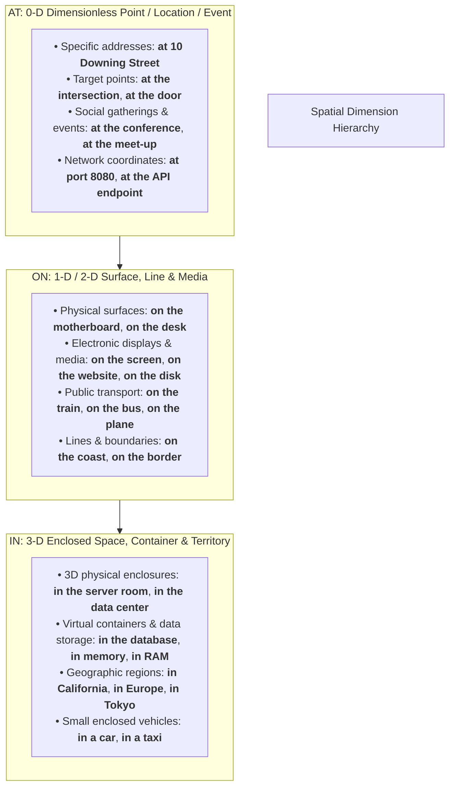
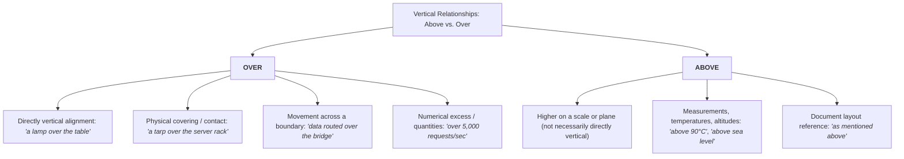
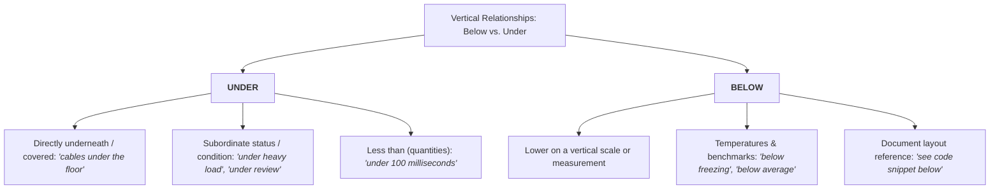
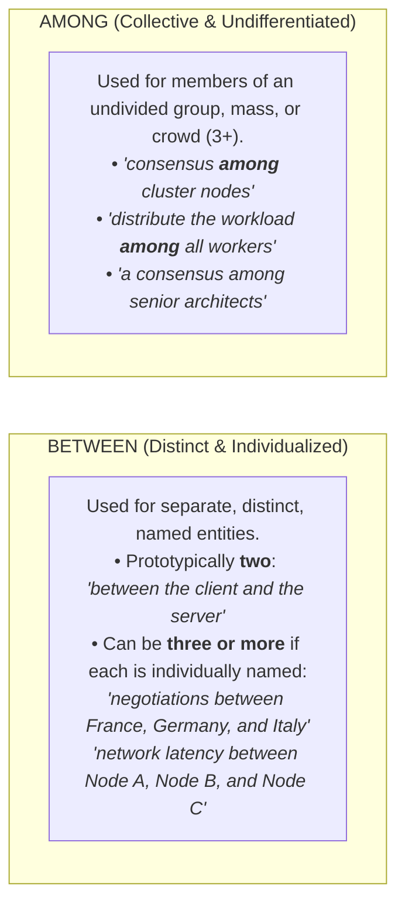

# Prepositions of Place and Position: At, On, In, Above, Over, Under, Between 🗺️📍

> **Level:** CEFR A1–B2 (Spatial Topology & Geometric Coordinates)  
> **Primary References:** Raymond Murphy (*English Grammar in Use*, Units 123–125); Michael Swan (*Practical English Usage*, §18.4–18.5)  
> **Core Concept:** Spatial prepositions locate entities within geometric and conceptual space. English organizes position through dimensional topology: **`at`** (zero dimensions: a point or milestone), **`on`** (one/two dimensions: a line or surface), and **`in`** (three dimensions: an enclosed volume or container), alongside precise vertical and relational coordinates (*above/over, below/under, between/among*).

---

## 1. The Spatial Dimension Hierarchy (At, On, In)



---

## 2. Technical Computing Spatial Topology

Software systems heavily repurpose spatial prepositions. Choosing the wrong preposition obscures architectural intent:

| Architectural Location | Standard Preposition | Rationale | Example Sentence |
| :--- | :---: | :--- | :--- |
| **Volatile RAM / Storage Engine** | **`in`** | Enclosed 3D data container | *The session state is stored **in Redis / in memory**.* |
| **Relational Database / File** | **`in`** | Internal data enclosure | *The records are located **in the `users` table**.* |
| **Host / Virtual Machine / OS** | **`on`** | Operating platform or surface | *The daemon executes **on Ubuntu / on AWS EC2**.* |
| **Physical Disk / Storage Medium** | **`on`** | Storage surface layer | *The write-ahead log is flushed **on SSD drives**.* |
| **Network Interface / Port / URL** | **`at`** | Specific dimensionless destination point | *The service listens for incoming TCP traffic **at port 443**.* |
| **Domain / Endpoint URL** | **`at`** | Discrete address coordinate | *The health check is available **at `/healthz`**.* |

> [!TIP]
> - **In** memory (internal state).
> - **On** the server (host platform).
> - **At** port 8080 (network endpoint address).

---

## 3. Vertical Relationships: `Above` vs. `Over`

Both words indicate a higher vertical position, but their geometric and figurative distributions differ:



### Contrast Table

| Context | `Above` | `Over` |
| :--- | :--- | :--- |
| **Direct Vertical Alignment** | Permissible (*a shelf above the desk*) | Preferred (*a light hanging over the desk*) |
| **Physical Surface Covering** | ❌ Cannot express covering | ✅ *Place a cover **over** the hardware.* |
| **Scale / Threshold Measurement** | ✅ *CPU utilization is **above 95%**.* | ❌ Unnatural with exact degree scales |
| **Numerical Quantity ("More than")** | ❌ *Above 500 users* (less common) | ✅ * **Over 500 users** are connected.* |
| **Movement Across an Obstacle** | ❌ Cannot express crossing | ✅ *Traffic travels **over** the TLS VPN tunnel.* |

---

## 4. Vertical Relationships: `Below` vs. `Under`

The downward counterparts of *above* and *over*:



- *The fiber optic cables run **under** the raised floor tiles.* (Directly underneath and covered).
- *The query latency dropped **below** the 50ms SLA threshold.* (Scalar benchmark).
- *The database is currently operating **under** heavy concurrent write stress.* (Idiomatic state).

---

## 5. Relational Proximity: `Between` vs. `Among`



> [!CAUTION]
> The traditional rule stating *"between is only for two; among is for three or more"* is an oversimplification. In technical prose:
> - *The packet travels **between** server 1, server 2, and server 3.* (Correct, because the servers are distinct, named nodes).
> - *The load is balanced **among** all available servers.* (Correct, because the servers form an indistinct collective pool).

---

## 6. Practical Dual-Domain Examples

### Everyday Conversation

1. *I left my keys **on the kitchen table**.* (Surface)
2. *She is waiting for you **at the coffee shop on 5th Avenue**.* (Point + Line)
3. *We stayed **in a charming hotel in Rome**.* (Enclosed building + City)
4. *There is an antique mirror hanging **above the fireplace**.* (Higher on the wall)
5. *The cat is sleeping **under the bed**.* (Directly underneath and covered)
6. *He divided the inheritance equally **between his two sons**.* (Two distinct individuals)
7. *She felt completely comfortable **among her closest friends**.* (Collective group)
8. *The temperature dropped **below zero** overnight.* (Scalar measurement)

### Software Engineering & Technical Documentation

9. *The background worker processes asynchronous jobs stored **in Redis**.*
10. *The application runs containerized workloads **on Kubernetes clusters**.*
11. *The reverse proxy listens **at port 80** and redirects to port 443.*
12. *The cache hit ratio remained **above 92%** throughout the stress test.*
13. *Network traffic is encrypted **over an IPsec VPN tunnel**.*
14. *Latency degraded significantly when CPU utilization climbed **over 90%**.*
15. *The cluster nodes reach consensus **among themselves** using the Raft protocol.*
16. *We analyzed the network latency **between the ingress gateway, the auth service, and the database**.*
17. *Inspect the diagram **below** to review the microservice dependency graph.*
18. *The microservice operates reliably **under high concurrent write pressure**.*

---

## 7. Common Antipatterns & Diagnostic Table

| Incorrect Antipattern | Corrected Grammar | Rule & Explanation |
| :--- | :--- | :--- |
| ❌ *The session is stored on memory.* | ✅ *The session is stored **in memory**.* | Volatile memory is an enclosed virtual container, requiring *in*. |
| ❌ *The microservice listens on port 8080.* | ✅ *The microservice listens **at port 8080**.* (or *on interface... at port*). | Ports represent discrete dimensionless network points (*at*). |
| ❌ *I read the tutorial in internet.* | ✅ *I read the tutorial **on the internet**.* | Digital media, broadcasts, and network surfaces take *on*. |
| ❌ *The server temperature is over 100°C.* | ✅ *The server temperature is **above 100°C**.* | Benchmark scales, levels, and thermometer measurements take *above*, not *over*. |
| ❌ *Divide the tasks between all developers.* | ✅ *Divide the tasks **among** all developers.* | Modifying an undivided collective group (3+) takes *among*. |
| ❌ *The latency fell under the 50ms SLA.* | ✅ *The latency fell **below** the 50ms SLA.* | Fixed scalar benchmarks and thresholds take *below*. |
| ❌ *We arrived to the data center.* | ✅ *We arrived **at the data center**.* | *Arrive* takes *at* (for buildings/points) or *in* (for cities/countries), never *to*. |

---

## 8. Self-Assessment Exercises

### Exercise 1: Spatial At, On, In
Fill in the blanks with **at, on**, or **in**:

1. The configuration values are defined ________ the `.env` file.
2. The webhook dispatcher listens for events ________ endpoint `/v1/events`.
3. We deployed the machine learning model ________ an AWS EC2 instance.
4. The Redis cache keeps all active user sessions ________ RAM.
5. The developers met ________ the main conference room ________ the third floor.

### Exercise 2: `Above`, `Over`, `Below`, `Under`, `Between`, `Among`
Choose the appropriate preposition:

6. The cluster latency must remain (below / under) 100 milliseconds at all times.
7. Traffic is routed securely (above / over) an encrypted TLS 1.3 connection.
8. We balanced the network requests (between / among) all fifty cluster worker nodes.
9. System memory usage spiked (above / over) 95% capacity during the backup.
10. The agreement was negotiated (between / among) the client, the vendor, and the host provider.

<details>
<summary>View Complete Answer Key & Diagnostic Explanations</summary>

1. **in** (Enclosed inside a digital file container).
2. **at** (Discrete address endpoint).
3. **on** (Host platform / VM surface).
4. **in** (Enclosed volatile memory).
5. **in** the main conference room **on** the third floor (*in* for 3D room; *on* for architectural floor level).
6. **below** (Benchmark threshold metric on a numeric scale).
7. **over** (Movement or communication across a medium/tunnel).
8. **among** (Collective, undifferentiated group of 50 nodes).
9. **above** (Scale measurement; *over* is also acceptable colloquially, but *above* is the standard scalar term).
10. **between** (Three separate, individually named corporate entities).

</details>

---

## 9. Revision Flashcards

```
Q: What is the spatial difference between "in", "on", and "at"?
A: "At" designates a dimensionless target point or address; "on" designates a 1D/2D line or surface; "in" designates an enclosed 3D volume, container, or geographic territory.

Q: In technical infrastructure, why do we say "in memory" but "on the server"?
A: Memory (RAM) is treated conceptually as an internal storage container ("in"), while a server or OS is treated as an execution platform or surface ("on").

Q: When should you use "above" instead of "over"?
A: Use "above" for measurements, temperatures, and scalar thresholds on a vertical scale ("above 90°C", "above the 50ms SLA"). Use "over" for direct vertical alignment, physical covering, or numerical quantities ("over 10,000 users").

Q: Can "between" ever be used with more than two items?
A: Yes! Use "between" whenever three or more items are distinct, individual, and separately named ("between Node A, Node B, and Node C").

Q: Why is "arrive to the office" incorrect?
A: The verb "arrive" takes "at" (for buildings, points, and specific facilities) or "in" (for cities and countries), never the directional preposition "to".
```
