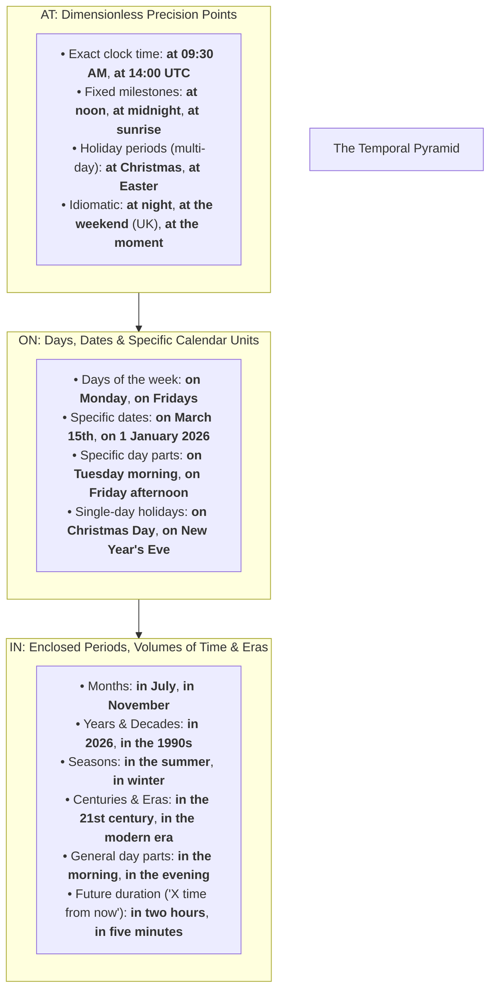
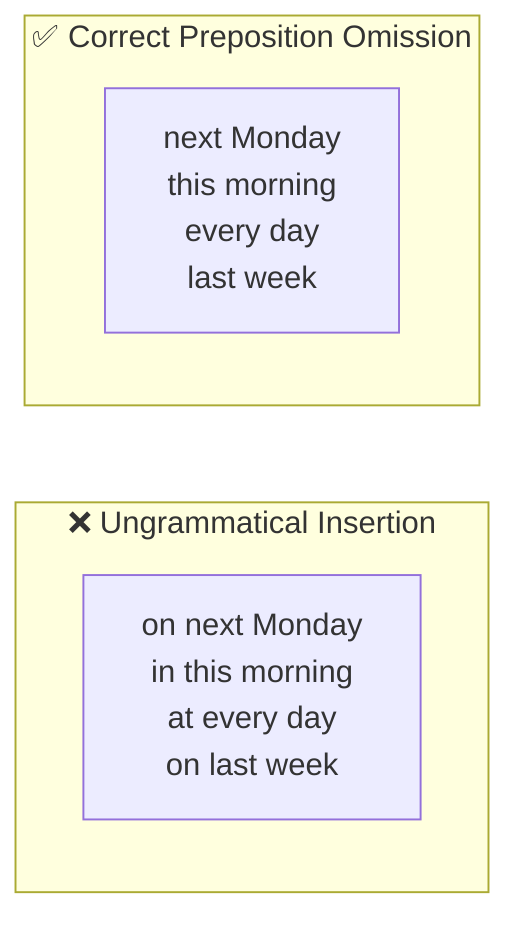
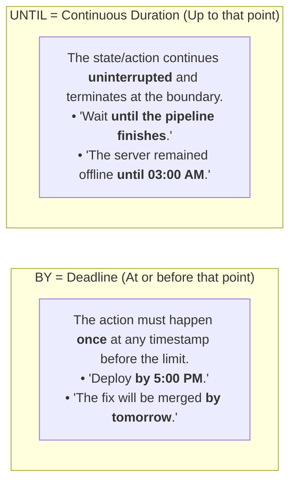

# Prepositions of Time: At, On, In, During, By, Until, For ⏱️📅

> **Level:** CEFR A1–B2 (Temporal Coordinates & Boundaries)  
> **Primary References:** Raymond Murphy (*English Grammar in Use*, Units 119–122); Michael Swan (*Practical English Usage*, §18.1–18.3)  
> **Core Concept:** Prepositions of time position events along a temporal continuum. English organizes temporal coordinates through the **At-On-In pyramid** (scaling from dimensionless points to broad eras) and enforces strict semantic boundaries between **deadlines** (*by*), **continuous duration** (*until, for*), and **temporal framing** (*during, while*).

---

## 1. The At-On-In Temporal Pyramid



---

## 2. The Preposition Omission Rule

In English, do **NOT** use `at`, `on`, or `in` before temporal noun phrases modified by **`this`**, **`next`**, **`last`**, **`every`**, **`each`**, **`some`**, **`any`**, or words like **`yesterday`**, **`tomorrow`**, and **`today`**:



> [!CAUTION]
> - ❌ *We will release the patch on next Monday.*
> - ✅ *We will release the patch **next Monday**.*
> - ❌ *The database crashed in yesterday morning.*
> - ✅ *The database crashed **yesterday morning**.*

---

## 3. `During` vs. `For` vs. `While`

These three words qualify duration and temporal overlap, but belong to distinct syntactic classes:

```mermaid
graph TD
    DurChoice["Choosing Between During, For, and While"]
    
    DurChoice --> CheckClause{"Is it followed by a full clause (Subject + Verb)?"}
    CheckClause -->|YES: Subject + Verb| UseWhile["Use <b>WHILE</b> (Conjunction)<br/>• <i>'while the test was running'</i><br/>• <i>'while we debugged'</i>"]
    
    CheckClause -->|NO: Noun Phrase| CheckNoun{"Does the noun phrase state a duration/quantity of time?"}
    CheckNoun -->|Duration / Time Quantity (How long?)| UseFor["Use <b>FOR</b> (Preposition)<br/>• <i>'for two hours'</i><br/>• <i>'for three days'</i>"]
    CheckNoun -->|Named Event / Period (When?)| UseDuring["Use <b>DURING</b> (Preposition)<br/>• <i>'during the deployment'</i><br/>• <i>'during the maintenance window'</i>"]
```

### Contrast Matrix

| Word | Part of Speech | Complement | Answers | Example Sentence |
| :--- | :--- | :--- | :--- | :--- |
| **`For`** | Preposition | Time duration quantity (*numbers + units*) | *How long?* | *The backup ran **for 45 minutes**.* |
| **`During`** | Preposition | Named event, process, or period | *When?* | *The memory spike occurred **during the backup**.* |
| **`While`** | Subordinating Conjunction | Finite clause (`Subject + Verb`) or participial phrase | *When? (Simultaneous action)* | *The memory spiked **while the backup was running**.* |

> [!NOTE]
> Never use *during* with a number of hours or days:
> - ❌ *We waited during two hours.*
> - ✅ *We waited **for two hours**.*

---

## 4. `By` vs. `Until` (Till): Deadlines vs. Continuous Duration

The semantic distinction between `by` and `until` is one of the most critical invariants in engineering agreements, SLAs, and technical deadlines:



### Contrast Test Table

| Sentence | Meaning & Implication |
| :--- | :--- |
| *The report must be completed **by Friday**.* | **Deadline:** You can finish on Wednesday or Thursday, but Friday is the latest permissible boundary. |
| *The engineers worked **until Friday**.* | **Continuous Duration:** The engineers worked continuously on Monday, Tuesday, Wednesday, and Thursday, stopping on Friday. |
| *Please keep the staging cluster locked **until 2:00 PM**.* | The lock remains active continuously until the clock reaches 2:00 PM. |
| *Please release the lock **by 2:00 PM**.* | You must perform the release action at some point before or at 2:00 PM. |

---

## 5. `Since` vs. `From` vs. `Throughout`

### 1. `Since` (Past Anchor Up to Now)
- Strictly paired with **Present Perfect** or **Past Perfect** tenses:
- Points to the starting timestamp of a state that persists into the reference moment:
  - *The API has been unresponsive **since 08:15 AM**.* (❌ NOT: *from 08:15 AM* in this context).
  - *We have supported OAuth 2.0 **since 2019**.*

### 2. `From` (Generic Origin Point)
- Used with any tense; typically paired with *to* or *until*:
  - *The maintenance window runs **from 01:00 to 04:00 UTC**.*
  - * **From next Monday**, code freezes will be strictly enforced.*

### 3. `Throughout` (Continuous Pervasiveness)
- Emphasizes that something happened continuously across the entire duration:
  - *The system maintained 99.999% availability **throughout the entire year**.*
  - *Latency remained elevated **throughout the incident**.*

---

## 6. Practical Dual-Domain Examples

### Everyday Conversation

1. *The dinner party starts **at 7:30 PM** sharp.*
2. *We are going hiking **on Saturday morning**.*
3. *She was born **in 1998** **in the middle of winter**.*
4. *Please submit your application **by Friday afternoon**.*
5. *We stayed at the library **until it closed** at 10:00 PM.*
6. *I fell asleep **while I was watching** the movie.*
7. *They lived in London **for ten years** before moving to Paris.*
8. *He called me **yesterday afternoon**.* (No preposition before *yesterday*)

### Software Engineering & Technical Documentation

9. *The cron job executes **at 00:00 UTC** on the first day of every month.*
10. *Scheduled database maintenance occurs **on Sunday evening** between 22:00 and 23:00.*
11. *The telemetry service crashed **in the middle of the deployment**.*
12. *All security patches must be merged **by 17:00 tomorrow**.*
13. *The worker thread blocks **until the message queue acknowledges** the event.*
14. *The background worker processed 50,000 requests **in three minutes**.*
15. *We observed severe memory degradation **during the stress testing phase**.*
16. *The connection remained idle **for 300 seconds** before being terminated by the proxy.*
17. *The server has recorded zero fatal errors **since the kernel update**.*
18. *The ingress gateway maintained peak throughput **throughout the flash sale event**.*

---

## 7. Common Antipatterns & Diagnostic Table

| Incorrect Antipattern | Corrected Grammar | Rule & Explanation |
| :--- | :--- | :--- |
| ❌ *We will deploy on next Tuesday.* | ✅ *We will deploy **next Tuesday**.* | Omit prepositions (*on/in/at*) before *next, last, this, every*. |
| ❌ *The build failed during three hours.* | ✅ *The build failed **for three hours**.* | Duration of time quantities takes *for*; *during* requires an event/noun phrase. |
| ❌ *Submit the code review until 5 PM.* | ✅ *Submit the code review **by 5 PM**.* | Completion deadlines use *by*; *until* indicates continuous ongoing action. |
| ❌ *The microservice is running from 2021.* | ✅ *The microservice has been running **since 2021**.* | Ongoing action starting in the past and continuing now requires *since* + Present Perfect. |
| ❌ *I'll see you in Monday.* | ✅ *I'll see you **on Monday**.* | Specific days of the week strictly take *on*, not *in*. |
| ❌ *We had an outage in the night.* | ✅ *We had an outage **at night** / **during the night**.* | Idiomatic time of day: *at night* (or *in the morning/afternoon/evening*). |
| ❌ *While the meeting, my laptop died.* | ✅ * **During** the meeting, my laptop died.* | *While* requires a finite clause (`Subject + Verb`); *during* precedes noun phrases. |

---

## 8. Self-Assessment Exercises

### Exercise 1: Temporal Triad (At / On / In)
Fill in the blanks with **at, on, in**, or leave blank (—) if no preposition is needed:

1. The automated backup kicks off ________ midnight.
2. The team sync is scheduled ________ every Wednesday afternoon.
3. We deployed the major breaking update ________ October 2024.
4. The engineers noticed packet loss ________ next Monday.
5. The conference keynote begins ________ 10:15 AM ________ Friday.

### Exercise 2: `By`, `Until`, `During`, `For`, `While`
Select the appropriate preposition or conjunction:

6. The cluster will continue draining traffic (by / until) all active HTTP connections finish.
7. You must rotate your administrative API credentials (by / until) the end of the sprint.
8. The database was locked (during / while) the schema migration was running.
9. Several network drops occurred (during / for) the four-hour outage.
10. The background worker waited (during / for) 120 seconds before retrying the failed RPC.

<details>
<summary>View Complete Answer Key & Diagnostic Explanations</summary>

1. **at** (*at midnight* — specific precision point).
2. **—** (No preposition before *every*).
3. **in** (*in October 2024* — months and years take *in*).
4. **—** (No preposition before *next*).
5. **at** 10:15 AM **on** Friday (*at* for clock time, *on* for day of the week).
6. **until** (Continuous state of draining continuing up to the completion point).
7. **by** (A deadline indicating completion on or before the end of the sprint).
8. **while** (Followed by a full finite clause: *the schema migration was running*).
9. **during** (Refers to when the drops occurred within the event: *during the four-hour outage*).
10. **for** (Followed by a time duration quantity: *for 120 seconds*).

</details>

---

## 9. Revision Flashcards

```
Q: What is the core rule of the At-On-In temporal pyramid?
A: Use "at" for precise clock times and points (at 5:00, at noon); use "on" for days and dates (on Monday, on May 4th); use "in" for months, years, seasons, and long eras (in July, in 2026).

Q: When must you omit "at", "on", or "in" before a time expression?
A: Before expressions preceded by "this", "next", "last", "every", "each", "all", "yesterday", or "tomorrow" (e.g., "next Friday", NOT "on next Friday").

Q: What is the grammatical and semantic difference between "by Friday" and "until Friday"?
A: "By Friday" is a deadline (the action happens once on or before Friday). "Until Friday" is continuous duration (the action or state continues uninterrupted through to Friday).

Q: Why is "I studied during three hours" ungrammatical?
A: "During" introduces a named event or period ("during the exam"). Numerical durations of time take "for" ("for three hours").

Q: What is the difference between "during" and "while"?
A: "During" is a preposition followed by a noun phrase ("during the meeting"). "While" is a conjunction followed by a subject and verb clause ("while we were meeting").
```
