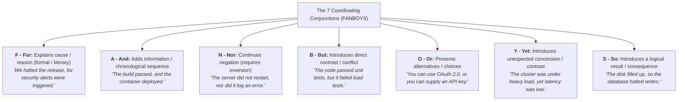
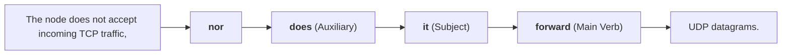
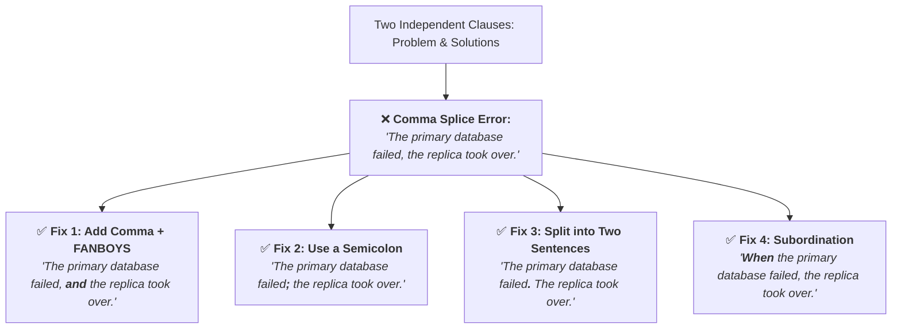

# Coordinating Conjunctions (FANBOYS) and Coordination Mechanics 🤝🔗

> **Level:** CEFR B1–B2 (Compound Syntax & Clause Boundary Law)  
> **Primary References:** Raymond Murphy (*English Grammar in Use*, Unit 113); Michael Swan (*Practical English Usage*, §20.1)  
> **Core Concept:** Coordinating conjunctions connect syntactic units of **equal grammatical rank** (words to words, phrases to phrases, or independent clauses to independent clauses). English contains exactly seven coordinating conjunctions, remembered by the mnemonic **FANBOYS**. When joining two independent clauses, standard English strictly enforces the **Comma + FANBOYS Rule** to prevent comma splices and fused run-ons.

---

## 1. The FANBOYS Semantic Matrix



### Detailed Functional Taxonomy

| Conjunction | Semantic Function | Clausal Syntax Pattern | Production Engineering Example |
| :---: | :--- | :--- | :--- |
| **`For`** | Cause / Justification (Formal) | `Clause 1, for Clause 2` | *The kernel killed the process, **for** it exceeded memory limits.* |
| **`And`** | Addition / Chronological Sequence | `Clause 1, and Clause 2` | *The worker pulled the task, **and** the engine processed it.* |
| **`Nor`** | Negative Disjunction + Inversion | `Negative Clause, nor + Aux + S + V` | *The host did not respond, **nor did** the fallback server engage.* |
| **`But`** | Direct Opposition / Contrast | `Clause 1, but Clause 2` | *The feature was approved, **but** QA postponed the release.* |
| **`Or`** | Alternative Possibilities | `Clause 1, or Clause 2` | *We must scale the cluster, **or** requests will time out.* |
| **`Yet`** | Surprising Concession (*= nevertheless*) | `Clause 1, yet Clause 2` | *The query lacked an index, **yet** it executed in 4 milliseconds.* |
| **`So`** | Logical Consequence / Result | `Clause 1, so Clause 2` | *The primary broker failed, **so** the client reconnected to replica 2.* |

---

## 2. The Comma + FANBOYS Punctuation Law

The boundary between independent clauses is governed by strict orthographic rules:

```mermaid
graph TD
    PunctCheck["Connecting Elements with FANBOYS"]
    
    PunctCheck --> CheckRank{"What are you joining?"}
    
    CheckRank -->|Two Full Independent Clauses<br/>(Subject 1 + Verb 1 & Subject 2 + Verb 2)| NeedComma["<b>INSERT COMMA BEFORE FANBOYS</b><br/><code>Independent Clause, + FANBOYS + Independent Clause.</code><br/><i>'The server crashed, <b>and</b> the monitoring fired.'</i>"]
    
    CheckRank -->|Compound Predicate (Same Subject)<br/>(Subject 1 + Verb 1 & Verb 2)| NoComma["<b>NO COMMA!</b><br/><code>Subject + Verb 1 + FANBOYS + Verb 2</code><br/><i>'The server crashed <b>and</b> restarted automatically.'</i><br/>❌ <i>NOT: 'The server crashed, and restarted...'</i>"]
    
    CheckRank -->|Two Words or Phrases| NoCommaWords["<b>NO COMMA!</b><br/><i>'robust <b>and</b> resilient'</i><br/><i>'in memory <b>or</b> on disk'</i>"]
```

> [!WARNING]
> Do not place a comma before *and* or *but* when the second verb shares the subject of the first verb:
> - ❌ *The daemon detected the leak, and logged an alert.*
> - ✅ *The daemon detected the leak **and logged** an alert.* (Compound predicate)
> - ✅ *The daemon detected the leak, **and it logged** an alert.* (Two independent clauses)

---

## 3. The Special Syntax of `Nor`: Negative Inversion

When `nor` coordinates two clauses, the second clause **must undergo Subject-Auxiliary Inversion** (just like a question):

$$\text{Negative Clause} + , + \mathbf{nor} + \mathbf{Auxiliary / Modal} + \text{Subject} + \text{Main Verb}$$



- *The API did not validate the payload, **nor did it sanitize** the SQL string.*
- *We cannot bypass authentication, **nor should we ignore** TLS warnings.*
- ❌ *The service did not restart, nor it sent an alert.* (Inversion failure!)

---

## 4. Diagnostic Antipatterns: Comma Splices and Fused Run-ons

A **comma splice** occurs when two independent clauses are joined with only a comma, omitting the coordinating conjunction. A **fused sentence** omits both:



---

## 5. Practical Dual-Domain Examples

### Everyday Conversation

1. *I wanted to go for a run, **but** it started raining heavily.*
2. *We can cook dinner at home, **or** we can try that new Italian bistro.*
3. *She did not attend the morning meeting, **nor did she reply** to my email.*
4. *He was exhausted from the flight, **yet** he stayed up to finish his presentation.*
5. *The traffic was terrible, **so** we arrived twenty minutes late.*
6. *She loves reading mystery novels **and** listening to classical podcasts.* (Compound predicate: no comma)
7. *He decided to take an umbrella, **for** the dark clouds threatened rain.*
8. *I called his office number, **but** nobody answered.*

### Software Engineering & Technical Documentation

9. *The staging cluster passed all automated tests, **but** the tech lead requested manual verification.*
10. *The database does not permit direct root access, **nor does it expose** unencrypted ports.*
11. *The ingress gateway experienced a massive DDoS surge, **yet** latency remained below 15 milliseconds.*
12. *The caching proxy ran out of assigned memory, **so** it evicted least-recently-used keys.*
13. *The client must provide a valid OAuth Bearer token, **or** the server will return an HTTP 401 Unauthorized status.*
14. *The background worker dequeued the payload **and parsed** the JSON structure.* (No comma: compound predicate)
15. *We refrained from deploying on Friday evening, **for** an unmonitored weekend outage would violate our SLA.*
16. *The primary broker severed its socket connection, **and** the standby node immediately assumed leadership.*
17. *The garbage collector freed 4 gigabytes of heap memory, **yet** fragmentation remained high.*
18. *You can configure the application using environment variables, **or** you can supply a YAML configuration file.*

---

## 6. Common Antipatterns & Diagnostic Table

| Incorrect Antipattern | Corrected Grammar | Rule & Explanation |
| :--- | :--- | :--- |
| ❌ *The microservice failed, the logs showed a memory leak.* | ✅ *The microservice failed, **and** the logs showed a memory leak.* | Comma splice: two independent clauses cannot be joined by a bare comma. |
| ❌ *The daemon crashed, and restarted.* | ✅ *The daemon crashed **and** restarted.* | Compound predicate with a single subject (*the daemon*) prohibits a comma. |
| ❌ *The server did not respond, nor it logged an error.* | ✅ *The server did not respond, **nor did it log** an error.* | Coordinating conjunction *nor* strictly requires subject-auxiliary inversion. |
| ❌ *We wanted to scale up but we lacked compute.* | ✅ *We wanted to scale up**, but** we lacked compute.* | Two independent clauses joined by *but* require a preceding comma. |
| ❌ *The query was slow, so therefore we added an index.* | ✅ *The query was slow, **so** we added an index.* | Redundant double conjunction: *so* and *therefore* perform the same function. |
| ❌ *We can use Postgres, or MySQL.* | ✅ *We can use Postgres **or** MySQL.* | Coordinating two simple noun phrases prohibits a comma. |

---

## 7. Self-Assessment Exercises

### Exercise 1: Comma Punctuation with FANBOYS
Determine whether a comma should be inserted before the coordinating conjunction:

1. The ingress controller inspected the headers (and / , and) forwarded the request to the backend.
2. The team completed the migration ahead of schedule (but / , but) they still needed to update documentation.
3. You can compile the program with GCC (or / , or) Clang.
4. The Redis cache hit ratio was 99% (so / , so) database load dropped dramatically.
5. The deployment script pulled the Docker image (and / , and) verified its cryptographic signature.

### Exercise 2: `Nor` Inversion & Comma Splice Repair
Correct the grammatical or syntactic errors in the following sentences:

6. The legacy application does not support TLS 1.3, nor it allows HTTP/2 connections.
7. The container exceeded memory limits, it was killed by the operating system kernel.
8. We thoroughly tested the new encryption algorithm, yet did not discover any vulnerabilities.
9. The cluster nodes lost network connectivity, so therefore failover was initiated.
10. The microservice did not emit metrics, nor did it threw any runtime exceptions.

<details>
<summary>View Complete Answer Key & Diagnostic Explanations</summary>

1. **and** (Compound predicate: *inspected ... and forwarded* $\rightarrow$ NO comma).
2. **, but** (Two independent clauses with separate subjects $\rightarrow$ COMMA required).
3. **or** (Joining two noun phrases $\rightarrow$ NO comma).
4. **, so** (Two independent clauses joined by *so* $\rightarrow$ COMMA required).
5. **and** (Compound predicate sharing subject *the deployment script* $\rightarrow$ NO comma).
6. The legacy application does not support TLS 1.3, **nor does it allow** HTTP/2 connections. (Inversion required).
7. The container exceeded memory limits, **and** it was killed by the operating system kernel. (Fixed comma splice with *, and*).
8. **Valid** (Compound predicate: *tested ... yet did not discover* $\rightarrow$ comma is optional/stylistic, but grammatically sound).
9. The cluster nodes lost network connectivity, **so** failover was initiated. (Eliminate redundant *therefore*).
10. The microservice did not emit metrics, nor did it **throw** any runtime exceptions. (After auxiliary *did*, the verb reverts to bare base form *throw*).

</details>

---

## 8. Revision Flashcards

```
Q: What does the mnemonic FANBOYS stand for?
A: For, And, Nor, But, Or, Yet, So (the seven coordinating conjunctions in English).

Q: What is the punctuation rule when FANBOYS connects two independent clauses?
A: Place a comma immediately before the coordinating conjunction (e.g., "The server crashed, and the logs were lost").

Q: Why is "The daemon crashed, and restarted" a punctuation error?
A: Because it is a compound predicate (one subject performing two actions). Do not insert a comma before the conjunction unless a new independent clause with its own subject follows.

Q: What syntactic transformation is triggered by "nor" when connecting clauses?
A: Subject-Auxiliary Inversion (e.g., "The host did not respond, NOR DID IT emit an error").

Q: What is a "comma splice" and how do you fix it?
A: Joining two independent clauses with only a comma. Fix it by: (1) adding a FANBOYS conjunction after the comma, (2) replacing the comma with a semicolon, (3) splitting into two sentences, or (4) using subordination.
```
