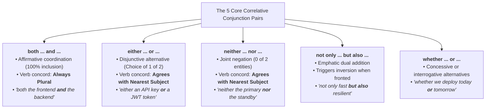
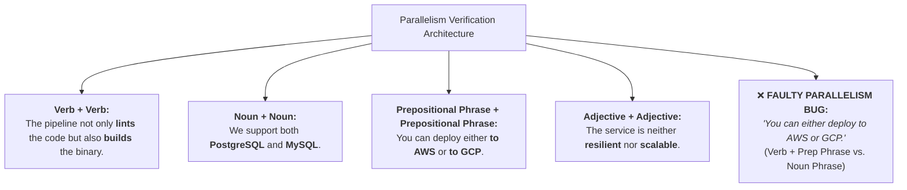
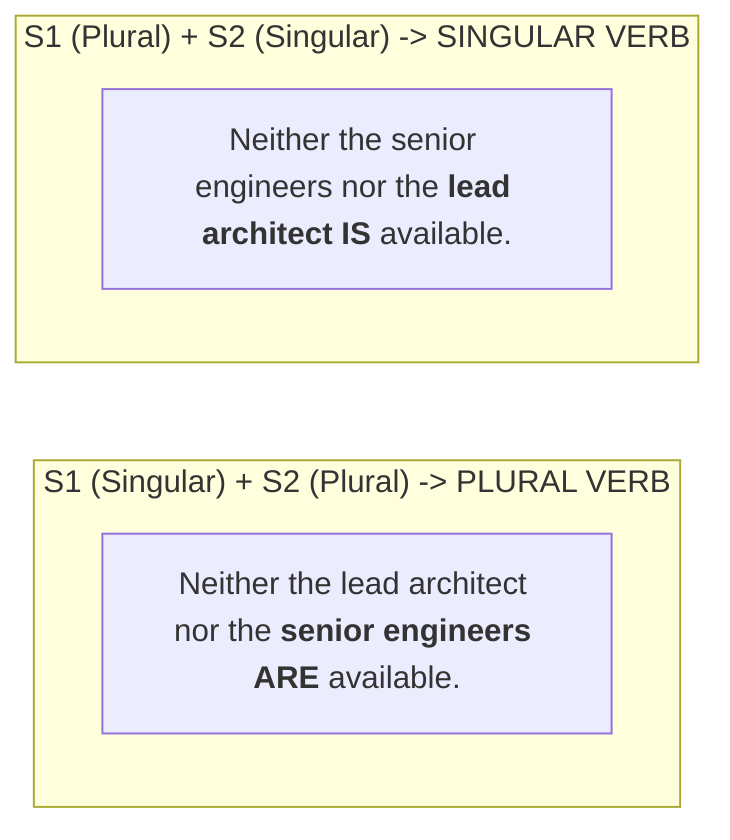

# Correlative Conjunctions and Syntactic Parallelism ⚖️🏛️

> **Level:** CEFR B1–C1 (Symmetrical Syntax & Proximity Concord)  
> **Primary References:** Raymond Murphy (*English Grammar in Use*, Unit 89); Michael Swan (*Practical English Usage*, §20.3, §25.2)  
> **Core Concept:** Correlative conjunctions work in coordinated pairs to link grammatically equal elements. They strictly demand **structural parallelism**: the grammatical form following the first half of the pair must match the grammatical form following the second half. Additionally, disjunctive pairs enforce the **Proximity Concord Rule** for subject-verb agreement.

---

## 1. The Core Correlative Pairs



---

## 2. The Inviolable Law of Syntactic Parallelism

The cardinal rule of correlative syntax states: **Element A and Element B must share the identical syntactic category**:



### Contrast Table: Faulty vs. Parallel Syntax

| Faulty Asymmetric Syntax | Corrected Symmetrical Parallelism | Grammatical Breakdown |
| :--- | :--- | :--- |
| ❌ *The tool not only **analyses code**, but also **it generates documentation**.* | ✅ *The tool not only **analyses code**, but also **generates documentation**.* | Parallel Verb Phrases (`VP` + `VP`) |
| ❌ *You can either **choose Python** or **Go**.* | ✅ *You can choose either **Python** or **Go**.* | Parallel Noun Phrases (`NP` + `NP`) |
| ❌ *The audit revealed issues both **in security** and **performance**.* | ✅ *The audit revealed issues both **in security** and **in performance**.* | Parallel Prepositional Phrases (`PP` + `PP`) |
| ❌ *She wants neither **to resign** nor **giving up**.* | ✅ *She wants neither **to resign** nor **to give up**.* | Parallel Infinitive Phrases (`Inf` + `Inf`) |

---

## 3. Subject-Verb Agreement: The Proximity Concord Rule

When subjects are linked by `either ... or`, `neither ... nor`, or `not only ... but also`, the finite verb agrees with the **closer (nearest) subject**:



### Concord Decision Matrix

| Subject Configuration | Proximity Rule | Example Sentence |
| :--- | :--- | :--- |
| **`Both [Singular] and [Singular]`** | **Always Plural** | *Both the primary node and the secondary node **are** healthy.* |
| **`Either [Singular] or [Plural]`** | **Agrees with Plural** | *Either the architect or the **developers are** responsible.* |
| **`Either [Plural] or [Singular]`** | **Agrees with Singular** | *Either the developers or the **architect is** responsible.* |
| **`Neither [Singular] nor [Plural]`** | **Agrees with Plural** | *Neither the manager nor the **engineers have** the access key.* |
| **`Neither [Plural] nor [Singular]`** | **Agrees with Singular** | *Neither the engineers nor the **manager has** the access key.* |
| **`Not only [A] but also [B]`** | **Agrees with B** | *Not only the server but also the **routers were** rebooted.* |

> [!TIP]
> In formal technical writing, if one subject is singular and the other plural, standard style guides recommend placing the **plural subject second**, resulting in a natural plural verb:
> - *Neither the database administrator nor the **site reliability engineers are** on duty.*

---

## 4. Fronted `Not Only`: Negative Inversion

When `not only` is placed at the very beginning of a sentence to provide dramatic rhetorical emphasis, it triggers **Subject-Auxiliary Inversion** in the first clause:

$$\mathbf{Not\ only} + \mathbf{Auxiliary / Modal} + \text{Subject} + \text{Main Verb} \dots, \mathbf{but\ (also)} + \text{Subject} + \text{Verb}$$


### Examples of Inverted Correlative Clauses
- * **Not only did the hotfix resolve** the memory leak, **but it also improved** query latency by 35%.*
- * **Not only is Rust** memory-safe, **but it also delivers** bare-metal performance.*
- * **Not only have we reduced** infrastructure costs, **but we have also enhanced** system uptime.*

---

## 5. Practical Dual-Domain Examples

### Everyday Conversation

1. * **Both** my brother **and** my sister live in Toronto.* (Always plural verb)
2. *We can **either** go to the cinema **or** have dinner downtown.* (Parallel verbs)
3. * **Neither** Alice **nor** Bob was aware of the change in schedule.* (Singular concord)
4. * **Not only** was the food delicious, **but** the service was **also** impeccable.* (Fronted inversion)
5. *I don't know **whether** to laugh **or** to cry.* (Parallel infinitives)
6. *You can pay **either** by credit card **or** with cash.* (Parallel prepositional phrases)
7. *He is **both** intelligent **and** hardworking.* (Parallel adjectives)
8. * **Neither** the students **nor** the teacher was in the classroom.* (Proximity concord)

### Software Engineering & Technical Documentation

9. *The API gateway supports **both** HTTP/2 **and** gRPC streaming protocols.*
10. *Clients must authenticate using **either** an OAuth 2.0 Bearer token **or** an mTLS certificate.*
11. * **Neither** the primary database **nor** the read replicas **were** affected by the network outage.*
12. * **Not only does the compiler optimize** intermediate bytecode, **but it also performs** dead-code elimination.*
13. *The orchestrator checks **whether** the pod is healthy **or** it requires a restart.*
14. *The refactored module is **not only** easier to maintain **but also** significantly faster to execute.*
15. *You can deploy the microservice **either to a Kubernetes cluster or to a serverless runtime**.* (Strict parallelism)
16. * **Neither** the tech lead **nor** the systems architect **approves** of storing secrets in plaintext.*
17. *The library provides bindings for **both** Python **and** Go.*
18. * **Not only was the regression caught** in staging, **but the automated pipeline also generated** an incident ticket.*

---

## 6. Common Antipatterns & Diagnostic Table

| Incorrect Antipattern | Corrected Grammar | Rule & Explanation |
| :--- | :--- | :--- |
| ❌ *The script either creates a file or log.* | ✅ *The script either **creates a file** or **writes a log**.* | Asymmetrical parallelism: *verb + noun* must be paired with *verb + noun*. |
| ❌ *Neither the server nor the pods was active.* | ✅ *Neither the server nor the **pods were** active.* | Proximity rule: the verb agrees with the closer plural subject (*pods*). |
| ❌ *Not only the server crashed, but it also corrupt data.* | ✅ * **Not only did the server crash**, but it also corrupted data.* | Fronted *not only* triggers mandatory subject-auxiliary inversion. |
| ❌ *Both the lead and the dev is in the meeting.* | ✅ *Both the lead and the dev **are** in the meeting.* | *Both ... and* creates a compound additive subject that is ALWAYS plural. |
| ❌ *We neither have the time nor money.* | ✅ *We have neither **the time** nor **the money**.* | Parallelism: place the verb *have* before *neither* so both complements are noun phrases. |
| ❌ *You can choose either AWS, or GCP.* | ✅ *You can choose either AWS **or** GCP.* | Correlative pairs linking two words do not take a comma between them. |

---

## 7. Self-Assessment Exercises

### Exercise 1: Parallelism Repair
Rewrite the sentence to establish strict syntactic parallelism:

1. The new deployment pipeline is both fast to execute and it operates reliably.
2. You must either configure the settings via environment variables or in the YAML file.
3. The framework not only supports REST endpoints but also GraphQL queries.
4. She decided neither to accept the promotion nor moving to the new office.
5. The system administrator wants both to patch the servers and upgrading the kernel.

### Exercise 2: Proximity Concord & Inversion
Supply the correct verb form or construct the inverted sentence:

6. Neither the database administrator nor the backend engineers (was / were) notified about the maintenance window.
7. Either the configuration files or the main daemon process (is / are) causing the deadlock.
8. Both the primary cluster and the disaster recovery site (has / have) passed compliance audits.
9. *Invert using fronted 'Not only':* The new compiler flag reduces binary size, and it also accelerates compilation speed.
10. Neither the developers nor the product manager (wants / want) to postpone the quarterly release.

<details>
<summary>View Complete Answer Key & Diagnostic Explanations</summary>

1. **The new deployment pipeline is both fast to execute and reliable to operate.** (or *is both fast and reliable*).
2. **You must configure the settings either via environment variables or in the YAML file.** (Prepositional phrase + Prepositional phrase).
3. **The framework supports not only REST endpoints but also GraphQL queries.** (Noun phrase + Noun phrase).
4. **She decided neither to accept the promotion nor to move to the new office.** (Infinitive + Infinitive).
5. **The system administrator wants both to patch the servers and to upgrade the kernel.** (Infinitive + Infinitive).
6. **were** (Agrees with nearest plural subject: *backend engineers*).
7. **is** (Agrees with nearest singular subject: *main daemon process*).
8. **have** (*Both ... and* always takes a plural verb).
9. **Not only does the new compiler flag reduce binary size, but it also accelerates compilation speed.** (Fronted inversion with *does*).
10. **wants** (Agrees with nearest singular subject: *product manager*).

</details>

---

## 8. Revision Flashcards

```
Q: What is the Law of Syntactic Parallelism for correlative conjunctions?
A: The grammatical structure following the first correlative word MUST match the grammatical structure following the second correlative word (e.g., Verb + Verb, Noun + Noun).

Q: What is the Subject-Verb Agreement rule for "either ... or" and "neither ... nor"?
A: The Proximity Rule: the verb agrees in number with the subject NEAREST to it in the clause ("Neither the director nor the ACTORS WERE ready").

Q: Why does "both ... and" differ from "either ... or" in subject-verb concord?
A: "Both ... and" coordinates two elements additively, making the subject plural 100% of the time, whereas "either/neither" coordinates disjunctively.

Q: What grammatical inversion occurs when "Not only" starts a sentence?
A: Subject-Auxiliary Inversion (e.g., "Not only DID the build fail, but it also corrupted the container registry").

Q: Fix the faulty parallelism in: "You can either run this on Linux or Windows."
A: "You can run this on either Linux or Windows" (Noun Phrase + Noun Phrase), or "You can run this either on Linux or on Windows" (PP + PP).
```
