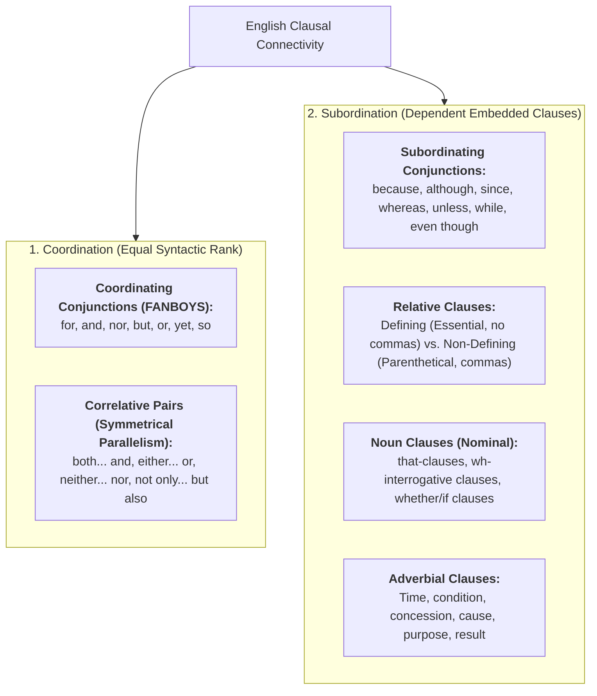

# Module 08: Conjunctions and Clauses 🌉📐

> **Level:** CEFR B1–C1 (Clausal Architecture & Complex Syntax)  
> **Primary References:** Raymond Murphy (*English Grammar in Use*, Units 92–96, 113–118); Michael Swan (*Practical English Usage*, §20–21)  
> **Core Concept:** Conjunctions are the architectural girders of English discourse. They assemble standalone simple clauses into complex and compound networks. Mastering this domain requires controlling **coordination vs. subordination**, maintaining **correlative parallelism**, punctiliously differentiating **defining vs. non-defining relative clauses**, and structuring **noun and adverbial clauses**.

---

## 1. Clausal Connectivity Architecture



---

## 2. Topic Curriculum

This module contains **5 deep-dive guides** covering the entire spectrum of complex clausal syntax:

| Guide | Core Focus | Target CEFR | Authoritative Literature |
| :--- | :--- | :---: | :--- |
| **01. [Coordinating Conjunctions (FANBOYS)](coordinating-conjunctions-fanboys.md)** | Coordination mechanics, comma rules with independent clauses, run-on sentence and comma splice prevention | B1–B2 | Murphy Unit 113; Swan §20.1 |
| **02. [Subordinating Conjunctions](subordinating-conjunctions.md)** | Subordination hierarchy, cause (*because/since*), concession (*although/even though/whereas*), condition (*unless/provided*), comma laws | B1–B2 | Murphy Units 113–115; Swan §20.2–20.4 |
| **03. [Correlative Conjunctions & Parallelism](correlative-conjunctions.md)** | Balanced pairs (*not only... but also, either... or, neither... nor*), strict syntactic parallelism, subject-verb agreement of proximity | B1–C1 | Murphy Unit 89; Swan §20.3 |
| **04. [Relative Clauses: Defining & Non-Defining](relative-clauses-defining-and-non-defining.md)** | Restrictive vs. non-restrictive syntax, *that* vs. *which*, *who* vs. *whom*, *whose*, zero relative pronoun omission (contact clauses), comma laws | B1–C1 | Murphy Units 92–96; Swan §21 |
| **05. [Noun and Adverbial Clauses](noun-and-adverbial-clauses.md)** | Nominal *that*-clauses, embedded interrogatives (*whether/if*), subjunctive nominals, adverbial clauses of purpose (*so that, in order that*) and result | B2–C1 | Swan §20.5–20.7 |

---

## 3. The Clause Boundary Decision Tree

When joining two propositions, use this decision framework:

```mermaid
graph TD
    StartJoin["Connecting Two Independent Clauses"]
    
    StartJoin --> CheckRelationship{"Are the clauses of equal grammatical status?"}
    
    CheckRelationship -->|Equal Rank (Symmetrical)| CoordPath{"What is the logical connection?"}
    CoordPath -->|Addition / Sequence| F_And["Use <b>and</b>"]
    CoordPath -->|Contrast / Exception| F_But["Use <b>but</b> or <b>yet</b>"]
    CoordPath -->|Alternative| F_Or["Use <b>or</b> or <b>nor</b>"]
    CoordPath -->|Cause / Result| F_So["Use <b>so</b> (result) or <b>for</b> (cause)"]
    
    CheckRelationship -->|Dependent / Subordinate| SubPath{"What is the clausal function?"}
    SubPath -->|Modifies a Noun| Rel["Use <b>Relative Clause</b> (who, which, that)"]
    SubPath -->|Acts as Subject / Object| Nom["Use <b>Noun Clause</b> (that, whether, what)"]
    SubPath -->|Modifies the Main Verb / Circumstance| Adv["Use <b>Subordinating Conjunction</b> (although, because, while)"]
```

---

## 4. Cross-Reference Directory
- **Foundations:** [Sentence Types and Purposes](../01-foundations/sentence-types-and-purposes.md) (Compound, Complex, and Compound-Complex structures).
- **Foundations:** [Punctuation Mastery](../01-foundations/punctuation-mastery.md) (Semicolon and comma usage in compound sentences).
- **Conditionals:** [Conditionals & Hypotheticals](../10-conditionals-and-hypotheticals/) (Adverbial conditional clauses).
- **Advanced Syntax:** [Advanced Sentence Structures](../12-advanced-sentence-structures/) (Negative inversion triggered by correlative and limiting conjunctions).
