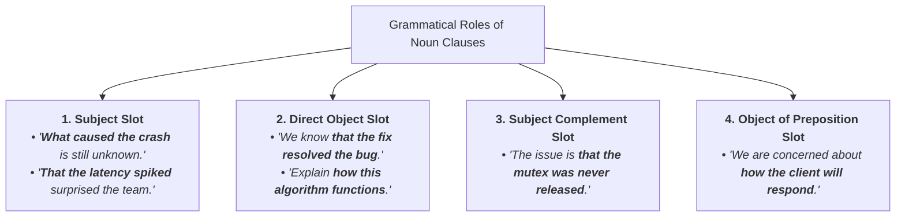
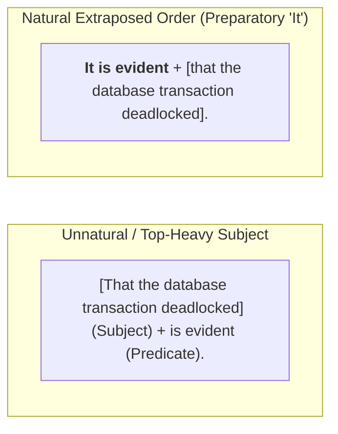
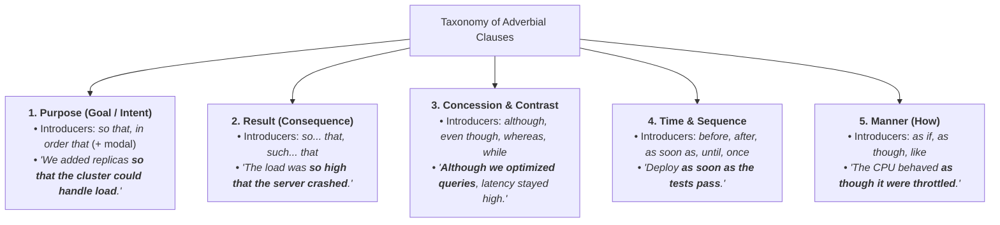

# Noun Clauses and Adverbial Clauses 📦🧩

> **Level:** CEFR B2–C1 (Nominal Syntax & Circumstantial Modification)  
> **Primary References:** Raymond Murphy (*English Grammar in Use*, Units 113–118); Michael Swan (*Practical English Usage*, §20.5–20.7)  
> **Core Concept:** While relative clauses modify nouns, **noun clauses (nominal clauses)** function as entire nouns themselves—occupying subject, object, or complement slots within a sentence. In contrast, **adverbial clauses** function as circumstantial modifiers, qualifying the predicate by articulating condition, concession, purpose, result, time, or manner.

---

## 1. Noun Clauses (Nominal Clauses)

A noun clause performs the identical grammatical work of a noun phrase:



### The Three Morphological Types of Noun Clauses

| Type | Introducer Words | Syntactic Function | Example Sentence |
| :--- | :--- | :--- | :--- |
| **Declarative `That`-Clauses** | `that` (often omissible after reporting verbs) | Stating a factual proposition | *The logs prove **(that) the authentication succeeded**.* |
| **Embedded Wh-Questions** | *who, what, where, when, why, how, which* | Indirect informational query | *The dashboard displays **how many requests were dropped**.* |
| **Alternative `Whether / If`** | `whether`, `if` | Binary condition or indirect yes/no inquiry | *We must verify **whether the backup snapshot is valid**.* |

---

## 2. Subject Noun Clauses and Extraposition

When a declarative *that*-clause occupies the **Subject** position of a sentence, standard English syntax considers it stylistic "top-heavy" (violating the principle of **end-weight**). It is almost universally **extraposed** using the preparatory dummy pronoun `it`:



### Contrast Table

| Heavy / Formal Canonical Form | Natural Extraposed Form | Notes |
| :--- | :--- | :--- |
| *That the API key was leaked is undeniable.* | * **It is undeniable that** the API key was leaked.* | Extraposed with preparatory `it` |
| *Whether the cluster can scale is questionable.* | * **It is questionable whether** the cluster can scale.* | Extraposed indirect interrogative |
| *How the attacker breached the firewall remains a mystery.* | * **It remains a mystery how** the attacker breached the firewall.* | Extraposed wh-clause |

> [!NOTE]
> Wh-clauses headed by *What* frequently remain in initial position as **pseudo-cleft sentences** for rhetorical focus:
> - * **What we need** is automated canary testing.*

---

## 3. Adverbial Clauses: Circumstantial Modifiers

Adverbial clauses modify the main clause by establishing the circumstantial context:



### Purpose Clauses vs. Result Clauses

A major area of confusion is distinguishing between clauses of **purpose** (intended goal) and clauses of **result** (actual consequence):

| Clause Type | Structure | Modal Verbs Used | Example Sentence |
| :--- | :--- | :--- | :--- |
| **Purpose** | `so that / in order that` | `can, could, may, might` | *We cached the responses **so that the database would not be overwhelmed**.* (Intent) |
| **Result** | `so + [adj] + that` / `such + [noun] + that` | Standard indicative | *The database was **so overwhelmed that it dropped connections**.* (Actual outcome) |

---

## 4. The Mandative Subjunctive in Noun Clauses

In formal English (especially American English and technical specifications), noun clauses following verbs or adjectives of **recommendation, demand, necessity, or requirement** require the **Mandative Subjunctive** (the bare base form of the verb, with no `-s` for third person singular, and *be* for the copula):

$$\text{Subject} + \text{Verb (recommend / demand / insist / require)} + \mathbf{that} + \text{Subject} + \mathbf{V_{\text{bare}}}$$

- *The architect recommended that the database **be** upgraded immediately.* (❌ NOT: *is upgraded*).
- *Security policy requires that every engineer **rotate** their API credentials quarterly.* (❌ NOT: *rotates*).
- *It is essential that the telemetry service **remain** operational.* (❌ NOT: *remains*).

---

## 5. Practical Dual-Domain Examples

### Everyday Conversation

1. *I believe **that honesty is the best policy**.* (Noun clause: direct object)
2. * **What you just said** makes a lot of sense.* (Noun clause: subject)
3. *She asked me **if I wanted to join them for lunch**.* (Noun clause: indirect question)
4. * **It is obvious that** they worked hard on this project.* (Extraposed noun clause)
5. *We left early **so that we wouldn't miss our train**.* (Adverbial clause: purpose)
6. *He spoke **as if he knew everything about the subject**.* (Adverbial clause: manner)
7. *The storm was **so intense that several trees fell**.* (Adverbial clause: result)
8. *We'll leave **as soon as the rain stops**.* (Adverbial clause: time)

### Software Engineering & Technical Documentation

9. *The dashboard visualizes **how memory allocation scales with concurrent connections**.* (Noun clause: object)
10. * **Whether the microservice should be decoupled** will be decided in the next RFC session.* (Noun clause: subject)
11. * **It is critical that** the storage engine **flush** write-ahead logs to disk synchronously.* (Mandative subjunctive)
12. *The gateway checks **whether the incoming JWT signature is cryptographically valid**.* (Noun clause: object)
13. *We implemented exponential backoff **so that failing nodes would not be hammered by retries**.* (Adverbial clause: purpose)
14. *The CPU utilization spiked **so rapidly that the autoscaler could not react in time**.* (Adverbial clause: result)
15. *The consensus node votes **as though it were the primary coordinator** during leader election.* (Adverbial clause: manner)
16. *The security specification mandates that all traffic **be encrypted** with TLS 1.3.* (Mandative subjunctive)
17. *We are actively investigating **what caused the cascade timeout across the payments cluster**.* (Noun clause: preposition object)
18. * **Once the container image is built and scanned**, the deployment controller pushes it to the registry.* (Adverbial clause: time)

---

## 6. Common Antipatterns & Diagnostic Table

| Incorrect Antipattern | Corrected Grammar | Rule & Explanation |
| :--- | :--- | :--- |
| ❌ *Show me what is the error.* | ✅ *Show me **what the error is**.* | Embedded wh-noun clauses use declarative word order (`S + V`), not question order (`V + S`). |
| ❌ *I wonder where did they deploy.* | ✅ *I wonder **where they deployed**.* | Embedded questions prohibit auxiliary *do/did* inversion. |
| ❌ *We recommend that he restarts the pod.* | ✅ *We recommend that he **restart** the pod.* | The mandative subjunctive requires the bare verb (*restart*), not third-person *-s*. |
| ❌ *It is necessary that it is updated.* | ✅ *It is necessary that it **be** updated.* | Subjunctive nominals after *necessary* require base *be*, not *is*. |
| ❌ *We cache data so that to reduce load.* | ✅ *We cache data **to reduce / so as to reduce** load.* | *So that* must be followed by a finite clause (`S + V`), not an infinitive. |
| ❌ *I don't know if or not it works.* | ✅ *I don't know **whether or not** it works.* | *Whether* can be directly followed by *or not*; *if or not* is ungrammatical. |

---

## 7. Self-Assessment Exercises

### Exercise 1: Declarative Word Order in Embedded Noun Clauses
Convert the direct questions into embedded noun clauses:

1. Direct Question: *Why did the transaction rollback?*  
   $\rightarrow$ We need to determine ________.
2. Direct Question: *Where does the daemon store temporary logs?*  
   $\rightarrow$ The documentation specifies ________.
3. Direct Question: *How can the client authenticate?*  
   $\rightarrow$ Please explain ________.
4. Direct Question: *What is the root cause?*  
   $\rightarrow$ Nobody understands ________.
5. Direct Question: *When will the maintenance window end?*  
   $\rightarrow$ Could you notify us ________?

### Exercise 2: Mandative Subjunctive & Adverbial Syntax
Supply the correct verb form or conjunction:

6. The incident commander demanded that the deployment (is / be) halted immediately.
7. RFC 2119 requires that all conformant clients (support / supports) HTTPS.
8. We increased connection pool limits so that the backend (can / could) handle the traffic surge.
9. The disk reached capacity so rapidly (that / so) the monitoring alert failed to fire.
10. It is imperative that the lead architect (review / reviews) the security implications.

<details>
<summary>View Complete Answer Key & Diagnostic Explanations</summary>

1. **why the transaction rolled back** (Declarative order; remove auxiliary *did* and inflect verb into past tense).
2. **where the daemon stores temporary logs** (Declarative order; remove auxiliary *does* and inflect verb).
3. **how the client can authenticate** (Declarative order: subject *the client* + modal *can*).
4. **what the root cause is** (Declarative order: subject *the root cause* + verb *is*).
5. **when the maintenance window will end** (Declarative order: subject + *will end*).
6. **be** (Mandative subjunctive after *demanded that*).
7. **support** (Mandative subjunctive base form after *requires that*).
8. **could** (Past tense sequence of purpose with *so that*).
9. **that** (Result clause structure: *so + adverb + that*).
10. **review** (Mandative subjunctive base form after *imperative that*).

</details>

---

## 8. Revision Flashcards

```
Q: What word order must an embedded wh-noun clause use (e.g. "I know where...")?
A: Declarative word order (Subject + Verb), NEVER question inversion (e.g., "I know where the file IS", NOT "where is the file").

Q: What is "extraposition" of a noun clause?
A: Moving a heavy subject that-clause to the end of the sentence and placing preparatory "it" at the front ("It is obvious that the build failed" instead of "That the build failed is obvious").

Q: What is the Mandative Subjunctive?
A: The use of the bare base verb in that-clauses after verbs/adjectives of recommendation, requirement, or necessity ("We recommend that the server BE restarted", "...that he DEPLOY the fix").

Q: What is the syntactic difference between a purpose clause and an infinitive of purpose?
A: "So that" requires a full clause with a subject and modal verb ("so that we could scale"); "to / in order to" takes a bare infinitive ("to scale").

Q: Can "if" be followed immediately by "or not" (e.g., "if or not it works")?
A: No! English requires "whether or not it works". "If" can only pair with "or not" at the end of the clause ("if it works or not").
```
