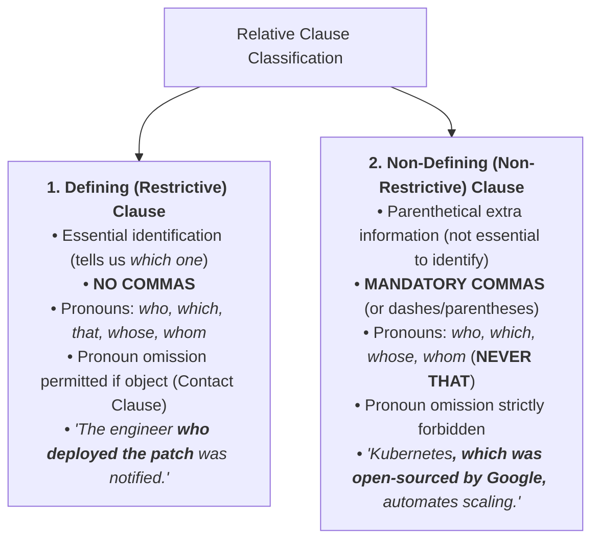

# Relative Clauses: Defining, Non-Defining, and Contact Clauses 🔍🧬

> **Level:** CEFR B1–C1 (Restrictive Syntax & Relative Punctuation)  
> **Primary References:** Raymond Murphy (*English Grammar in Use*, Units 92–96); Michael Swan (*Practical English Usage*, §21)  
> **Core Concept:** Relative clauses function as complex adjectival modifiers that qualify a noun head. English strictly differentiates **defining (restrictive)** clauses (which identify *which* specific entity is being referred to and prohibit commas) from **non-defining (non-restrictive)** clauses (which provide parenthetical, non-essential information and mandate commas).

---

## 1. The Defining vs. Non-Defining Dichotomy

The difference between defining and non-defining relative clauses is both semantic and syntactic:



### Semantic Contrast: The Life-or-Death Comma

Notice how the presence or absence of commas completely changes architectural meaning:

| Sentence | Meaning & Implication |
| :--- | :--- |
| *The microservices **which failed health checks** were restarted.* (Defining) | **Only the subset** that failed health checks was restarted. The healthy microservices continued running. |
| *The microservices**, which failed health checks,** were restarted.* (Non-defining) | **All the microservices** in the system failed health checks, and **all of them** were restarted. |

---

## 2. The Relative Pronoun Selection Matrix

```mermaid
graph TD
    PronounMatrix["Relative Pronoun Selection"]
    
    PronounMatrix --> Human{"Is the antecedent human?"}
    
    Human -->|YES: Human| HumanCase{"What syntactic role does it play in the relative clause?"}
    HumanCase -->|Subject| WhoSubj["Use <b>who</b> (or <i>that</i> in defining)<br/><i>'the architect who designed the system'</i>"]
    HumanCase -->|Object| WhoObj["Use <b>who / whom</b> (or omit in defining)<br/><i>'the engineer [whom] we hired'</i>"]
    HumanCase -->|Possessive| WhoseHum["Use <b>whose</b><br/><i>'the author whose code won the award'</i>"]
    
    Human -->|NO: Inanimate / System / Tool| InanClause{"Is the clause Defining or Non-Defining?"}
    InanClause -->|Defining (Restrictive)| InanDef["Use <b>that</b> (US preferred) or <b>which</b> (UK)<br/><i>'the database that crashed'</i>"]
    InanClause -->|Non-Defining (Commas)| InanNonDef["Use <b>WHICH ONLY</b> (Never 'that'!)<br/><i>'Redis, which is an in-memory cache,...'</i>"]
```

### Comprehensive Pronoun Breakdown

| Relative Pronoun | Antecedent | Clause Type | Role in Clause | Example Sentence |
| :--- | :--- | :--- | :--- | :--- |
| **`who`** | People | Defining & Non-defining | Subject or Object | *The engineer **who fixed the bug** received a bonus.* |
| **`whom`** | People | Defining & Non-defining | Object ONLY (Formal) | *The consultant **with whom we collaborated** was brilliant.* |
| **`which`** | Things / Animals | Defining & Non-defining | Subject or Object | *The server rack**, which was installed in 2022,** needs inspection.* |
| **`that`** | People or Things | **Defining ONLY** | Subject or Object | *The pull request **that introduced the regression** was reverted.* |
| **`whose`** | People or Things | Defining & Non-defining | Possessive Determiner | *We shut down the VM **whose CPU utilization reached 100%**.* |
| **`where`** | Places / Environments | Defining & Non-defining | Adverbial Locative | *This is the directory **where temporary binaries are stored**.* |
| **`when`** | Time / Moments | Defining & Non-defining | Adverbial Temporal | *03:00 AM is the hour **when scheduled backups execute**.* |

> [!CAUTION]
> In formal writing and standard American English style guides (Chicago, APA, Google Dev Style):
> - Use **`that`** for defining relative clauses without commas (*The cluster that failed...*).
> - Use **`which`** for non-defining relative clauses with commas (*The cluster, which failed,...*).
> - **Never use `that` in a non-defining relative clause!**
>   - ❌ *Docker, that was released in 2013, revolutionized DevOps.*
>   - ✅ *Docker**, which was released in 2013,** revolutionized DevOps.*

---

## 3. Contact Clauses: Zero Relative Pronoun Omission

In defining relative clauses, the relative pronoun (`that`, `which`, `who`, `whom`) can be **completely deleted** if and only if it functions as the **OBJECT** of the relative clause:

```mermaid
graph TD
    OmitCheck["Pronoun Deletion Verification"]
    
    OmitCheck --> IsObject{"Is the relative pronoun the grammatical OBJECT of the clause?"}
    
    IsObject -->|YES: Subject follows pronoun| CanOmit["✅ <b>PRONOUN CAN BE OMITTED (Contact Clause)</b><br/>• <i>'The framework <b>[that]</b> we selected is fast.'</i><br/>• <i>'The developer <b>[whom]</b> you interviewed approved the PR.'</i>"]
    
    IsObject -->|NO: Verb follows pronoun (Subject)| MustKeep["❌ <b>CANNOT OMIT! PRONOUN IS SUBJECT</b><br/>• <i>'The script <b>that generates</b> reports failed.'</i><br/>• ❌ NOT: <i>'The script generates reports failed.'</i>"]
```

- **Pronoun as Object (Omission Permitted):**
  - *The configuration **[which]** you modified broke the build.*
  - *The client **[whom]** we billed disputed the charges.*
- **Pronoun as Subject (Omission Forbidden):**
  - *The thread **that** holds the mutex crashed.* (❌ *The thread holds the mutex crashed* $\rightarrow$ fused sentence!)

---

## 4. Preposition Placement: Pied-Piping vs. Preposition Stranding

When a relative clause contains a preposition, English permits two syntactic structures:

### 1. Formal / Academic Syntax (Pied-Piping)
The preposition moves to the front of the relative clause, preceding `which` or `whom`:
- *The communication protocol **upon which the microservices rely** is gRPC.*
- *The systems architect **to whom I submitted the proposal** approved it.*
- *(Note: You cannot use `that` or `who` immediately following a fronted preposition: ❌ upon that / ❌ to who).*

### 2. Standard / Idiomatic Syntax (Preposition Stranding)
The preposition remains in its natural position at the end of the clause:
- *The communication protocol **that the microservices rely on** is gRPC.*
- *The systems architect **I submitted the proposal to** approved it.*

---

## 5. Sentential `Which` (Modifying an Entire Clause)

A non-defining relative clause with `which` can modify **the entire proposition of the preceding sentence**, rather than just a single noun. It must **always be preceded by a comma**:

- *The deployment pipeline completed in under thirty seconds**, which surprised the entire team**.*  
  (Here, *which* refers to the whole fact that the pipeline completed so quickly).
- *The database replica failed to synchronize write-ahead logs**, which caused severe data inconsistency**.*

---

## 6. Practical Dual-Domain Examples

### Everyday Conversation

1. *The barista **who made this coffee** is an artist.* (Defining: subject)
2. *The jacket **[that] I bought yesterday** is too small.* (Contact clause: object omitted)
3. *My older sister**, who lives in Melbourne,** is visiting us next month.* (Non-defining: commas)
4. *We visited the museum **where the impressionist paintings are exhibited**.* (Place)
5. *He missed the bus**, which meant he had to walk three miles in the rain**.* (Sentential *which*)
6. *The woman **whose purse was stolen** reported the incident to the police.* (Possessive)
7. *Is that the restaurant **you were talking about**?* (Preposition stranding)
8. *The book **that you recommended** was fascinating.* (Defining)

### Software Engineering & Technical Documentation

9. *The database queries **that exceed the 500-millisecond threshold** are automatically logged.*
10. *Our primary Kubernetes cluster**, which runs in region `eu-central-1`,** handles all European traffic.*
11. *The engineer **[whom] we hired to lead the SRE team** starts on Monday.*
12. *The microservice **whose memory footprint spiked** was terminated by the OOM killer.*
13. *The gRPC protocol**, which utilizes HTTP/2 framing,** significantly reduces connection overhead.*
14. *The encryption key **with which the payload was encrypted** has expired.* (Pied-piping)
15. *The telemetry daemon drops packets **[that] it cannot parse**.* (Contact clause)
16. *The server rack lost power unexpectedly**, which triggered automated failover to the secondary generator**.*
17. *We deprecated all legacy endpoints **that do not require mTLS authentication**.*
18. *The architect **who authored the original design document** scheduled an RFC review.*

---

## 7. Common Antipatterns & Diagnostic Table

| Incorrect Antipattern | Corrected Grammar | Rule & Explanation |
| :--- | :--- | :--- |
| ❌ *PostgreSQL, that is relational, is fast.* | ✅ *PostgreSQL**, which is relational,** is fast.* | *That* can never be used in a non-defining relative clause (with commas). |
| ❌ *The server crashed yesterday is fixed.* | ✅ *The server **that** crashed yesterday is fixed.* | Subject relative pronouns cannot be omitted; only object pronouns can. |
| ❌ *The microservices which failed were five.* | ✅ *The microservices **that** failed were five.* (or *, which failed,*) | Defining clauses identify the subset; use *that* without commas in standard style. |
| ❌ *The database who crashed was Postgres.* | ✅ *The database **which / that** crashed was Postgres.* | *Who* is strictly reserved for human beings, not databases or software. |
| ❌ *The protocol to that we upgraded is HTTP/3.* | ✅ *The protocol **to which** we upgraded is HTTP/3.* | Prepositions can only precede *which* or *whom*, never *that*. |
| ❌ *The fix which it solved the race condition.* | ✅ *The fix **that** solved the race condition.* | Resumptive pronoun bug: do not include *it* when the relative pronoun is the subject. |
| ❌ *The system crashed which caused downtime.* | ✅ *The system crashed**, which** caused downtime.* | Sentential *which* modifying a whole sentence strictly requires a preceding comma. |

---

## 8. Self-Assessment Exercises

### Exercise 1: Pronoun Selection & Comma Punctuation
Fill in the blanks with **that, which, who**, or **whose**, and insert commas where necessary:

1. The API gateway ________ routes incoming requests was updated yesterday.
2. Apache Kafka ________ was developed at LinkedIn processes trillions of messages daily.
3. The systems architect ________ proposal was accepted will lead the migration.
4. We inspected the log files ________ the security auditor requested.
5. The cloud provider experienced a widespread power outage ________ took down twenty datacenters.

### Exercise 2: Contact Clauses & Error Repair
Determine whether the relative pronoun can be omitted. If the sentence contains an error, correct it:

6. The Docker image which we built this morning passed all security scans.
7. The worker process that is holding the database lock must be terminated.
8. MongoDB, that is a NoSQL document database, scales horizontally with ease.
9. The framework upon that our application relies has reached end-of-life.
10. The engineer who we interviewed yesterday has accepted our job offer.

<details>
<summary>View Complete Answer Key & Diagnostic Explanations</summary>

1. **that** (Defining relative clause identifying the gateway $\rightarrow$ NO commas).
2. **, which** ... **,** (*Apache Kafka, which was developed at LinkedIn, processes...* — Non-defining $\rightarrow$ commas required; *that* prohibited).
3. **whose** (*whose proposal was accepted* — possessive).
4. **[that / which]** (Can be omitted entirely as a contact clause: *the log files the security auditor requested*).
5. **, which** (Sentential relative clause modifying the whole clause $\rightarrow$ comma required).
6. **Omission Permitted:** *The Docker image we built this morning...* (*which* is the direct object of *built*).
7. **Cannot Omit:** *that* is the subject of *is holding*.
8. **MongoDB, which is a NoSQL document database, scales...** (Replace *that* with *which* in non-defining clauses).
9. **The framework upon which our application relies...** (Replace *that* with *which* after a fronted preposition).
10. **Valid** (Informal *who* or formal *whom*; can also be omitted as a contact clause: *The engineer we interviewed yesterday...*).

</details>

---

## 9. Revision Flashcards

```
Q: What is the fundamental difference between a defining and a non-defining relative clause?
A: A defining clause provides essential information identifying the noun and takes NO commas; a non-defining clause provides extra parenthetical information and MUST take commas.

Q: Can "that" be used in a non-defining relative clause?
A: No! "That" is strictly restricted to defining relative clauses. Non-defining clauses with commas must use "which" (for things) or "who" (for people).

Q: When can a relative pronoun be completely omitted (Contact Clause)?
A: Only in defining relative clauses when the pronoun functions as the grammatical OBJECT of the clause (e.g., "The server [that] we bought", but NOT "The server that crashed").

Q: What is a "sentential which" clause?
A: A non-defining relative clause beginning with ", which" that refers back to the entire preceding proposition rather than a single noun ("The build passed, which surprised us").

Q: Why is "The API to that we connect" ungrammatical?
A: When a preposition is fronted (pied-piped), it can only be followed by "which" (for objects) or "whom" (for people), never "that".
```
