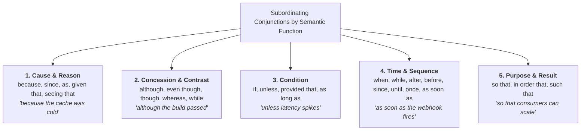
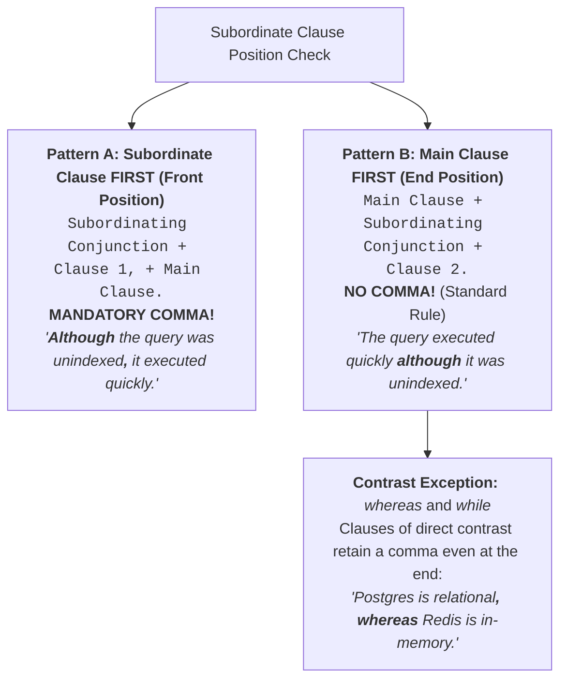
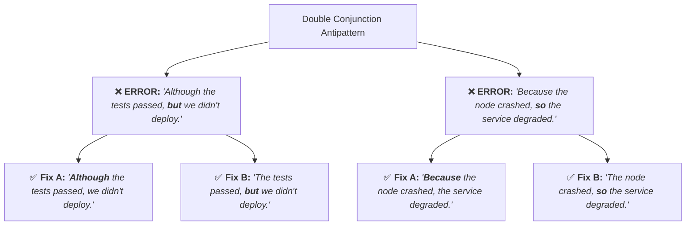
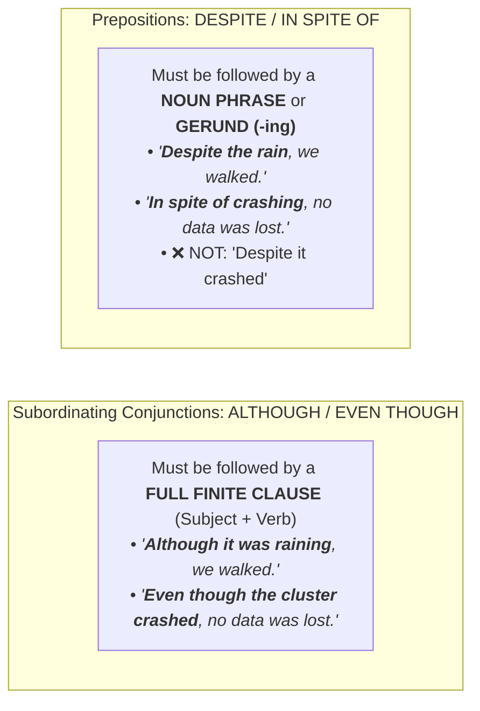

# Subordinating Conjunctions and Complex Sentence Architecture 🏗️🔀

> **Level:** CEFR B1–B2 (Subordination Syntax & Concessive Logic)  
> **Primary References:** Raymond Murphy (*English Grammar in Use*, Units 113–115); Michael Swan (*Practical English Usage*, §20.2–20.4)  
> **Core Concept:** A subordinating conjunction reduces an independent clause to a **dependent (subordinate) clause**, establishing a logical hierarchy with the main clause. The resulting structure is a **complex sentence**. Mastering subordination requires managing **concessive and causal logic**, enforcing strict **comma placement rules**, and avoiding common transfer traps like the **double-conjunction antipattern** (*although... but*).

---

## 1. Functional Taxonomy of Subordinating Conjunctions



### Detailed Conjunction Classifications

| Function | Conjunctions | Semantic Nuance | Production Example |
| :--- | :--- | :--- | :--- |
| **Direct Cause** | `because` | Focuses on the unknown cause | *The pod crashed **because** it ran out of memory.* |
| **Known Cause** | `since`, `as`, `given that` | Cause is already known / given context | * **Since** we already use AWS, let's deploy on EKS.* |
| **Concession** | `although`, `even though`, `though` | Surprising contrast; unexpected fact | * **Even though** the cluster was under attack, it stayed up.* |
| **Direct Contrast** | `whereas`, `while` | Symmetrical contrast between two facts | *The primary node processes writes, **whereas** replicas serve reads.* |
| **Negative Condition** | `unless` | Meaning: *if ... not* | *Do not deploy **unless** all smoke tests succeed.* |
| **Temporal Immediate** | `once`, `as soon as` | Immediate sequential trigger | * **Once** the build finishes, trigger the smoke test.* |
| **Purpose** | `so that`, `in order that` | Intended architectural goal | *We enabled compression **so that** payload size decreased.* |

---

## 2. The Punctuation Invariant: Comma Law for Subordinate Clauses

In standard English syntax, comma placement depends strictly on whether the subordinate clause precedes or follows the main clause:



> [!TIP]
> - * **Because** the primary database failed**,** traffic was rerouted to Frankfurt.* (Comma required ✅)
> - *Traffic was rerouted to Frankfurt **because** the primary database failed.* (No comma ✅)

---

## 3. The Fatal Double-Conjunction Trap

In many world languages (including Spanish, Hindi, Chinese, and Arabic), speakers pair a subordinating conjunction with a coordinating conjunction or adverbial connector (*Although... but*, *Because... so*). **In standard English, this is a serious grammatical bug**:



> [!CAUTION]
> Use **either** the subordinating conjunction **or** the coordinating conjunction, never both in the same sentence:
> - ❌ *Although the query was fast, but it returned stale data.*
> - ✅ * **Although** the query was fast, it returned stale data.*
> - ✅ *The query was fast, **but** it returned stale data.*

---

## 4. `Although / Even Though` vs. `Despite / In Spite Of`

Learners frequently confuse the syntactic category of these concessive markers:



### Contrast Structure Matrix

| Form | Grammatical Class | Complement Structure | Example Sentence |
| :--- | :--- | :--- | :--- |
| **`Although`** | Conjunction | Finite Clause (`S + V`) | * **Although** latency was high, throughput remained stable.* |
| **`Even though`** | Conjunction (Emphatic) | Finite Clause (`S + V`) | * **Even though** the server overheated, it did not shut down.* |
| **`Despite`** | Preposition | Noun Phrase or Gerund | * **Despite** high latency, throughput remained stable.* |
| **`In spite of`** | Prepositional Phrase | Noun Phrase or Gerund | * **In spite of** the server overheating, it did not shut down.* |
| **`Despite the fact that`** | Complex Conjunction | Finite Clause (`S + V`) | * **Despite the fact that** the build failed, nobody was alerted.* |

> [!WARNING]
> Never say *despite of*:
> - ❌ *Despite of the error, the job completed.*
> - ✅ * **Despite** the error, the job completed.*
> - ✅ * **In spite of** the error, the job completed.*

---

## 5. Practical Dual-Domain Examples

### Everyday Conversation

1. * **Although** it was snowing heavily, they drove to the mountain cabin.*
2. *We will cancel the picnic **unless** the rain stops by noon.*
3. *She stayed up late **so that** she could prepare for the interview.*
4. * **Since** everyone is already here, let's start the presentation.*
5. *He arrived early **in order to** find a parking space.*
6. * **Even though** he had never visited London before, he navigated the city with ease.*
7. * **Once** you finish breakfast, please put your dishes in the dishwasher.*
8. *I prefer working from home, **whereas** my partner prefers an office.*

### Software Engineering & Technical Documentation

9. * **Because** the primary availability zone suffered a power outage, the DNS controller rerouted traffic.*
10. * **Although** the database engine executed 50,000 writes per second, memory consumption stayed flat.*
11. *The ingress gateway will drop incoming connections **unless** the client negotiates TLS 1.3.*
12. *We enabled client-side caching **so that** redundant API calls are eliminated.*
13. * **Since** the API contracts are defined in protobufs, multi-language code generation is automated.*
14. * **Despite** the heavy concurrent read load, query latency never exceeded 8 milliseconds.*
15. *The monolithic service processes batch reports, **whereas** the event-driven microservices handle real-time ingestion.*
16. * **As soon as** the pull request passes automated linting, the continuous integration runner builds the container.*
17. *The scheduler will not dispatch background jobs **while** database schema migrations are executing.*
18. * **Even though** the distributed lock expired prematurely, optimistic concurrency prevented data corruption.*

---

## 6. Common Antipatterns & Diagnostic Table

| Incorrect Antipattern | Corrected Grammar | Rule & Explanation |
| :--- | :--- | :--- |
| ❌ *Although it failed, but we retried.* | ✅ * **Although** it failed, we retried.* | Double conjunction bug: do not combine *although* with *but*. |
| ❌ *Because the CPU spiked, so it crashed.* | ✅ * **Because** the CPU spiked, it crashed.* | Double conjunction bug: do not combine *because* with *so*. |
| ❌ *Despite of the warning, he merged the PR.* | ✅ * **Despite** the warning, he merged the PR.* | *Despite* never takes *of*. Use *despite* or *in spite of*. |
| ❌ *Despite the server crashed, we recovered.* | ✅ * **Although** the server crashed, we recovered.* | *Despite* is a preposition requiring a noun phrase, not a finite clause. |
| ❌ *We didn't deploy, because it was raining.* | ✅ *We didn't deploy **because** it was raining.* | Do not insert a comma before *because* when the main clause comes first. |
| ❌ *Unless you don't commit, changes are lost.* | ✅ * **Unless** you commit, changes are lost.* | *Unless* already contains negative meaning (*if you do not*). Avoid double negatives. |
| ❌ *Once when the build finishes, deploy.* | ✅ * **Once** the build finishes, deploy.* | *Once* is an independent conjunction; combining it with *when* is redundant. |

---

## 7. Self-Assessment Exercises

### Exercise 1: Conjunction vs. Preposition Selection
Choose the correct word in parentheses:

1. (Although / Despite) the network switch experienced packet loss, connections did not drop.
2. The team launched the product on time (in spite of / although) numerous technical hurdles.
3. The cluster failed over (because / because of) the database process crashed.
4. The cluster failed over (because / because of) a sudden hardware malfunction.
5. (Even though / Despite) being warned about the regression, the developer deployed the patch.

### Exercise 2: Comma Punctuation & Error Repair
Correct the punctuation or syntactic errors in the following sentences:

6. Although the compiler reported zero errors, but the binary crashed on execution.
7. Since the authentication service is down we cannot log into the admin portal.
8. The worker daemon will shut down, unless new jobs arrive within sixty seconds.
9. Despite of the optimization, the SQL query remained sluggish.
10. The microservice will not accept traffic, because the health check failed.

<details>
<summary>View Complete Answer Key & Diagnostic Explanations</summary>

1. **Although** (Followed by a full finite clause: *the network switch experienced*).
2. **in spite of** (Followed by a noun phrase: *numerous technical hurdles*).
3. **because** (Followed by a finite clause: *the database process crashed*).
4. **because of** (Followed by a noun phrase: *a sudden hardware malfunction*).
5. **Despite** (Followed by a gerund phrase: *being warned about the regression*).
6. **Although the compiler reported zero errors, the binary crashed on execution.** (Removed redundant *but*).
7. **Since the authentication service is down, we cannot log into the admin portal.** (Inserted mandatory comma after front subordinate clause).
8. The worker daemon will shut down **unless new jobs arrive within sixty seconds.** (Removed unnecessary comma before final subordinate clause).
9. **Despite the optimization**, the SQL query remained sluggish. (Removed illegal *of* after *despite*).
10. The microservice will not accept traffic **because the health check failed.** (Removed unnecessary comma before *because*).

</details>

---

## 8. Revision Flashcards

```
Q: What is the comma rule when a subordinate clause starts a sentence?
A: Place a comma immediately after the subordinate clause (e.g., "Although the tests passed, we did not deploy").

Q: Do you insert a comma when a main clause is followed by "because"?
A: No! When the main clause comes first, do not place a comma before "because" ("We did not deploy because the tests failed").

Q: Why is "Although the server crashed, but we recovered" a severe grammatical error?
A: It is a double-conjunction antipattern. A sentence can have a subordinating conjunction ("Although") OR a coordinating conjunction ("but"), but never both.

Q: What is the grammatical difference between "although" and "despite"?
A: "Although" is a conjunction that must be followed by a full subject-verb clause ("Although it was slow"); "despite" is a preposition that must be followed by a noun phrase or gerund ("Despite the delay", "Despite being slow").

Q: Why is "despite of" ungrammatical?
A: "Despite" is a single preposition that never takes "of". If you want to use "of", use the three-word prepositional phrase "in spite of".
```
