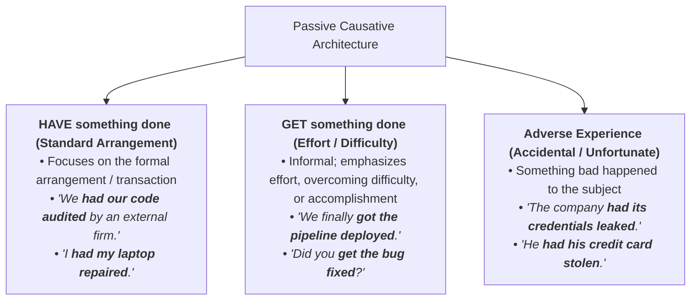
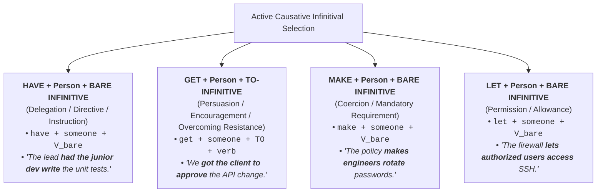
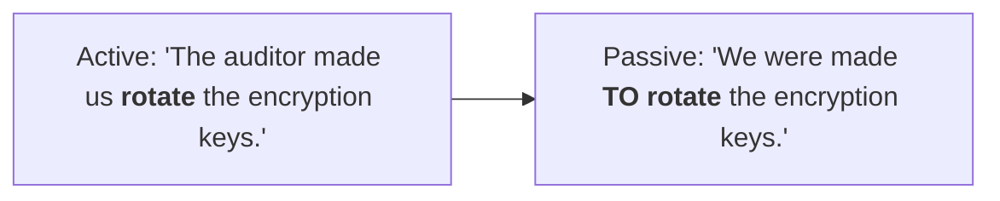

# Causative Structures: Have, Get, Make, and Let 🛠️👔

> **Level:** CEFR B1–B2 (Delegation, Coercion & Infinitival Complementation)  
> **Primary References:** Raymond Murphy (*English Grammar in Use*, Unit 46); Michael Swan (*Practical English Usage*, §1.7)  
> **Core Concept:** Causative constructions express that a subject **causes, arranges, coerces, persuades, or permits** another agent to perform an action. Causatives are divided into **Passive Causatives** (*have/get something done*—focusing on the completed service) and **Active Causatives** (*have, get, make, let*—focusing on the delegated actor, with strict complementation rules governing bare vs. to-infinitives).

---

## 1. Passive Causatives: `Have / Get Something Done`

When you arrange for a professional, service, or external tool to perform a task for you, use the passive causative:

$$\mathbf{\text{Subject}} + \mathbf{\text{have / get}} + \mathbf{\text{Object (Thing)}} + \mathbf{V3_{\text{past participle}}}$$



### Conjugation Across Tenses

| Tense | Example Sentence | Semantic Note |
| :--- | :--- | :--- |
| **Present Simple** | *We **have our servers patched** monthly.* | Regular routine arrangement |
| **Present Continuous** | *We **are having the penetration test conducted** right now.* | Active ongoing service |
| **Past Simple** | *The team **had the cluster provisioned** yesterday.* | Completed arrangement |
| **Present Perfect** | *We **have had all databases backed up** to cold storage.* | Resulting completed state |
| **Future (will)** | *We **will have the architecture reviewed** by an AWS specialist.* | Planned future engagement |
| **Modal (should)** | *You **should get your hard drive cloned** before formatting.* | Recommendation / advice |

---

## 2. Active Causatives: The Infinitival Rule

When you identify the **human or automated agent** performing the caused action, the verb selection dictates whether a **bare infinitive** or a **to-infinitive** is required:



### The Invariable Complementation Table

| Causative Verb | Meaning & Implication | Complement Form | Example Sentence | ❌ Fatal Bug |
| :--- | :--- | :--- | :--- | :--- |
| **`have`** | Delegate, assign, instruct | **Bare Infinitive** | *I'll **have my engineer inspect** the logs.* | ❌ *have my engineer to inspect* |
| **`get`** | Persuade, convince, coax | **TO-Infinitive** | *We **got the vendor to patch** the vulnerability.* | ❌ *got the vendor patch* |
| **`make`** | Compel, force, require | **Bare Infinitive** | *Security policies **make us use** 2FA.* | ❌ *make us to use* |
| **`let`** | Allow, permit, enable | **Bare Infinitive** | *Docker **lets us run** isolated environments.* | ❌ *lets us to run* |

---

## 3. The Passive Transformation of `Make` and `Let`

A crucial grammatical shift occurs when causative verbs are themselves passivized:

### 1. `Make` in the Passive Voice (Restoring the `To`)
In the active voice, *make* takes a bare infinitive. In the passive voice, standard English **restores the to-infinitive**:



- *Active:* *The manager made the engineers **work** over the weekend.*
- *Passive:* *The engineers were made **to work** over the weekend.* (Mandatory *to* in passive!)

### 2. `Let` in the Passive Voice (Forbidden)
The causative verb `let` has **no passive voice form** in standard English. You must substitute **`be allowed to`** or **`be permitted to`**:
- ❌ *The traffic was let pass through the firewall.*
- ✅ *The traffic **was allowed to pass** through the firewall.*
- ❌ *We were let deploy to production.*
- ✅ *We **were permitted to deploy** to production.*

---

## 4. Practical Dual-Domain Examples

### Everyday Conversation

1. *I need to **have my hair cut** before the wedding.* (Passive causative)
2. *She finally **got her landlord to fix** the heating.* (Active: *get + to-infinitive*)
3. *My parents **made me clean** my room before going out.* (Active: *make + bare*)
4. *Could you please **let me borrow** your phone charger?* (Active: *let + bare*)
5. *We **had our house painted** last summer.* (Passive causative)
6. *I will **have the waiter bring** you some water.* (Active: *have + bare*)
7. *He **had his passport stolen** while traveling in Madrid.* (Adverse passive causative)
8. *The students **were made to rewrite** their essays.* (Passive of *make*: *to* restored)

### Software Engineering & Technical Documentation

9. *We **had our Kubernetes deployment audited** by a third-party cybersecurity firm.*
10. *The team lead **had the on-call engineer roll back** the breaking release.* (Bare infinitive)
11. *We finally **got the database vendor to acknowledge** the deadlock bug.* (*to*-infinitive)
12. *The continuous integration pipeline **makes all commits pass** automated linters.* (Bare infinitive)
13. *The cloud proxy **lets internal microservices communicate** over private VPC peering.* (Bare infinitive)
14. *The enterprise company **had its customer records exfiltrated** during the zero-day exploit.* (Adverse)
15. *All developers **were made to complete** security training after the phishing incident.* (Passive *make*)
16. *The system administrator **got the clustered storage to synchronize** after two days of debugging.*
17. *Unauthenticated requests **are not permitted to access** administrative endpoints.* (Passive equivalent of *let*)
18. *You should **have your SSL certificates auto-renewed** via Let's Encrypt.* (Passive causative)

---

## 5. Common Antipatterns & Diagnostic Table

| Incorrect Antipattern | Corrected Grammar | Rule & Explanation |
| :--- | :--- | :--- |
| ❌ *The manager made us to stay late.* | ✅ *The manager made us **stay** late.* | Active *make* takes a bare infinitive, never a *to-infinitive*. |
| ❌ *We had the team to review the code.* | ✅ *We had the team **review** the code.* | Active *have* takes a bare infinitive. |
| ❌ *We got the vendor patch the software.* | ✅ *We got the vendor **to patch** the software.* | Active *get* takes a *to-infinitive*. |
| ❌ *The firewall lets users to connect.* | ✅ *The firewall lets users **connect**.* | Active *let* takes a bare infinitive. |
| ❌ *We were let deploy the hotfix.* | ✅ *We **were allowed / permitted to deploy** the hotfix.* | *Let* cannot be used in the passive voice; substitute *be allowed to*. |
| ❌ *I had repaired my computer.* | ✅ *I **had my computer repaired**.* | Word order: *have + object + V3*. Placing the verb before the object turns it into Past Perfect. |
| ❌ *They were made sign the NDA.* | ✅ *They were made **to sign** the NDA.* | The passive form of *make* strictly restores the *to-infinitive*. |

---

## 6. Self-Assessment Exercises

### Exercise 1: Bare vs. To-Infinitive Selection
Choose the correct infinitival form in parentheses:

1. The senior architect had the development team (refactor / to refactor) the monolithic controller.
2. The site reliability team got the executive committee (approve / to approve) the budget for multi-region failover.
3. Corporate security policy makes every developer (rotate / to rotate) SSH keys every 90 days.
4. The container runtime lets processes (communicate / to communicate) via standard Unix sockets.
5. The engineers were made (rewrite / to rewrite) the entire persistence layer in Rust.

### Exercise 2: Passive Causative Sentence Assembly
Reorder the scrambled elements into a correct passive causative construction:

6. [our SSL certificates / we / renewed / have / every 90 days]
7. [the legacy database / the CTO / migrated / got / to PostgreSQL]
8. [its DNS records / had / the company / hijacked / by attackers]
9. [audited / should have / the codebase / we / for security vulnerabilities]
10. [repaired / my workstation / I / yesterday / had]

<details>
<summary>View Complete Answer Key & Diagnostic Explanations</summary>

1. **refactor** (*have + person + bare infinitive*).
2. **to approve** (*get + person + to-infinitive*).
3. **rotate** (*make + person + bare infinitive*).
4. **communicate** (*let + person + bare infinitive*).
5. **to rewrite** (Passive of *make* requires *to-infinitive*).
6. **We have our SSL certificates renewed every 90 days.**
7. **The CTO got the legacy database migrated to PostgreSQL.**
8. **The company had its DNS records hijacked by attackers.** (Adverse passive causative).
9. **We should have the codebase audited for security vulnerabilities.**
10. **I had my workstation repaired yesterday.**

</details>

---

## 7. Revision Flashcards

```
Q: What is the structural formula for the Passive Causative?
A: Subject + have/get + Object (thing) + V3 (past participle) (e.g., "We had the code audited", "I got the server rebooted").

Q: What is the complementation rule for "have someone do" versus "get someone to do"?
A: "Have someone + BARE INFINITIVE" (delegation: "have him write the code"); "Get someone + TO-INFINITIVE" (persuasion/effort: "get him to write the code").

Q: Does "make" take a bare infinitive or a to-infinitive in the active voice? What about the passive?
A: In the active voice, "make" takes a BARE infinitive ("The rule makes us test"). In the passive voice, it RESTORES the to-infinitive ("We were made TO test").

Q: Can the verb "let" be used in the passive voice (e.g., "We were let go")?
A: No! "Let" has no passive voice. Substitute "be allowed to" or "be permitted to" ("We were allowed to deploy").

Q: What is the "Adverse Causative" construction?
A: Using "have something done" to describe an unfortunate accident or security breach happening to the subject ("The company had its data stolen").
```
