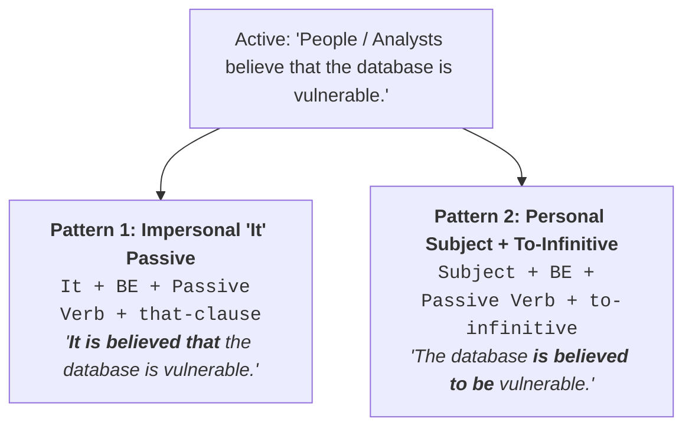
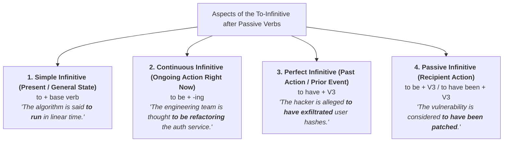

# Impersonal and Advanced Passives: Reporting Structures and Passive Infinitives 🏛️🔬

> **Level:** CEFR B2–C1 (Epistemic Attribution & Non-Finite Voice)  
> **Primary References:** Raymond Murphy (*English Grammar in Use*, Unit 45); Michael Swan (*Practical English Usage*, §6.4–6.6)  
> **Core Concept:** When attributing claims, beliefs, rumors, or unverified findings without identifying a specific speaker, English uses **impersonal reporting passives**. These structures either rely on **dummy `it` with a *that*-clause** or promote the topic entity into the subject position followed by a **to-infinitive** (*Nominative with Infinitive*). Advanced passives also include **passive infinitives, passive gerunds, and retro-active gerunds** (*needs restarting*).

---

## 1. The Two Reporting Passive Architectures

Verbs of thought, belief, and communication (*say, believe, think, report, expect, consider, understand, allege, claim, know*) participate in two distinct passive transformations:



### The 4 Aspects of the Infinitive in Pattern 2

The to-infinitive in Pattern 2 conjugates across four grammatical aspects to match the timing of the reported event:



---

## 2. Transformation Reference Matrix

| Active Claim | Pattern 1: Impersonal `It` + `that` | Pattern 2: Subject + `to-infinitive` | Time Relationship |
| :--- | :--- | :--- | :--- |
| *People say the CEO will resign.* | * **It is said that** the CEO will resign.* | *The CEO **is said to be resigning** soon.* | Present/Future |
| *Security analysts report that the API is flawed.* | * **It is reported that** the API is flawed.* | *The API **is reported to be** flawed.* | Present State |
| *Engineers expect that the migration will take 2 hours.* | * **It is expected that** the migration will take 2 hours.* | *The migration **is expected to take** 2 hours.* | Future Prospect |
| *Auditors believe that the breach occurred in May.* | * **It is believed that** the breach occurred in May.* | *The breach **is believed to have occurred** in May.* | Past Event (Perfect) |
| *Insiders allege that the company hid telemetry errors.* | * **It is alleged that** the company hid telemetry errors.* | *The company **is alleged to have hidden** telemetry errors.* | Past Action (Perfect) |

---

## 3. Passive Infinitives and Passive Gerunds

Voice distinctions apply not only to finite verbs but also to non-finite verbals:

### 1. The Passive Infinitive (`to be + V3` / `to have been + V3`)
Used when the infinitive's implicit subject receives the action:
- *The microservice needs **to be restarted**.* (Present passive infinitive).
- *The container appears **to have been compromised** during the attack.* (Perfect passive infinitive).
- *There is a lot of legacy code **to be refactored**.*

### 2. The Passive Gerund (`being + V3` / `having been + V3`)
Used after prepositions or verbs taking gerund complements:
- *Nobody enjoys **being interrupted** during deep programming sessions.*
- *The architect was annoyed at **having been excluded** from the RFC review.* (Perfect passive gerund).
- *He avoided **being assigned** to the legacy maintenance rotation.*

---

## 4. The Retroactive "Needs Doing" Construction

In standard British and international English, verbs expressing necessity (*need, require, want*) can be paired with an **active gerund (`-ing`)** that conveys a **passive meaning**:

$$\mathbf{\text{Subject}} + \mathbf{\text{need / require / want}} + \mathbf{\text{V-ing}} \equiv \mathbf{\text{Subject}} + \mathbf{\text{need / require}} + \mathbf{\text{to be + V3}}$$


- *The configuration file requires **updating**.* (= *requires to be updated*).
- *The battery in the sensor wants **replacing**.* (= *needs to be replaced*).

---

## 5. Practical Dual-Domain Examples

### Everyday Conversation

1. * **It is said that** walking 10,000 steps a day improves cardiovascular health.*
2. *The suspect **is believed to be hiding** somewhere in the mountains.* (Continuous infinitive)
3. *She **is expected to win** the championship match tomorrow.*
4. *The ancient manuscript **is thought to have been written** in the 12th century.* (Perfect passive infinitive)
5. *He hates **being told** what to do.* (Passive gerund)
6. *My car **needs servicing** before the road trip.* (Needs doing)
7. *The package was supposed **to be delivered** yesterday.* (Passive infinitive)
8. * **It is well known that** regular sleep enhances cognitive performance.*

### Software Engineering & Technical Documentation

9. * **It is widely reported that** the distributed denial-of-service attack originated from a compromised IoT botnet.*
10. *The zero-day vulnerability **is understood to affect** all versions prior to release 2.4.1.*
11. *The remote code execution flaw **is thought to have been introduced** during the sprint 42 merge.* (Perfect passive)
12. *The distributed consensus protocol **is proven to guarantee** safety under asynchronous network delays.*
13. *The root TLS certificate **needs to be rotated** before it expires on midnight.* (Passive infinitive)
14. *The SQL query engine **requires optimizing** to prevent high IOPS throttling.* (Retroactive gerund)
15. *The malicious binary **is suspected of having been injected** via a compromised NPM package.* (Perfect passive gerund)
16. *The primary database cluster **is claimed to achieve** 99.999% annual uptime.*
17. *The server hardware **is reported to have overheated** due to a coolant pump failure.*
18. * **It is assumed that** all ingress traffic passes through the cloud load balancer.*

---

## 6. Common Antipatterns & Diagnostic Table

| Incorrect Antipattern | Corrected Grammar | Rule & Explanation |
| :--- | :--- | :--- |
| ❌ *The bug is said that it is fixed.* | ✅ *The bug **is said to be** fixed.* / * **It is said that** the bug is fixed.* | Do not combine the personal subject with *that*; use a *to-infinitive*. |
| ❌ *It is said him to be an expert.* | ✅ * **He is said to be** an expert.* / * **It is said that he is** an expert.* | Impersonal *It is said* requires a *that*-clause, not an object pronoun + infinitive. |
| ❌ *The hacker is thought to steal data.* | ✅ *The hacker is thought **to have stolen** data.* | Completed past actions require the perfect infinitive (*to have + V3*). |
| ❌ *The server needs to restart.* | ✅ *The server **needs to be restarted**.* / *...needs **restarting**.* | The server is the passive recipient of the restart; active infinitive implies agency. |
| ❌ *He hates to be interrupt.* | ✅ *He hates **being interrupted**.* | Verbs of disliking typically take a passive gerund (*being + V3*). |
| ❌ *The pod is expected crash.* | ✅ *The pod is expected **to crash**.* | Reporting passives require a full *to-infinitive*, not a bare verb. |

---

## 7. Self-Assessment Exercises

### Exercise 1: Pattern 1 to Pattern 2 Conversion
Convert the impersonal *It*-clauses into personal sentences with *to-infinitives*:

1. *It is reported that the network switch lost power.*  
   $\rightarrow$ The network switch is reported ________.
2. *It is believed that the developers are writing comprehensive integration tests.*  
   $\rightarrow$ The developers are believed ________.
3. *It is thought that the new garbage collector improves latency.*  
   $\rightarrow$ The new garbage collector is thought ________.
4. *It is alleged that the contractor leaked the proprietary source code.*  
   $\rightarrow$ The contractor is alleged ________.
5. *It is expected that the container cluster will autoscale during peak hours.*  
   $\rightarrow$ The container cluster is expected ________.

### Exercise 2: Passive Infinitives, Gerunds & "Needs Doing"
Complete the sentences with the correct passive or gerund form:

6. The configuration parameters need (to update / to be updated) before the deployment begins.
7. The query execution plan requires (optimizing / to optimize) to reduce table scan overhead.
8. The junior engineer was nervous about (evaluating / being evaluated) by the principal architect.
9. The malware seems (to inject / to have been injected) through an unauthenticated webhook.
10. The microservice avoids (being restarted / to be restarted) unless memory consumption exceeds 90%.

<details>
<summary>View Complete Answer Key & Diagnostic Explanations</summary>

1. **to have lost power** (Perfect infinitive for past completed event).
2. **to be writing comprehensive integration tests** (Continuous infinitive for ongoing action).
3. **to improve latency** (Simple infinitive for general capability).
4. **to have leaked the proprietary source code** (Perfect infinitive for past action).
5. **to autoscale during peak hours** (Simple infinitive for expected future behavior).
6. **to be updated** (Passive infinitive: *needs to be updated*; or *needs updating*).
7. **optimizing** (Retroactive passive gerund: *requires optimizing*).
8. **being evaluated** (Passive gerund after preposition *about*).
9. **to have been injected** (Perfect passive infinitive indicating prior compromise).
10. **being restarted** (*Avoid* takes a gerund complement $\rightarrow$ passive gerund *being restarted*).

</details>

---

## 8. Revision Flashcards

```
Q: What are the two structural patterns for reporting passives?
A: Pattern 1: "It + BE + Passive Verb + that-clause" ("It is believed that the server crashed").
Pattern 2: "Subject + BE + Passive Verb + to-infinitive" ("The server is believed to have crashed").

Q: When must you use a Perfect Infinitive ("to have + V3") in a reporting passive?
A: When the reported action happened BEFORE the time of reporting (e.g., "The hacker is alleged TO HAVE STOLEN the data last year").

Q: Explain the construction "The server needs restarting".
A: In British and international English, verbs like "need" and "require" can take an active gerund (-ing) that conveys a passive meaning ("needs restarting" = "needs to be restarted").

Q: Why is "The bug is said that it was resolved" ungrammatical?
A: You cannot mix the personal subject with "that". Either say "IT is said that the bug was resolved" or "The bug IS SAID TO HAVE BEEN resolved".

Q: What is the formula for a passive gerund?
A: "being + V3" (e.g., "He dislikes BEING CRITICIZED") or perfect passive gerund "having been + V3".
```
