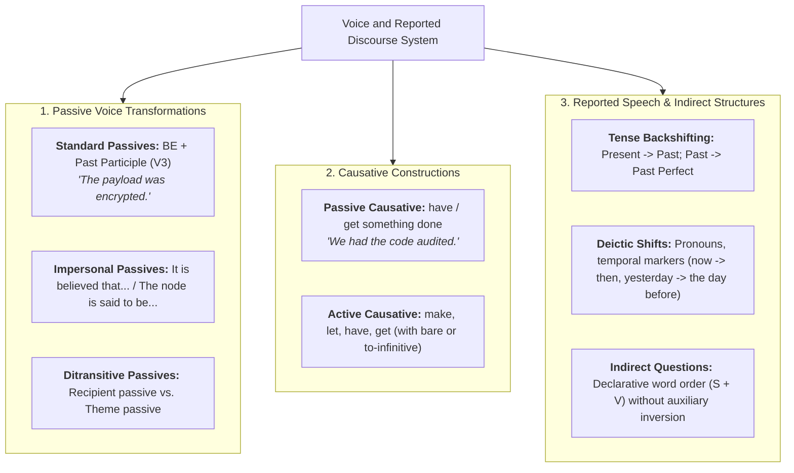
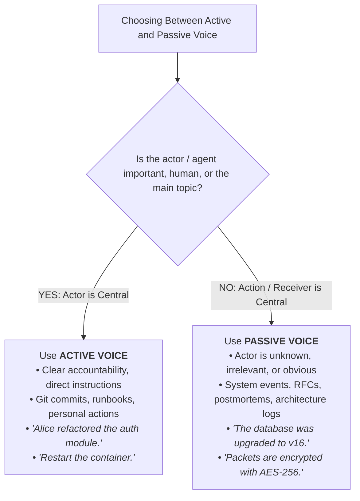

# Module 09: Voice and Reported Speech 📢🛡️

> **Level:** CEFR B1–B2 (Transitivity, Rhetorical Focus & Discourse Shifts)  
> **Primary References:** Raymond Murphy (*English Grammar in Use*, Units 42–48, 50); Michael Swan (*Practical English Usage*, §6, 24)  
> **Core Concept:** Grammatical voice controls **thematic focus** (directing attention to the agent or the patient/receiver of an action). In technical writing, the **passive voice** is an indispensable tool for objective, process-centric documentation where the actor is irrelevant or systemic. Additionally, **reported speech** enables clear communication of decisions, bug reports, and requirements across time and discourse boundaries.

---

## 1. The Voice and Reported Discourse Architecture

---

## 2. Topic Curriculum

This module contains **4 comprehensive deep-dive guides**:

| Guide | Core Focus | Target CEFR | Authoritative Literature |
| :--- | :--- | :---: | :--- |
| **01. [Passive Voice Forms and Mechanics](passive-voice-forms-and-mechanics.md)** | Active-to-passive transformation across all tenses, agent *by*-phrase omission criteria, ditransitive passives, technical style rationale | B1–B2 | Murphy Units 42–44; Swan §6.1–6.3 |
| **02. [Impersonal and Advanced Passives](impersonal-and-advanced-passives.md)** | Impersonal *it*-passives (*It is reported that*), personal passives with to-infinitives (*The bug is thought to be fixed*), passive gerunds & infinitives | B2–C1 | Murphy Unit 45; Swan §6.4–6.6 |
| **03. [Causative Structures: Have, Get, Make, Let](causative-structures-have-and-get.md)** | Delegated action (*have/get something done*), coercive/permissive causatives (*make someone do*, *let someone do*, *get someone to do*) | B1–B2 | Murphy Unit 46; Swan §1.7 |
| **04. [Reported Speech and Indirect Questions](reported-speech-and-indirect-questions.md)** | Backshifting laws, modal preservation/shifts, reporting verbs with that-clauses/infinitives, indirect question word order | B1–B2 | Murphy Units 47–48, 50; Swan §24 |

---

## 3. When to Choose Active vs. Passive Voice in Engineering

---

## 4. Cross-Reference Directory
- **Foundations:** [Sentence Elements & Word Order](../01-foundations/sentence-elements-and-word-order.md) (Transitivity and Direct vs. Indirect objects).
- **Verbs:** [Transitive and Intransitive Verbs](../02-verbs-and-auxiliaries/transitive-and-intransitive-verbs.md) (Why intransitive verbs like *happen* or *occur* can **never** be passivized).
- **Tenses:** [Tenses & Aspect](../03-tenses-and-aspect/) (The 12 tense coordinate matrix).
- **Technical Writing:** [Practical Technical Communication](../15-practical-english-and-communication/) (Passive voice calibration in incident postmortems and SLAs).
