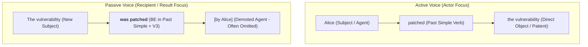
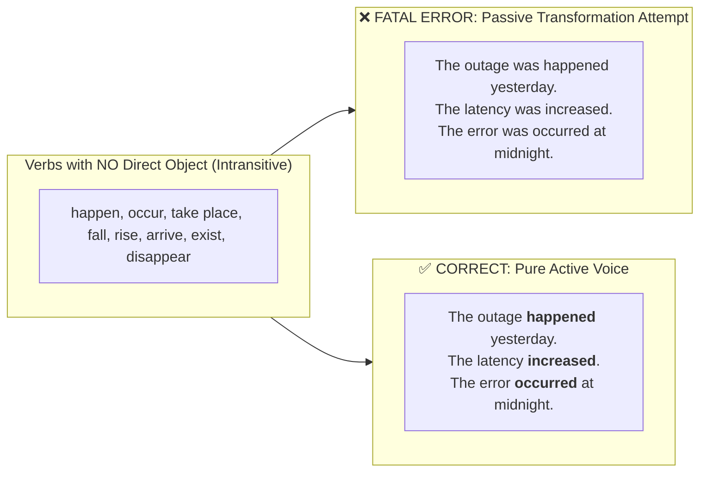
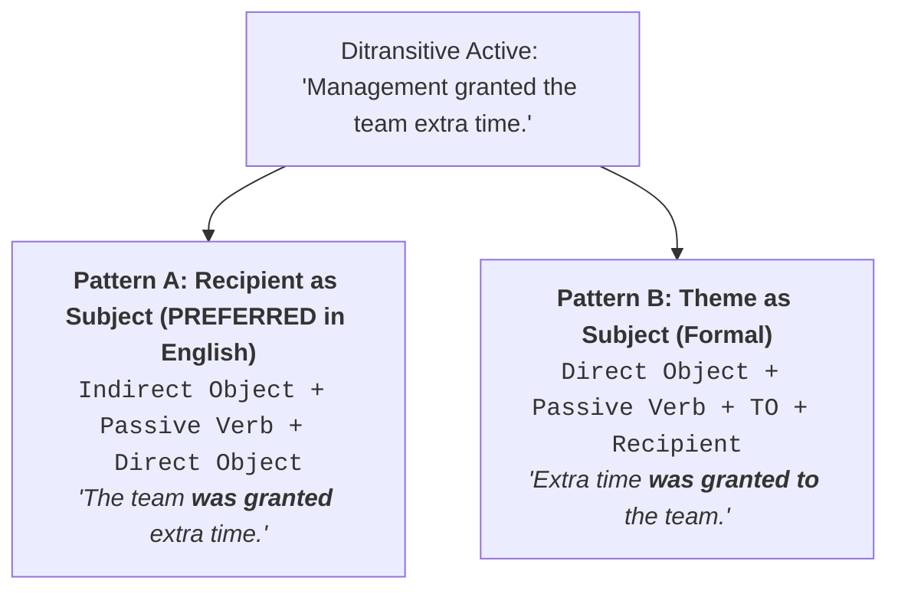

# Passive Voice: Forms, Mechanics, and Technical Writing Applications 🛡️⚙️

> **Level:** CEFR B1–B2 (Transitivity, Thematic Alignment & Blameless Style)  
> **Primary References:** Raymond Murphy (*English Grammar in Use*, Units 42–44); Michael Swan (*Practical English Usage*, §6.1–6.3)  
> **Core Concept:** The passive voice flips the thematic orientation of a clause, converting the semantic **patient/receiver (direct object)** into the grammatical **subject**, while the agent (actor) is either demoted to an optional prepositional *by*-phrase or omitted entirely. In software engineering documentation, incident root cause analyses (RCAs), and scientific writing, the passive voice is essential for **objective, blameless, and process-centric reporting**.

---

## 1. The Transformation Architecture

To transform an active clause into the passive voice:



### The Universal Passive Formula
$$\mathbf{\text{Subject}_{\text{patient}}} + \mathbf{BE_{\text{tense}}} + \mathbf{V3_{\text{past participle}}} + (\mathbf{by + \text{Agent}})$$

---

## 2. Complete Tense Conjugation Matrix for the Passive Voice

| Tense / Aspect | Active Pattern | Passive Formula | Technical Example Sentence |
| :--- | :--- | :--- | :--- |
| **Present Simple** | `write / writes` | `am / is / are + V3` | *All API requests **are logged** to Elasticsearch.* |
| **Present Continuous** | `is / are writing` | `am / is / are + being + V3` | *The database index **is currently being rebuilt**.* |
| **Past Simple** | `wrote` | `was / were + V3` | *The pull request **was merged** into `main`.* |
| **Past Continuous** | `was / were writing` | `was / were + being + V3` | *The telemetry **was being ingested** when the broker died.* |
| **Present Perfect** | `has / have written` | `has / have + been + V3` | *The security flaw **has been resolved**.* |
| **Past Perfect** | `had written` | `had + been + V3` | *The data **had been backed up** prior to the corruption.* |
| **Future Simple** | `will write` | `will + be + V3` | *The container **will be deployed** automatically.* |
| **Future Perfect** | `will have written`| `will have + been + V3` | *The migration **will have been completed** by Sunday.* |
| **Modal Verbs** | `can / must write` | `modal + be + V3` | *All sensitive keys **must be encrypted** at rest.* |
| **Modal Perfect** | `should have written`| `modal + have been + V3` | *The certificate **should have been renewed** last week.* |

> [!NOTE]
> English avoids forming passives in the **Present Perfect Continuous**, **Past Perfect Continuous**, and **Future Continuous** (*is being been written* ❌) because stacking multiple forms of *be* sounds highly awkward. Use an active construction instead.

---

## 3. The Intransitive Prohibition (Fatal Error)

Only **transitive verbs** (verbs that take a direct object) can be transformed into the passive voice. **Intransitive verbs cannot be passivized**:



> [!CAUTION]
> Non-native speakers frequently produce the error *The incident was happened*. Remember that *happen* and *occur* are strictly intransitive:
> - ❌ *The failover was occurred during maintenance.*
> - ✅ *The failover **occurred** during maintenance.*

---

## 4. Ditransitive Verbs (Verbs with Two Objects)

Verbs like *give, offer, send, grant, teach, award, pay* take two objects: an **Indirect Object (Recipient / Person)** and a **Direct Object (Thing / Theme)**. English allows **two different passive transformations**, but strongly favors making the **Recipient** the subject:



### Examples of Recipient Passives
- *The on-call engineer **was given** root SSH access.* (More natural than: *Root SSH access was given to the on-call engineer*).
- *All developers **were paid** a bonus for zero-downtime migration.*
- *The contractor **was denied** access to production data.*

---

## 5. Agent Omission in Technical Writing

In technical writing, the agent (*by someone*) is omitted in over **85% of passive sentences**. We omit the agent when:

1. **The agent is unknown or unidentifiable:**
   - *The optical fiber cable **was severed** 10 miles offshore.*
2. **The agent is obvious or irrelevant:**
   - *The latest Linux security kernel **was installed**.* (By the sysadmin or package manager; irrelevant to state).
3. **The focus is on the object/process rather than human actors:**
   - *JSON payloads **are deserialized** into domain objects.*
4. **Blameless Postmortems and Incident Reviews:**
   - Engineering culture emphasizes **blameless incident postmortems**. The passive voice describes failures objectively without singling out individuals:
   - ❌ *John accidentally deleted the database table.*
   - ✅ *The database table **was inadvertently dropped** during manual schema manipulation.*

---

## 6. Practical Dual-Domain Examples

### Everyday Conversation

1. *My bicycle **was stolen** from the garage last night.*
2. *The package **will be delivered** before noon tomorrow.*
3. *This historic bridge **was built** in 1888.*
4. *She **was offered** a fantastic new job in Zurich.* (Recipient passive)
5. *The house **is being painted** this week.* (Present continuous passive)
6. *The museum **has been visited** by millions of tourists.*
7. *He **was fined** for speeding on the highway.*
8. *The cake **was eaten** before the party even started.*

### Software Engineering & Technical Documentation

9. *Inbound HTTPS traffic **is terminated** at the cloud load balancer.*
10. *All sensitive database columns **are encrypted** using AES-256-GCM.*
11. *The corrupted database indexes **were rebuilt** within forty-five minutes.*
12. *The microservice **is currently being migrated** to a serverless AWS Lambda runtime.*
13. *The container **was terminated** by the Linux out-of-memory (OOM) killer.*
14. *Write-ahead logs **must be committed** to non-volatile disk before returning an ACK.*
15. *The developers **were granted** read-only access to staging telemetry logs.*
16. *A high-severity remote code execution vulnerability **was discovered** during the pen-test.*
17. *The outdated TLS 1.0 protocol **has been deprecated** across all internal endpoints.*
18. *The configuration changes **will have been deployed** globally by the end of the maintenance window.*

---

## 7. Common Antipatterns & Diagnostic Table

| Incorrect Antipattern | Corrected Grammar | Rule & Explanation |
| :--- | :--- | :--- |
| ❌ *The outage was happened at midnight.* | ✅ *The outage **happened** at midnight.* | *Happen* is an intransitive verb; it can NEVER appear in the passive voice. |
| ❌ *The error was occurred in production.* | ✅ *The error **occurred** in production.* | *Occur* is strictly intransitive and forbids passive voice. |
| ❌ *The data is being back up.* | ✅ *The data is being **backed up**.* | Passive requires the past participle (*backed up*), not the base form. |
| ❌ *The server was crash by the memory leak.* | ✅ *The server was **crashed** / **crashed**.* | Passive requires the past participle (*crashed*), or use active (*The leak crashed the server*). |
| ❌ *The team was explained the architecture.* | ✅ *The architecture **was explained to** the team.* | *Explain* cannot take a recipient subject in the passive voice; use *explained to*. |
| ❌ *All files was deleted.* | ✅ *All files **were** deleted.* | Subject-verb agreement: plural subject (*files*) requires plural auxiliary (*were*). |
| ❌ *The database is been upgraded.* | ✅ *The database **is being** upgraded.* / *...**has been** upgraded.* | Progressive passive uses *being*; completed perfect passive uses *been*. |

---

## 8. Self-Assessment Exercises

### Exercise 1: Active to Passive Transformation
Convert the following active sentences into the passive voice (omit the agent if it is generic):

1. The site reliability engineer configured the reverse proxy.  
   $\rightarrow$ The reverse proxy ________.
2. The operating system is killing idle processes.  
   $\rightarrow$ Idle processes ________.
3. The team will deploy the new microservice on Tuesday.  
   $\rightarrow$ The new microservice ________.
4. The security scanner has detected three critical CVE vulnerabilities.  
   $\rightarrow$ Three critical CVE vulnerabilities ________.
5. The gateway must validate all user tokens before forwarding.  
   $\rightarrow$ All user tokens ________.

### Exercise 2: Intransitive Traps & Ditransitives
Identify whether the sentence is grammatically valid. If invalid, correct the error:

6. A strange race condition was occurred during high-load concurrent writes.
7. The senior architect was given full administrative authority over the cluster.
8. The legacy server was disappeared from the network topology.
9. The junior engineers were explained the complex distributed consensus algorithm.
10. The telemetry metrics are being aggregated every five minutes.

<details>
<summary>View Complete Answer Key & Diagnostic Explanations</summary>

1. **was configured** by the site reliability engineer.
2. **are being killed** by the operating system.
3. **will be deployed** on Tuesday.
4. **have been detected** by the security scanner.
5. **must be validated** by the gateway before forwarding.
6. **Invalid** — *Occurred* is intransitive. Correction: *A strange race condition **occurred** during...*
7. **Valid** — Recipient passive with ditransitive verb *give*.
8. **Invalid** — *Disappeared* is intransitive. Correction: *The legacy server **disappeared** from...*
9. **Invalid** — *Explain* cannot form recipient passives. Correction: *The complex distributed consensus algorithm **was explained to** the junior engineers.*
10. **Valid** — Present continuous passive (*are being aggregated*).

</details>

---

## 9. Revision Flashcards

```
Q: What is the universal structural formula for the passive voice?
A: Subject (patient) + BE (conjugated in the tense of the active verb) + V3 (past participle) + (by Agent).

Q: Why can't you say "The outage was happened yesterday"?
A: "Happen" is an intransitive verb. Intransitive verbs do not take a direct object, meaning there is no patient that can become the subject of a passive clause.

Q: How do you form the passive voice in the Present Continuous tense?
A: "is/are being + V3" (e.g., "The database IS BEING REBUILT", NOT "is been rebuilt").

Q: What is a "Recipient Passive" with ditransitive verbs like "give"?
A: A passive structure where the indirect object (the person receiving) becomes the grammatical subject ("The team was given a deadline", rather than "A deadline was given to the team").

Q: Why is the passive voice preferred in incident postmortems?
A: It creates an objective, blameless tone by focusing on what system event occurred rather than highlighting human fault ("The table was dropped" rather than "Bob dropped the table").
```
