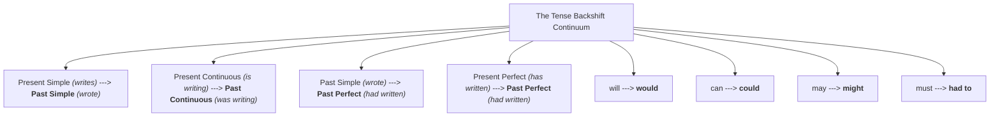
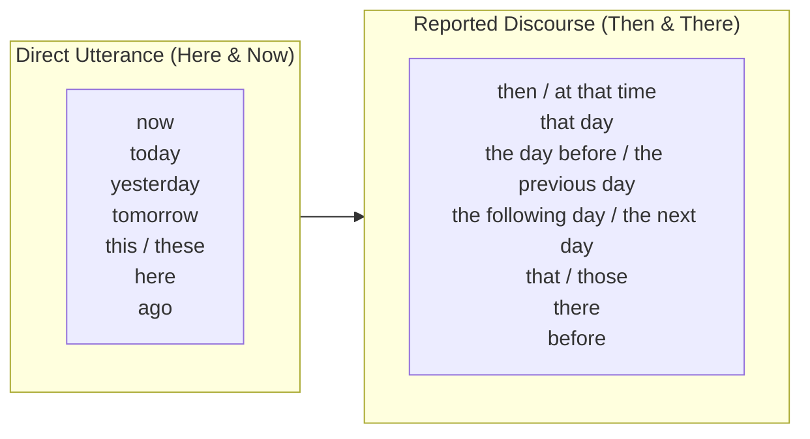
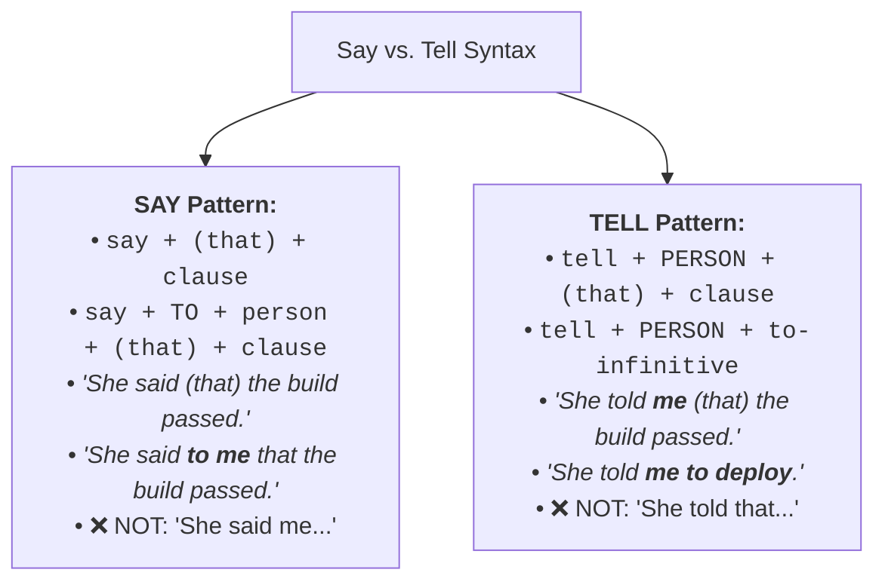
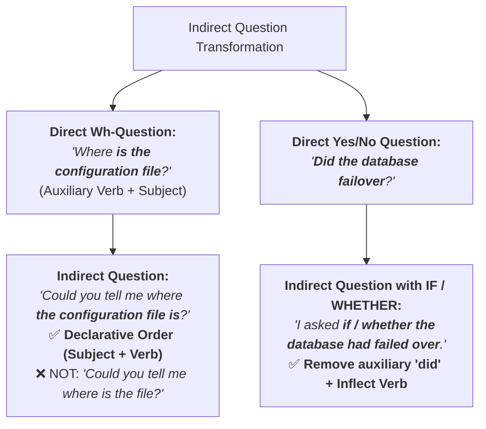

# Reported Speech and Indirect Questions 🗣️🔄

> **Level:** CEFR B1–B2 (Discourse Deixis, Backshifting & Declarative Word Order)  
> **Primary References:** Raymond Murphy (*English Grammar in Use*, Units 47–48, 50); Michael Swan (*Practical English Usage*, §24)  
> **Core Concept:** When converting **Direct Speech** (exact quoted words) into **Reported (Indirect) Speech**, English syntax enforces systematic **tense backshifting**, **pronoun and deictic realignments**, and **reporting verb complementation**. Furthermore, when embedding questions within polite inquiries or indirect reporting, English strictly prohibits question inversion, requiring **declarative word order (`Subject + Verb`)**.

---

## 1. The Tense Backshifting Matrix

When a reporting verb is in the **Past Tense** (*said, told, reported, confirmed*), the verbs in the reported clause generally shift one step back into the grammatical past:



### Complete Backshift Conjugation Reference

| Direct Speech Tense | Reported Speech Backshift | Direct Speech Example | Reported Speech Transformation |
| :--- | :--- | :--- | :--- |
| **Present Simple** | **Past Simple** | *"The API returns JSON."* | *He confirmed that the API **returned** JSON.* |
| **Present Continuous**| **Past Continuous** | *"We are scaling the pods."* | *She said they **were scaling** the pods.* |
| **Past Simple** | **Past Perfect** | *"The node crashed."* | *The log revealed that the node **had crashed**.* |
| **Present Perfect** | **Past Perfect** | *"We have patched the bug."* | *The team announced they **had patched** the bug.* |
| **Past Continuous** | **Past Perfect Continuous**| *"I was debugging all night."* | *He explained he **had been debugging** all night.* |
| **Future (`will`)** | **Conditional (`would`)** | *"I will review the PR."* | *Alex promised he **would review** the PR.* |
| **`can`** | **`could`** | *"We can deploy now."* | *They thought they **could deploy** then.* |
| **`may`** | **`might`** | *"The server may overheat."* | *The tech warned the server **might overheat**.* |
| **`must`** | **`had to`** | *"You must rotate keys."* | *Security stated we **had to rotate** keys.* |

> [!NOTE]
> Modals that already represent a past or hypothetical form (**`would`, `could`, `should`, `might`, `ought to`, `had better`**) do **NOT** backshift.
> - Direct: *"You should add unit tests."* $\rightarrow$ Reported: *She said I **should add** unit tests.*

---

## 2. When Backshifting is Optional (Universal Truths & Invariants)

Backshifting is **not mandatory** if the reported statement represents a **universal architectural truth**, a **permanent invariant**, or a situation that remains **currently valid at the moment of reporting**:

- *The architect confirmed that gRPC **uses** HTTP/2 multiplexing.* (Valid invariant; backshift to *used* is optional).
- *Alice said that the staging database **is** currently offline.* (If it is still offline right now, Present tense is preferred).
- *The professor explained that light **travels** faster than sound.* (Universal physical law: no backshift).

---

## 3. Deictic Shifts: Pronouns, Time, and Place

When the reporting occurs at a different time, place, or perspective from the original utterance, **deictic coordinates** shift:



- Direct: *"We deployed **this** service **yesterday**."*
- Reported: *The team lead reported that they had deployed **that** service **the day before**.*

---

## 4. Reporting Verbs and Clausal Patterns

The two most common reporting verbs—`say` and `tell`—follow mutually exclusive syntactic patterns:



### Advanced Reporting Verb Complementation

| Complementation Pattern | Permitted Verbs | Production Engineering Example |
| :--- | :--- | :--- |
| **`Verb + that-clause`** | *confirm, announce, explain, admit, mention, deny* | *The SRE **confirmed that** all pods were healthy.* |
| **`Verb + Person + that-clause`** | *tell, remind, notify, convince, inform, assure* | *The alert **notified us that** CPU load exceeded 95%.* |
| **`Verb + to-infinitive`** | *promise, agree, refuse, offer, threaten, claim* | *The vendor **promised to deliver** the patch by Friday.* |
| **`Verb + Person + to-infinitive`** | *tell, advise, urge, warn, instruct, remind* | *The lead **instructed the team to halt** all deployments.* |
| **`Verb + -ing (Gerund)`** | *admit, deny, suggest, recommend* | *The engineer **suggested enabling** query caching.* |

---

## 5. Indirect (Embedded) Questions: No Inversion!

When reporting a question or embedding an inquiry inside a polite preamble (*Could you tell me...*, *I wonder...*), English **forbids question inversion**. The word order **must remain declarative (`Subject + Verb`)**:



> [!CAUTION]
> This is a pervasive error in technical meetings and Slack communications:
> - ❌ *Can you tell me what is the IP address?*
> - ✅ *Can you tell me **what the IP address is**?*
> - ❌ *I wonder when will the migration finish.*
> - ✅ *I wonder **when the migration will finish**.*

---

## 6. Practical Dual-Domain Examples

### Everyday Conversation

1. *Direct:* "I am going to the supermarket." $\rightarrow$ *Indirect:* *She said **she was going** to the supermarket.*
2. *Direct:* "Did you see my keys?" $\rightarrow$ *Indirect:* *He asked **if I had seen** his keys.*
3. *Direct:* "Where do you live?" $\rightarrow$ *Indirect:* *Could you tell me **where you live**?* (No inversion)
4. *Direct:* "Don't touch that hot pan!" $\rightarrow$ *Indirect:* *She **warned me not to touch** the hot pan.*
5. *Direct:* "I will call you tomorrow." $\rightarrow$ *Indirect:* *He promised that he **would call me the following day**.*
6. *Direct:* "I have already finished my homework." $\rightarrow$ *Indirect:* *She told her mother that she **had already finished** her homework.*
7. *Direct:* "Why are you laughing?" $\rightarrow$ *Indirect:* *He asked me **why I was laughing**.*
8. *Direct:* "Please turn down the volume." $\rightarrow$ *Indirect:* *The neighbor **asked us to turn down** the volume.*

### Software Engineering & Technical Documentation

9. *Direct:* "The memory leak is crashing the worker threads."  
   $\rightarrow$ *Reported:* *The developer reported that the memory leak **was crashing** the worker threads.*
10. *Direct:* "We have mitigated the DDoS attack."  
   $\rightarrow$ *Reported:* *The incident commander announced that they **had mitigated** the DDoS attack.*
11. *Direct:* "Can we downgrade the database engine?"  
   $\rightarrow$ *Reported:* *The client inquired **whether they could downgrade** the database engine.*
12. *Direct:* "How does the consensus protocol handle network partitions?"  
   $\rightarrow$ *Reported:* *The RFC document explains **how the consensus protocol handles** network partitions.* (Declarative order)
13. *Direct:* "Do not merge PRs without two approvals."  
   $\rightarrow$ *Reported:* *The tech lead **instructed the team not to merge** PRs without two approvals.*
14. *Direct:* "What is causing the intermittent 504 Gateway Timeouts?"  
   $\rightarrow$ *Reported:* *The dashboard investigates **what is causing** the intermittent 504 Gateway Timeouts.*
15. *Direct:* "We will deploy the container image tomorrow morning."  
   $\rightarrow$ *Reported:* *The release engineer stated that they **would deploy** the container image **the next morning**.*
16. *Direct:* "The TLS certificate expired three days ago."  
   $\rightarrow$ *Reported:* *The security audit revealed that the TLS certificate **had expired three days before**.*
17. *Direct:* "The API must enforce rate limits."  
   $\rightarrow$ *Reported:* *The architect insisted that the API **had to enforce** rate limits.*
18. *Direct:* "Does the service support OAuth 2.0 PKCE?"  
   $\rightarrow$ *Reported:* *Could you clarify **whether the service supports** OAuth 2.0 PKCE?*

---

## 7. Common Antipatterns & Diagnostic Table

| Incorrect Antipattern | Corrected Grammar | Rule & Explanation |
| :--- | :--- | :--- |
| ❌ *Can you tell me where is the server?* | ✅ *Can you tell me **where the server is**?* | Indirect questions require declarative word order (`S + V`), not question inversion. |
| ❌ *He said me that the tests failed.* | ✅ *He **told me** that the tests failed.* / *He **said that**...* | *Say* cannot take a personal object directly; use *tell someone* or *say to someone*. |
| ❌ *She asked me where did I deploy.* | ✅ *She asked me **where I had deployed**.* | In indirect questions, remove dummy auxiliary *did* and backshift the main verb. |
| ❌ *The engineer said that he will fix it.* | ✅ *The engineer said that he **would** fix it.* | Backshift rule: *will* shifts to *would* when the reporting verb is past (*said*). |
| ❌ *She suggested us to restart.* | ✅ *She suggested **that we restart**.* / *...suggested **restarting**.* | *Suggest* cannot take the pattern *suggest someone to do*; use a *that*-clause or gerund. |
| ❌ *I wonder if does the cluster autoscale.* | ✅ *I wonder **if the cluster autoscales**.* | Indirect questions remove auxiliary *do/does/did*. |
| ❌ *The logs showed that the node crashed today.* | ✅ *The logs showed that the node had crashed **that day**.* | Deictic shift: *today* shifts to *that day* in past reported discourse. |

---

## 8. Self-Assessment Exercises

### Exercise 1: Direct to Reported Speech Conversion
Convert the direct quotes into reported speech (reporting verb in past tense):

1. Direct: *"The database connection pool is completely exhausted."*  
   $\rightarrow$ The systems engineer reported that the database connection pool ________.
2. Direct: *"We have resolved the synchronization deadlock."*  
   $\rightarrow$ The database administrator confirmed that they ________.
3. Direct: *"I will deploy the security patch tomorrow."*  
   $\rightarrow$ The developer promised that she ________ the following day.
4. Direct: *"Do not commit plaintext credentials to Git."*  
   $\rightarrow$ The security manager warned the developers ________.
5. Direct: *"We can scale the pods horizontally."*  
   $\rightarrow$ The architect explained that they ________.

### Exercise 2: Indirect Question Transformation
Rephrase the direct questions into polite indirect questions:

6. Direct: *Where does the microservice log runtime errors?*  
   $\rightarrow$ Could you tell me where ________?
7. Direct: *Did the automated smoke tests pass?*  
   $\rightarrow$ I want to know whether ________.
8. Direct: *Why was the build cancelled?*  
   $\rightarrow$ Do you know why ________?
9. Direct: *When will the maintenance window begin?*  
   $\rightarrow$ Please inform us when ________.
10. Direct: *Is the database replica synchronized?*  
   $\rightarrow$ We need to check if ________.

<details>
<summary>View Complete Answer Key & Diagnostic Explanations</summary>

1. **was completely exhausted** (Present Simple *is* backshifts to Past Simple *was*).
2. **had resolved the synchronization deadlock** (Present Perfect *have resolved* backshifts to Past Perfect *had resolved*).
3. **would deploy the security patch** (*will* backshifts to *would*).
4. **not to commit plaintext credentials to Git** (*warned someone not to do something*).
5. **could scale the pods horizontally** (*can* backshifts to *could*).
6. Could you tell me where **the microservice logs runtime errors**? (Declarative order; remove *does* and inflect verb).
7. I want to know whether **the automated smoke tests passed**. (Remove *did* and inflect verb into past).
8. Do you know why **the build was cancelled**? (Declarative order: subject *the build* + verb *was cancelled*).
9. Please inform us when **the maintenance window will begin**. (Declarative order: subject + *will begin*).
10. We need to check if **the database replica is synchronized**. (Declarative order: subject + *is*).

</details>

---

## 9. Revision Flashcards

```
Q: What is "tense backshifting" in reported speech?
A: Shifting the tense of the reported clause one step further into the past when the reporting verb is in the past tense (e.g., Present Simple -> Past Simple; Past Simple / Present Perfect -> Past Perfect).

Q: When is tense backshifting optional in reported speech?
A: When the reported fact is a universal truth, a permanent architectural law, or remains currently true at the moment of reporting.

Q: What is the syntactic difference between "say" and "tell"?
A: "Tell" requires an indirect object person ("He told ME that..."), while "say" cannot take an object directly ("He said that...", or "He said TO me that...").

Q: What word order must be used in indirect/embedded questions?
A: Declarative word order (Subject + Verb), with NO auxiliary inversion and NO dummy "do/did" (e.g., "Can you tell me where the server IS?").

Q: How do you report an imperative command (e.g. "Run the tests!")?
A: Use a reporting verb followed by person + to-infinitive (e.g., "He told us TO RUN the tests").
```
