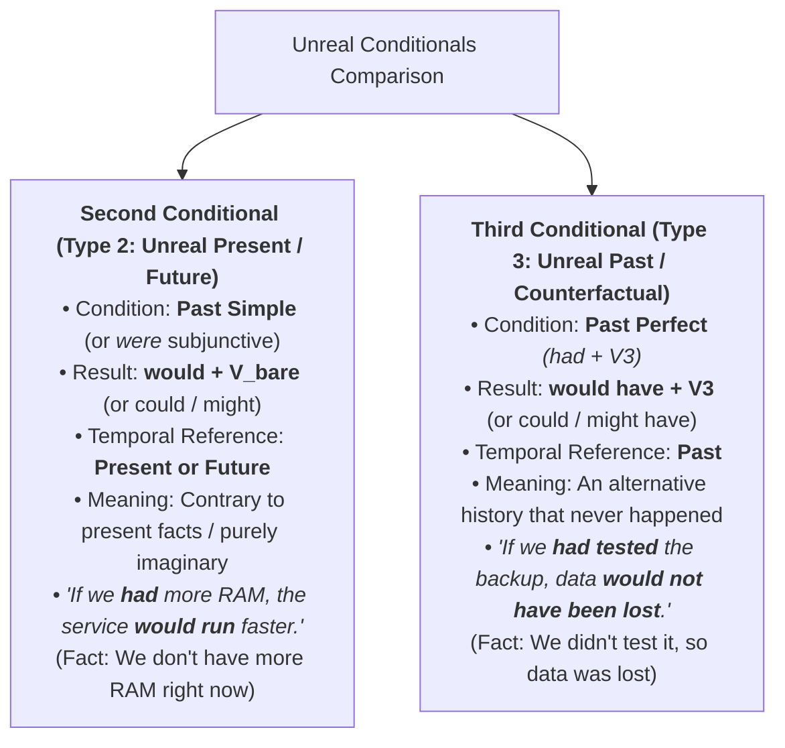
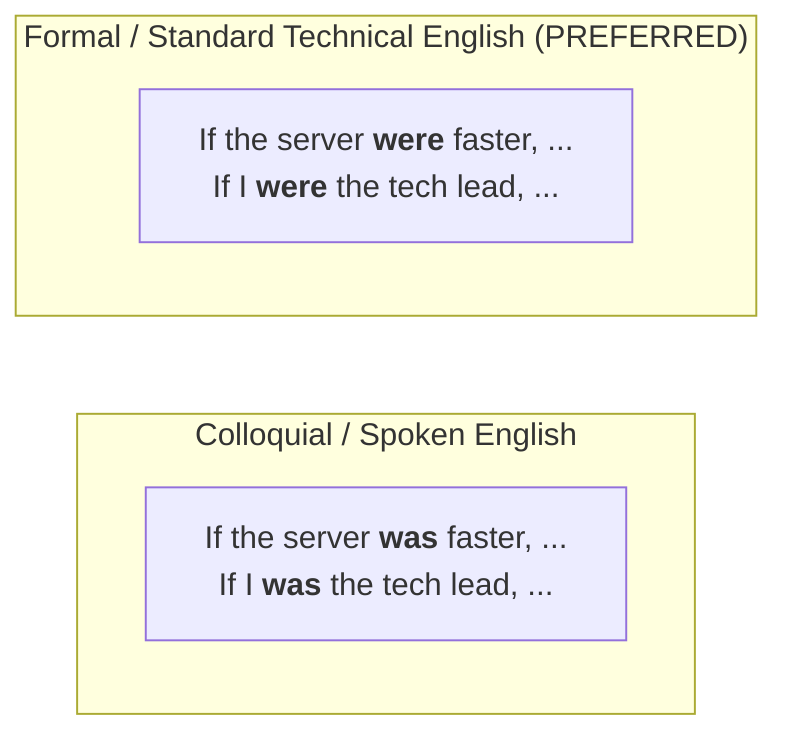
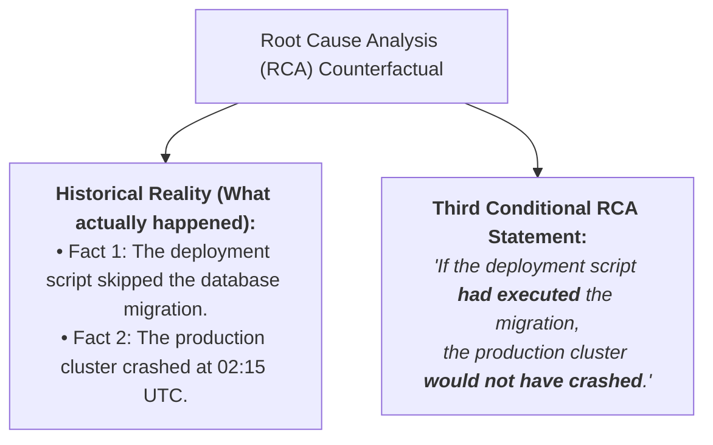

# Second and Third Conditionals: Hypothetical Scenarios and Counterfactual Retrospectives 🔮⏪

> **Level:** CEFR B1–B2 (Unreal Modality & Counterfactual Syntax)  
> **Primary References:** Raymond Murphy (*English Grammar in Use*, Units 39–40); Michael Swan (*Practical English Usage*, §22.4–22.6)  
> **Core Concept:** Unreal conditionals model scenarios contrary to factual reality. The **Second Conditional (Type 2)** expresses **hypothetical present states or improbable future scenarios** (`If X were true now, Y would happen`). The **Third Conditional (Type 3)** models **counterfactual past events** (`If X had happened in the past, Y would have happened`). In technical documentation, Type 3 is the foundational grammatical mechanism for **incident postmortems and Root Cause Analyses (RCAs)**.

---

## 1. Structural Comparison: Type 2 vs. Type 3



### Algebraic Syntax Formulas

| Conditional Type | *If*-Clause (Condition) | Main Clause (Result / Consequence) | Temporal Focus | Reality Entailment |
| :---: | :--- | :--- | :---: | :--- |
| **Type 2 (Second)** | $\mathbf{\text{If}} + \mathbf{\text{Past Simple}}$ | $\mathbf{\text{would / could / might}} + \mathbf{V_{\text{bare}}}$ | Present / Future | *The condition is currently untrue or improbable.* |
| **Type 3 (Third)** | $\mathbf{\text{If}} + \mathbf{\text{Past Perfect}}$ | $\mathbf{\text{would / could / might}} + \mathbf{\text{have}} + \mathbf{V3}$ | Past | *The condition never occurred; counterfactual past.* |

---

## 2. Second Conditional & The `Were` Subjunctive

In the Second Conditional, standard English uses the **Past Simple** to signify psychological and modal distance from reality (not past time).

### 1. The `Were` Subjunctive Rule
In formal English, architecture decision records, and standard idiom, the verb `be` takes the subjunctive form **`were` for all persons** (*I, he, she, it*):



- * **If I were you**, I would refactor the authentication module immediately.* (Fixed advice idiom: *was* is considered non-standard).
- *If the database **were** clustered across availability zones, this failover **would be** seamless.*

### 2. Modal Variations in Type 2
- **`Would`** expresses conditional certainty:
  - *If we rewrote the parser in Rust, throughput **would double**.*
- **`Could`** expresses hypothetical ability or capacity:
  - *If we had access to the production cluster, we **could inspect** the live socket tables.*
- **`Might`** expresses hypothetical uncertainty or possibility:
  - *If we relaxed connection limits, the server **might crash** under sudden load.*

---

## 3. Third Conditional: Root Cause Analysis & Counterfactuals

The Third Conditional examines historical events that already took place and evaluates **what would have happened under different circumstances**:

$$\mathbf{\text{If}} + \mathbf{\text{had + V3}} \dots, \mathbf{\text{would have + V3}}$$



### The Double `Would Have` Antipattern
A frequent and egregious error is inserting *would have* inside the *if*-clause:

> [!CAUTION]
> Never put *would have* in the *if*-clause!
> - ❌ *If we would have known about the bug, we would have delayed the launch.*
> - ✅ *If we **had known** about the bug, we **would have delayed** the launch.*
> - ❌ *If the firewall would have blocked the port, the attack would have failed.*
> - ✅ *If the firewall **had blocked** the port, the attack **would have failed**.*

### Modal Variations in Type 3
- **`Could have + V3`** (Hypothetical past ability/opportunity):
  - *If you had notified us earlier, we **could have mitigated** the breach.*
- **`Might have + V3`** (Hypothetical past probability):
  - *If the attacker had attempted brute force, the rate limiter **might have caught** them.*

---

## 4. Practical Dual-Domain Examples

### Everyday Conversation

1. *If I **won** the lottery, I **would travel** around the world.* (Type 2: improbable future)
2. *If I **were** taller, I **would play** professional basketball.* (Type 2: unreal present)
3. *If you **had called** me, I **would have picked** you up from the airport.* (Type 3: unfulfilled past)
4. *We **could have gone** to the concert if we **had bought** tickets in advance.* (Type 3: past ability)
5. *If she **had studied** harder, she **might have passed** the certification exam.* (Type 3: probability)
6. *If I **had** more free time, I **would learn** Italian.* (Type 2: unreal present)
7. *If it **were not** raining right now, we **could have** lunch in the garden.* (Type 2: *were*)
8. *What **would you do** if you **lost** your wallet?* (Type 2 inquiry)

### Software Engineering & Technical Documentation

9. *If our microservices **were** stateless, horizontal autoscaling **would be** trivial.* (Type 2)
10. *If the caching layer **were** operational, read latency **would drop** by 80%.* (Type 2)
11. *If the on-call engineer **had observed** the disk alert, the database **would not have halted** writes.* (Type 3 RCA)
12. *If we **had implemented** automated regression tests, this critical bug **would have been caught** in CI.* (Type 3)
13. *We **could have prevented** the data loss if the read replica **had completed** synchronization.* (Type 3)
14. *If the company **invested** more in infrastructure security, compliance audits **would take** less time.* (Type 2)
15. *If the developer **had checked** the pointer for null, the application **would not have suffered** a segfault.* (Type 3)
16. *The failover **might have succeeded** if the heartbeat timeout **had been set** to 500 milliseconds.* (Type 3)
17. *If I **were** the lead architect, I **would mandate** trunk-based continuous delivery.* (Type 2 advice)
18. *If the Kubernetes cluster **had experienced** a network partition, the Raft quorum **would have elected** a new leader.* (Type 3)

---

## 5. Common Antipatterns & Diagnostic Table

| Incorrect Antipattern | Corrected Grammar | Rule & Explanation |
| :--- | :--- | :--- |
| ❌ *If we would have tested, it wouldn't fail.* | ✅ *If we **had tested**, it **would not have failed**.* | Third conditional: use *had + V3* in the *if*-clause, never *would have*. |
| ❌ *If I was you, I would refactor.* | ✅ *If I **were** you, I would refactor.* | Hypothetical advice idiom strictly requires the *were* subjunctive. |
| ❌ *If we had more memory, it will run faster.* | ✅ *If we had more memory, it **would** run faster.* | Mixed sequence error: Type 2 pairs Past Simple with *would*, not *will*. |
| ❌ *If the server crashed yesterday, we fixed it.* | ✅ *If the server **had crashed** yesterday, we **would have fixed** it.* | Counterfactual past events require the Third Conditional (*had crashed... would have fixed*). |
| ❌ *If he had known, he could prevented it.* | ✅ *If he had known, he **could have prevented** it.* | Modal past counterfactual requires *could have + V3*, not bare verb. |
| ❌ *If the cluster were down, so we fail over.* | ✅ *If the cluster were down, we **would fail over**.* | Double conjunction bug (*if... so*), plus missing modal *would*. |

---

## 6. Self-Assessment Exercises

### Exercise 1: Second vs. Third Conditional Conjugation
Complete the sentences with the correct unreal conditional forms:

1. If our application (be) ________ stateless, we (can) ________ deploy updates with zero downtime. (Type 2)
2. If the security team (patch) ________ the OpenSSL library last month, the vulnerability (not be) ________ exploited. (Type 3)
3. If I (be) ________ the infrastructure manager, I (mandate) ________ mutual TLS for all internal microservices. (Type 2)
4. We (prevent) ________ the database outage if the monitoring alert (fire) ________ five minutes earlier. (Type 3)
5. If the compiler (support) ________ asynchronous coroutines, the developers (write) ________ cleaner code. (Type 2)

### Exercise 2: Counterfactual Error Repair
Correct the grammatical bugs in the following sentences:

6. If the deployment script would have verified the hash, the corrupted package would not have installed.
7. If the server was more powerful, it will process the backlog effortlessly.
8. The engineers could solved the race condition if they had reviewed the execution trace.
9. If we had known about the scheduled power cut, we would migrated the virtual machines yesterday.
10. If I was in charge of the release, I would postpone the launch.

<details>
<summary>View Complete Answer Key & Diagnostic Explanations</summary>

1. **were** ... **could** (Type 2: *were* subjunctive + *could deploy*).
2. **had patched** ... **would not have been** (Type 3 counterfactual past).
3. **were** ... **would mandate** (Type 2: *were* subjunctive for advice).
4. **would have prevented** (or *could have prevented*) ... **had fired** (Type 3).
5. **supported** ... **would write** (Type 2).
6. **If the deployment script had verified the hash**, the corrupted package would not have installed. (Removed *would have* from *if*-clause).
7. If the server **were** more powerful, it **would** process the backlog effortlessly. (Type 2 alignment).
8. The engineers **could have solved** the race condition if they had reviewed the execution trace. (Restored missing *have*).
9. If we had known about the scheduled power cut, we **would have migrated** the virtual machines yesterday. (Restored *have + V3*).
10. If I **were** in charge of the release, I would postpone the launch. (Replaced *was* with formal subjunctive *were*).

</details>

---

## 7. Revision Flashcards

```
Q: What is the formula for the Second Conditional (Type 2) and what time does it refer to?
A: Formula: "If + Past Simple, would + base verb". It refers to the PRESENT or FUTURE (expressing an unreal or hypothetical scenario contrary to current facts).

Q: What is the "were subjunctive" and when should you use it?
A: Using "were" instead of "was" for all subjects (including I, he, she, it) in unreal conditionals (e.g., "If I were you", "If the server were online"). It is preferred in formal and technical writing.

Q: What is the formula for the Third Conditional (Type 3) and what is its primary use in software engineering?
A: Formula: "If + Past Perfect (had + V3), would have + V3". It is the primary grammatical structure used in Root Cause Analyses (RCAs) to evaluate counterfactual past events that did not happen.

Q: Why is "If we would have known, we would have stopped" a severe grammatical error?
A: "Would have" can NEVER appear inside the conditional "if"-clause. Use Past Perfect instead: "If we HAD known, we would have stopped".

Q: What modal verbs can substitute for "would" in Second and Third Conditionals?
A: "Could" (expressing hypothetical capability/ability) and "might" (expressing hypothetical possibility/uncertainty).
```
