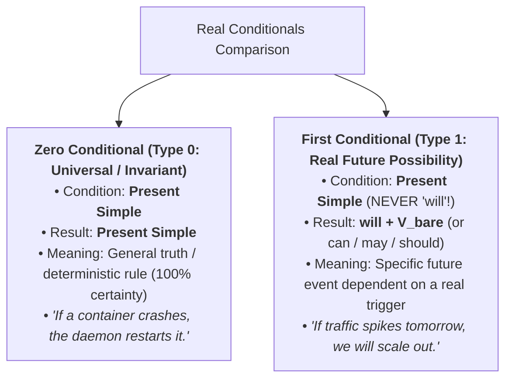
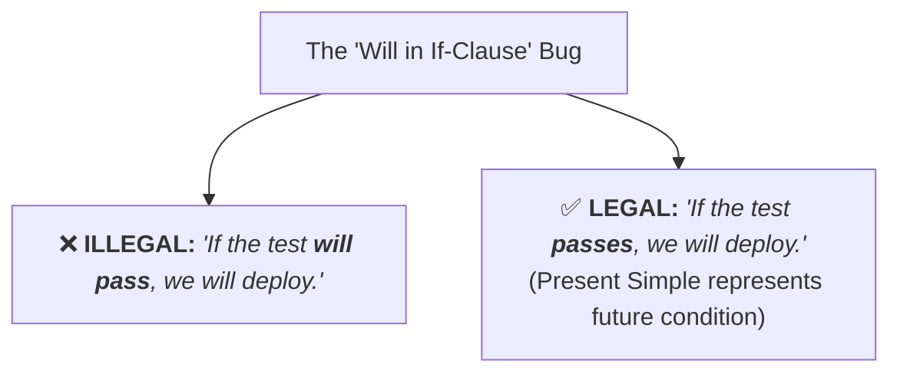
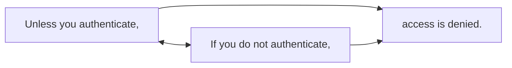

# Zero and First Conditionals: Deterministic Logic and Real Future Predictions 🎯⚡

> **Level:** CEFR B1–B2 (Predictive Modality & Tense Simplification)  
> **Primary References:** Raymond Murphy (*English Grammar in Use*, Units 38, 114–115); Michael Swan (*Practical English Usage*, §22.1–22.3)  
> **Core Concept:** Real conditionals govern scenarios that are factually true or realistically possible. The **Zero Conditional (Type 0)** models deterministic causality, scientific laws, and program invariants (`If X happens, Y always happens`). The **First Conditional (Type 1)** models real future predictions and conditional commitments (`If X happens, Y will happen`). In both types, English strictly enforces the **Tense Simplification Invariant** (prohibiting *will* in the conditional clause).

---

## 1. Structural Comparison: Zero vs. First Conditional



### Algebraic Syntax Formulas

| Type | Conditional Clause (*If*-Clause) | Main Clause (Result Clause) | Semantic Realm |
| :---: | :--- | :--- | :--- |
| **Type 0** | $\mathbf{\text{If / When}} + \mathbf{\text{Present Simple}}$ | $\mathbf{\text{Present Simple}}$ | Universal laws, code logic, automated reactions |
| **Type 1** | $\mathbf{\text{If}} + \mathbf{\text{Present Simple}}$ | $\mathbf{\text{will / can / may / should}} + \mathbf{V_{\text{bare}}}$ | Specific future possibility / actionable plan |
| **Type 1 (Imperative)** | $\mathbf{\text{If}} + \mathbf{\text{Present Simple}}$ | $\mathbf{\text{Imperative (Base Verb)}}$ | Direct operational instruction / runbook rule |

---

## 2. Zero Conditional: Deterministic Invariants & System Logic

Use the Zero Conditional when the relationship between condition and result is an **unalterable rule, scientific law, or hardcoded software trigger**:

- *If you heat ice, it **melts**.* (Physical law)
- *If a query **exceeds** the 30-second timeout, the proxy **returns** an HTTP 504 error.* (Deterministic system behavior)
- *When the buffer **fills** to 100%, incoming packets **are dropped**.*

### `If` vs. `When` in Type 0
- **`When`** implies certainty that the event will happen repeatedly:
  - * **When** the cron job executes at midnight, it clears temporary files.*
- **`If`** introduces a conditional trigger that may or may not occur:
  - * **If** an unhandled exception occurs, the runtime logs a stack trace.*

---

## 3. First Conditional: The Tense Simplification Invariant

In the First Conditional, although the *if*-clause refers to a future contingency, English grammar **forbids the modal `will` inside the conditional clause**:



> [!CAUTION]
> This is one of the highest-frequency grammatical bugs in software engineering communication:
> - ❌ *If it will rain tomorrow, the outdoor demo will be cancelled.*
> - ✅ *If it **rains** tomorrow, the outdoor demo will be cancelled.*
> - ❌ *If the build will succeed, we will merge the pull request.*
> - ✅ *If the build **succeeds**, we will merge the pull request.*

### Modal Variations in the Main Clause
Instead of *will*, you can modulate certainty, capability, or advice using other modals:
- *If the server crashes, you **can** restore it from the snapshot.* (Capability)
- *If memory consumption continues to rise, the host **might** freeze.* (Uncertain possibility)
- *If you notice anomalous database locks, you **should** notify the SRE lead.* (Recommendation)
- *If an operator enters maintenance mode, they **must** log the reason.* (Obligation)

---

## 4. Negative Condition: `Unless`

`Unless` is a subordinating conjunction meaning **`if ... not`** or **`except if`**:

$$\mathbf{\text{Unless}} + \text{Affirmative Verb} \equiv \mathbf{\text{If}} + \text{Negative Verb}$$



> [!WARNING]
> Because `unless` already contains negative semantic polarity, do **not** use a negative verb with it:
> - ❌ *Unless you don't commit your code, changes will be lost.*
> - ✅ * **Unless** you commit your code, changes will be lost.*
> - ✅ * **If** you do not commit your code, changes will be lost.*

---

## 5. Alternative Conditional Conjunctions

In technical specifications and contracts, conditional clauses are often introduced by formal conjunctions:

| Conjunction | Meaning | Degree of Formality | Example Sentence |
| :--- | :--- | :---: | :--- |
| **`provided that` / `providing that`** | *Only if; on the condition that* | Formal | *The API is free to use **provided that** users do not exceed rate limits.* |
| **`as long as` / `so long as`** | *During the whole time that / if* | Standard | *We can continue deploying **as long as** error rates remain below 0.1%.* |
| **`on condition that`** | *With the contractual requirement that* | Highly Formal | *The license is granted **on condition that** attribution is preserved.* |
| **`in case`** | *As a precaution against a future event* | Precautionary | *We mirrored the cluster **in case** the primary region suffers an outage.* |

> [!NOTE]
> **`In case` vs. `If` Precautionary Distinction:**
> - *We will failover **if** the primary fails.* (Action happens *after* the failure).
> - *We created a standby cluster **in case** the primary fails.* (Action happens *before* the failure as a precaution).

---

## 6. Practical Dual-Domain Examples

### Everyday Conversation

1. *If you press this button, the television **turns on**.* (Type 0: invariant)
2. *If it **rains** this weekend, we **will watch** movies at home.* (Type 1: future)
3. *When water reaches 0°C, it **freezes**.* (Type 0)
4. *If you are tired, **take** a short nap.* (Type 1: imperative)
5. *We will go to the beach tomorrow **unless** the weather turns bad.* (Unless)
6. *You can borrow my car **as long as** you fill up the gas tank.* (As long as)
7. *I took an umbrella **in case** it rained.* (Precaution)
8. *If she **studies** diligently, she **will pass** her board exams.* (Type 1)

### Software Engineering & Technical Documentation

9. *If a Kubernetes worker node **becomes** unresponsive for five minutes, the control plane **evicts** its pods.* (Type 0)
10. *If the integration tests **pass**, the CI/CD pipeline **will automatically push** the container to production.* (Type 1)
11. *The reverse proxy **drops** connection sockets when clients **send** malformed HTTP headers.* (Type 0)
12. *If you observe elevated database deadlocks, **trigger** a manual thread dump.* (Type 1: imperative)
13. *The autoscaler **will provision** four additional worker instances if queue depth **exceeds** 5,000 tasks.* (Type 1)
14. *Unauthenticated requests are rejected **unless** they **originate** from trusted internal CIDR blocks.* (Unless)
15. *The microservice can handle 50,000 requests per second **provided that** Redis caching **is enabled**.* (Provided that)
16. *We provisioned redundant cross-region optical fibers **in case** an undersea cable **is damaged**.* (Precautionary in case)
17. *If memory fragmentation **continues** at this rate, the kernel **might invoke** the OOM killer.* (Modal variation)
18. *When the database engine **commits** a transaction, it **flushes** write-ahead logs to durable storage.* (Type 0)

---

## 7. Common Antipatterns & Diagnostic Table

| Incorrect Antipattern | Corrected Grammar | Rule & Explanation |
| :--- | :--- | :--- |
| ❌ *If the build will fail, we will get an email.* | ✅ *If the build **fails**, we will get an email.* | Prohibited *will* in the conditional *if*-clause. Use Present Simple. |
| ❌ *Unless you don't approve the PR, it won't merge.* | ✅ * **Unless** you approve the PR, it won't merge.* | *Unless* already carries negative meaning; do not use a negative verb. |
| ❌ *If the server crashes, so we fail over.* | ✅ *If the server crashes, we fail over.* | Double conjunction bug: do not combine *if* with *so* in the main clause. |
| ❌ *We will alert you in case if there is an error.* | ✅ *We will alert you **in case** there is an error.* | Redundant double conjunction: combine *in case* with a noun/clause, not *if*. |
| ❌ *If a pod fails, it will restart.* (as universal rule) | ✅ *If a pod fails, it **restarts**.* | Deterministic, permanent system logic requires Zero Conditional (Present Simple). |
| ❌ *As long as you will maintain the code, it works.* | ✅ *As long as you **maintain** the code, it works.* | Conditional conjunctions (*as long as*) take Present Simple for future conditions. |

---

## 8. Self-Assessment Exercises

### Exercise 1: Zero vs. First Conditional Verb Conjugation
Supply the correct tense of the verbs in parentheses:

1. When a client (send) ________ an invalid token, the server (return) ________ a 401 Unauthorized status. (Type 0)
2. If our cloud provider (experience) ________ an outage tomorrow, we (switch) ________ to the disaster recovery region. (Type 1)
3. If you (encounter) ________ a merge conflict, (consult) ________ the original author before rebasing. (Type 1 Imperative)
4. The background job (terminate) ________ automatically if the parent process (exit) ________. (Type 0)
5. If the database latency (not improve) ________ by Friday, the engineering lead (cancel) ________ the rollout. (Type 1)

### Exercise 2: `Unless` & Conditional Error Repair
Rewrite and correct the grammatical bugs in the following sentences:

6. Unless the security auditor does not approve the code, we will deploy it on Thursday.
7. If the container engine will run out of memory, it will crash.
8. We have configured an emergency read replica in case if the primary database fails.
9. If you will configure the `.env` file properly, the application will boot smoothly.
10. The microservice will scale out as long as the CPU load will exceed 80%.

<details>
<summary>View Complete Answer Key & Diagnostic Explanations</summary>

1. **sends** ... **returns** (Zero Conditional: Present Simple in both clauses).
2. **experiences** ... **will switch** (First Conditional: Present Simple in *if*-clause, *will* in main clause).
3. **encounter** ... **consult** (First Conditional with Imperative in main clause).
4. **terminates** ... **exits** (Zero Conditional deterministic behavior).
5. **does not improve** ... **will cancel** (First Conditional).
6. **Unless the security auditor approves the code, we will deploy it on Thursday.** (or *If the security auditor does not approve...*).
7. **If the container engine runs out of memory, it will crash.** (Remove illegal *will* from *if*-clause).
8. **We have configured an emergency read replica in case the primary database fails.** (Remove redundant *if*).
9. **If you configure the `.env` file properly, the application will boot smoothly.** (Remove illegal *will*).
10. **The microservice will scale out as long as the CPU load exceeds 80%.** (Remove illegal *will* from *as long as* clause).

</details>

---

## 9. Revision Flashcards

```
Q: What is the core structural difference between a Zero Conditional and a First Conditional?
A: Zero Conditional uses Present Simple in BOTH clauses to express universal/deterministic invariants ("If X happens, Y happens"). First Conditional uses Present Simple in the if-clause and "will + base verb" in the main clause for specific future possibilities ("If X happens, Y will happen").

Q: Why is "If it will rain tomorrow, we will stay home" grammatically incorrect?
A: English enforces a strict Tense Simplification Invariant: modal "will" is prohibited in adverbial conditional if-clauses. The future condition must be expressed in the Present Simple ("If it rains tomorrow").

Q: What does "unless" mean, and what is its most common grammatical trap?
A: "Unless" means "if ... not". The most common trap is using a negative verb with it (e.g., "Unless you don't commit"), which creates an ungrammatical double negative.

Q: How does "in case" differ from "if"?
A: "In case" describes a precautionary action taken BEFORE a potential event ("I bought backup disks in case the server fails"); "if" describes an action triggered AFTER the event occurs ("I will replace the disks if the server fails").

Q: What can replace "will" in the main clause of a First Conditional?
A: Other modal verbs like "can", "may", "might", "should", "must", or an imperative base verb ("If you see an error, alert the team").
```
