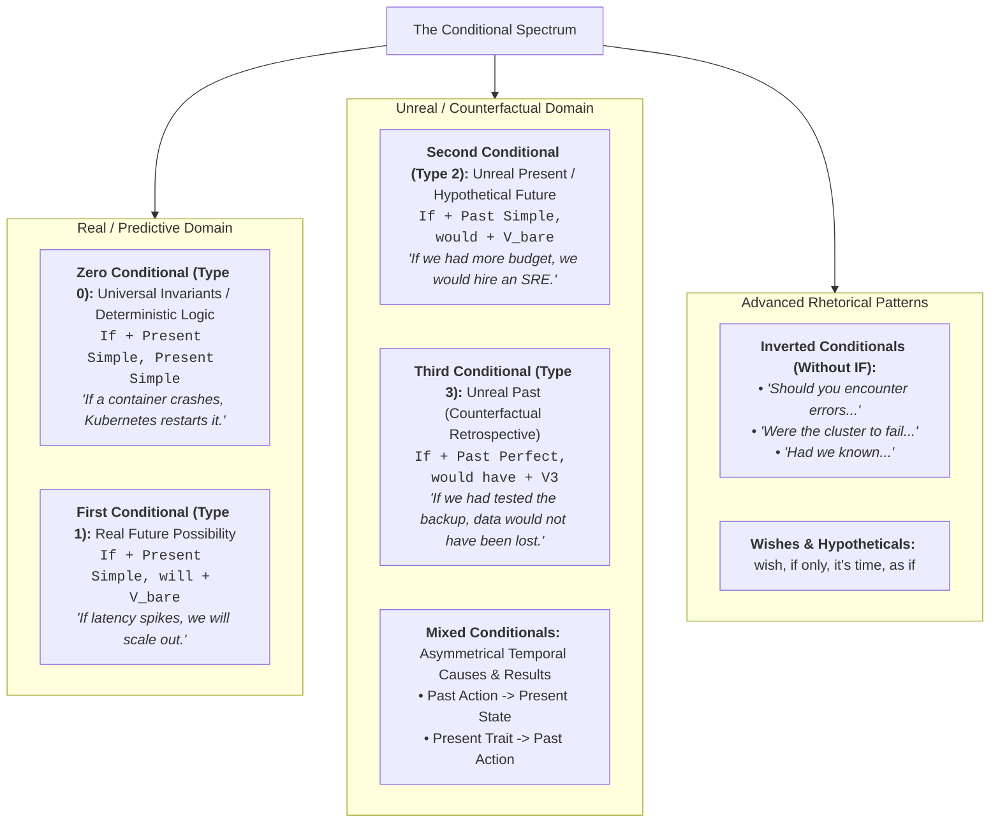

# Module 10: Conditionals and Hypotheticals 🔀🔮

> **Level:** CEFR B1–C1 (Hypothetical Modality & Counterfactual Syntax)  
> **Primary References:** Raymond Murphy (*English Grammar in Use*, Units 38–41, 114–115); Michael Swan (*Practical English Usage*, §22)  
> **Core Concept:** Conditionals model **deterministic causal logic, predictive scenarios, counterfactual simulations, and unfulfilled past hypotheses**. In software engineering and architecture documentation, conditionals are the linguistic counterpart to control flow (`if/else`), incident postmortems (counterfactual retrospectives), and disaster recovery simulations.

---

## 1. The Conditional Coordinate Matrix



---

## 2. Topic Curriculum

This module contains **5 comprehensive deep-dive guides**:

| Guide | Core Focus | Target CEFR | Authoritative Literature |
| :--- | :--- | :---: | :--- |
| **01. [Zero and First Conditionals](conditionals-zero-and-first.md)** | Deterministic causal rules (Type 0) vs. predictive future possibilities (Type 1), prohibition of *will* in if-clauses, *unless*, modal variations | B1–B2 | Murphy Units 38, 114–115; Swan §22.1–22.3 |
| **02. [Second and Third Conditionals](conditionals-second-and-third.md)** | Hypothetical present (Type 2, *were* subjunctive) vs. counterfactual past (Type 3, RCA postmortem causality), *could/might* substitutions | B1–B2 | Murphy Units 39–40; Swan §22.4–22.6 |
| **03. [Mixed Conditionals](mixed-conditionals.md)** | Asymmetric cross-temporal configurations: Type 3 condition + Type 2 result (Past cause $\rightarrow$ Present impact) and Type 2 condition + Type 3 result | B2–C1 | Murphy Unit 40; Swan §22.7 |
| **04. [Inverted Conditionals Without 'If'](inverted-conditionals-without-if.md)** | High-formality inversion eliminating *if*: *Should* (Type 1), *Were* (Type 2), *Had* (Type 3), negative placement (*Had we not*), RFC style | B2–C1 | Swan §22.8 |
| **05. [Wishes, Regrets, and Hypotheticals](wishes-regrets-and-hypotheticals.md)** | *Wish / if only* with past tense (present dissatisfaction), past perfect (past regret), and *would* (complaint/request); *as if*, *it's high time* | B1–C1 | Murphy Unit 41; Swan §22.9–22.10 |

---

## 3. The Conditional Selection Flowchart

When formulating a conditional statement, apply this decision sequence:

```mermaid
graph TD
    StartCond["Formulating a Conditional Sentence"]
    
    StartCond --> IsReal{"Is the condition real, possible, or a scientific/code invariant?"}
    
    IsReal -->|YES: Real / Possible| IsGeneral{"Is it a universal invariant or a specific future event?"}
    IsGeneral -->|Universal / Deterministic Invariant| UseType0["Use <b>ZERO CONDITIONAL (Type 0)</b><br/><code>If + Present, Present</code>"]
    IsGeneral -->|Specific Future Possibility| UseType1["Use <b>FIRST CONDITIONAL (Type 1)</b><br/><code>If + Present, WILL + V_bare</code>"]
    
    IsReal -->|NO: Hypothetical / Unreal / Impossible| TemporalRef{"What time period are you evaluating?"}
    TemporalRef -->|Present or Future (Unreal)| UseType2["Use <b>SECOND CONDITIONAL (Type 2)</b><br/><code>If + Past Simple, WOULD + V_bare</code>"]
    TemporalRef -->|Past (Counterfactual / Retrospective)| UseType3["Use <b>THIRD CONDITIONAL (Type 3)</b><br/><code>If + Past Perfect, WOULD HAVE + V3</code>"]
    TemporalRef -->|Cross-Temporal (Past cause, Present state)| UseMixed["Use <b>MIXED CONDITIONAL</b><br/><code>If + Past Perfect, WOULD + V_bare</code>"]
```

---

## 4. Cross-Reference Directory
- **Verbs:** [Modal Verbs (Core)](../02-verbs-and-auxiliaries/modal-verbs-core.md) (*could* and *might* expressing degrees of conditional certainty).
- **Tenses:** [Future Time in Subordinate Clauses](../03-tenses-and-aspect/future-time-in-subordinate-clauses.md) (The strict rule prohibiting *will* in adverbial if-clauses).
- **Advanced Syntax:** [Advanced Sentence Structures](../12-advanced-sentence-structures/) (Subjunctive mood and negative inversion parallels).
- **Technical Writing:** [Practical Technical Communication](../15-practical-english-and-communication/) (Disaster simulations, postmortem root-cause analysis, SLAs).
