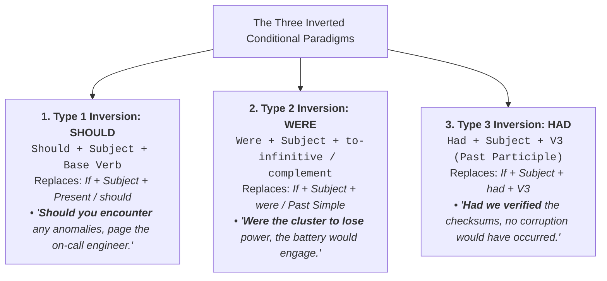
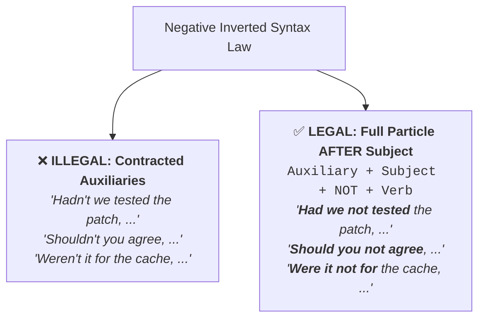

# Inverted Conditionals Without 'If' (Should, Were, Had) 📜🏛️

> **Level:** CEFR B2–C1 (Formal Inversion & Technical Stylistics)  
> **Primary References:** Raymond Murphy (*English Grammar in Use*, Units 40, 114); Michael Swan (*Practical English Usage*, §22.8, §25.1)  
> **Core Concept:** In formal literary English, legal agreements, and authoritative technical documentation (such as IETF RFCs and enterprise SLAs), conditional clauses frequently drop the conjunction `if`. To preserve grammatical marking of the condition, English moves an auxiliary verb (**`Should`**, **`Were`**, or **`Had`**) to the front of the clause before the subject, triggering **Conditional Subject-Auxiliary Inversion**.

---

## 1. The Tripartite Inversion Architecture

Conditional inversion maps directly onto the three core conditional types:



### Transformation Formula Matrix

| Conditional Type | Standard Form with *If* | Inverted Form (Without *If*) | Register & Connotation |
| :---: | :--- | :--- | :--- |
| **Type 1 (Real Future)** | *If you experience downtime, ...* | $\mathbf{Should} + \text{Subject} + \mathbf{V_{\text{bare}}}$ | Formal assistance, warranty, RFC instruction |
| **Type 2 (Unreal Present/Future)** | *If the datacenter were to flood, ...* | $\mathbf{Were} + \text{Subject} + \mathbf{\text{to-infinitive}}$ | Theoretical disaster modeling / low probability |
| **Type 2 (Copular *be*)** | *If I were in charge, ...* | $\mathbf{Were} + \text{Subject} + \text{Complement}$ | Hypothetical status |
| **Type 3 (Unreal Past)** | *If the patch had been merged, ...* | $\mathbf{Had} + \text{Subject} + \mathbf{V3}$ | High-register postmortem retrospectives |

---

## 2. Inversion Mechanics by Type

### 1. `Should` Inversion (Type 1 Future Contingency)
`Should` conveys a tentative nuance ("if by any chance"):
- *Standard:* *If you have any further questions, please do not hesitate to ask.*
- *Inverted:* * **Should you have** any further questions, please do not hesitate to ask.*
- *Technical:* * **Should the primary node fail** to emit heartbeats within 500ms, the replica **will assume** the master role.*

### 2. `Were` Inversion (Type 2 Hypothetical / Future)
When the verb in the *if*-clause is dynamic, the inverted structure uses **`Were + Subject + to-infinitive`**:
- *Standard:* *If the primary broker crashed, traffic would redirect to secondary.*
- *Inverted:* * **Were the primary broker to crash**, traffic **would redirect** to secondary.*
When the verb is a copular *be*, *were* inverts directly with the subject:
- *Standard:* *If the system were resilient, this outage would not matter.*
- *Inverted:* * **Were the system resilient**, this outage **would not matter**.*

### 3. `Had` Inversion (Type 3 Counterfactual Past)
In Root Cause Analyses, inverted *had* represents the highest level of professional elegance:
- *Standard:* *If the development team had validated inputs, the SQL injection would have failed.*
- *Inverted:* * **Had the development team validated** inputs, the SQL injection **would have failed**.*
- *Standard:* *If we had known about the hardware vulnerability, we would have delayed rollout.*
- *Inverted:* * **Had we known** about the hardware vulnerability, we **would have delayed** rollout.*

---

## 3. The Negative Inversion Law: No Contractions!

In negative inverted conditionals, **contracted forms (`*Shouldn't*, *Weren't*, *Hadn't*`) are strictly forbidden**. The negative particle `not` must sit **immediately following the subject**:



> [!CAUTION]
> Placing the contraction at the front completely destroys the grammatical validity of the clause:
> - ❌ *Hadn't the firewall blocked the request, the cluster would have crashed.*
> - ✅ * **Had the firewall not blocked** the request, the cluster would have crashed.*
> - ❌ *Shouldn't the container restart, page the SRE on call.*
> - ✅ * **Should the container not restart**, page the SRE on call.*

---

## 4. Fixed Idiomatic Inversions: `Were it not for` & `Had it not been for`

These high-level prepositional formulas mean **"without"** or **"if it were not for"**:

### 1. `Were it not for` (Present Condition = "Without")
- * **Were it not for** our distributed caching layer, the database **would buckle** under this traffic.*  
  (= *If it were not for our caching layer...* / *Without our caching layer...*)

### 2. `Had it not been for` (Past Condition = "Without")
- * **Had it not been for** the timely intervention of the security team, the customer data **would have been stolen**.*  
  (= *If it had not been for the timely intervention...* / *Without the timely intervention...*)

---

## 5. Practical Dual-Domain Examples

### Everyday Conversation & Formal Correspondence

1. * **Should you require** any assistance with your reservation, please contact our concierge.* (Type 1)
2. * **Were I** in your situation, I would accept the job offer without hesitation.* (Type 2)
3. * **Had I known** you were visiting town, I would have prepared the guest room.* (Type 3)
4. * **Were it not for** my family's encouragement, I would never have started this venture.* (Present hypothetical)
5. * **Should you not receive** the confirmation email within 24 hours, check your spam folder.* (Negative)
6. * **Had we left** home ten minutes earlier, we would have caught the scheduled train.* (Type 3)
7. * **Were he to discover** the truth, he would be deeply disappointed.* (Type 2: *to-infinitive*)
8. * **Had it not been for** the umbrella, I would have been soaked to the skin.* (Past counterfactual)

### Software Engineering & Technical Documentation (RFC Style)

9. * **Should any node fail** health-check pings for three consecutive intervals, the orchestrator **shall initiate** automated pod eviction.* (RFC style)
10. * **Were an attacker to compromise** the private API key, mTLS certificate pinning **would prevent** unauthorized access.* (Security analysis)
11. * **Had the database administrator configured** replication timeouts correctly, the split-brain scenario **would have been avoided**.* (Incident postmortem)
12. * **Were it not for** the non-blocking event loop, Node.js **would struggle** to handle 100,000 concurrent socket connections.* (Architecture review)
13. * **Had we not isolated** the affected subnet immediately, the ransomware **would have propagated** to the entire corporate network.* (Negative postmortem)
14. * **Should the memory footprint exceed** the hard 4GB cgroup limit, the Linux kernel **will terminate** the process via `SIGKILL`.* (Runbook)
15. * **Were the schema migration to fail** midway, the transaction manager **would execute** an automatic rollback.* (Disaster recovery)
16. * **Had the developers reviewed** the cryptographic implementation, the timing attack vulnerability **would not have slipped** into production.* (Security retrospective)
17. * **Should client requests not contain** a valid `Authorization` header, the gateway **must return** an HTTP 401 Unauthorized response.* (API spec)
18. * **Had it not been for** the automatic snapshot mechanism, hours of transactional data **would have been irrevocably lost**.* (Postmortem)

---

## 6. Common Antipatterns & Diagnostic Table

| Incorrect Antipattern | Corrected Grammar | Rule & Explanation |
| :--- | :--- | :--- |
| ❌ *If should you encounter an error...* | ✅ * **Should you encounter** an error...* | Redundant double marking: inverted conditionals eliminate the word *if*. |
| ❌ *Hadn't we taken backups, we'd lose data.* | ✅ * **Had we not taken** backups, we would have lost data.* | Contracted forms are forbidden in inverted conditionals; place *not* after the subject. |
| ❌ *Were the server crashes, we would failover.* | ✅ * **Were the server to crash**, we would failover.* | Dynamic verbs in *were*-inversion require the *to-infinitive* (*to crash*). |
| ❌ *Had we know the password, we'd log in.* | ✅ * **Had we known** the password, we would have logged in.* | *Had*-inversion requires the past participle (*known*), not the base form. |
| ❌ *Should you to need help, call us.* | ✅ * **Should you need** help, call us.* | *Should*-inversion takes a bare infinitive, never a *to-infinitive*. |
| ❌ *Did we have more time, we'd finish.* | ✅ * **Had we** more time / **Were we to have** more time...* | Inverted conditionals only use *Should, Were*, and *Had*; *did* cannot form conditionals. |

---

## 7. Self-Assessment Exercises

### Exercise 1: Standard 'If' to Inverted Conditional Conversion
Convert the standard conditional sentences into their formal inverted equivalents:

1. *If you need any further architectural details, please review the attached RFC.*  
   $\rightarrow$ ________ any further architectural details, please review the attached RFC.
2. *If the primary power grid were to fail, the auxiliary generators would take over.*  
   $\rightarrow$ ________ to fail, the auxiliary generators would take over.
3. *If we had enabled rate limiting earlier, our backend would not have crashed under the surge.*  
   $\rightarrow$ ________ rate limiting earlier, our backend would not have crashed under the surge.
4. *If you do not agree to the service level terms, do not initialize the cluster.*  
   $\rightarrow$ ________ to the service level terms, do not initialize the cluster.
5. *If we had not implemented automated canary releases, the regression would have reached all users.*  
   $\rightarrow$ ________ automated canary releases, the regression would have reached all users.

### Exercise 2: Inversion Error Diagnostics
Identify and correct the grammatical bug in each sentence:

6. Hadn't the team reacted so promptly, the security breach would have been far worse.
7. If should the client exceed the maximum payload size, the server will terminate the connection.
8. Were the database administrator restores the backup, the data will be recovered.
9. Should you to notice any latency spikes, alert the on-call engineer immediately.
10. Did we have sufficient compute capacity, we could run the simulation locally.

<details>
<summary>View Complete Answer Key & Diagnostic Explanations</summary>

1. **Should you need** (Type 1 inversion with bare infinitive).
2. **Were the primary power grid** (Type 2 inversion with *to fail*).
3. **Had we enabled** (Type 3 inversion with past participle).
4. **Should you not agree** (Negative Type 1 inversion without contraction).
5. **Had we not implemented** (Negative Type 3 inversion with *not* after subject).
6. **Had the team not reacted** so promptly, the security breach... (Uncontracted negative).
7. **Should the client exceed** the maximum payload size... (Removed redundant *if*).
8. **Were the database administrator to restore** the backup... (Type 2 dynamic verb requires *to-infinitive*).
9. **Should you notice** any latency spikes... (Removed illegal *to* after *should*).
10. **Were we to have** sufficient compute capacity (or *Had we sufficient...*). (*Did* cannot be used for conditional inversion).

</details>

---

## 8. Revision Flashcards

```
Q: What are the three auxiliary verbs that can trigger conditional inversion without "if"?
A: "Should" (for Type 1), "Were" (for Type 2), and "Had" (for Type 3).

Q: What happens to the word "if" in an inverted conditional?
A: It is completely omitted (e.g., "Had I known", NEVER "If had I known").

Q: How do you negate an inverted conditional clause (e.g. "Hadn't we known")?
A: Contractions are strictly forbidden. The word "not" must follow the subject: "Had we NOT known", "Should you NOT receive".

Q: What is the formula for inverting a Second Conditional with a dynamic action verb?
A: "Were + Subject + to-infinitive" (e.g., "Were the server TO FAIL, we would fail over").

Q: Translate "Without our caching layer, we would fail" into formal inverted English.
A: "Were it not for our caching layer, we would fail."
```
