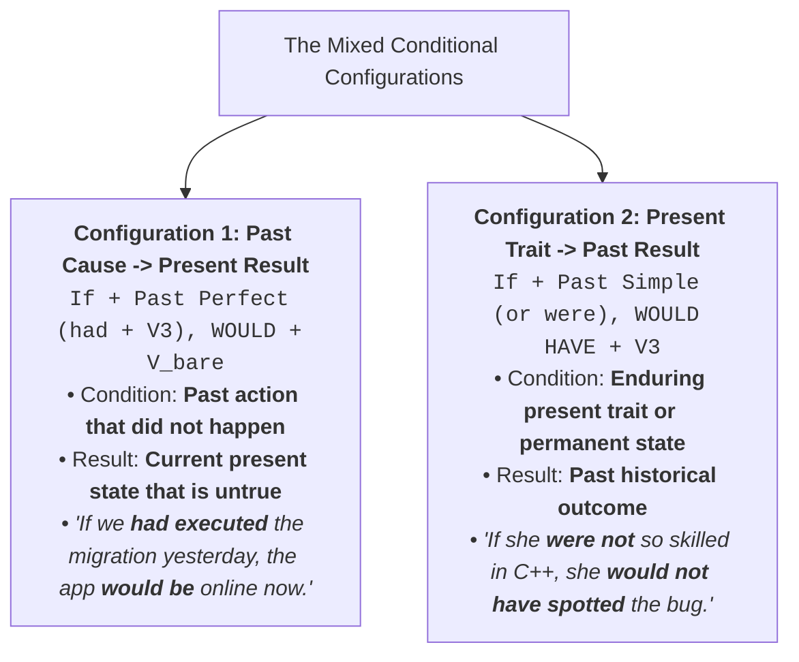
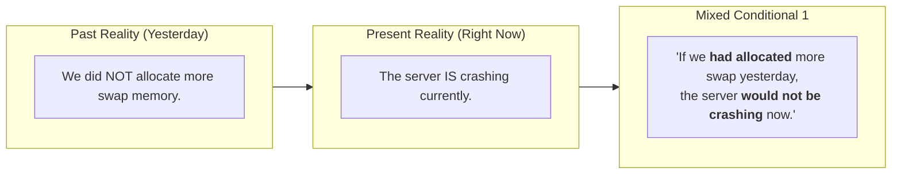
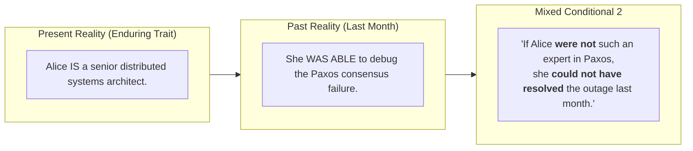

# Mixed Conditionals: Asymmetrical Temporal Syntax and Cross-Time Causality ⏳🔀

> **Level:** CEFR B2–C1 (Cross-Temporal Counterfactuals)  
> **Primary References:** Raymond Murphy (*English Grammar in Use*, Unit 40); Michael Swan (*Practical English Usage*, §22.7)  
> **Core Concept:** Standard conditionals pair symmetrical temporal clauses (Type 2 = Present/Present; Type 3 = Past/Past). However, real-world causality frequently bridges across time: a **past decision creates a present ongoing state**, or an **enduring present capability caused an outcome in the past**. These asymmetrical relationships are expressed through **Mixed Conditionals**.

---

## 1. The Two Primary Mixed Conditional Configurations



### Algebraic Syntax Matrix

| Configuration | *If*-Clause (Condition) | Main Clause (Result) | Cause Timestamp | Result Timestamp | Reality Entailment |
| :--- | :--- | :--- | :---: | :---: | :--- |
| **Type 3 $\rightarrow$ Type 2** | $\mathbf{\text{If}} + \mathbf{\text{had + V3}}$ *(Past Perfect)* | $\mathbf{\text{would}} + \mathbf{V_{\text{bare}}}$ | **PAST** | **PRESENT** | *A past failure caused our current poor state.* |
| **Type 2 $\rightarrow$ Type 3** | $\mathbf{\text{If}} + \mathbf{\text{Past Simple / were}}$ | $\mathbf{\text{would have}} + \mathbf{V3}$ | **PERMANENT / NOW** | **PAST** | *A permanent attribute enabled a past achievement.* |
| **Type 3 $\rightarrow$ Future** | $\mathbf{\text{If}} + \mathbf{\text{had + V3}}$ | $\mathbf{\text{would be}} + \mathbf{\text{V-ing}}$ *(Future)* | **PAST** | **FUTURE** | *A past failure dictates next week's schedule.* |

---

## 2. Configuration 1: Past Cause $\rightarrow$ Present Consequence (Type 3 + Type 2)

This is the most common mixed conditional in software engineering retrospectives. It connects an **unfulfilled past action** to the **current system status right now**:

$$\mathbf{\text{If}} + \mathbf{\text{had + V3}} \dots, \mathbf{\text{would / could / might}} + \mathbf{V_{\text{bare}}} + (\mathbf{now / currently})$$



### Technical Postmortem Examples
- *If the tech lead **had merged** the pull request on Friday, the new features **would be available** to users today.*  
  (Fact: He didn't merge it Friday; the features are not available today).
- *If we **had not introduced** Redis caching last month, our database **would struggle** under this morning's traffic.*  
  (Fact: We did introduce caching; our database is not struggling).
- *If the security team **had rotated** the master keys last week, our cluster **would not be** compromised right now.*

---

## 3. Configuration 2: Present Trait $\rightarrow$ Past Consequence (Type 2 + Type 3)

This configuration explains a **past event** by referencing a **permanent characteristic, enduring skill, or universal policy** that remains true in the present:

$$\mathbf{\text{If}} + \mathbf{\text{Past Simple / were}} \dots, \mathbf{\text{would have + V3}}$$



### Technical Examples
- *If our architecture **were** truly cloud-agnostic, the AWS outage **would not have brought down** our entire platform yesterday.*  
  (Fact: Our architecture is not cloud-agnostic; that's why the outage took us down).
- *If he **spoke** fluent English, he **would have delivered** the international keynote last month.*  
  (Fact: He does not speak fluent English; he didn't deliver the keynote).
- *If this compiler **did not support** SIMD vectorization, our benchmark tests **would have run** much slower.*

---

## 4. Disambiguation: Standard vs. Mixed Conditionals

To avoid temporal errors, compare the timelines side by side:

| Sentence Construction | Condition Time | Result Time | Meaning |
| :--- | :---: | :---: | :--- |
| **Standard Type 2:**<br>*If I had more time, I would help you.* | Present | Present | I don't have time right now, so I cannot help you right now. |
| **Standard Type 3:**<br>*If I had had more time, I would have helped you.* | Past | Past | I didn't have time yesterday, so I didn't help you yesterday. |
| **Mixed 1 (Past $\rightarrow$ Present):**<br>*If I had taken that course, I would know how to do this now.* | Past | Present | I didn't take the course last year; therefore, I don't know how to do this today. |
| **Mixed 2 (Present $\rightarrow$ Past):**<br>*If I were better at Python, I would have finished earlier.* | Permanent | Past | I am generally not great at Python; therefore, I took a long time to finish yesterday. |

---

## 5. Practical Dual-Domain Examples

### Everyday Conversation

1. *If I **had won** the lottery last year, I **would be** a millionaire today.* (Mixed 1)
2. *If he **had taken** his medicine this morning, he **would feel** much better now.* (Mixed 1)
3. *If she **were not** so terrified of flying, she **would have joined** us on the trip to Hawaii.* (Mixed 2)
4. *If we **had booked** the train tickets in advance, we **would not be waiting** in this queue.* (Mixed 1)
5. *If I **spoke** fluent Japanese, I **would have applied** for that job in Tokyo.* (Mixed 2)
6. *If you **had not forgotten** the map, we **would not be** lost right now.* (Mixed 1)
7. *If he **were** more patient, he **would not have lost** his temper during the meeting.* (Mixed 2)
8. *If I **had gone** to medical school, I **would be** working in a hospital today.* (Mixed 1)

### Software Engineering & Technical Documentation

9. *If the DevOps team **had provisioned** auto-scaling last week, our website **would not be timing out** right now.* (Mixed 1)
10. *If our microservices **were not** tightly coupled, the payment gateway failure **would not have cascaded** through the entire system yesterday.* (Mixed 2)
11. *If we **had not migrated** to PostgreSQL 16, query throughput **would be** 40% slower today.* (Mixed 1)
12. *If the lead engineer **were** more familiar with Kubernetes, the cluster provisioning **would not have taken** three weeks.* (Mixed 2)
13. *If the security patch **had been deployed** on Tuesday, the system **would not be** vulnerable today.* (Mixed 1)
14. *If our database **supported** native JSON indexing, we **would not have needed** to deploy an Elasticsearch cluster last quarter.* (Mixed 2)
15. *If you **had subscribed** to our on-call alerting service, you **would be receiving** notifications on your phone right now.* (Mixed 1)
16. *If the code **were** well-tested, the bug **would have been caught** before reaching production.* (Mixed 2)
17. *If we **had signed** the cloud contract in January, we **would be deploying** to multi-region infrastructure next month.* (Past $\rightarrow$ Future)
18. *If the storage engine **were not** thread-safe, the concurrent write stress test **would have corrupted** the file system yesterday.* (Mixed 2)

---

## 6. Common Antipatterns & Diagnostic Table

| Incorrect Antipattern | Corrected Grammar | Rule & Explanation |
| :--- | :--- | :--- |
| ❌ *If we patched it yesterday, it would be fine now.* | ✅ *If we **had patched** it yesterday, it would be fine now.* | Past action in mixed conditional requires Past Perfect (*had patched*). |
| ❌ *If I was knowing Go, I would have built it.* | ✅ *If I **knew** Go, I would have built it.* | Stative present trait requires Past Simple (*knew*), never continuous. |
| ❌ *If he had won, he would have been rich now.* | ✅ *If he had won, he **would be** rich now.* | Present result requires *would + V_bare*, not *would have been*. |
| ❌ *If we had more memory yesterday, we wouldn't crash.* | ✅ *If we **had had** more memory yesterday, we **would not have crashed**.* | Symmetrical past counterfactual requires pure Type 3. |
| ❌ *If the server would have been fast, we'd deploy now.* | ✅ *If the server **were** fast, we **would deploy** now.* | Never put *would have* in the *if*-clause. |

---

## 7. Self-Assessment Exercises

### Exercise 1: Mixed Conditional Configuration Identification
Classify each sentence as **Mixed 1 (Past Cause $\rightarrow$ Present Result)** or **Mixed 2 (Present Trait $\rightarrow$ Past Result)**:

1. *If our company had embraced remote work years ago, we would have a global engineering team today.*
2. *If she were not an expert in distributed databases, the recovery would have taken days instead of hours.*
3. *If you had committed your local changes before rebasing, your branch would not be broken right now.*
4. *If the compiler were more intelligent, it would have optimized that nested loop automatically.*
5. *If the cloud provider had not experienced an outage in Dublin, all our services would be operating normally right now.*

### Exercise 2: Cross-Temporal Conjugation
Supply the correct forms of the verbs in parentheses:

6. If the SRE team (not notice) ________ the memory leak yesterday, our production API (be) ________ completely offline now.
7. If our platform (be) ________ truly resilient, the power surge yesterday (not cause) ________ a full cluster shutdown.
8. If we (implement) ________ rate limiting last sprint, the server (not struggle) ________ with this DDoS attack right now.
9. If he (have) ________ better communication skills, the client (not reject) ________ his architecture proposal last week.
10. If they (not back up) ________ the database on Sunday, we (be) ________ in serious trouble right now.

<details>
<summary>View Complete Answer Key & Diagnostic Explanations</summary>

1. **Mixed 1** (Past decision *had embraced* $\rightarrow$ Present state *would have today*).
2. **Mixed 2** (Present expertise *were not* $\rightarrow$ Past recovery *would have taken*).
3. **Mixed 1** (Past action *had committed* $\rightarrow$ Present state *would not be broken now*).
4. **Mixed 2** (Enduring property of compiler *were* $\rightarrow$ Past action *would have optimized*).
5. **Mixed 1** (Past event *had not experienced* $\rightarrow$ Present state *would be operating now*).
6. **had not noticed** ... **would be** (Past cause $\rightarrow$ Present result).
7. **were** ... **would not have caused** (Enduring trait $\rightarrow$ Past result).
8. **had implemented** ... **would not be struggling** (Past cause $\rightarrow$ Present result).
9. **had** (or *were to have*) ... **would not have rejected** (Enduring trait $\rightarrow$ Past result).
10. **had not backed up** ... **would be** (Past cause $\rightarrow$ Present result).

</details>

---

## 8. Revision Flashcards

```
Q: What is a "Mixed Conditional"?
A: A conditional sentence where the time in the if-clause is different from the time in the result clause (e.g. Past Condition -> Present Result, or Present Trait -> Past Result).

Q: What is the formula for a Past Cause -> Present Result mixed conditional?
A: "If + Past Perfect (had + V3), would + base verb (now)" (e.g., "If we had tested yesterday, the app would work now").

Q: What is the formula for a Present Trait -> Past Result mixed conditional?
A: "If + Past Simple / were (permanent trait), would have + V3 (past event)" (e.g., "If she were not so smart, she wouldn't have solved the bug").

Q: Why can't you say "If we had run the backup, the database would have been healthy now"?
A: The time marker "now" denotes the present. Therefore, the result clause must use the Second Conditional form "would be healthy now", NOT the past form "would have been".

Q: In what context are mixed conditionals most valuable for software engineers?
A: In incident retrospectives and root cause analyses (RCAs) to explain how an earlier engineering action or inaction is directly impacting current system health.
```
