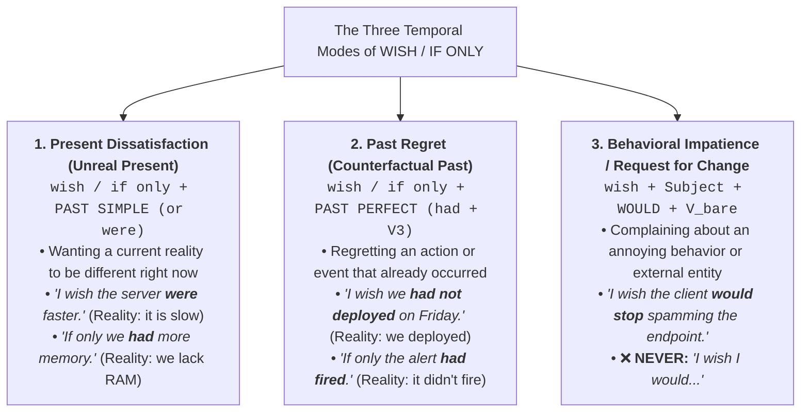
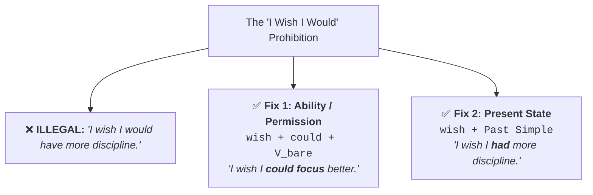
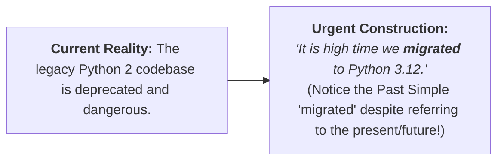

# Wishes, Regrets, and Hypothetical Structures 💭⏪

> **Level:** CEFR B1–C1 (Hypothetical Desirability & Counterfactual Stance)  
> **Primary References:** Raymond Murphy (*English Grammar in Use*, Unit 41); Michael Swan (*Practical English Usage*, §22.9–22.10, §25.3)  
> **Core Concept:** English uses specialized grammatical past tenses (**unreal past / modal past**) to express hypothetical desires contrary to present reality, retrospectively regret past actions, voice impatience with external behavior, and set hypothetical thought experiments. Key structures include **`wish / if only`**, **`it's (high) time`**, and **`as if / as though`**.

---

## 1. The Three Facets of `Wish` and `If Only`

`If only` functions as a more intense, dramatic synonym of `wish`. Both constructions fall into three distinct temporal categories:



### Complete Syntax Matrix

| Construction | Structure | Meaning / Speaker Attitude | Production Engineering Example |
| :--- | :--- | :--- | :--- |
| **Present Wish** | `wish + Past Simple / were` | Dissatisfaction with a current state | *I wish this legacy monolith **were** modular.* |
| **Present Capability** | `wish + could + V_bare` | Desire for an ability one currently lacks | *I wish I **could reproduce** this race condition locally.* |
| **Past Regret** | `wish + had + V3` | Sorrow/regret over an unalterable past event | *The SRE wishes they **had set** lower retry limits.* |
| **Impatience / Desire for Change** | `wish + someone/thing + would + V_bare` | Complaint about an action outside the speaker's control | *I wish the CI runner **would execute** faster.* |

---

## 2. The `I Wish I Would` Prohibition

You cannot use `would` with `wish` when the subject of `wish` and the subject of the subordinate clause are the **same person** (*I wish I...* or *We wish we...*):



> [!CAUTION]
> *Would* implies an appeal or complaint directed at an **external agent**. Because you control your own will, you cannot "complain" about yourself using *would*:
> - ❌ *I wish I would earn more money.*
> - ✅ *I wish I **earned** more money.* (or *I wish I **could earn**...*)
> - ✅ *I wish the company **would pay** me more money.* (External entity $\rightarrow$ *would* is valid!).

---

## 3. `It's High Time`: Expressing Urgency

The construction **`It is (high / about) time + Subject + Past Simple`** indicates that an action is **already overdue** and should happen immediately:

$$\mathbf{\text{It is (high / about) time}} + \mathbf{\text{Subject}} + \mathbf{\text{Past Simple}}$$



- *It is high time management **invested** in automated integration testing.*  
  (Meaning: Management should have invested in this long ago; it is overdue).
- *It's about time the team **updated** the API documentation.*
- *(Alternative infinitive form without subject:* *It is time **to deploy**.*)

---

## 4. `As If` / `As Though`: Hypothetical Manner

`As if` and `as though` describe appearances or behaviors that may be unreal or exaggerated:

### 1. Unreal / Counterfactual Present (Past Simple / `were`)
When the speaker knows the description is contrary to fact:
- *The microservice behaves **as if it were out of memory**.* (Reality: it has plenty of memory; it is leaking file descriptors).
- *He talks about distributed systems **as though he were a principal architect**.* (Reality: he is an intern).

### 2. Unreal Past (Past Perfect)
When the hypothetical comparison refers to a prior event:
- *The database engine threw an exception **as if the disk had vanished**.* (Reality: the disk was intact; an I/O driver timeout occurred).

### 3. Real / Likely Possibility (Present Tense)
When the appearance is likely genuine:
- *It looks **as if the container is crashing**.* (It genuinely seems to be crashing right now).

---

## 5. Practical Dual-Domain Examples

### Everyday Conversation

1. *I wish I **had** a larger kitchen.* (Present dissatisfaction)
2. *I wish I **had not eaten** that second slice of cake.* (Past regret)
3. *If only you **had told** me the truth!* (Past regret with *if only*)
4. *I wish the neighbors **would stop** making noise late at night.* (Impatience with external actor)
5. *It's high time you **cleaned** out your closet.* (Overdue action)
6. *She acted **as if she had never seen** me before.* (Unreal comparison)
7. *I wish I **could speak** fluent Spanish.* (Unreal present capability)
8. *What if we **moved** to the countryside?* (Hypothetical proposal)

### Software Engineering & Technical Documentation

9. *I wish our deployment pipeline **were** ten minutes faster.* (Present dissatisfaction)
10. *The incident commander wishes the team **had executed** a dry-run migration in staging.* (Past regret)
11. *If only the third-party payment gateway **would provide** clear error codes.* (Impatience / complaint)
12. *It is high time the engineering organization **deprecated** TLS 1.0 and 1.1 across all ingress points.* (Overdue urgent reform)
13. *The caching layer acts **as if it were holding** valid data, but the records are actually stale.* (Unreal present)
14. *I wish we **could eliminate** all synchronous cross-service HTTP calls in favor of event queues.* (Desired capability)
15. *The cluster controller logs errors **as though the worker nodes had lost** network connectivity.* (Counterfactual past)
16. *If only we **had captured** a memory heap dump right before the process terminated.* (Postmortem regret)
17. *I wish the product team **would freeze** requirements two weeks before GA release.* (Complaint about external group)
18. *Suppose the primary database **failed** right now; how long would failover take?* (Hypothetical simulation)

---

## 6. Common Antipatterns & Diagnostic Table

| Incorrect Antipattern | Corrected Grammar | Rule & Explanation |
| :--- | :--- | :--- |
| ❌ *I wish I would know the password.* | ✅ *I wish I **knew** the password.* | Cannot use *would* with *I wish I*; use Past Simple (*knew*) or *could*. |
| ❌ *I wish we didn't deploy on Friday.* (past event) | ✅ *I wish we **had not deployed** on Friday.* | Regretting a past completed action strictly requires Past Perfect (*had not deployed*). |
| ❌ *It is high time we update the code.* | ✅ *It is high time we **updated** the code.* | *It is high time + Subject* demands a Past Simple verb (*updated*). |
| ❌ *The node behaves as if it is dead.* (unreal) | ✅ *The node behaves **as if it were** dead.* | Hypothetical, contrary-to-fact manner clauses use the *were* subjunctive. |
| ❌ *I wish the server was faster.* | ✅ *I wish the server **were** faster.* | Subjunctive *were* is preferred in standard/formal English after *wish*. |
| ❌ *If only I would have listened to you.* | ✅ *If only I **had listened** to you.* | *If only* takes Past Perfect (*had listened*) for past regrets, never *would have*. |

---

## 7. Self-Assessment Exercises

### Exercise 1: Wish Aspect Selection
Supply the correct form of the verb in parentheses:

1. I wish our monolithic application (be) ________ easier to test in isolation.
2. The team lead wishes the security auditor (notify) ________ us before publishing the CVE advisory last week.
3. I wish the build runner (not hang) ________ on the end-to-end integration suite every afternoon.
4. If only we (purchase) ________ additional cloud compute capacity before the Black Friday sale.
5. I wish I (can) ________ understand why this race condition only reproduces on Linux.

### Exercise 2: `It's High Time` and `As If` Construction
Rewrite the sentences correctly:

6. It is high time the development team (addresses / addressed) the mounting technical debt.
7. The database driver is throwing connection reset errors as if the network cable (is / were) unplugged.
8. I wish I would be able to deploy updates without downtime.
9. It's about time we (rewrite / rewrote) this legacy Perl script in Go.
10. If only the failover script (would execute / had executed) properly during yesterday's blackout.

<details>
<summary>View Complete Answer Key & Diagnostic Explanations</summary>

1. **were** (Present dissatisfaction: *were* subjunctive).
2. **had notified** (Past regret: Past Perfect *had notified*).
3. **would not hang** (Complaint about an annoying automated behavior: *would + base verb*).
4. **had purchased** (Past regret with *if only*: *had + V3*).
5. **could** (Desire for present capability: *could understand*).
6. **addressed** (*It is high time + Subject + Past Simple*).
7. **were** (*as if* describing an unreal hypothetical situation).
8. **I wish I were able to deploy...** (or *I wish I could deploy...* — eliminate *I wish I would*).
9. **rewrote** (*It's about time + Subject + Past Simple*).
10. **had executed** (Past regret requiring Past Perfect *had executed*).

</details>

---

## 8. Revision Flashcards

```
Q: What tense is used after "wish" to express dissatisfaction with a present situation?
A: Past Simple (or the "were" subjunctive) (e.g., "I wish the server WERE faster", "I wish I HAD more time").

Q: What tense is used after "wish" or "if only" to express regret about a past completed event?
A: Past Perfect (had + V3) (e.g., "I wish we HAD NOT DEPLOYED on Friday", "If only the alert HAD FIRED").

Q: Why is "I wish I would stop procrastinating" ungrammatical?
A: "Wish + would" is strictly restricted to expressing complaints about external actors or uncontrollable entities. You cannot use "would" when the subject of both clauses is the same ("I wish I could stop...").

Q: What verb form must follow "It's (high) time + Subject"?
A: The Past Simple tense (e.g., "It's high time we UPGRADED the database", NOT "we upgrade").

Q: When do you use "as if / as though" with "were"?
A: When describing an appearance or behavior that the speaker knows is contrary to present reality ("The process behaves as if it WERE throttled").
```
