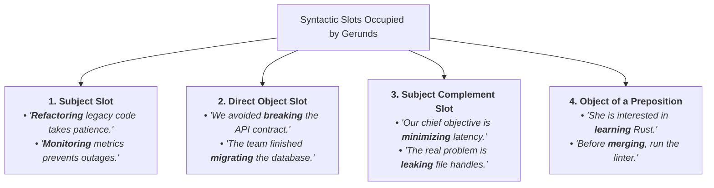
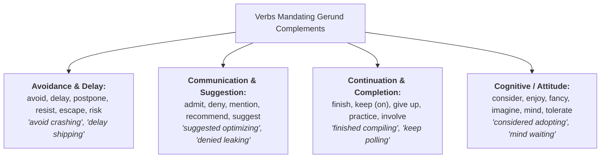
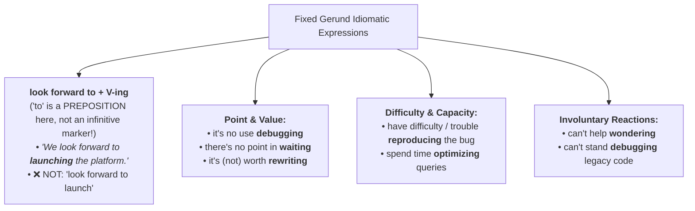
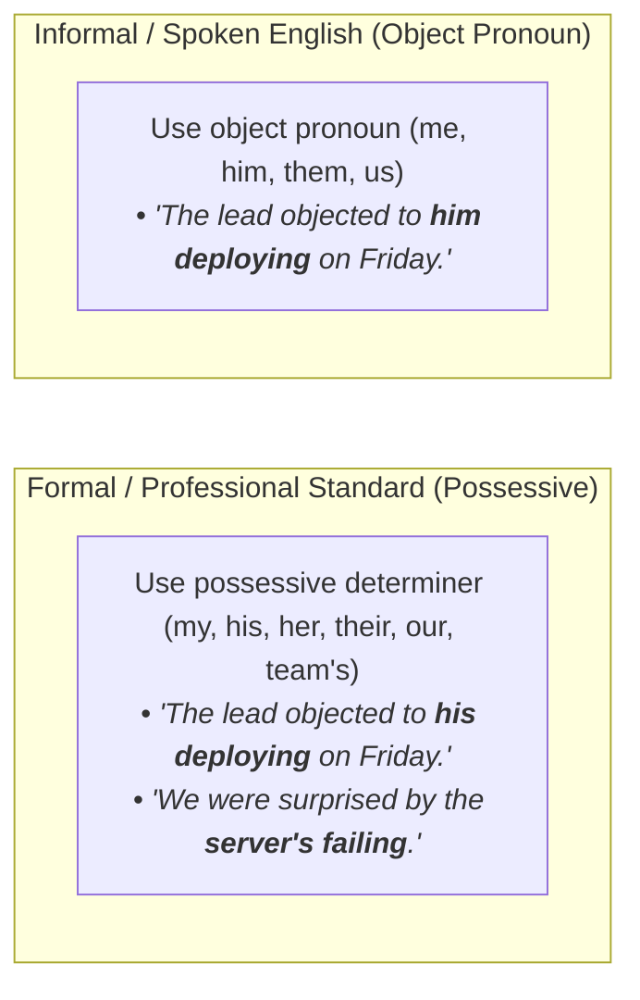

# Gerunds: Syntax, Nominal Roles, and Verb Complementation 🏷️⚖️

> **Level:** CEFR B1–B2 (Nominalization & Verb Regimens)  
> **Primary References:** Raymond Murphy (*English Grammar in Use*, Units 53, 56–58, 60–63); Michael Swan (*Practical English Usage*, §8)  
> **Core Concept:** A **gerund** is a non-finite verbal form produced by affixing `-ing` to a base verb that functions syntactically as a **noun**. While preserving verb-like properties (taking direct objects and adverbial modifiers), a gerund occupies nominal slots: **Subject, Direct Object, Subject Complement, and Object of a Preposition**.

---

## 1. Syntactic Distribution of Gerunds



### Verbal Properties within the Gerund Phrase
Although the gerund acts as a noun within the matrix clause, it internally behaves like a verb:
1. **It takes direct objects:** * **Refactoring** [the authentication controller] (Object) takes time.*
2. **It is modified by adverbs (not adjectives):** * **Refactoring** [meticulously] (Adverb) takes time.*
3. **It can be negated:** *We decided on **not deploying** the container on Friday.*

---

## 2. Verbs Followed Strictly by Gerunds

Certain matrix verbs strictly mandate a gerund complement and **forbid a to-infinitive**:



### High-Frequency Verb Complementation Table

| Verb | Meaning | Correct Gerund Pattern | ❌ Fatal Infinitive Bug |
| :--- | :--- | :--- | :--- |
| **`avoid`** | Stay clear of | *We **avoid hardcoding** credentials.* | ❌ *avoid to hardcode* |
| **`consider`** | Contemplate | *The team is **considering migrating** to gRPC.* | ❌ *considering to migrate* |
| **`delay` / `postpone`**| Put off in time | *We **postponed releasing** the major version.* | ❌ *postponed to release* |
| **`deny`** | State untruth of | *The contractor **denied leaking** the source code.* | ❌ *denied to leak* |
| **`enjoy`** | Take pleasure in | *Engineers **enjoy building** distributed tools.* | ❌ *enjoy to build* |
| **`finish`** | Complete action | *The cron job **finished aggregating** data.* | ❌ *finished to aggregate* |
| **`involve`** | Require/entail | *Refactoring **involves updating** unit tests.* | ❌ *involves to update* |
| **`risk`** | Expose to danger | *Deploying without tests **risks corrupting** state.* | ❌ *risks to corrupt* |
| **`suggest`** | Propose | *She **suggested caching** the query results.* | ❌ *suggested to cache* |

> [!CAUTION]
> Non-native speakers frequently say *She suggested me to do it*. *Suggest* **never** takes an infinitive with a person:
> - ❌ *The tech lead suggested us to use Docker.*
> - ✅ *The tech lead **suggested using** Docker.* (Gerund)
> - ✅ *The tech lead **suggested that we use** Docker.* (*That*-clause with subjunctive)

---

## 3. Fixed Idiomatic Expressions Taking Gerunds

English contains fixed idioms that grammatically demand a gerund:



### The `Look Forward To` Preposition Invariant
In the phrase *look forward to*, the word `to` is a **preposition**, NOT an infinitive particle:
- ❌ *We look forward to meet you at the conference.*
- ✅ *We look forward to **meeting** you at the conference.*
- ❌ *I look forward to receive your pull request.*
- ✅ *I look forward to **receiving** your pull request.*

---

## 4. The Possessive with Gerunds: Formal vs. Informal

When a noun or pronoun precedes a gerund to identify **who** is performing the non-finite action:



In technical specifications, academic documentation, and formal correspondence, the **possessive form** is preferred because the gerund is syntactically a noun:
- *We appreciate **your taking** the time to review this RFC.* (Formal standard).
- *What was the reason for **the database's crashing**?* (Formal standard).

---

## 5. Practical Dual-Domain Examples

### Everyday Conversation

1. * **Swimming** every morning keeps me energized throughout the day.* (Subject)
2. *I really enjoy **reading** historical fiction on rainy afternoons.* (Direct object)
3. *She apologized for **arriving** late to the dinner party.* (Prepositional complement)
4. *There is no point in **worrying** about things beyond your control.* (Idiom)
5. *I look forward to **seeing** you again next weekend.* (*Look forward to*)
6. *He admitted **making** a careless mistake on the spreadsheet.* (Admit + gerund)
7. *Do you mind **closing** the window? It's freezing outside.* (Mind + gerund)
8. *We had serious difficulty **finding** the venue in the dark.* (Have difficulty + gerund)

### Software Engineering & Technical Documentation

9. * **Profiling** application memory allocations in production helps isolate memory leaks.* (Subject)
10. *Our team decided to avoid **deploying** breaking changes without a six-month deprecation notice.* (Avoid + gerund)
11. *The database administrator suggested **partitioning** the large transactional table by year.* (Suggest + gerund)
12. *Refactoring this legacy networking layer involves **rewriting** the underlying socket wrappers.* (Involve + gerund)
13. *It is not worth **maintaining** backward compatibility for unsupported runtime versions.* (It's not worth)
14. *The background worker finished **processing** all 500,000 asynchronous messages.* (Finish + gerund)
15. *We look forward to **collaborating** with the open-source community on this RFC.* (Look forward to)
16. *The engineering director objected to **our merging** the pull request without approval.* (Formal possessive)
17. *The gateway risks **exposing** internal microservices if mTLS authentication is bypassed.* (Risk + gerund)
18. *The team spent two weeks **debugging** an obscure concurrency race condition.* (Spend time doing)

---

## 6. Common Antipatterns & Diagnostic Table

| Incorrect Antipattern | Corrected Grammar | Rule & Explanation |
| :--- | :--- | :--- |
| ❌ *We avoided to break the build.* | ✅ *We avoided **breaking** the build.* | *Avoid* strictly takes a gerund complement, never an infinitive. |
| ❌ *The architect suggested to use Go.* | ✅ *The architect suggested **using** Go.* | *Suggest* cannot take a to-infinitive directly. |
| ❌ *I look forward to hear from you.* | ✅ *I look forward to **hearing** from you.* | *To* in *look forward to* is a preposition, requiring a gerund (`-ing`). |
| ❌ *He is good in programming.* | ✅ *He is good **at programming**.* | Adjectives of skill take *at + gerund*. |
| ❌ *There is no point to wait for it.* | ✅ *There is no point in **waiting** for it.* | Fixed idiom: *there is no point (in) + gerund*. |
| ❌ *Refactor code is essential.* | ✅ * **Refactoring** code is essential.* | A bare verb cannot sit in the subject slot; use the nominal gerund. |
| ❌ *She suggested me to update.* | ✅ *She suggested **that I update**.* / *...suggested **updating**.* | *Suggest* cannot take the double object pattern *suggest someone to do*. |

---

## 7. Self-Assessment Exercises

### Exercise 1: Gerund vs. Infinitive Selection
Supply the correct gerund form of the verb in parentheses:

1. The developer admitted (commit) ________ unencrypted API tokens to the repository.
2. We should avoid (introduce) ________ tightly coupled dependencies between services.
3. The principal architect suggested (implement) ________ an asynchronous message queue.
4. Have you considered (migrate) ________ our workloads to ARM64 instances?
5. The deployment automation finished (provision) ________ the virtual private cloud.

### Exercise 2: Prepositions & Idiomatic Gerund Traps
Correct the grammatical bug in each sentence:

6. The engineering team looks forward to release version 3.0 next month.
7. It is not worth to maintain support for outdated browser versions.
8. We had immense difficulty in reproduce the intermittent network timeout.
9. Deploy without automated tests risks to introduce severe regression bugs.
10. The tech lead objected to him merging the code without peer review. (Revise for formal style)

<details>
<summary>View Complete Answer Key & Diagnostic Explanations</summary>

1. **committing** (*admit + gerund*).
2. **introducing** (*avoid + gerund*).
3. **implementing** (*suggest + gerund*).
4. **migrating** (*consider + gerund*).
5. **provisioning** (*finish + gerund*).
6. The engineering team looks forward to **releasing** version 3.0 next month. (*To* is a preposition).
7. It is not worth **maintaining** support for outdated browser versions. (*It's not worth + gerund*).
8. We had immense difficulty in **reproducing** the intermittent network timeout. (*Preposition in + gerund*).
9. **Deploying** without automated tests risks **introducing** severe regression bugs. (Subject gerund + *risk* takes gerund).
10. The tech lead objected to **his merging** the code without peer review. (Formal possessive before gerund).

</details>

---

## 8. Revision Flashcards

```
Q: What is a gerund and what syntactic roles can it occupy?
A: A verbal noun ending in "-ing". It occupies nominal slots: Subject, Direct Object, Subject Complement, and Object of a Preposition.

Q: Name five common verbs that strictly mandate a gerund complement.
A: Avoid, consider, delay, finish, postpone, recommend, risk, suggest.

Q: Why is "I look forward to see you" grammatically incorrect?
A: The "to" in "look forward to" is a preposition, not an infinitive marker. All prepositions must be followed by a gerund ("look forward to seeing you").

Q: Why can't you say "The architect suggested us to use Redis"?
A: "Suggest" cannot take the pattern "suggest + person + to-infinitive". You must say "suggested USING Redis" or "suggested THAT WE USE Redis".

Q: What is the formal rule for pronouns preceding a gerund (e.g. "him deploying" vs. "his deploying")?
A: In formal English, use a possessive determiner before a gerund ("his deploying", "our reviewing"), because the gerund functions as a noun.
```
