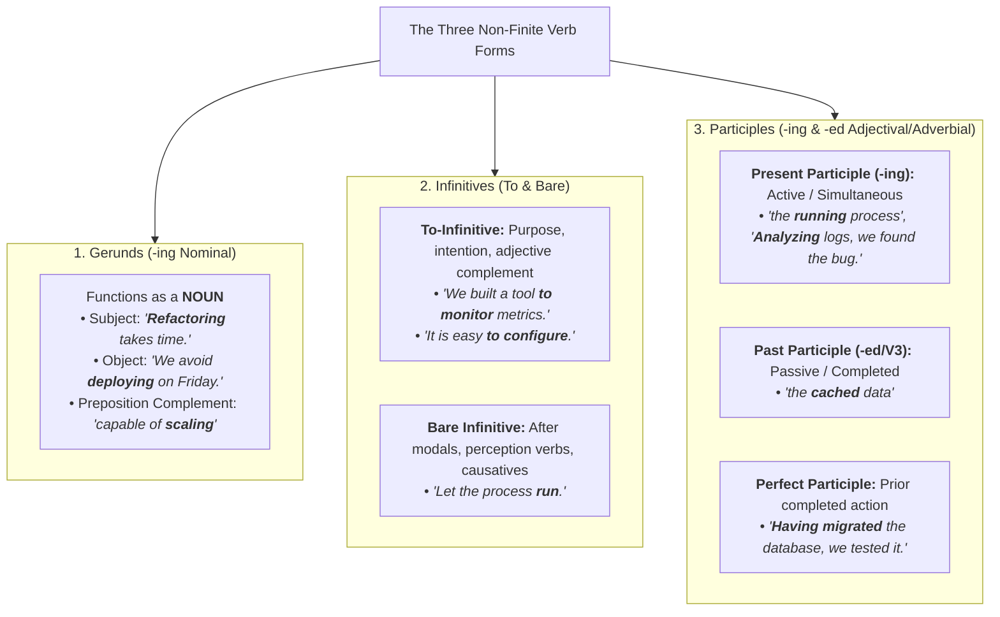

# Module 11: Non-Finite Verbs (Verbals) ⚙️🧬

> **Level:** CEFR B1–C1 (Non-Finite Syntax & Clausal Compression)  
> **Primary References:** Raymond Murphy (*English Grammar in Use*, Units 53–68); Michael Swan (*Practical English Usage*, §8–10)  
> **Core Concept:** Unlike finite verbs, **non-finite verbs (verbals)** do not conjugate for person, number, or grammatical tense. They function as **nouns** (Gerunds), **adjectives/adverbs** (Participles), or **goals/purposes/complements** (Infinitives). In technical writing, non-finite structures provide **clausal compression**—condensing wordy subordinate clauses into sleek, dense, and precise engineering statements.

---

## 1. The Non-Finite Verb Taxonomy



---

## 2. Topic Curriculum

This module contains **4 comprehensive deep-dive guides**:

| Guide | Core Focus | Target CEFR | Authoritative Literature |
| :--- | :--- | :---: | :--- |
| **01. [Gerunds: Syntax and Roles](gerunds-syntax-and-roles.md)** | Nominal distribution (subject, object, complement), verbs strictly taking gerunds (*avoid, postpone, suggest*), possessive with gerund | B1–B2 | Murphy Units 53, 56–58; Swan §8 |
| **02. [Infinitives: To-Infinitives and Bare Infinitives](infinitives-to-and-bare.md)** | Infinitives of purpose, adjective complements, verbs strictly taking infinitives (*decide, manage, promise*), bare infinitives with causatives and perception | B1–B2 | Murphy Units 54–55, 64–66; Swan §9 |
| **03. [Verbs Taking Gerund or Infinitive (Semantic Shifts)](verbs-taking-gerund-or-infinitive.md)** | Verbs with no meaning shift (*begin, continue*), verbs with radical semantic divergence (*remember, forget, stop, try, regret, mean, go on*) | B1–C1 | Murphy Units 56–58; Swan §10.1 |
| **04. [Participial Clauses and Reduced Relatives](participial-clauses-and-reduced-relatives.md)** | Present, past, and perfect participial clauses, reduced relative clause compression, and eliminating dangling participle bugs | B2–C1 | Murphy Unit 68; Swan §10.2–10.4 |

---

## 3. Verbal Selection Decision Tree

```mermaid
graph TD
    StartVerbal["Choosing Between Gerund and Infinitive"]
    
    StartVerbal --> IsPrep{"Does the verb directly follow a PREPOSITION?"}
    IsPrep -->|YES: After Preposition| UseGerund["<b>USE GERUND (-ing) 100% OF THE TIME!</b><br/>• <i>'interested in <b>learning</b>'</i><br/>• <i>'before <b>deploying</b>'</i><br/>• <i>'responsible for <b>monitoring</b>'</i>"]
    
    IsPrep -->|NO: After a Verb| CheckVerbCategory{"What is the matrix verb?"}
    CheckVerbCategory -->|Verbs of Avoidance, Suggestion, Ongoing State| VerbGerund["<b>Use Gerund:</b><br/>avoid, consider, delay, deny, enjoy, finish, postpone, suggest"]
    CheckVerbCategory -->|Verbs of Intent, Decision, Future Goal| VerbInf["<b>Use To-Infinitive:</b><br/>agree, decide, hope, manage, plan, promise, refuse, tend"]
    CheckVerbCategory -->|Dual Verbs (remember, stop, try)| SemanticCheck["<b>Check Semantic Shift:</b><br/>• stop to do (pause to act) vs. stop doing (terminate)<br/>• remember to do (task) vs. remember doing (memory)"]
```

---

## 4. Cross-Reference Directory
- **Prepositions:** [Dependent Prepositions: Nouns & Adjectives](../07-prepositions/dependent-prepositions-nouns-and-adjectives.md) (The rule that prepositions are **always** followed by gerunds).
- **Voice:** [Impersonal & Advanced Passives](../09-voice-and-reported-speech/impersonal-and-advanced-passives.md) (Passive infinitives *to be done* and passive gerunds *being done*).
- **Disambiguation:** [Comparisons & Disambiguation](../13-comparisons-and-disambiguation/) (Dedicated matrix: *Gerund vs. Infinitive*).
