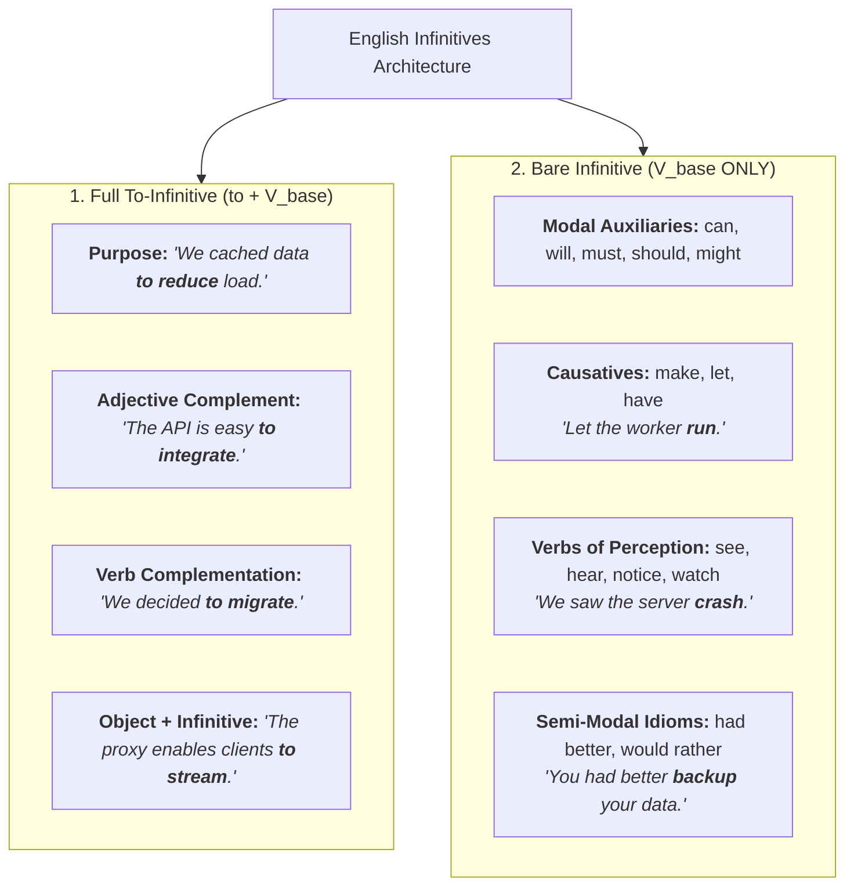
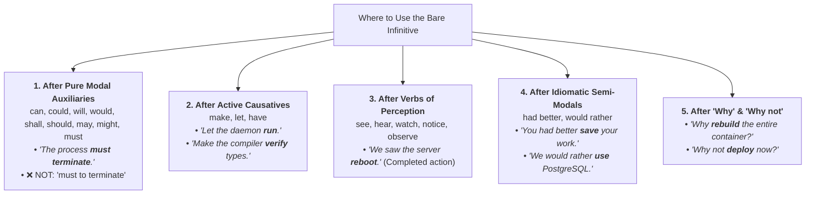

# Infinitives: To-Infinitives and Bare Infinitives 🎯🔓

> **Level:** CEFR B1–B2 (Infinitival Complementation & Modal Syntax)  
> **Primary References:** Raymond Murphy (*English Grammar in Use*, Units 54–55, 64–66); Michael Swan (*Practical English Usage*, §9)  
> **Core Concept:** An infinitive is the base, uninflected form of a verb. In English syntax, infinitives appear in two distinct varieties: the **To-Infinitive** (preceded by the particle `to`, expressing **purpose, future intentions, and adjectival complementation**) and the **Bare Infinitive** (the uninflected base verb without `to`, strictly mandated after **modal auxiliaries, causative verbs, perception verbs, and idioms like *had better***).

---

## 1. The To-Infinitive vs. Bare Infinitive Taxonomy



---

## 2. Syntactic Functions of the To-Infinitive

### 1. The Infinitive of Purpose (`in order to` / `so as to`)
The to-infinitive directly expresses **goal or intended outcome**. In formal or technical writing, it can be expanded into *in order to* or *so as to*:
- *We introduced database sharding **to handle** 500,000 concurrent write operations.*
- *The pipeline runs smoke tests **in order to prevent** regressions in production.*
- *The daemon throttles outgoing packets **so as not to overwhelm** the downstream gateway.*

> [!CAUTION]
> Never use *for + infinitive* to express purpose:
> - ❌ *We use Redis for store sessions.*
> - ✅ *We use Redis **to store** sessions.* (or *for storing sessions*).

### 2. Adjective Complementation (`Adjective + to-infinitive`)
- *The new GraphQL endpoint is remarkably simple **to consume**.*
- *It is impossible **to decrypt** AES-256 ciphertext without the private key.*
- *The distributed cluster is resilient enough **to survive** a regional blackout.*

### 3. Verbs Followed Strictly by the To-Infinitive
These verbs express intention, future projection, decision, or failure:

| Verb | Meaning | Correct To-Infinitive Pattern | ❌ Fatal Gerund Bug |
| :--- | :--- | :--- | :--- |
| **`decide`** | Form a resolution | *We **decided to adopt** Rust.* | ❌ *decided adopting* |
| **`manage`** | Succeed despite difficulty | *The SRE **managed to restore** the cluster.* | ❌ *managed restoring* |
| **`fail`** | Be unsuccessful | *The process **failed to bind** to port 80.* | ❌ *failed binding* |
| **`refuse`** | Decline to act | *The gateway **refused to forward** the payload.* | ❌ *refused forwarding* |
| **`agree`** | Consent | *The client **agreed to sign** the SLA.* | ❌ *agreed signing* |
| **`promise`** | Pledge | *The vendor **promised to fix** the CVE.* | ❌ *promised fixing* |
| **`tend`** | Have a predisposition | *Unindexed queries **tend to consume** high CPU.*| ❌ *tend consuming* |
| **`afford`** | Have financial/resource capability | *We cannot **afford to lose** this data.* | ❌ *afford losing* |

### 4. Matrix Pattern: `Verb + Person/Object + To-Infinitive`
These verbs involve instructing, allowing, or causing another entity to perform an action:

$$\mathbf{\text{Subject}} + \mathbf{\text{Verb}} + \mathbf{\text{Object}} + \mathbf{\text{to-infinitive}}$$

- *The API gateway **allows authenticated clients to query** internal endpoints.*
- *The tech lead **instructed the team to halt** the rollout.*
- *Automated health checks **enable the orchestrator to evict** unhealthy pods.*
- *The security team **warned developers not to expose** debug ports.*
- *(Common verbs in this class: `advise, allow, cause, enable, encourage, expect, forbid, force, instruct, permit, remind, require, teach, tell, warn`).*

---

## 3. The Bare Infinitive (Infinitive Without `To`)

The bare infinitive is strictly required in five specific syntactic environments:



### Perception Verbs: Bare Infinitive vs. Present Participle
Verbs of sensory perception (*see, hear, watch, notice, observe, feel*) display a subtle aspectual contrast:

| Construction | Aspectual Meaning | Technical Example Sentence |
| :--- | :--- | :--- |
| **`Verb + Object + Bare Infinitive`** | **Complete event:** witnessed the entire action from start to finish | *The engineer watched the node **drain** all traffic and shut down.* |
| **`Verb + Object + Present Participle (-ing)`** | **Ongoing event:** witnessed the action in progress (simultaneous) | *The engineer watched the node **draining** traffic when the alert fired.* |

---

## 4. The "Split Infinitive" Phenomenon

A split infinitive occurs when an adverb is placed between the particle `to` and the bare verb:

$$\mathbf{\text{to}} + \mathbf{\text{[Adverb]}} + \mathbf{\text{Verb}}$$

- *to **boldly** go where no man has gone before*
- *to **completely** refactor the legacy persistence layer*

> [!NOTE]
> **Modern Stylistic Consensus:**  
> The 19th-century prohibition against split infinitives was an artificial rule imported from Latin (where the infinitive is a single indivisible word, e.g., *amare*). In modern English, **split infinitives are completely standard and often necessary** to avoid awkwardness or ambiguity:
> - *Natural & Clear:* *We need **to thoroughly test** this module.*
> - *Awkward Un-split:* *We need thoroughly to test this module.*
> - *Ambiguous:* *We need to test thoroughly this module.*

---

## 5. Practical Dual-Domain Examples

### Everyday Conversation

1. *I decided **to learn** French before moving to Montreal.* (To-infinitive)
2. *She went to the grocery store **to buy** some fresh vegetables.* (Infinitive of purpose)
3. *Could you please **let me speak**?* (Bare infinitive after *let*)
4. *You had better **leave** now if you want to catch the 5:00 PM train.* (Bare infinitive)
5. *He managed **to finish** the marathon despite the heavy rain.* (Manage + to-infinitive)
6. *I heard the thunder **rumble** in the distance.* (Perception verb)
7. *The teacher encouraged the students **to ask** questions.* (Verb + Object + to-infinitive)
8. *Why not **call** him directly to clear up the confusion?* (Why not + bare)

### Software Engineering & Technical Documentation

9. *The deployment pipeline triggers automated tests **to verify** backward compatibility.* (Purpose)
10. *Our infrastructure team managed **to restore** the corrupted partition without data loss.* (Manage)
11. *The cloud provider allows users **to provision** dedicated GPU instances.* (Allow + obj + to)
12. *The memory leak caused the worker process **to terminate** unexpectedly.* (Cause + obj + to)
13. *The operating system kernel will not let unprivileged processes **bind** to port 443.* (Bare infinitive)
14. *We watched the database replica **catch up** with the primary write-ahead log.* (Perception bare)
15. *You had better **rotate** the leaked AWS credentials immediately.* (Had better + bare)
16. *The architecture is intentionally designed **to easily scale** horizontally.* (Split infinitive)
17. *The gateway refused **to forward** the unauthenticated HTTP request.* (Refuse)
18. *Why **re-architect** the entire system when a localized caching layer suffices?* (Why + bare)

---

## 6. Common Antipatterns & Diagnostic Table

| Incorrect Antipattern | Corrected Grammar | Rule & Explanation |
| :--- | :--- | :--- |
| ❌ *We use Redis for store sessions.* | ✅ *We use Redis **to store** sessions.* | Purpose is expressed with a to-infinitive, not *for + bare verb*. |
| ❌ *You had better to backup the database.* | ✅ *You had better **backup** the database.* | *Had better* strictly requires a bare infinitive, never a *to-infinitive*. |
| ❌ *The policy makes us to use MFA.* | ✅ *The policy makes us **use** MFA.* | Active causative *make* takes a bare infinitive. |
| ❌ *The microservice failed restarting.* | ✅ *The microservice failed **to restart**.* | *Fail* takes a to-infinitive complement, never a gerund. |
| ❌ *The manager let him to leave early.* | ✅ *The manager let him **leave** early.* | Causative *let* strictly mandates a bare infinitive. |
| ❌ *We must to encrypt all database records.* | ✅ *We must **encrypt** all database records.* | Pure modal auxiliaries take bare infinitives, never *to*. |
| ❌ *The tool enables developers build apps.* | ✅ *The tool enables developers **to build** apps.* | *Enable + object* strictly requires a *to-infinitive*. |

---

## 7. Self-Assessment Exercises

### Exercise 1: To-Infinitive vs. Bare Infinitive Selection
Supply the correct infinitival form (with or without `to`):

1. The site reliability team managed (recover) ________ the deleted volume from S3 snapshots.
2. The orchestrator will make the unhealthy container (restart) ________ immediately.
3. We implemented an asynchronous buffer so as not (block) ________ the main event loop.
4. You had better (verify) ________ the TLS certificate fingerprints before approving the connection.
5. The cloud platform allows organizations (enforce) ________ granular RBAC permissions.

### Exercise 2: Infinitival Error Repair
Correct the grammatical error in each sentence:

6. The automated script runs every midnight for aggregate application metrics.
7. The security team warned the developers do not deploy without static analysis.
8. We watched the cluster nodes to fail one after another during the network partition.
9. Why to rebuild the container when you can simply patch the configuration file?
10. The company cannot afford losing its compliance certification.

<details>
<summary>View Complete Answer Key & Diagnostic Explanations</summary>

1. **to recover** (*manage* takes a to-infinitive).
2. **restart** (Active causative *make* takes a bare infinitive).
3. **to block** (*so as not to block* — infinitive of purpose).
4. **verify** (*had better* takes a bare infinitive).
5. **to enforce** (*allow + object + to-infinitive*).
6. The automated script runs every midnight **to aggregate** application metrics. (Infinitive of purpose).
7. The security team warned the developers **not to deploy** without static analysis. (*warn + object + not to-infinitive*).
8. We watched the cluster nodes **fail** one after another... (Perception verb *watch* takes bare infinitive).
9. Why **rebuild** the container... (*Why* + bare infinitive for rhetorical questions).
10. The company cannot afford **to lose** its compliance certification. (*afford* takes a to-infinitive).

</details>

---

## 8. Revision Flashcards

```
Q: What is an Infinitive of Purpose? Give an example.
A: Using a to-infinitive (or "in order to") to express the goal of an action (e.g., "We added indexes TO SPEED UP queries", NOT "for speed up").

Q: Name four environments where the BARE infinitive (without "to") is mandatory.
A: (1) After modal auxiliaries (can, will, must); (2) after active causatives (make, let, have); (3) after perception verbs (see, hear, watch); (4) after "had better" and "would rather".

Q: Why is "The manager made the developer to stay" ungrammatical?
A: In the active voice, the causative verb "make" takes a bare infinitive without "to" ("The manager made the developer STAY").

Q: Contrast the bare infinitive versus the present participle after verbs of perception (e.g. "We saw the server reboot" vs. "We saw the server rebooting").
A: The bare infinitive ("reboot") implies witnessing the entire completed action from start to finish. The participle ("rebooting") implies witnessing the action ongoing in progress.

Q: Is the "split infinitive" (e.g., "to thoroughly test") considered acceptable in modern English?
A: Yes! Modern English style guides universally recognize split infinitives as natural, clear, and often necessary to avoid ambiguity.
```
