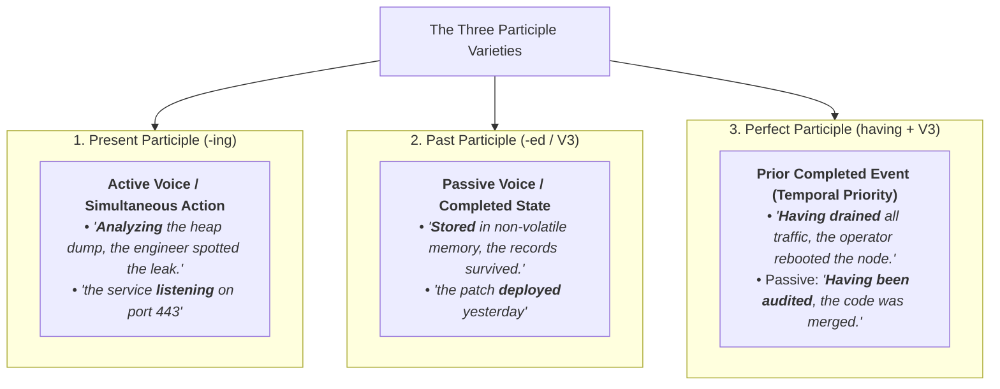
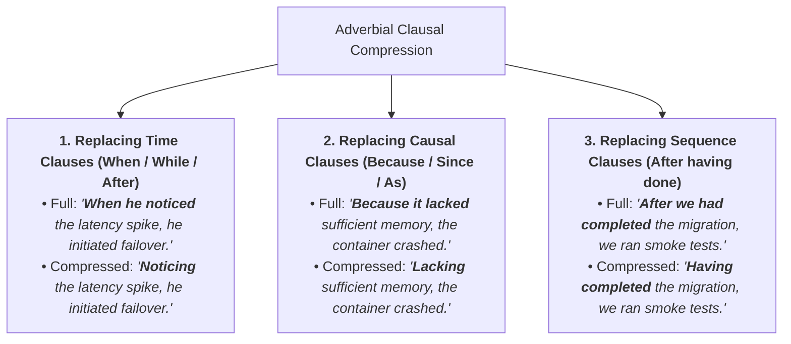
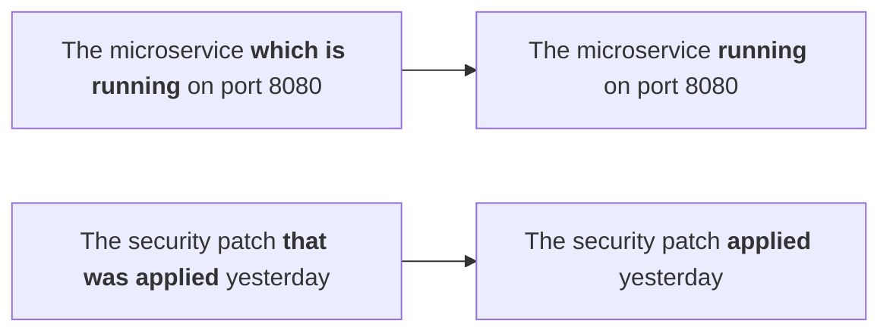
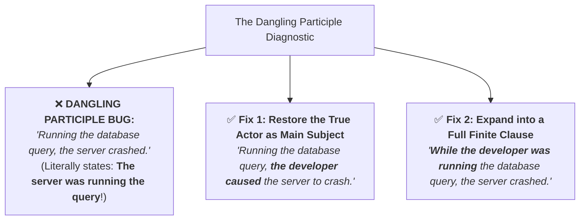

# Participial Clauses, Reduced Relatives, and Dangling Participle Elimination ✂️🧩

> **Level:** CEFR B2–C1 (Clausal Compression & Syntactic Attachment)  
> **Primary References:** Raymond Murphy (*English Grammar in Use*, Unit 68); Michael Swan (*Practical English Usage*, §10.2–10.4)  
> **Core Concept:** Participial clauses are non-finite clausal structures that condense full adverbial or relative clauses into economical, elegant phrases. They express **simultaneous actions, causal explanations, temporal sequences, and adjectival qualification**. However, English syntax strictly enforces the **Subject Attachment Law**: the unstated agent of a participial clause must be grammatically identical to the subject of the main clause to prevent **dangling participles**.

---

## 1. The Tripartite Participle Architecture



---

## 2. Clausal Compression: Adverbial Clauses $\rightarrow$ Participial Clauses

Participial clauses streamline sentences by replacing wordy conjunctions (*when, because, after, since*):



### Contrast Table

| Full Subordinate Clause | Compressed Participial Clause | Logical Relationship |
| :--- | :--- | :---: |
| *Because the team **had completed** the sprint early, they celebrated.* | * **Having completed** the sprint early, the team celebrated.* | Cause + Prior Action |
| *While the worker thread **was scanning** the disk, it found corrupted sectors.* | * **Scanning** the disk, the worker thread found corrupted sectors.* | Simultaneous Time |
| *Because it **was compiled** with optimization flags, the binary ran fast.* | * **Compiled** with optimization flags, the binary ran fast.* | Passive Cause |
| *The database crashed, **and this left** orphaned connections.* | *The database crashed, **leaving** orphaned connections.* | Resulting Consequence |

---

## 3. Reduced Relative Clauses

A reduced relative clause strips away the relative pronoun and the auxiliary verb `be`, leaving only the participle:



- *All containers **[that are] hosting** payment services must enforce mTLS.*
- *The configuration parameters **[which were] defined** in `.env` override defaults.*
- *Any user **[who is] attempting** brute-force authentication will be rate-limited.*

---

## 4. The Cardinal Syntactic Bug: The Dangling Participle

The **Subject Attachment Rule** dictates: **The implicit subject of the participle MUST be the exact grammatical subject of the main clause**. If they do not match, the participle is left "dangling" (erroneously attached to an unintended subject):



### High-Frequency Technical Dangling Participles

| ❌ Dangling Antipattern | Who actually did the action? | ✅ Grammatically Correct Revision |
| :--- | :--- | :--- |
| ❌ *Looking through the logs, the error was discovered.* | The logs didn't look; the engineer did! | ✅ *Looking through the logs, **the engineer discovered** the error.* |
| ❌ *Having drained the cluster, the upgrade began.* | The upgrade didn't drain; the SRE did! | ✅ *Having drained the cluster, **the SRE began** the upgrade.* |
| ❌ *Using an unindexed column, the query ran slowly.* | The query didn't use itself; the code used it. | ✅ * **Because the query used** an unindexed column, it ran slowly.* |
| ❌ *After rebooting the host, the network issue disappeared.* | The network issue didn't reboot the host. | ✅ *After **the engineer rebooted** the host, the issue disappeared.* |

---

## 5. Absolute Clauses (Independent Subjects)

An **Absolute Clause** is a participial clause that possesses its **own overt grammatical subject**, making it syntactically independent of the main clause:

$$\mathbf{\text{Noun / Pronoun}} + \mathbf{\text{Participle (-ing / -ed)}} \dots, \mathbf{\text{Main Clause}}$$

- * **The migration having concluded**, the engineering team updated the DNS records.*  
  (Subject 1: *The migration*; Subject 2: *the engineering team* $\rightarrow$ Fully legal!).
- * **Time permitting**, we will conduct additional performance benchmarks tomorrow.*
- * **All dependencies having been verified**, the compiler began linking the object files.*

---

## 6. Practical Dual-Domain Examples

### Everyday Conversation

1. * **Hearing** a strange sound downstairs, she grabbed a flashlight.* (Simultaneous active)
2. * **Exhausted** by the long hike, they fell asleep immediately.* (Passive state)
3. * **Having lost** his keys, he had to wait outside until his roommate arrived.* (Perfect participle)
4. *She sat on the balcony, **drinking** a cup of hot tea.* (Simultaneous manner)
5. *The package **delivered** yesterday was addressed to the previous tenant.* (Reduced relative)
6. * **Weather permitting**, we will have a picnic in the park on Sunday.* (Absolute clause)
7. * **Knowing** her love for classical music, I bought her symphony tickets.* (Causal participle)
8. *He walked out of the room, **slamming** the door behind him.* (Resulting action)

### Software Engineering & Technical Documentation

9. * **Analyzing** the JVM thread dump, the engineer identified a severe deadlock between worker threads.*
10. * **Having migrated** all tenant data to PostgreSQL 16, the database administrator decommissioned the MySQL cluster.*
11. *The reverse proxy drops incoming requests **originating** from blacklisted IP ranges.* (Reduced relative)
12. * **Stored** in volatile memory, the session state does not persist across node restarts.* (Passive participle)
13. *The primary storage volume reached capacity, **causing** all write transactions to fail.* (Resulting consequence)
14. * **Having been audited** by a third-party cybersecurity firm, the smart contract was deployed to mainnet.* (Passive perfect participle)
15. *The microservice **running** on port 8080 routes decrypted traffic to downstream pods.* (Reduced relative)
16. * **Resource limits permitting**, the orchestrator will schedule three additional replicas.* (Absolute clause)
17. * **Noticing** the sudden latency spike, the automated circuit breaker tripped within 200 milliseconds.*
18. * **Having verified** the SHA-256 checksums, the sysadmin installed the Linux kernel update.*

---

## 7. Common Antipatterns & Diagnostic Table

| Incorrect Antipattern | Corrected Grammar | Rule & Explanation |
| :--- | :--- | :--- |
| ❌ *Reviewing the PR, a bug was found.* | ✅ *Reviewing the PR, **the architect found** a bug.* | Dangling participle: the bug did not review the PR; the architect did. |
| ❌ *Having crashed, the engineer restarted the pod.* | ✅ *Having crashed, **the pod was restarted** by the engineer.* | Dangling participle: the engineer did not crash; the pod crashed. |
| ❌ *The microservice running in port 8080.* (as full sentence) | ✅ *The microservice **runs** on port 8080.* | Sentence fragment: a participial phrase cannot serve as the finite verb of a clause. |
| ❌ *Being unindexed, the query took long.* | ✅ * **Because it was unindexed**, the query took long.* | Stylistically weak dangling *being*; explicit causal conjunction is clearer. |
| ❌ *After deploy the patch, we verified.* | ✅ *After **deploying** the patch, we verified.* | Preposition *after* requires a gerund (`-ing`), not a base verb. |
| ❌ *Having been completed the build, we deployed.* | ✅ * **Having completed** the build, we deployed.* | False passive: the active perfect participle is *having completed*. |

---

## 8. Self-Assessment Exercises

### Exercise 1: Identifying & Repairing Dangling Participles
Identify which sentences contain a dangling participle. If dangling, rewrite the sentence correctly:

1. *Inspecting the network traffic, several unencrypted HTTP headers were observed.*
2. *Having failed three consecutive health checks, the pod was terminated by the orchestrator.*
3. *Walking into the server room, the heat was overwhelming.*
4. *Configured with default parameters, the database struggled under production load.*
5. *After analyzing the crash dump, the memory leak was fixed by the junior developer.*

### Exercise 2: Clausal Compression into Participles
Compress the full subordinate clauses into participial phrases:

6. *Because the engineer had worked all night on the outage, he took Friday off.*  
   $\rightarrow$ ________ on the outage, the engineer took Friday off.
7. *The server instances that are deployed in region `us-west-2` handle California traffic.*  
   $\rightarrow$ The server instances ________ California traffic.
8. *When the daemon detected the corrupted block, it triggered an automated rebuild.*  
   $\rightarrow$ ________, the daemon triggered an automated rebuild.
9. *After the team had tested the failover mechanism thoroughly, they scheduled the production rollout.*  
   $\rightarrow$ ________ thoroughly, the team scheduled the production rollout.
10. *The configuration parameters that were defined in YAML overrode the environment variables.*  
    $\rightarrow$ The configuration parameters ________ overrode the environment variables.

<details>
<summary>View Complete Answer Key & Diagnostic Explanations</summary>

1. **Dangling** — The headers didn't inspect traffic. Fix: *Inspecting the network traffic, **the engineer observed** several unencrypted HTTP headers.*
2. **Valid** — The pod failed the checks, and the pod is the subject of the main clause.
3. **Dangling** — The heat didn't walk into the room. Fix: *Walking into the server room, **the technician felt** overwhelming heat.*
4. **Valid** — The database was configured with default parameters.
5. **Dangling** — The memory leak didn't analyze the dump. Fix: *After analyzing the crash dump, **the junior developer fixed** the memory leak.*
6. **Having worked all night** (Perfect active participle).
7. **deployed in region `us-west-2` handle** (Reduced passive relative).
8. **Detecting the corrupted block** (Present participle of simultaneous action).
9. **Having tested the failover mechanism** (Perfect participle indicating completed prior action).
10. **defined in YAML** (Reduced passive relative).

</details>

---

## 9. Revision Flashcards

```
Q: What is a participial clause?
A: A non-finite clause headed by a present participle (-ing), past participle (-ed), or perfect participle (having done) that acts as an adverbial modifier or compressed relative clause.

Q: What is the "Subject Attachment Rule" for participial clauses?
A: The implicit subject of the participle MUST be identical to the grammatical subject of the main clause following it.

Q: What is a "dangling participle"? Give an example.
A: A participle whose implied subject does not match the subject of the main clause (e.g., "Reviewing the code, a bug was found" — literally states that the bug reviewed the code).

Q: How do you fix a dangling participle?
A: Either: (1) make the true actor the subject of the main clause ("Reviewing the code, THE ENGINEER found a bug"), or (2) expand the participle into a full finite clause ("While the engineer was reviewing the code, a bug was found").

Q: What is an "Absolute Clause"?
A: A participial clause that has its own overt noun subject, making it grammatically independent of the main clause ("The tests having passed, we deployed the code").
```
