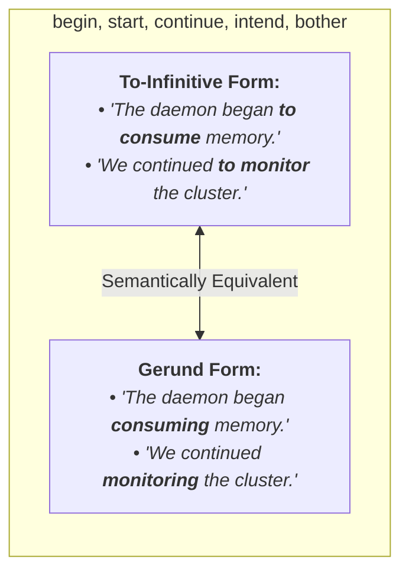
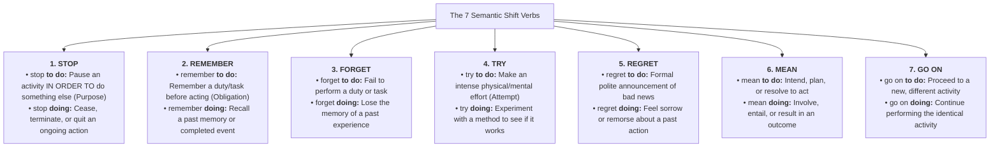

# Verbs Taking Either Gerund or Infinitive (Semantic Shift Matrices) 🔀🔍

> **Level:** CEFR B1–C1 (Aspectual Complementation & Semantic Shifts)  
> **Primary References:** Raymond Murphy (*English Grammar in Use*, Units 56–58); Michael Swan (*Practical English Usage*, §10.1)  
> **Core Concept:** While some English verbs take either a gerund or a to-infinitive with negligible difference in meaning (*begin, continue*), a crucial class of dual-complementation verbs undergoes a **radical, categorical semantic shift** depending on whether they are paired with a **Gerund (referring to past experiences, ongoing processes, or experiments)** or a **To-Infinitive (referring to future obligations, purpose, or conscious effort)**.

---

## 1. Group 1: Verbs with No Significant Semantic Shift

A small set of aspectual verbs permits either complementation form with almost identical meaning:



> [!TIP]
> **The Horror Aequi Rule (Avoiding Double `-ing`):**  
> If the matrix verb is already in the continuous tense (`-ing`), standard English style strongly prefers the **to-infinitive** to prevent awkward phonetic repetition:
> - *Awkward:* *The system is starting failing.*
> - *Preferred:* *The system is **starting to fail**.*

---

## 2. Group 2: The 7 Critical Semantic Shift Verbs



---

## 3. Exhaustive Contrast Matrices

### 1. `Stop to do` vs. `Stop doing`

| Form | Meaning & Mechanism | Technical Computing Example |
| :--- | :--- | :--- |
| **`stop + to-infinitive`** | **Pause an existing activity in order to initiate a new task** (*Infinitive of Purpose*) | *The on-call engineer was writing code, but he **stopped to inspect** the production alert.* |
| **`stop + gerund`** | **Terminate, halt, or cease an ongoing process completely** | *The background daemon **stopped emitting** heartbeats at 02:15 UTC.* |

> [!CAUTION]
> - *We stopped **to debug** the code.* = We interrupted our current work so that we could debug.
> - *We stopped **debugging** the code.* = We ceased debugging and closed our debuggers.

---

### 2. `Remember to do` vs. `Remember doing`

| Form | Meaning & Temporal Sequence | Example Sentence |
| :--- | :--- | :--- |
| **`remember + to-infinitive`** | **First remember $\rightarrow$ Then perform the task** (Duty / Obligation) | *Always **remember to sanitize** inputs before executing SQL queries.* |
| **`remember + gerund`** | **First perform the action $\rightarrow$ Later recall the memory** | *I **remember reviewing** that pull request last Tuesday.* |

---

### 3. `Try to do` vs. `Try doing`

| Form | Meaning & Mechanism | Technical Computing Example |
| :--- | :--- | :--- |
| **`try + to-infinitive`** | **Make an effort to accomplish something difficult** (Success uncertain) | *The client **tried to establish** a TLS socket, but the firewall blocked it.* |
| **`try + gerund`** | **Experiment with a technique or troubleshooting step as a test** | *If the pod is unresponsive, **try restarting** the container runtime.* |

---

### 4. `Regret to do` vs. `Regret doing`

| Form | Meaning & Pragmatics | Example Sentence |
| :--- | :--- | :--- |
| **`regret + to-infinitive`** | **Formal delivery of unpleasant information** (*regret to inform / say*) | *We **regret to inform** you that your API quota has been exceeded.* |
| **`regret + gerund`** | **Remorse regarding a past action that actually happened** | *The architect **regretted approving** the premature migration.* |

---

### 5. `Mean to do` vs. `Mean doing`

| Form | Meaning | Example Sentence |
| :--- | :--- | :--- |
| **`mean + to-infinitive`** | **Intend / Consciously plan** | *I did not **mean to drop** the primary database table.* |
| **`mean + gerund`** | **Involve / Entail as an inevitable consequence** | *Adopting microservices **means managing** distributed transactions.* |

---

### 6. `Go on to do` vs. `Go on doing`

| Form | Meaning | Example Sentence |
| :--- | :--- | :--- |
| **`go on + to-infinitive`** | **Complete one task and transition to the next milestone** | *After optimizing the schema, the team **went on to build** the caching layer.* |
| **`go on + gerund`** | **Continue executing the same ongoing action without interruption** | *The worker thread **went on polling** the queue despite network drops.* |

---

## 4. Practical Dual-Domain Examples

### Everyday Conversation

1. *Please **remember to lock** the front door when you leave.* (Duty)
2. *I distinctly **remember locking** the front door this morning.* (Memory)
3. *He was walking home when he **stopped to tie** his shoelace.* (Purpose)
4. *She **stopped smoking** three years ago.* (Termination)
5. *I **tried to open** the jammed window, but it wouldn't budge.* (Effort)
6. *If you have a headache, **try drinking** a large glass of water.* (Experiment)
7. *We **regret to announce** that flight 302 has been delayed.* (Formal bad news)
8. *I deeply **regret saying** those hurtful words.* (Past remorse)

### Software Engineering & Technical Documentation

9. *The developers **stopped to analyze** the memory profiler output.* (Interrupted work to analyze)
10. *The database engine **stopped accepting** new connections after hitting the socket limit.* (Ceased)
11. *Make sure you **remember to rotate** the master encryption keys every ninety days.* (Duty)
12. *I **remember configuring** the CORS headers, but they seem to have been overwritten.* (Memory)
13. *The client **tried to reconnect** five times before throwing a timeout exception.* (Effort)
14. *If you experience high CPU utilization, **try enabling** jemalloc.* (Troubleshooting experiment)
15. *We **regret to inform** our enterprise customers that service in region `ap-east-1` is degraded.* (Formal announcement)
16. *The team **regretted deploying** the untested hotfix directly to production on Friday night.* (Postmortem regret)
17. *Migrating to a multi-cloud strategy **means accepting** increased network complexity.* (Entails)
18. *After successfully deprecating the legacy REST API, the SRE team **went on to implement** gRPC services.* (New task transition)

---

## 5. Common Antipatterns & Diagnostic Table

| Incorrect Antipattern | Corrected Grammar | Rule & Explanation |
| :--- | :--- | :--- |
| ❌ *We stopped debugging to eat dinner.* (meaning ceased) | ✅ *We **stopped debugging** and ate dinner.* | *Stopped to eat* means paused *in order to eat*; *stopped debugging* means ceased. |
| ❌ *Remember backing up your data daily!* | ✅ * **Remember to back up** your data daily!* | Future duty/task requires *remember + to-infinitive*. |
| ❌ *I'll never forget to see that eclipse.* | ✅ *I'll never **forget seeing** that eclipse.* | Recalling a vivid past experience requires *forget + gerund*. |
| ❌ *Try to reboot if it freezes.* (troubleshooting) | ✅ * **Try rebooting** if it freezes.* | Experimenting with a potential solution requires *try + gerund*. |
| ❌ *We regret informing you of the delay.* | ✅ *We **regret to inform** you of the delay.* | Formal delivery of unfortunate news strictly uses *regret to inform*. |
| ❌ *It is starting raining.* | ✅ *It is **starting to rain**.* | Horror aequi: avoid consecutive `-ing` verbs. |
| ❌ *Using microservices means to manage complexity.* | ✅ *Using microservices **means managing** complexity.* | Expressing consequences/entailment requires *mean + gerund*. |

---

## 6. Self-Assessment Exercises

### Exercise 1: Semantic Disambiguation
Choose between the **to-infinitive** and the **gerund** based on the context:

1. Did you remember (commit / committing) your changes before shutting down your workstation?
2. The sysadmin was monitoring logs, but she stopped (reboot / rebooting) the secondary node.
3. The cluster stopped (process / processing) incoming webhooks after the database reached disk capacity.
4. If your container fails to start, try (increase / increasing) the memory allocation limit.
5. We regret (inform / informing) our users that maintenance has been extended by two hours.

### Exercise 2: Contextual Diagnostics
Select the correct form to express the intended engineering meaning:

6. *Meaning: We intended to patch the vulnerability, but ran out of time.*  
   $\rightarrow$ We meant (to patch / patching) the vulnerability during the last sprint.
7. *Meaning: Transitioning to Kubernetes entails learning complex networking.*  
   $\rightarrow$ Transitioning to Kubernetes means (to learn / learning) complex networking.
8. *Meaning: After completing the security audit, the team proceeded to refactor the database.*  
   $\rightarrow$ The team went on (to refactor / refactoring) the database.
9. *Meaning: The worker thread continued running its loop uninterrupted.*  
   $\rightarrow$ The worker thread went on (to run / running) its loop uninterrupted.
10. *Meaning: The team attempted with great difficulty to reverse-engineer the proprietary binary.*  
    $\rightarrow$ The team tried (to reverse-engineer / reverse-engineering) the binary.

<details>
<summary>View Complete Answer Key & Diagnostic Explanations</summary>

1. **to commit** (Remembering a duty/obligation before acting).
2. **to reboot** (Interrupted monitoring *in order to* reboot the secondary node).
3. **processing** (Ceased/terminated the ongoing action).
4. **increasing** (Experimenting with a troubleshooting technique).
5. **to inform** (Formal delivery of unfortunate news).
6. **to patch** (*mean to do* = intend/plan).
7. **learning** (*mean doing* = involve/entail).
8. **to refactor** (*go on to do* = transition to a new task).
9. **running** (*go on doing* = continue the same action).
10. **to reverse-engineer** (*try to do* = make a difficult attempt).

</details>

---

## 7. Revision Flashcards

```
Q: What is the difference between "stopped to debug" and "stopped debugging"?
A: "Stopped to debug" means paused an existing activity IN ORDER TO debug (purpose). "Stopped debugging" means ceased/quit the debugging process entirely (termination).

Q: Contrast "remember to do" with "remember doing".
A: "Remember to do" refers to a duty or task you must not forget to perform (forward-looking). "Remember doing" refers to a past memory or experience you recall (backward-looking).

Q: What is the difference between "try to restart" and "try restarting"?
A: "Try to restart" implies making a difficult effort to achieve the action (success uncertain). "Try restarting" implies easily performing the restart as an experiment to see if it solves a problem.

Q: What does "mean doing" mean, compared to "mean to do"?
A: "Mean to do" signifies conscious intention ("I meant to call you"). "Mean doing" signifies involvement or inevitable consequence ("Scaling means adding servers").

Q: Why do we say "We regret to inform you" instead of "We regret informing you"?
A: "Regret to inform/say" is a polite formal formula for communicating bad news in the present. "Regret doing" expresses remorse over a past mistake.
```
