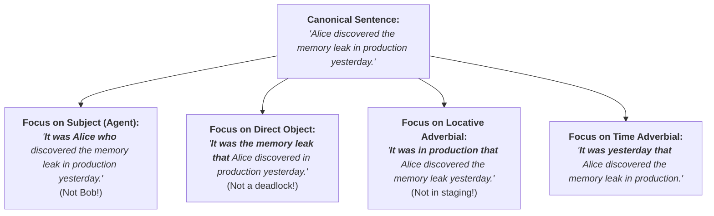
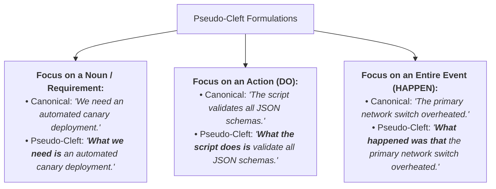

# Cleft Sentences: It-Clefts, Wh-Clefts, and Information Packaging 🔦🎯

> **Level:** CEFR B2–C1 (Information Structure & Focus Mechanics)  
> **Primary References:** Michael Swan (*Practical English Usage*, §25.2–25.3)  
> **Core Concept:** In standard discourse, English places new information at the end of a clause (**end-focus principle**). However, when a writer needs to shine an intense rhetorical spotlight on a specific constituent (a culprit, a root cause, an essential requirement, or a contrasting element), English **cleaves (splits)** a single clause into two distinct parts via a **Cleft Sentence** (*It-Cleft* or *Wh-Pseudo-Cleft*).

---

## 1. The Anatomy of an `It`-Cleft Sentence

An *It*-cleft allows you to focus on virtually any syntactic element of a sentence (except the main verb itself):

$$\mathbf{It} + \mathbf{BE_{\text{tense}}} + \mathbf{\text{Focused Element}} + \mathbf{that / who} + \mathbf{\text{Remainder of Clause}}$$



### Agreement Nuances in `It`-Clefts
1. **Pronoun Case in Formal English:**
   - In formal writing, use the subject pronoun: *It was **she who** discovered the flaw.* (Informal: *It was **her who**...*).
2. **Verb Agreement in the Relative Clause:**
   - The verb in the relative clause formally agrees with the focused pronoun:
     - *It is **I who am** responsible for the deployment.* (Formal).
     - *It is **me that is** responsible for the deployment.* (Informal spoken).

---

## 2. The Anatomy of `Wh`-Clefts (Pseudo-Clefts)

While *It*-clefts highlight a specific entity by isolating it at the front, **`Wh`-clefts (Pseudo-clefts)** build anticipation by placing the entire given context into a relative clause headed by `what`, pushing the focused element to the **end position**:

$$\mathbf{\text{What-Clause}} + \mathbf{BE} + \mathbf{\text{Focused Element / Requirement}}$$



### The Bare Infinitive Rule with `What ... does is`
When focusing on a verb using `What [subject] does is...`, the following verb can be either a **bare infinitive** or a **to-infinitive** (bare infinitive is preferred in modern technical writing):
- *What the caching daemon does is **intercept** database read calls.* (Preferred).
- *What the caching daemon does is **to intercept** database read calls.* (Permissible).

---

## 3. Reversed Clefts & `All`-Clefts

### 1. Reversed `Wh`-Clefts
Placing the focused element at the very beginning of the sentence before the *what*-clause creates an assertive, concluding tone:

$$\mathbf{\text{Focused Element}} + \mathbf{BE} + \mathbf{\text{what-clause}}$$

- *An automated canary deployment is **what we need**.*
- *Predictable latency is **what our enterprise clients care about**.*
- *A single corrupted pointer was **what brought down the cluster**.*

### 2. `All`-Clefts (Limiting / Minimizing Focus)
Using `all` instead of `what` emphasizes that the action is minimal, simple, or singular:

$$\mathbf{All} + \mathbf{\text{Subject + Verb}} + \mathbf{BE} + \mathbf{\text{Focused Element}}$$

- * **All we did was** restart the worker process.* (Minimizing effort).
- * **All the system requires is** an inbound TCP socket on port 443.* (Minimizing dependency).
- * **All I want is** zero-downtime database upgrades.*

---

## 4. Practical Dual-Domain Examples

### Everyday Conversation

1. * **It was John who** suggested taking the coastal road.* (Subject focus)
2. * **It was in Paris that** they first met.* (Place focus)
3. * **What I really need right now is** a cup of strong coffee.* (Wh-cleft)
4. * **All she wanted was** an honest apology.* (All-cleft)
5. *A good night's sleep is **what you need**.* (Reversed cleft)
6. * **What happened was that** our flight was delayed by four hours.* (Event focus)
7. * **It was because of the traffic that** we arrived late.* (Reason focus)
8. * **What he did was** apologize immediately to everyone involved.* (Action focus)

### Software Engineering & Technical Documentation

9. * **It was a memory leak in the telemetry agent that** triggered the node out-of-memory panic.* (RCA culprit focus)
10. * **It was during the database failover that** three hundred transactions were dropped.* (Time focus)
11. * **What this architecture lacks is** an asynchronous message queue between ingress and persistence.* (Wh-cleft requirement)
12. * **What the garbage collector actually does is** sweep unreachable objects in ephemeral generations.* (Action focus)
13. * **All the deployment script does is** pull the container image and update the Helm release.* (Minimizing complexity)
14. *Sub-millisecond read latency is **what makes Redis indispensable** for our session store.* (Reversed cleft)
15. * **It is customer data integrity that** we must prioritize above all else.* (Value focus)
16. * **What happened was that** the rate limiter misclassified legitimate webhooks as a DDoS attack.* (Incident explanation)
17. * **It was with the release of version 2.0 that** the API achieved enterprise stability.* (Milestone focus)
18. *A distributed consensus deadlock was **what caused the cluster to hang**.* (Reversed cleft)

---

## 5. Common Antipatterns & Diagnostic Table

| Incorrect Antipattern | Corrected Grammar | Rule & Explanation |
| :--- | :--- | :--- |
| ❌ *There was Alice who fixed the bug.* | ✅ * **It was Alice who** fixed the bug.* | Cleft sentences for focal identification strictly use *It + BE*, never *There was*. |
| ❌ *What we need are more servers.* | ✅ * **What we need is** more servers.* | A singular *what*-clause acting as subject takes singular copula *is* in standard English. |
| ❌ *It was the database what failed.* | ✅ *It was the database **that** failed.* | *It*-clefts use *that* (or *who* for people), never *what*. |
| ❌ *What the script does is to updating records.* | ✅ *What the script does is **update** records.* | After *does is*, use the bare infinitive (*update*), never a gerund. |
| ❌ *It is yesterday that we deployed.* | ✅ * **It was** yesterday that we deployed.* | The copular *be* in an *it*-cleft must agree in tense with the relative clause (*deployed* $\rightarrow$ *was*). |
| ❌ *All what we need is an index.* | ✅ * **All we need is** an index.* / * **What we need is**...* | Do not combine *all* with *what*; say *All we need* or *What we need*. |

---

## 6. Self-Assessment Exercises

### Exercise 1: Transforming Canonical Sentences into Cleft Sentences
Convert the canonical sentence into the specified cleft form:

1. Canonical: *The firewall blocked the incoming webhook.*  
   $\rightarrow$ *Focus on Subject (It-cleft):* It was ________.
2. Canonical: *The database crashed during the backup process.*  
   $\rightarrow$ *Focus on Time/Event (It-cleft):* It was ________.
3. Canonical: *We need a centralized logging pipeline.*  
   $\rightarrow$ *Wh-Pseudo-Cleft:* What ________.
4. Canonical: *The script only clears the temporary cache directory.*  
   $\rightarrow$ *All-Cleft:* All the script ________.
5. Canonical: *Microservice decoupling solved our scalability bottleneck.*  
   $\rightarrow$ *Reversed Wh-Cleft:* Microservice decoupling was ________.

### Exercise 2: Cleft Structure Diagnostics
Correct the grammatical or stylistic error in each sentence:

6. There was the DNS misconfiguration that caused the global outage yesterday.
7. What the continuous integration runner does is executing all unit tests in parallel.
8. It is the authentication service that failed during the deployment last night.
9. All what the developer did was changing a single environment variable.
10. It was Bob which discovered the unauthorized access attempt.

<details>
<summary>View Complete Answer Key & Diagnostic Explanations</summary>

1. **It was the firewall that** blocked the incoming webhook.
2. **It was during the backup process that** the database crashed.
3. **What we need is** a centralized logging pipeline.
4. **All the script does is** clear the temporary cache directory.
5. Microservice decoupling was **what solved our scalability bottleneck**.
6. **It was the DNS misconfiguration that** caused the global outage yesterday. (Replaced *There was* with *It was*).
7. What the continuous integration runner does is **execute** all unit tests in parallel. (Bare infinitive *execute*).
8. **It was** the authentication service that failed during the deployment last night. (Tense agreement: *failed* $\rightarrow$ *was*).
9. **All the developer did was change** a single environment variable. (Removed redundant *what*; bare infinitive *change*).
10. It was Bob **who** discovered the unauthorized access attempt. (Human antecedent takes *who*, not *which*).

</details>

---

## 7. Revision Flashcards

```
Q: What is the primary communicative purpose of a cleft sentence?
A: To split a clause into two parts to place intense rhetorical focus or contrast on one specific element (e.g. identifying the culprit or core requirement).

Q: What is the formula for an "It-Cleft" sentence?
A: "It + BE (in appropriate tense) + Focused Element + that/who + remainder of clause" (e.g., "It was Alice who committed the fix").

Q: What is a "Wh-Pseudo-Cleft" and what is its typical formula?
A: A cleft sentence starting with a what-clause that pushes the focus to the end of the sentence: "What + S + V + IS/WAS + focused element" ("What we need is a better database").

Q: What verb form should follow "What the script does is..."?
A: A bare infinitive (e.g., "What the script does is VALIDATE the payload", NOT "is validating").

Q: Why is "There was the database that crashed" incorrect for focal emphasis?
A: Cleft sentences for focal identification strictly use "It was [element] that...", never existential "There was".
```
