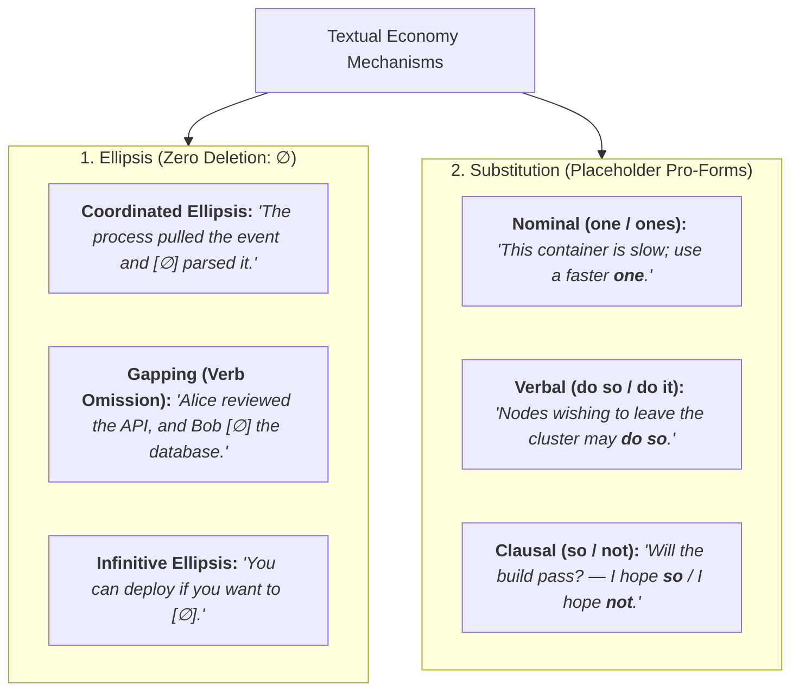
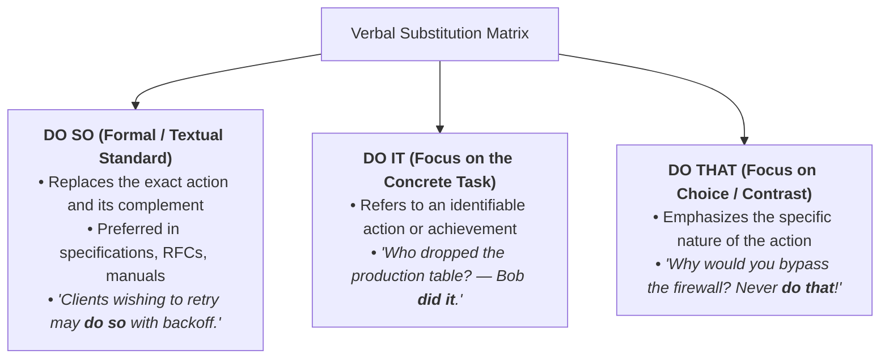
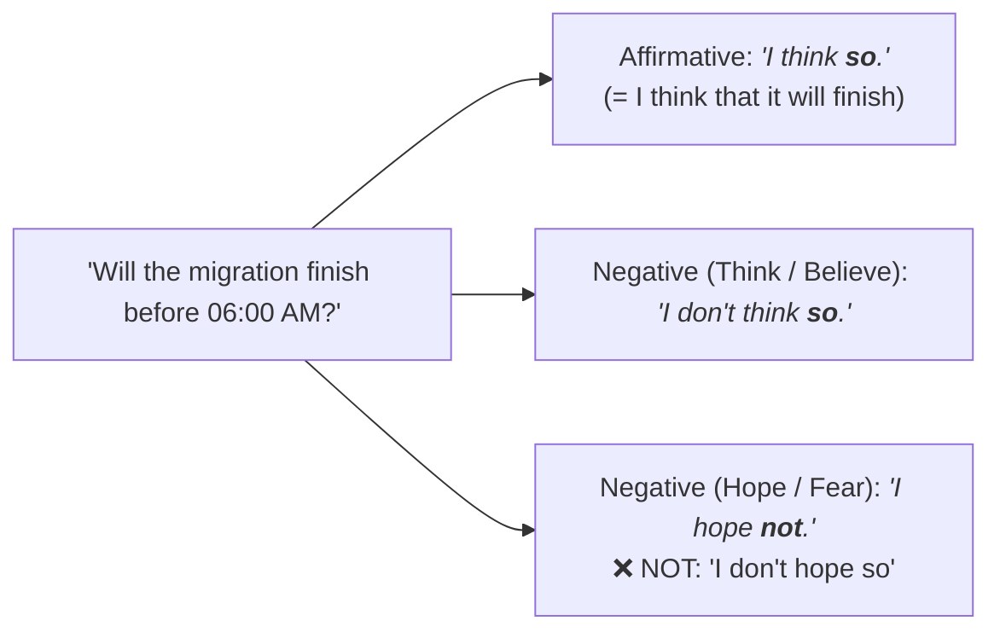

# Ellipsis and Substitution: Principles of Textual Economy ✂️🎯

> **Level:** CEFR B2–C2 (Discourse Economy & Syntactic Reduction)  
> **Primary References:** Michael Swan (*Practical English Usage*, §20.8, §25.6)  
> **Core Concept:** Sophisticated written and technical English prizes **textual economy**—communicating complex information concisely without redundant repetition. English achieves this through **Ellipsis** (the deliberate grammatical omission of words that are unambiguously recoverable from the context) and **Substitution** (replacing a repeated noun, verb phrase, or entire clause with pro-forms such as **`one / ones`**, **`do so`**, and **`so / not`**).

---

## 1. The Ellipsis vs. Substitution Dichotomy



---

## 2. Ellipsis: Types and Mechanics

### 1. Coordinated Clausal Ellipsis
When two independent clauses are joined by coordinating conjunctions (*and, but, or*), shared grammatical elements can be deleted to avoid clunky repetition:

| Type of Ellipsis | Full Repetitive Sentence | Streamlined Elliptical Sentence |
| :--- | :--- | :--- |
| **Identical Subject** | *The daemon parsed the log and **the daemon** logged an alert.* | *The daemon parsed the log and **logged an alert**.* |
| **Identical Auxiliary**| *The servers have been patched and **have been** rebooted.* | *The servers have been **patched and rebooted**.* |
| **Identical Predicate**| *Node A passed all checks, and Node B **passed all checks too**.* | *Node A passed all checks, and **Node B did too**.* |
| **Gapping (Middle Verb)**| *PostgreSQL handles writes, and Redis **handles** reads.* | *PostgreSQL handles writes, and Redis, **reads**.* |

### 2. Infinitive Ellipsis (Reduced `To`)
When a to-infinitive has already been mentioned in the discourse, the verb phrase can be omitted, leaving only the grammatical particle `to`:
- *The script didn't restart the cluster because it was not configured **to** [restart the cluster].*
- *You don't have to review the documentation tonight if you don't want **to**.*

### 3. Informal Situational Ellipsis
In daily engineering standups, Slack channels, and conversational English, unstressed words at the start of a sentence (subjects, auxiliary verbs, articles) are colloquially dropped:
- * **[Have you]** seen the latest pull request?* $\rightarrow$ *Seen the latest PR?*
- * **[It]** looks good to me.* $\rightarrow$ *Looks good to me (LGTM).*
- * **[I]** couldn't reproduce the bug.* $\rightarrow$ *Couldn't reproduce the bug.*

---

## 3. Substitution: Pro-Forms for Nouns, Verbs, and Clauses

### 1. Nominal Substitution: `One` and `Ones`
`One` (singular) and `ones` (plural) substitute for countable nouns to avoid repetition after an adjective or determiner:
- *We benchmarked several algorithms; the fastest **one** was radix sort.*
- *These unit tests are failing, but the integration **ones** are passing.*

> [!CAUTION]
> `One / ones` can **never** substitute for uncountable mass nouns:
> - ❌ *This memory is volatile; we need permanent one.*
> - ✅ *This memory is volatile; we need **permanent memory**.*

---

### 2. Verbal Substitution: `Do So`, `Do It`, and `Do That`

In technical documentation, RFCs, and academic prose, **`do so`** substitutes for an entire verb phrase (Verb + Object/Complements):



---

### 3. Clausal Substitution: `So` and `Not`

After verbs of mental state, conjecture, and anticipation (*think, believe, hope, expect, suppose, assume, imagine, guess*), the pro-forms `so` (affirmative) and `not` (negative) replace an entire *that*-clause:

$$\mathbf{\text{Subject}} + \mathbf{\text{Verb}} + \mathbf{so / not}$$



### Negation Asymmetry Table

| Reporting Verb | Affirmative Clausal Substitution | Negative Clausal Substitution |
| :--- | :--- | :--- |
| **`think`** | *I think **so**.* | *I **don't think so**.* (Transfer negative to verb) |
| **`believe`** | *I believe **so**.* | *I **don't believe so**.* |
| **`suppose`** | *I suppose **so**.* | *I **don't suppose so**.* |
| **`hope`** | *I hope **so**.* | *I hope **not**.* (❌ NEVER: *I don't hope so*) |
| **`afraid`** | *I'm afraid **so**.* | *I'm afraid **not**.* |

---

## 4. Practical Dual-Domain Examples

### Everyday Conversation

1. *Which jacket do you prefer? — The black **one**.* (Nominal substitution)
2. *Will it rain tomorrow? — I hope **not**; we planned a picnic.* (Clausal *not*)
3. *She promised to call me, but she failed **to**.* (Infinitive ellipsis)
4. *Do you think the train is delayed? — I think **so**.* (Clausal *so*)
5. *He wanted to buy the vintage guitar, but he couldn't afford **to**.* (Infinitive ellipsis)
6. *These shoes are worn out; I need new **ones**.* (Nominal plural substitution)
7. *Seen anything like this before?* (Situational ellipsis)
8. *If anyone needs a ride home, please let me know and I will arrange **it**.*

### Software Engineering & Technical Documentation

9. *Clients wishing to gracefully disconnect from the WebSocket may **do so** by sending a `CLOSE` frame.* (Formal *do so*)
10. *Our team evaluated two message brokers and selected the more resilient **one**.* (Nominal substitution)
11. *Will the database failover cause transaction rollback? — I don't think **so**.* (Transferred negation)
12. *The orchestrator checked if the pod was ready to receive traffic, but found it was not configured **to**.* (Infinitive ellipsis)
13. *The frontend microservice was migrated to Next.js, and the backend, to Go.* (Gapping)
14. *Any process attempting to access unauthorized memory space will be terminated immediately upon attempting to **do so**.* (Specification *do so*)
15. *Are there unhandled exceptions in the telemetry log? — I'm afraid **so**.* (Afraid so)
16. *The primary host has been provisioned, hardened, and **integrated** into the cluster.* (Auxiliary ellipsis)
17. *We deprecated the legacy REST endpoints and migrated users to the new **ones**.* (Nominal substitution)
18. *Can we ship this release on schedule? — We certainly hope **so**.* (Clausal *so*)

---

## 5. Common Antipatterns & Diagnostic Table

| Incorrect Antipattern | Corrected Grammar | Rule & Explanation |
| :--- | :--- | :--- |
| ❌ *Will the build fail? — I don't hope so.* | ✅ *Will the build fail? — I hope **not**.* | *Hope* forms its negative clausal substitution with *hope not*, never *don't hope so*. |
| ❌ *We need fresh data; delete the old one.* | ✅ *We need fresh data; delete the old **data**.* | *Data* (or mass nouns) cannot be substituted with *one*; repeat the noun. |
| ❌ *Clients may do it at any time.* (in RFC) | ✅ *Clients may **do so** at any time.* | Formal technical instructions and specifications use *do so* for clausal action substitution. |
| ❌ *The server was crashed and was rebooted.* | ✅ *The server crashed and was rebooted.* | Auxiliary ellipsis: avoid redundant repeated passive auxiliaries. |
| ❌ *He didn't want to deploy, but had to deploy.* | ✅ *He didn't want to deploy, but had **to**.* | Infinitive ellipsis: leave the particle *to* to avoid verbal repetition. |
| ❌ *Do you think it will rain? — I think it.* | ✅ *Do you think it will rain? — I think **so**.* | Clausal substitution after *think* requires *so*, not *it*. |

---

## 6. Self-Assessment Exercises

### Exercise 1: Ellipsis Identification & Streamlining
Streamline the repetitive sentences by applying coordinate or infinitive ellipsis:

1. The automated backup script backed up the database, and the automated backup script uploaded the archive to S3.
2. The network switch has been inspected and the network switch has been certified for production.
3. The cluster manager was not authorized to evict the pods, but it attempted to evict the pods anyway.
4. Alice designed the microservice architecture, and Bob implemented the microservice architecture.
5. The container runtime pulled the image, verified its cryptographic signature, and deployed the image.

### Exercise 2: Substitution Mechanics (`One`, `Do so`, `So`, `Not`)
Complete the sentences with the appropriate substitute pro-form:

6. We analyzed three caching libraries and adopted the lightweight ________.
7. Any microservice wishing to emit Prometheus metrics may ________ by exposing port 9090.
8. Will this schema migration require a scheduled maintenance window? — I don't believe ________.
9. Will the distributed consensus protocol suffer a split-brain condition? — We certainly hope ________!
10. The old deployment pipelines were slow, but the new ________ are automated and containerized.

<details>
<summary>View Complete Answer Key & Diagnostic Explanations</summary>

1. **The automated backup script backed up the database and uploaded the archive to S3.** (Subject ellipsis).
2. **The network switch has been inspected and certified for production.** (Subject and auxiliary ellipsis).
3. **The cluster manager was not authorized to evict the pods, but it attempted to anyway.** (Infinitive ellipsis: *attempted to*).
4. **Alice designed the microservice architecture, and Bob, implemented it.** (or *...and Bob, the database* via gapping).
5. **The container runtime pulled the image, verified its cryptographic signature, and deployed it.**
6. **one** (Nominal singular substitute for *library*).
7. **do so** (Formal verbal substitution for *emit Prometheus metrics*).
8. **so** (Clausal substitution: *I don't believe so*).
9. **not** (Negative clausal substitution after *hope*: *We hope not*).
10. **ones** (Nominal plural substitute for *pipelines*).

</details>

---

## 7. Revision Flashcards

```
Q: What is the difference between "Ellipsis" and "Substitution"?
A: Ellipsis is the zero-deletion (omission) of recoverable words ("He wanted to [go]"). Substitution is replacing a word or clause with a grammatical placeholder ("one", "do so", "I think so").

Q: Why is "I don't hope so" a grammatical error in standard English?
A: Verbs like "hope" and "be afraid" cannot transfer negation to the main verb. Their negative clausal substitution form is strictly "I hope not" / "I'm afraid not".

Q: When is "do so" preferred over "do it" or "do that"?
A: In formal technical writing, specifications, and RFCs to refer back to a previously mentioned action and its complements ("Clients wishing to retry may do so").

Q: Can "one / ones" substitute for uncountable nouns (e.g., "fast software" -> "a fast one")?
A: No! "One / ones" can ONLY substitute for countable nouns. Uncountable nouns must be repeated or referred to with a pronoun ("it").

Q: What is "Infinitive Ellipsis"?
A: Omitting the verb phrase following the particle "to" when the meaning is already clear from context ("I didn't want to go, but I had TO").
```
