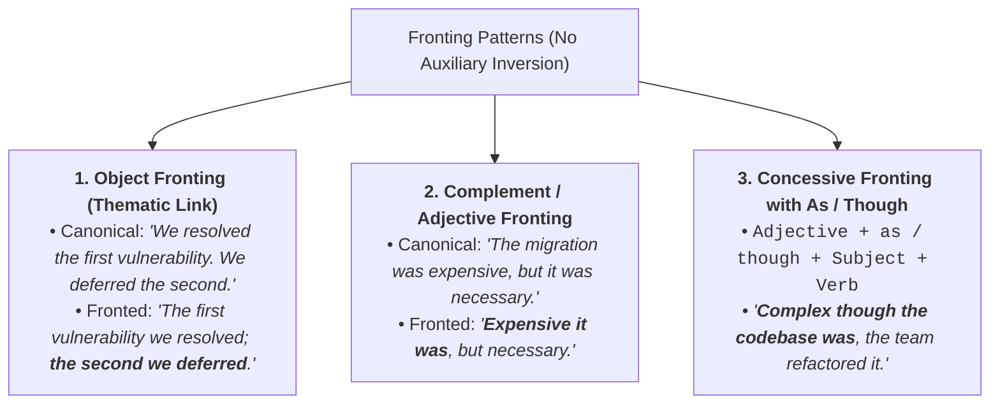
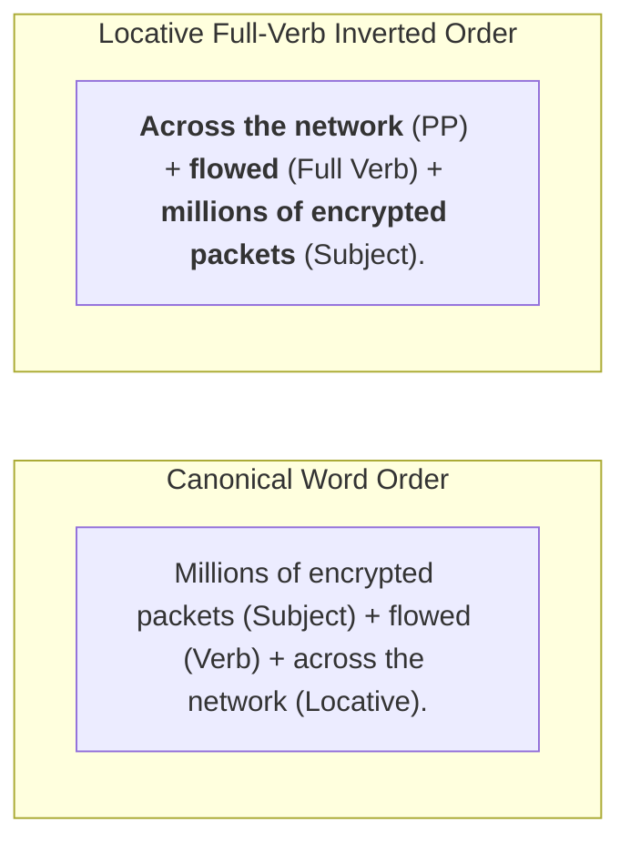
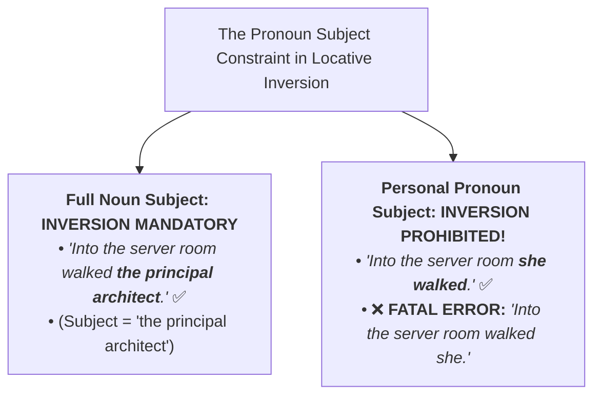

# Fronting, Topicalization, and Locative Inversion 🔄🏛️

> **Level:** CEFR C1–C2 (Thematic Progression & Full-Verb Inversion)  
> **Primary References:** Michael Swan (*Practical English Usage*, §25.4–25.5)  
> **Core Concept:** Standard English word order follows the canonical **Subject-Verb-Object (SVO)** template. However, in advanced narrative, rhetorical discourse, and cohesive technical prose, writers employ **Fronting (Topicalization)** to establish seamless thematic links between sentences. When directional or locative adverbials are fronted, English triggers **Full-Verb Inversion**, swapping the subject and the main lexical verb without using dummy auxiliaries.

---

## 1. Fronting (Topicalization) for Thematic Cohesion

Fronting moves a non-subject element (Direct Object, Subject Complement, or Adverbial) to the beginning of the clause **without triggering auxiliary inversion**:



### The Given-to-New Information Principle
Fronting connects the **given information** (already mentioned in the preceding sentence) to the front of the new sentence, allowing the **new, climactic information** to take the end position:
- *We reviewed five architectural proposals. **Three of them we rejected immediately**; the fourth required minor adjustments; **the fifth we approved unanimously**.*

---

## 2. Locative and Directional Inversion (Full-Verb Inversion)

When a sentence begins with a **prepositional phrase of place, location, or direction**, standard English inverts the subject and the **entire main verb** (unlike negative inversion, no auxiliary *do/did* is used):

$$\mathbf{\text{Prepositional Phrase (Place / Direction)}} + \mathbf{\text{Full Lexical Verb}} + \mathbf{\text{Subject Noun Phrase}}$$



### Prototypical Stative and Motion Verbs
Locative inversion occurs primarily with intransitive verbs of **position, posture, or motion** (*stand, lie, sit, hang, come, go, walk, flow, run, emerge*):
- * **On the top shelf stood** the backup magnetic tape drives.* (❌ NOT: *did stand*).
- * **Through the firewall passed** thousands of malicious SYN packets.*
- * **Behind the primary cluster lies** a dedicated disaster recovery warm standby.*

---

## 3. The Pronoun Inversion Constraint (Fatal Error)

Locative full-verb inversion **ONLY applies when the subject is a full noun phrase**. If the subject is a **personal pronoun (`he, she, it, they, we`)**, **INVERSION IS FORBIDDEN**:



### Comparison Table

| Fronted Prepositional Phrase | Noun Subject (Inversion ✅) | Pronoun Subject (NO Inversion! ✅) |
| :--- | :--- | :--- |
| *Out of the data center...* | *...rushed **the technicians**.* | *...**they** rushed.* (❌ *rushed they*) |
| *Here...* | *...comes **the release manager**.* | *...**she** comes.* (❌ *comes she*) |
| *There...* | *...goes **our weekend plan**.* | *...**it** goes.* (❌ *goes it*) |
| *Down the hallway...* | *...ran **the sysadmin**.* | *...**he** ran.* (❌ *ran he*) |

---

## 4. Concessive Fronting with `As` and `Though`

To express strong concession or contrast, adjectives or adverbs can be fronted before `as` or `though`:

$$\mathbf{\text{Adjective / Adverb}} + \mathbf{\text{as / though}} + \mathbf{\text{Subject}} + \mathbf{\text{Verb}} \dots, \mathbf{\text{Main Clause}}$$

- * **Difficult though it was**, the team completed the live database migration without dropped transactions.*  
  (= *Although it was difficult...*)
- * **Fast as the new algorithm runs**, it still consumes excessive memory.*  
  (= *Although the new algorithm runs fast...*)
- * **Strange as it may seem**, disabling hardware acceleration resolved the browser crash.*

---

## 5. Practical Dual-Domain Examples

### Everyday Conversation & Narrative Prose

1. *The soup was terrible, but **the dessert I really enjoyed**.* (Object fronting)
2. * **Into the cafe walked** an elderly gentleman wearing a tweed coat.* (Locative inversion)
3. *Here **comes the bus**!* (Locative inversion with noun)
4. *Here **it comes**!* (Pronoun constraint respected: no inversion)
5. * **Tired though she was**, she stayed up to help her son with his homework.* (Concessive fronting)
6. *On the wall **hung** a portrait of the company's founder.* (Stative locative)
7. * **Talented as he is**, he lacks the discipline to finish long-term projects.* (Concessive)
8. *Off **they went** on their summer vacation.* (Pronoun constraint)

### Software Engineering & Technical Documentation

9. *The initial prototype we discarded; **the production engine we built from scratch in Go**.* (Object fronting)
10. * **Across the private optical network flowed** terabytes of synchronized telemetry data.* (Locative inversion)
11. * **Beneath the application layer lies** the distributed Raft consensus state machine.* (Locative inversion)
12. * **Complex as distributed transactions are**, modern two-phase commit protocols ensure ACID compliance.* (Concessive)
13. *Out of the staging cluster **came** reports of severe thread deadlocks.* (Motion inversion)
14. *The unit tests we passed without issue; **the end-to-end integration tests we failed repeatedly**.* (Contrastive fronting)
15. * **On the primary storage partition sits** the write-ahead log.* (Locative stative inversion)
16. * **Unlikely though a simultaneous triple-datacenter failure may be**, our SLA guarantees recovery within four hours.* (Concessive fronting)
17. *Through the ingress load balancer **streamed** over one million requests per second during the flash sale.* (Locative)
18. *Here **comes the hotfix**.* (Particle fronting)

---

## 6. Common Antipatterns & Diagnostic Table

| Incorrect Antipattern | Corrected Grammar | Rule & Explanation |
| :--- | :--- | :--- |
| ❌ *Into the room walked he.* | ✅ *Into the room **he walked**.* | Pronoun constraint: personal pronouns do NOT invert in locative constructions. |
| ❌ *Across the wire did flow the data.* | ✅ *Across the wire **flowed the data**.* | Locative inversion uses the full lexical verb (*flowed*), never dummy *did*. |
| ❌ *Though difficult it was, we deployed.* | ✅ * **Difficult though it was**, we deployed.* | Concessive fronting requires the adjective first (*Difficult though it was*). |
| ❌ *The second bug did we fix yesterday.* | ✅ *The second bug **we fixed** yesterday.* | Standard object fronting does NOT trigger subject-auxiliary inversion. |
| ❌ *Here comes it!* | ✅ *Here **it comes**!* | Pronoun subject prohibits inversion after *here/there*. |
| ❌ *On the desk was sitting the laptop.* | ✅ *On the desk **sat the laptop**.* (or *...was the laptop*). | Simple past verbs are preferred over continuous in formal locative inversion. |

---

## 7. Self-Assessment Exercises

### Exercise 1: Locative Inversion & Pronoun Constraint
Determine whether full-verb inversion is required, and supply the correct word order:

1. Through the web application firewall (passed / the malicious payload / passed).  
   $\rightarrow$ Through the web application firewall ________.
2. Across the finish line (she / ran / ran / she).  
   $\rightarrow$ Across the finish line ________.
3. Beneath the virtualization hypervisor (the bare-metal hardware / sits / sits / the bare-metal hardware).  
   $\rightarrow$ Beneath the virtualization hypervisor ________.
4. Down the hill (it / rolled / rolled / it).  
   $\rightarrow$ Down the hill ________.
5. In the center of the server room (the primary mainframe / stood / stood / the primary mainframe).  
   $\rightarrow$ In the center of the server room ________.

### Exercise 2: Fronting & Concessive Structures
Rewrite the sentences using fronting or concessive *as / though*:

6. *Rewrite using object fronting:* We fixed the frontend styling immediately, but we postponed the database refactoring.  
   $\rightarrow$ The frontend styling we fixed immediately; ________.
7. *Rewrite using concessive fronting:* Although the legacy code was clunky, it ran reliably for a decade.  
   $\rightarrow$ ________ though the legacy code was, it ran reliably for a decade.
8. *Rewrite using locative inversion:* Hundreds of background worker threads run inside the JVM runtime.  
   $\rightarrow$ Inside the JVM runtime ________.
9. *Fix the pronoun inversion error:* Out of the conference room walked they after the heated debate.
10. *Rewrite using concessive 'as':* Although the security patch was simple, it prevented a catastrophic breach.  
    $\rightarrow$ ________ as the security patch was, it prevented a catastrophic breach.

<details>
<summary>View Complete Answer Key & Diagnostic Explanations</summary>

1. **passed the malicious payload** (Full-verb inversion with noun subject).
2. **she ran** (Pronoun subject $\rightarrow$ NO inversion).
3. **sits the bare-metal hardware** (Full-verb inversion with noun subject).
4. **it rolled** (Pronoun subject $\rightarrow$ NO inversion).
5. **stood the primary mainframe** (Full-verb inversion with noun subject).
6. The frontend styling we fixed immediately; **the database refactoring we postponed**. (Object fronting).
7. **Clunky though the legacy code was**, it ran reliably for a decade. (Concessive fronting).
8. Inside the JVM runtime **run hundreds of background worker threads**. (Locative inversion).
9. Out of the conference room **they walked** after the heated debate. (Pronoun constraint).
10. **Simple as the security patch was**, it prevented a catastrophic breach. (Concessive fronting).

</details>

---

## 8. Revision Flashcards

```
Q: What is "Locative Inversion" and how does it differ from "Negative Inversion"?
A: Locative inversion inverts a fronted place/direction phrase with the FULL LEXICAL VERB ("Across the wire FLOWED the packets"), without using dummy auxiliaries like "do/did".

Q: What is the "Pronoun Constraint" in locative inversion?
A: If the subject is a personal pronoun (he, she, it, they), inversion is strictly FORBIDDEN (e.g., "Into the room SHE WALKED", NEVER "walked she").

Q: What is "Object Fronting" and why is it used in technical documentation?
A: Moving a direct object to the front of a sentence without inversion ("The first issue we solved; the second we postponed") to establish smooth thematic cohesion between sentences.

Q: How do you construct a concessive sentence using "though" or "as" with fronting?
A: "Adjective + though/as + Subject + Verb" (e.g., "Complex though the architecture was, it worked flawlessly").

Q: Why is "Here comes he!" ungrammatical?
A: Because the subject is a personal pronoun ("he"), which prohibits inversion after "here/there". The correct form is "Here HE COMES!".
```
