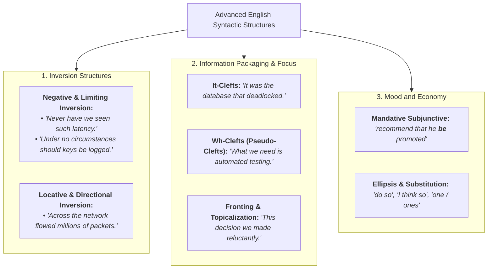

# Module 12: Advanced Sentence Structures and Information Packaging 🏛️🎭

> **Level:** CEFR B2–C2 (Rhetorical Syntax, Inversion & Discourse Packaging)  
> **Primary References:** Michael Swan (*Practical English Usage*, §20, 25, 27)  
> **Core Concept:** At the advanced level, English syntax moves beyond basic grammatical correctness into **information packaging, discourse pragmatics, and rhetorical emphasis**. By manipulating canonical word order through **inversion, clefting, fronting, the subjunctive mood, and strategic ellipsis**, writers establish dramatic focus, maintain thematic cohesion, and project authoritative professional gravitas.

---

## 1. Advanced Syntactic Strategies Architecture

---

## 2. Topic Curriculum

This module contains **5 comprehensive deep-dive guides**:

| Guide | Core Focus | Target CEFR | Authoritative Literature |
| :--- | :--- | :---: | :--- |
| **01. [Negative and Limiting Inversion](negative-and-limiting-inversion.md)** | Negative adverbials fronted (*Never, rarely, seldom, hardly... when, no sooner... than, only after, under no circumstances*), auxiliary syntax | B2–C1 | Swan §25.1 |
| **02. [Cleft Sentences: It-Clefts and Wh-Clefts](cleft-sentences-it-and-wh.md)** | Information packaging, end-focus manipulation, *It*-clefts, pseudo-clefts (*What we need is...*), reversed wh-clefts, *All I did was...* | B2–C1 | Swan §25.2–25.3 |
| **03. [Fronting, Topicalization, and Locative Inversion](fronting-topicalization-and-inversion.md)** | Fronting objects and complements for thematic flow, locative inversion (*Into the server room walked the CEO*), full verb inversion | C1–C2 | Swan §25.4–25.5 |
| **04. [Subjunctive Mood and Mandative Forms](subjunctive-mood-and-mandative-forms.md)** | Mandative subjunctive (*recommend that the pod be restarted*), formulaic subjunctive (*be that as it may, so be it*), *were* subjunctive | B2–C1 | Swan §27 |
| **05. [Ellipsis and Substitution](ellipsis-and-substitution.md)** | Textual economy, situational ellipsis, verbal ellipsis, nominal substitution (*one/ones*), verbal substitution (*do so*), clausal substitution (*so/not*) | B2–C2 | Swan §20.8, §25.6 |

---

## 3. The Information Packaging Matrix

When structuring an advanced sentence, select the syntactic strategy based on your communicative intent:

| If your objective is to... | Use this Syntactic Strategy | Example Sentence |
| :--- | :--- | :--- |
| Create dramatic rhetorical emphasis after a negative limit | **Negative Inversion** | * **Under no circumstances should** credentials be stored in git.* |
| Emphasize the specific agent or component at fault | ***It*-Cleft Sentence** | * **It was the firewall that** blocked incoming traffic.* |
| Highlight the core requirement or proposed solution | **Wh-Pseudo-Cleft** | * **What the architecture lacks is** an asynchronous message queue.* |
| Maintain seamless thematic flow from the previous sentence | **Fronting / Topicalization** | *The first vulnerability we patched; **the second we mitigated**.* |
| State an authoritative formal policy or mandate | **Mandative Subjunctive** | *Policy requires that all engineers **use** hardware 2FA.* |
| Avoid clunky verbal repetition in technical prose | **Substitution (`do so`)** | *Clients wishing to disconnect may **do so** immediately.* |

---

## 4. Cross-Reference Directory
- **Foundations:** [Sentence Elements & Word Order](../01-foundations/sentence-elements-and-word-order.md) (Canonical S-V-O-C-A vs. marked word orders).
- **Conditionals:** [Inverted Conditionals Without 'If'](../10-conditionals-and-hypotheticals/inverted-conditionals-without-if.md) (Conditional inversion parallels).
- **Technical Writing:** [Practical Technical Communication](../15-practical-english-and-communication/) (Executive summaries, RFC requirements, authoritative security guidelines).
