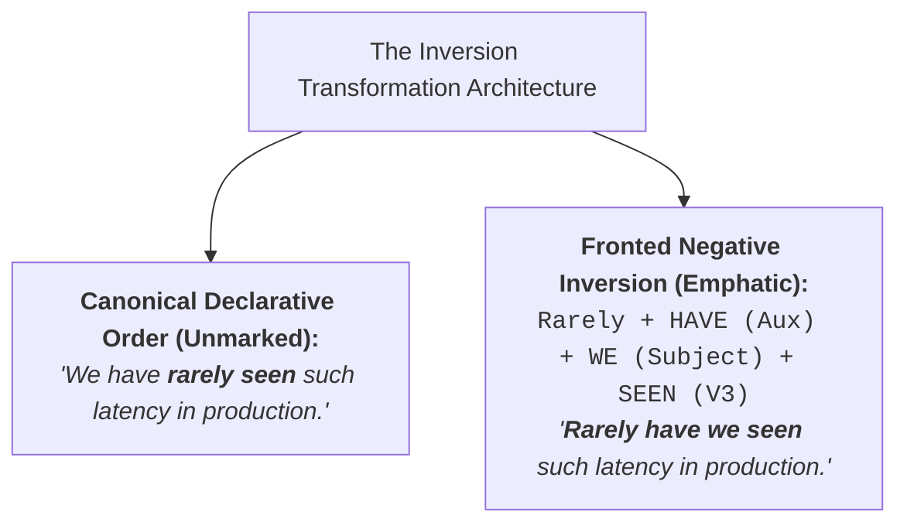
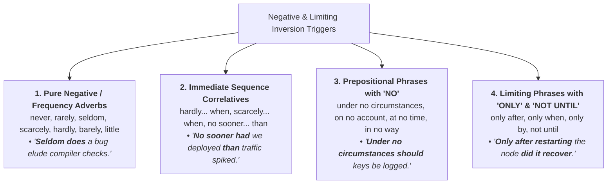
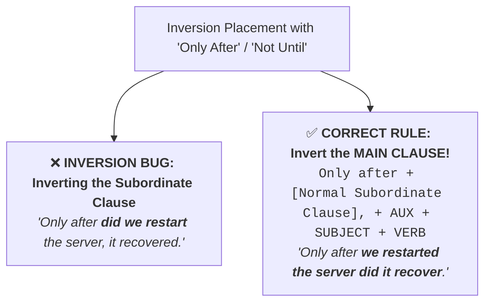

# Negative and Limiting Inversion ⚡🏛️

> **Level:** CEFR B2–C1 (Rhetorical Inversion & Emphatic Fronting)  
> **Primary References:** Michael Swan (*Practical English Usage*, §25.1); Raymond Murphy (*English Grammar in Use*, Unit 110)  
> **Core Concept:** In formal English, placing a **negative, restrictive, or limiting adverbial** at the front of a sentence creates intense dramatic emphasis. To balance this marked fronting, standard syntax requires **Subject-Auxiliary Inversion**: the auxiliary verb (or dummy *do/does/did*) moves before the subject, adopting the word order of an interrogative clause while retaining declarative force.

---

## 1. The Inversion Transformation Mechanism

$$\mathbf{\text{Fronted Negative / Limiting Adverbial}} + \mathbf{\text{Auxiliary / Modal}} + \mathbf{\text{Subject}} + \mathbf{\text{Main Verb}}$$



> [!IMPORTANT]
> If the sentence does not contain an existing auxiliary verb, you must insert **dummy `do / does / did`**:
> - *Canonical:* *We little **knew** what would happen.*
> - *Inverted:* *Little **did we know** what would happen.* (❌ NOT: *Little knew we...*)

---

## 2. Taxonomy of Fronted Inversion Triggers



### Inversion Triggers Reference Matrix

| Trigger Category | Trigger Expression | Required Sequence | Production Engineering Example |
| :--- | :--- | :--- | :--- |
| **Negative Frequency** | `Never`, `Rarely`, `Seldom` | `Trigger + Aux + S + V` | * **Rarely has** our infrastructure experienced such a sustained attack.* |
| **Cognitive Negation** | `Little` | `Little + did + S + V` | * **Little did the engineers realize** that the hard drive was failing.* |
| **Immediate Sequence** | `Hardly ... when` | `Hardly + had + S + V3 ... when` | * **Hardly had the cluster booted when** a node died.* |
| **Immediate Sequence** | `No sooner ... than` | `No sooner + had + S + V3 ... than` | * **No sooner had the patch merged than** alerts fired.* |
| **Security Prohibitions** | `Under no circumstances` | `Trigger + should/must + S + V` | * **Under no circumstances may** credentials be committed.* |
| **Total Negation** | `At no time`, `In no way` | `Trigger + Aux + S + V` | * **At no time was** user data exposed in plaintext.* |
| **Delayed Outcome** | `Only after`, `Not until` | `Trigger + Subordinate + Aux + S + V` | * **Only after analyzing the trace did we understand** the deadlock.* |

---

## 3. The `Only After` / `Not Until` Clause Inversion Rule

When a sentence begins with `Only after`, `Only when`, `Only if`, or `Not until`, the trigger is followed by a **subordinate clause**. A fatal trap is inverting the subordinate clause instead of the main clause:



> [!CAUTION]
> The subordinate clause maintains standard declarative word order (`S + V`). The inversion is executed strictly in the **main clause**:
> - ❌ *Not until the database crashed did we notice the leak.* (Wait, that is actually correct!)
> - ❌ *Not until **did the database crash** we noticed the leak.* (Error: inverted subordinate clause!)
> - ✅ *Not until the database crashed **did we notice** the leak.*

---

## 4. `No Sooner ... Than` vs. `Hardly ... When`

These two correlative constructions indicate that two events happened in virtually instantaneous succession:

### 1. `No sooner had ... than`
- Always takes **`than`** (never *when*):
- * **No sooner had the container started than** it encountered an out-of-memory error.*

### 2. `Hardly / Scarcely had ... when`
- Always takes **`when`** (never *than*):
- * **Hardly had the on-call engineer fallen asleep when** the PagerDuty alarm sounded.*

---

## 5. Practical Dual-Domain Examples

### Everyday Conversation & Formal Rhetoric

1. * **Never have I witnessed** such an incredible display of sportsmanship.*
2. * **Rarely does one encounter** someone with such profound musical talent.*
3. * **Under no circumstances should you open** the door to strangers.*
4. * **Hardly had we arrived** at the beach **when** the thunderstorm erupted.*
5. * **No sooner had she walked** into the room **than** everyone began applauding.*
6. * **Little did he know** that a surprise birthday party awaited him at home.*
7. * **Only when you face adversity do you discover** your true resilience.*
8. * **At no time did he show** any signs of fatigue.*

### Software Engineering & Technical Documentation

9. * **Under no circumstances should administrative API keys be hardcoded** into frontend bundles.* (Security spec)
10. * **Rarely does an unindexed query execute** in under 100 milliseconds on a table with 50 million rows.* (Performance guide)
11. * **Hardly had the DNS records propagated when** incoming traffic flooded the ingress gateway.* (Incident report)
12. * **No sooner had the database migration completed than** the write-ahead log reached maximum disk capacity.* (Postmortem)
13. * **Little did the systems architect suspect** that the third-party library contained a remote code execution exploit.* (RCA)
14. * **At no point during the maintenance window was** customer traffic dropped or throttled.* (SLA report)
15. * **Only by enforcing mTLS across all microservices can we guarantee** zero-trust internal network security.* (Architecture doc)
16. * **Not until the telemetry daemon had flushed all local buffers did the host terminate** gracefully.* (Shutdown script)
17. * **In no way does this architectural refactoring compromise** existing public API contracts.* (RFC change note)
18. * **Seldom has a compiler optimization yielded** such dramatic reductions in binary footprint.* (Benchmark summary)

---

## 6. Common Antipatterns & Diagnostic Table

| Incorrect Antipattern | Corrected Grammar | Rule & Explanation |
| :--- | :--- | :--- |
| ❌ *Never I have seen such a crash.* | ✅ * **Never have I seen** such a crash.* | Fronted negative *never* mandates subject-auxiliary inversion. |
| ❌ *Under no circumstances you should commit.* | ✅ *Under no circumstances **should you commit**.* | Prepositional phrase with *no* requires inversion of modal *should*. |
| ❌ *No sooner had we deployed when it failed.* | ✅ *No sooner had we deployed **than** it failed.* | *No sooner* strictly pairs with *than*, never *when*. |
| ❌ *Hardly had he left than the phone rang.* | ✅ *Hardly had he left **when** the phone rang.* | *Hardly* strictly pairs with *when*, never *than*. |
| ❌ *Only after did we fix the bug it booted.* | ✅ *Only after we fixed the bug **did it boot**.* | Inversion belongs in the main clause, not the subordinate clause. |
| ❌ *Rarely he updates his dependencies.* | ✅ *Rarely **does he update** his dependencies.* | Inversion requires inserting dummy *does* for present simple. |
| ❌ *Little we realized the danger.* | ✅ *Little **did we realize** the danger.* | Inversion requires inserting dummy *did* for past simple. |

---

## 7. Self-Assessment Exercises

### Exercise 1: Canonical to Negative Inversion Transformation
Rewrite the sentences starting with the negative or limiting expression provided:

1. We have never encountered a concurrency deadlock this complex.  
   $\rightarrow$ *Never* ________.
2. Production database credentials must not be stored in plaintext under any circumstances.  
   $\rightarrow$ *Under no circumstances* ________.
3. We realized how severe the data corruption was only after we analyzed the transaction logs.  
   $\rightarrow$ *Only after we analyzed the transaction logs* ________.
4. The database administrator had no sooner restored the backup than the disk controller failed again.  
   $\rightarrow$ *No sooner* ________.
5. The systems architect little suspected that the legacy daemon would crash under high load.  
   $\rightarrow$ *Little* ________.

### Exercise 2: Error Diagnostics
Correct the grammatical bug in each inverted sentence:

6. Seldom an enterprise application recovers from a full region outage without manual intervention.
7. Hardly had the service booted than it began throwing 500 Internal Server Errors.
8. Only when the cluster reached 90% CPU load did the autoscaler initiated new pods.
9. At no time the development team bypassed code review requirements.
10. No sooner we deployed the release than customer complaints flooded Slack.

<details>
<summary>View Complete Answer Key & Diagnostic Explanations</summary>

1. **Never have we encountered** a concurrency deadlock this complex.
2. **Under no circumstances must production database credentials be stored** in plaintext.
3. **Only after we analyzed the transaction logs did we realize** how severe the data corruption was.
4. **No sooner had the database administrator restored the backup than** the disk controller failed again.
5. **Little did the systems architect suspect** that the legacy daemon would crash under high load.
6. Seldom **does an enterprise application recover** from... (Inserted dummy auxiliary *does*).
7. Hardly had the service booted **when** it began... (*Hardly* pairs with *when*, not *than*).
8. Only when the cluster reached 90% CPU load did the autoscaler **initiate** new pods. (After auxiliary *did*, verb reverts to base form *initiate*).
9. At no time **did the development team bypass** code review requirements. (Inversion with *did*).
10. No sooner **had we deployed** the release than... (Inversion with auxiliary *had*).

</details>

---

## 8. Revision Flashcards

```
Q: What syntactic rule is triggered when a negative adverbial (e.g. "Never", "Rarely") is placed at the front of a sentence?
A: Subject-Auxiliary Inversion: an auxiliary verb (or dummy do/does/did) must precede the subject ("Never HAVE I seen...", "Rarely DOES HE log...").

Q: What correlative conjunction pairs with "No sooner"? What about "Hardly"?
A: "No sooner had... THAN"; "Hardly had... WHEN".

Q: Where does the inversion occur in sentences starting with "Only after" or "Not until"?
A: The inversion occurs in the MAIN CLAUSE, NOT in the subordinate clause (e.g., "Only after we restarted the node DID IT RECOVER").

Q: Transform: "We little knew the truth" into an inverted sentence.
A: "Little DID WE KNOW the truth" (requires dummy auxiliary "did" and base verb).

Q: Why is "Under no circumstances developers should push to main" an error?
A: Negative prepositional phrases with "no" mandate inversion: "Under no circumstances SHOULD DEVELOPERS push to main".
```
