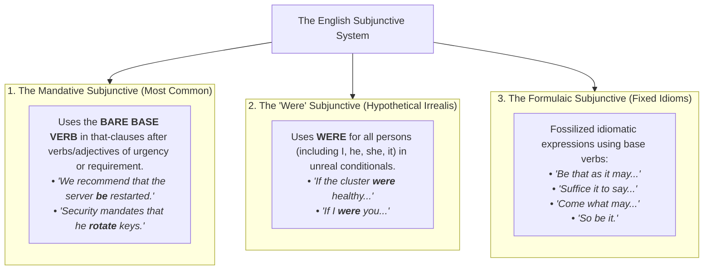
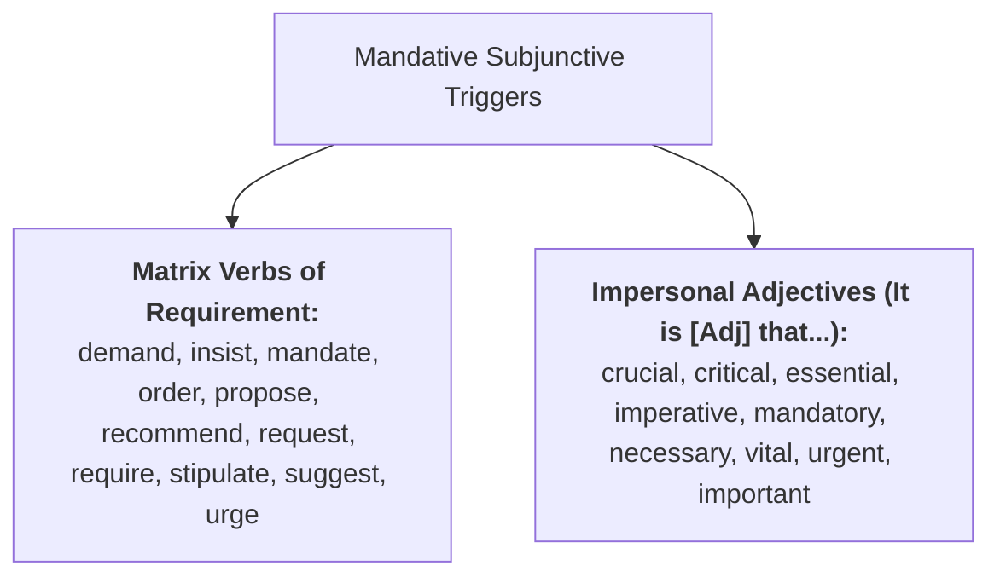
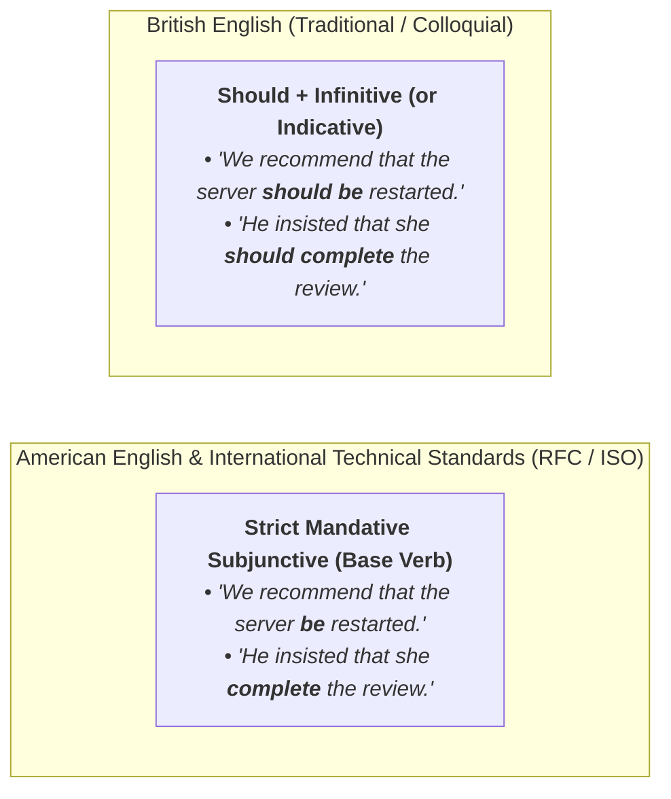

# The Subjunctive Mood: Mandative, Formulaic, and Hypothetical Forms 📜⚖️

> **Level:** CEFR B2–C1 (Mandative Syntax & Modal Irrealis)  
> **Primary References:** Michael Swan (*Practical English Usage*, §27); Raymond Murphy (*English Grammar in Use*, Unit 39)  
> **Core Concept:** The **Subjunctive Mood** expresses non-factual, hypothetical, or demanded states (wishes, requirements, recommendations, and necessities). In modern English, while traditional inflected mood paradigms have largely simplified, the **Mandative Subjunctive** remains vibrant and mandatory in American English, international technical specifications (such as IETF RFCs and ISO standards), and formal legal agreements.

---

## 1. The Three Subjunctive Varieties in English



---

## 2. The Mandative Subjunctive in Detail

The mandative subjunctive occurs in a nominal *that*-clause following verbs or adjectives that express **demand, necessity, recommendation, or requirement**.

### 1. The Morphological Rules
1. **Third-Person Singular Drops the `-s`:**
   - Indicative: *The engineer **submits** a pull request.*
   - Subjunctive: *Policy requires that the engineer **submit** a pull request.* (No `-s`!).
2. **The Copula `BE` Remains Invariant (`be`):**
   - Indicative: *The database **is** encrypted.*
   - Subjunctive: *The compliance auditor insisted that the database **be** encrypted.* (NOT *is*).
3. **Negative Mandative Subjunctive (No Dummy `do`):**
   - The negative particle `not` sits directly before the bare base verb without auxiliary *do*:
   - $$\mathbf{\text{that}} + \text{Subject} + \mathbf{not} + \mathbf{V_{\text{bare}}}$$
   - *The tech lead demanded that developers **not deploy** on Friday afternoon.* (❌ NOT: *do not deploy*).
4. **Passive Mandative Subjunctive:**
   - $$\mathbf{\text{that}} + \text{Subject} + \mathbf{be} + \mathbf{V3_{\text{past participle}}}$$
   - *It is imperative that the root certificate **be renewed** before midnight.*

---

## 3. Trigger Lexicon: Verbs and Adjectives of Requirement



### Reference Syntax Table

| Trigger Category | Trigger Word | Subjunctive Sentence Example |
| :--- | :--- | :--- |
| **Verb: Recommendation** | `recommend` | *The architect recommended that the microservice **use** gRPC.* |
| **Verb: Insistence** | `insist` | *The security team insisted that all traffic **be encrypted** with TLS 1.3.* |
| **Verb: Requirement** | `require` | *RFC 2119 requires that a compliant server **return** an HTTP 400 error.* |
| **Verb: Proposal** | `propose` | *She proposed that the team **adopt** trunk-based continuous delivery.* |
| **Adjective: Urgency** | `imperative` | *It is imperative that the failing worker node **be quarantined** immediately.* |
| **Adjective: Necessity** | `essential` | *It is essential that each replica **maintain** a complete write-ahead log.* |
| **Adjective: Criticality**| `critical` | *It is critical that the on-call engineer **not ignore** priority-1 alerts.* |

---

## 4. Regional Variations: American vs. British English

The mandative subjunctive demonstrates significant transatlantic divergence:



> [!NOTE]
> In international software documentation, IETF RFC standards, and enterprise compliance manuals, the **American standard (the bare base verb subjunctive)** is the established global norm.

---

## 5. The Formulaic Subjunctive (Fossilized Idioms)

In classical English rhetoric and formal decision-making, several fixed expressions preserve the archaic subjunctive base form:

| Fixed Expression | Core Meaning | Practical Context Example |
| :--- | :--- | :--- |
| **`Be that as it may`** | *Nevertheless; even if that is true* | *The migration was costly. **Be that as it may**, it was essential for long-term scalability.* |
| **`Suffice it to say`** | *It is enough to say (without details)* | * **Suffice it to say**, the database deadlock caused a four-hour outage.* |
| **`So be it`** | *Accepting an inevitable outcome* | *If we must rewrite the persistence layer from scratch, **so be it**.* |
| **`Come what may`** | *Regardless of what happens* | *We will ship version 2.0 by the end of Q3, **come what may**.* |
| **`Heaven forbid` / `God forbid`** | *May that terrible thing never happen* | *If, **God forbid**, the primary datacenter floods, the disaster recovery site takes over.* |

---

## 6. Practical Dual-Domain Examples

### Everyday Conversation & Formal Speech

1. *The doctor recommended that he **exercise** three times a week.* (Base verb)
2. *It is essential that you **be** at the airport two hours before departure.* (Copula *be*)
3. *She insisted that we **not tell** anyone about the surprise party.* (Negative)
4. * **Be that as it may**, we cannot afford to exceed our monthly household budget.* (Formulaic)
5. *The judge ordered that the defendant **surrender** his passport.*
6. * **Suffice it to say**, the meeting did not go as planned.* (Formulaic)
7. *It is important that everyone **have** an equal opportunity to speak.* (Base verb *have*)
8. *If that is your final decision, **so be it**.* (Formulaic)

### Software Engineering & Technical Documentation (RFC & Specs)

9. *The IETF specification requires that each client **send** a unique cryptographic nonce.* (RFC requirement)
10. *It is critical that the write-ahead log **be flushed** to non-volatile disk before acknowledging transactions.* (Passive mandative)
11. *The security architect recommended that the authorization service **not accept** unverified JWTs.* (Negative mandative)
12. *Company compliance policy mandates that every engineer **rotate** their API tokens every 90 days.* (Mandative)
13. *It is imperative that the Kubernetes cluster **remain** accessible during rolling kernel upgrades.* (Base verb)
14. * **Be that as it may**, backward compatibility must be maintained for another two minor versions.* (Formulaic)
15. *The infrastructure team requested that all non-essential staging pods **be scaled** to zero overnight.* (Passive)
16. *The protocol stipulates that an agent **respond** within 250 milliseconds, or **be deemed** dead.* (Compound subjunctive)
17. *It is vital that the continuous deployment pipeline **halt** immediately upon discovering a high-severity CVE.* (Base verb)
18. * **Suffice it to say**, running unindexed foreign key joins on a billion-row table severely degraded IOPS.* (Formulaic)

---

## 7. Common Antipatterns & Diagnostic Table

| Incorrect Antipattern | Corrected Grammar | Rule & Explanation |
| :--- | :--- | :--- |
| ❌ *The policy requires that he rotates keys.* | ✅ *The policy requires that he **rotate** keys.* | Mandative subjunctive drops third-person *-s*; use bare base verb. |
| ❌ *It is essential that the node is restarted.* | ✅ *It is essential that the node **be** restarted.* | Impersonal *essential that* mandates subjunctive copula *be*, not *is*. |
| ❌ *We insist that the team does not deploy.* | ✅ *We insist that the team **not deploy**.* | Negative mandative subjunctive places *not* before base verb; omit *does*. |
| ❌ *I recommend him to update the code.* | ✅ *I recommend **that he update** the code.* | *Recommend* does not take *person + to-infinitive*; use a subjunctive *that*-clause. |
| ❌ *It is crucial that all data will be saved.* | ✅ *It is crucial that all data **be saved**.* | Do not use future modal *will* in mandative subjunctive clauses. |
| ❌ *Be as it may, we must proceed.* | ✅ * **Be that as it may**, we must proceed.* | The fossilized idiom is strictly *Be that as it may*. |

---

## 8. Self-Assessment Exercises

### Exercise 1: Mandative Subjunctive Verb Conjugation
Supply the correct subjunctive form of the verb in parentheses:

1. The systems architect recommended that the database (be) ________ configured with read replicas.
2. Corporate compliance mandates that every developer (complete) ________ security training annually.
3. It is imperative that the load balancer (not drop) ________ connections during rolling updates.
4. The security advisory requested that all SSH access (be) ________ restricted to the internal VPN.
5. The RFC standard specifies that the client (retry) ________ failed requests using exponential backoff.

### Exercise 2: Error Correction (Subjunctive vs. Indicative)
Identify and correct the grammatical error in each sentence:

6. The incident commander demanded that the engineer restarts the failing container runtime.
7. It is vital that the cluster does not run out of assigned disk space during the migration.
8. We recommend the tech lead to approve the pull request before the freeze window.
9. Suffice is to say, the memory corruption caused an irrecoverable kernel panic.
10. It is essential that each worker thread handles exceptions gracefully.

<details>
<summary>View Complete Answer Key & Diagnostic Explanations</summary>

1. **be** (Copular mandative subjunctive *be*).
2. **complete** (Bare base verb; drop third-person *-s*).
3. **not drop** (Negative mandative: *not* + bare verb).
4. **be** (Passive mandative: *be restricted*).
5. **retry** (Bare base verb).
6. The incident commander demanded that the engineer **restart** the failing container runtime. (Remove *-s*).
7. It is vital that the cluster **not run** out of assigned disk space... (Remove dummy *does*).
8. We recommend **that the tech lead approve** the pull request... (Subjunctive *that*-clause).
9. **Suffice it to say**, the memory corruption caused... (Correct formulaic idiom).
10. It is essential that each worker thread **handle** exceptions gracefully. (Remove *-s*).

</details>

---

## 9. Revision Flashcards

```
Q: What is the Mandative Subjunctive?
A: The use of the bare base verb (without -s, and using "be" for the copula) in a that-clause following verbs/adjectives of recommendation, requirement, or necessity.

Q: How do you negate a mandative subjunctive clause (e.g. "We insist that he does not deploy")?
A: Omit the auxiliary "does/do" and place "not" directly before the bare verb: "We insist that he NOT DEPLOY".

Q: Give three common matrix verbs and three adjectives that trigger the mandative subjunctive.
A: Verbs: recommend, insist, require, demand, suggest.
Adjectives: crucial, essential, imperative, vital, mandatory.

Q: What are British English speakers more likely to use instead of the bare subjunctive?
A: "Should + infinitive" (e.g., "We recommend that the server SHOULD BE restarted").

Q: Name two common formulaic subjunctive idioms used in professional English.
A: "Be that as it may" (nevertheless) and "Suffice it to say" (it is enough to say).
```
