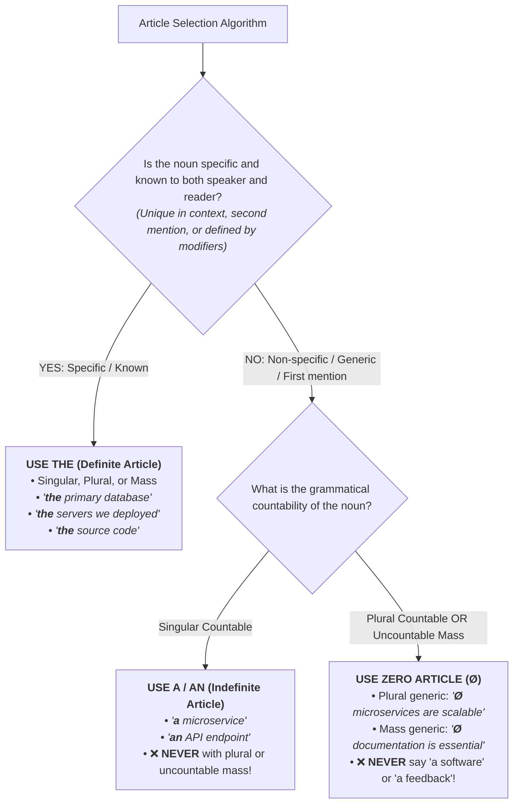
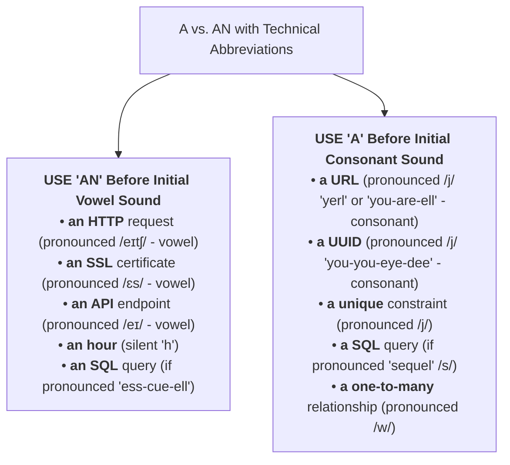

# A / An vs. The vs. Zero Article: Disambiguation Matrix ⚖️🏷️

> **Level:** CEFR A2–B2 (Nominal Definiteness & Generic Reference)  
> **Primary References:** Raymond Murphy (*English Grammar in Use*, Units 72–78); Michael Swan (*Practical English Usage*, §11–12)  
> **Core Conflict:** Choosing between **`A / An`** (Indefinite), **`The`** (Definite), and **`Zero Article (Ø)`** (Omission) dictates how entities are identified in discourse. Definiteness is governed by **shared knowledge** (does the listener know *which* specific entity is meant?), **countability** (singular count vs. plural/mass), and **referential scope** (generic class vs. specific instance).

---

## 1. The Article Determination Algorithm



---

## 2. Side-by-Side Semantic Contrast Matrix

| Dimension | `A / An` (Indefinite) | `The` (Definite) | `Zero Article (Ø)` (Omission) |
| :--- | :--- | :--- | :--- |
| **Definiteness** | Non-specific; unidentifiable to listener | Specific; identifiable to both speaker & listener | Generic class; non-specific collective |
| **Discourse Mention** | **First mention** (*We spawned a pod...*) | **Second mention** (*...the pod crashed*) | Generic plural / abstract concept |
| **Noun Classes** | **Singular Countable ONLY** | **Singular, Plural, and Mass** | **Plural Countable and Mass ONLY** |
| **Uniqueness** | One of many equivalents | Unique in system / universe (*the internet*) | Entire category / substance |
| **Phonetics** | *A* before consonant sound; *An* before vowel | Pronounced /ðə/ (consonant) or /ðiː/ (vowel) | No sound |
| **Technical Errors**| ❌ *a software*, ❌ *an information* | ❌ *the developers like coffee* (generic) | ❌ *server is offline* (singular count needs article) |

---

## 3. Technical Acronym & Initialism Phonetics

The choice between `a` and `an` is determined by the **initial pronunciation sound**, NOT the written letter:



> [!CAUTION]
> - ❌ *a HTTP request* $\rightarrow$ ✅ * **an** HTTP request* (Letter 'H' is pronounced /eɪtʃ/, starting with a vowel sound).
> - ❌ *an URL* $\rightarrow$ ✅ * **a** URL* (Letter 'U' is pronounced /juː/, starting with a consonant glide /j/).
> - ❌ *an unique ID* $\rightarrow$ ✅ * **a** unique ID*.

---

## 4. The Uncountable Mass Trap in Software Engineering

In software engineering, several essential nouns are **uncountable mass nouns** in standard English. They **cannot take `a / an`** and **cannot be pluralized with `-s`**:

| Uncountable Tech Noun | ❌ Fatal Bug Pattern | ✅ Correct Standard Usage | ✅ Partitive Construction |
| :--- | :--- | :--- | :--- |
| **`software`** | ❌ *a software / softwares* | *We develop **Ø software**.* | *a **piece of** software* |
| **`hardware`** | ❌ *a hardware / hardwares* | *The rack holds **Ø hardware**.* | *a **piece of** hardware* |
| **`information`** | ❌ *an information / informations*| *We need **Ø information**.* | *a **piece of** information* |
| **`documentation`** | ❌ *a documentation / documentations*| *Review the **Ø documentation**.* | *a **set of** documentation* |
| **`feedback`** | ❌ *a feedback / feedbacks* | *Thank you for the **Ø feedback**.*| *a **piece of** feedback* |
| **`code`** | ❌ *a code / codes* (as program text) | *She wrote clean **Ø code**.* | *a **line of** code* |
| **`data`** | ❌ *a data* | *The **data is / are** valid.* | *a **datum** / a **data point*** |

---

## 5. Practical Dual-Domain Examples

### Everyday Conversation

1. *Indefinite:* *I bought **a** new laptop yesterday.* (First mention / singular count)
2. *Definite:* * **The** laptop has an OLED display.* (Second mention / specific)
3. *Zero:* * **Ø** Laptops have become essential for remote work.* (Generic plural class)
4. *Indefinite:* *Can you lend me **a** pen?* (Any pen will do)
5. *Definite:* *Could you pass me **the** pen next to your keyboard?* (Specific unique pen)
6. *Zero:* *She drinks **Ø** tea with milk.* (Uncountable substance generic)
7. *Definite:* * **The** milk in the fridge has expired.* (Specific milk)
8. *Phonetic:* *We waited for **an** hour at the airport.* (Silent 'h' $\rightarrow$ vowel sound)

### Software Engineering & Technical Documentation

9. *Indefinite:* *We need **a** reverse proxy to handle SSL termination.* (First mention: any proxy)
10. *Definite:* * **The** reverse proxy routes incoming packets to port 8080.* (Specific identified component)
11. *Zero:* * **Ø** Microservices increase deployment independence.* (Generic plural class)
12. *Definite:* * **The** microservices in our payment cluster failed.* (Specific defined subset)
13. *Phonetic:* *Clients must negotiate **an** HTTP/2 connection.* (/eɪtʃ/ vowel sound)
14. *Phonetic:* *Each user record is assigned **a** UUID v4.* (/j/ consonant sound)
15. *Zero (Mass):* *The project manager requested **Ø** feedback on the roadmap.* (Uncountable)
16. *Definite:* * **The** feedback we received from beta testers was positive.* (Specific feedback)
17. *Zero (Mass):* *Engineers should author readable **Ø** documentation.* (Uncountable generic)
18. *Definite:* * **The** internet relies on the border gateway protocol (BGP).* (Unique in the world)

---

## 6. Common Antipatterns & Diagnostic Table

| Incorrect Antipattern | Corrected Grammar | Rule & Explanation |
| :--- | :--- | :--- |
| ❌ *We built a new software.* | ✅ *We built **a new piece of software**.* / *...built **new software**.* | *Software* is uncountable mass; it cannot take indefinite article *a*. |
| ❌ *The microservice returns a HTTP 404.* | ✅ *The microservice returns **an** HTTP 404.* | *HTTP* begins with vowel sound /eɪtʃ/, requiring *an*. |
| ❌ *Server is offline.* | ✅ * **The** server is offline.* | Singular countable nouns in English CANNOT stand bare without an article. |
| ❌ *The developers like coffee.* (generic) | ✅ * **Ø** Developers like coffee.* | Speaking about an entire professional category in general takes Zero Article. |
| ❌ *We received many good feedbacks.* | ✅ *We received **much good feedback**.* / *...a lot of **feedback**.* | *Feedback* is uncountable mass; it cannot take plural *-s*. |
| ❌ *An URL was provided.* | ✅ * **A** URL was provided.* | *URL* begins with consonant sound /j/, requiring *a*. |
| ❌ *In internet, latency matters.* | ✅ * **On the** internet, latency matters.* | *Internet* is a unique global entity requiring *the*, and takes preposition *on*. |

---

## 7. Self-Assessment Exercises

### Exercise 1: Article Discrimination (A, An, The, or Ø)
Fill in the blanks with **a**, **an**, **the**, or **Ø** (Zero Article):

1. The client sent ________ HTTP request to ________ authentication server.
2. We need ________ UUID generator to assign unique identifiers to transactions.
3. ________ documentation for this REST API is hosted on GitHub.
4. Our development team writes ________ clean, maintainable code.
5. In 1991, Tim Berners-Lee introduced ________ World Wide Web to the public.

### Exercise 2: Technical Error Diagnostics
Correct the article error in each sentence:

6. We purchased a new hardware for our on-premise datacenter.
7. An SQL query with unindexed joins will degrade database performance. (Assume "sequel" pronunciation).
8. Cluster crashed because worker node ran out of memory.
9. She provided a valuable feedback during the sprint retrospective.
10. The microservices are great for large enterprise organizations. (Generic statement about microservice architecture).

<details>
<summary>View Complete Answer Key & Diagnostic Explanations</summary>

1. **an** HTTP request ... **the** authentication server (*an* for /eɪtʃ/; *the* for specific server).
2. **a** UUID generator (*a* before /j/ consonant sound).
3. **The** documentation (Specific documentation for this API).
4. **Ø** clean, maintainable code (*code* is uncountable mass $\rightarrow$ zero article).
5. **the** World Wide Web (Unique global entity).
6. We purchased **new hardware** (or *a new piece of hardware*) for our datacenter. (Eliminate *a*).
7. **A** SQL query with unindexed joins... (Pronounced /siːkwəl/ $\rightarrow$ *a*).
8. **The** cluster crashed because **the** worker node ran out of memory. (Singular count nouns cannot stand bare).
9. She provided **valuable feedback** (or *a piece of valuable feedback*). (Eliminate *a*).
10. **Ø** Microservices are great for large enterprise organizations. (Generic plural class takes Zero Article).

</details>

---

## 7. Revision Flashcards

```
Q: What is the rule for choosing between "a" and "an"?
A: Use "a" before a consonant SOUND (a URL, a unique constraint, a user); use "an" before a vowel SOUND (an HTTP request, an API, an hour, an SSL certificate).

Q: Why can't you say "We created a software"?
A: "Software" is an uncountable mass noun in English. You must say "We created software" or "We created a piece of software".

Q: When do you use the Zero Article (Ø) with plural nouns?
A: When speaking generally about the entire class or category ("Ø Microservices are scalable", NOT "The microservices are scalable" if speaking generally).

Q: Can a singular countable noun like "server" stand alone without an article in English?
A: Never! A singular countable noun must always have an article or determiner (e.g., "THE server", "A server", "MY server", NEVER bare "Server crashed").

Q: Why do we say "THE internet"?
A: Because "the" is used for unique, one-of-a-kind entities in the world or system (the internet, the moon, the sun, the World Wide Web).
```
