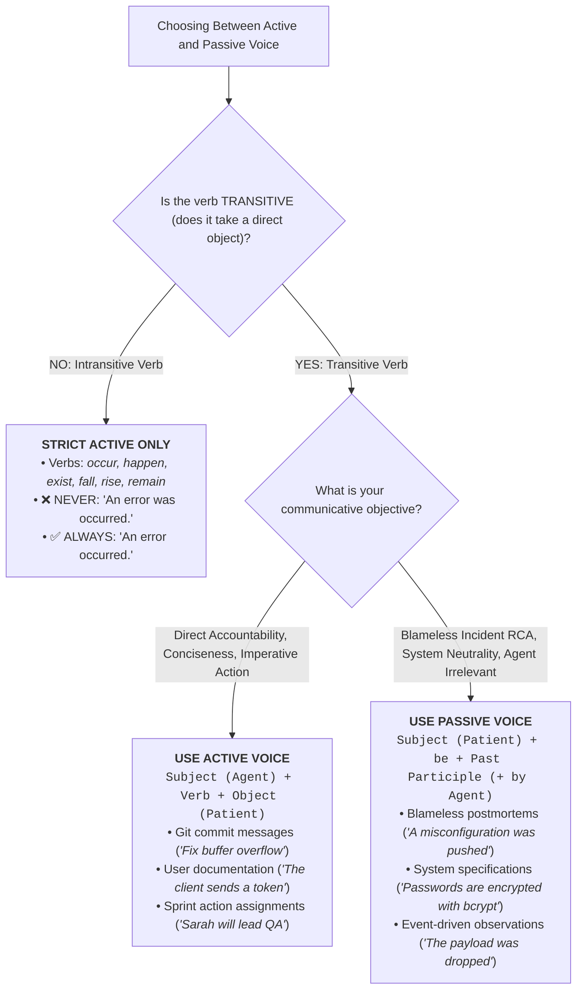

# Active vs. Passive Voice: Strategic Disambiguation Matrix ⚖️🛡️

> **Level:** CEFR B1–C1 (Voice, Information Packaging & Discourse Register)  
> **Primary References:** Raymond Murphy (*English Grammar in Use*, Units 42–44); Michael Swan (*Practical English Usage*, §412–421)  
> **Core Conflict:** The choice between **Active Voice** and **Passive Voice** is not merely a stylistic preference; it is a **functional syntactic decision** that governs **agent accountability**, **discourse focus**, **information packaging (given vs. new information)**, and **rhetorical tone**. In professional software development, active voice drives clarity in pull requests and commit messages, while passive voice underpins objective architectural documentation and blameless incident postmortems.

---

## 1. The Voice Selection Architecture



---

## 2. Side-by-Side Structural & Pragmatic Contrast Matrix

| Dimension | Active Voice | Passive Voice |
| :--- | :--- | :--- |
| **Syntactic Formula** | $\mathbf{\text{Agent (Subject)}} + \mathbf{\text{Verb}} + \mathbf{\text{Patient (Object)}}$ | $\mathbf{\text{Patient (Subject)}} + \mathbf{\text{be} + \mathbf{V_3\text{ (Past Participle)}}} + (\text{by Agent})$ |
| **Primary Focus** | The **actor / initiator** of the action | The **receiver / result / affected entity** of the action |
| **Agent Visibility** | **Explicit and prominent** at sentence head | **Omitted** or demoted to a prepositional *by*-phrase |
| **Tone & Register** | Direct, dynamic, accountable, concise | Objective, neutral, detached, diplomatic |
| **Ideal Technical Contexts** | • Git commit titles (*"Add OAuth middleware"*)</br>• Code comments explaining developer intent</br>• Step-by-step user onboarding tutorials | • Blameless incident postmortems</br>• System state logs & telemetry reports</br>• Architectural specifications & compliance docs |
| **Example (Tech)** | *The garbage collector reclaimed 4GB of heap.* | *4GB of heap was reclaimed (by the garbage collector).* |
| **Fatal Antipattern** | *(Rarely creates syntax errors, but can sound accusatory: "Bob broke the server.")* | ❌ Passivizing intransitive verbs: *“A failover was occurred at 02:00.”* |

---

## 3. Pragmatic Domains: Active vs. Passive in Tech Workflows

### Context 1: Blameless Incident Postmortems (Passive Voice Dominance)
In site reliability engineering (SRE) culture, incident postmortems focus on systemic vulnerabilities rather than pointing fingers at individuals:
- ❌ **Accusatory Active Voice:** *“Alex deployed an invalid YAML configuration and crashed the cluster at 14:22 UTC.”*
- ✅ **Blameless Passive Voice:** *“An invalid YAML configuration **was deployed**, which **caused** the Kubernetes cluster to enter a crash loop at 14:22 UTC.”*
- *Result:* Focus stays entirely on the failure mechanism and the missing automated validation guardrails, not human guilt.

### Context 2: Git Commit Messages & Code Reviews (Active / Imperative Dominance)
Git conventions strictly mandate active, imperative constructions:
- ❌ **Passive Commit Title:** *“A bug in the JWT parser was resolved by our team.”*
- ✅ **Active Imperative Title:** *“Fix buffer overflow in JWT authorization parser.”*
- Rule: A good commit message title completes the phrase: *“If applied, this commit will [Your Message].”*

### Context 3: API & Architectural Specifications (System Neutrality)
When describing protocol behavior, the agent is often unknown, universal, or irrelevant:
- ✅ *“Incoming payloads **are validated** against the JSON schema before persistence.”*
- ✅ *“Secrets **are stored** in AWS KMS and **are rotated** every 90 days.”*
- Active equivalent (*“AWS KMS stores secrets and someone rotates them...”*) introduces unnecessary agents and weakens professional tone.

---

## 4. The Intransitive Passivization Invariant

$$\mathbf{\text{Intransitive Verbs (No Direct Object)}} \implies \mathbf{\text{CANNOT Form Passive Voice}}$$

The following high-frequency engineering verbs are **strictly intransitive**:

| Verb | Meaning | Correct Active Construction | ❌ Fatal Passive Bug |
| :--- | :--- | :--- | :--- |
| **`Occur`** | Happen, take place | *A network partition **occurred**.* | ❌ *was occurred* |
| **`Happen`** | Occur by chance | *The timeout **happened** during peak load.* | ❌ *was happened* |
| **`Exist`** | Be real / present | *A race condition **exists** in this loop.* | ❌ *is existed* |
| **`Fall` / `Drop` (intr.)** | Decrease | *Memory utilization **fell** by 30%.* | ❌ *was fallen* |
| **`Rise`** | Increase | *Throughput **rose** significantly.* | ❌ *was risen* |
| **`Disappear`** | Vanish | *The memory leak **disappeared** after restart.* | ❌ *was disappeared* |
| **`Consist of`** | Be composed of | *The cluster **consists of** three nodes.* | ❌ *is consisted of* |

---

## 5. Practical Dual-Domain Examples

### Everyday Conversation

1. *Active:* *The storm **knocked out** the power across three counties.*
2. *Passive:* *The power **was knocked out** across three counties by the storm.*
3. *Active (Direct):* *Someone **stole** my bicycle from the courtyard.*
4. *Passive (Agent unknown):* *My bicycle **was stolen** from the courtyard.*
5. *Active (Personal):* *The chef **prepared** a magnificent five-course dinner.*
6. *Passive (Focus on experience):* *A magnificent five-course dinner **was prepared** for the guests.*
7. *Active (Intransitive):* *The accident **happened** right in front of the supermarket.*
8. *Passive (Polite / Diplomatic):* *A mistake **has been made** on your utility invoice.*

### Software Engineering & Technical Documentation

9. *Active (Commit title):* *Refactor database connection pool to eliminate thread starvation.*
10. *Passive (System state):* *Database connection pools **are initialized** during application bootstrap.*
11. *Active (PR explanation):* *This patch **replaces** linear scans with a hash set lookup.*
12. *Passive (Postmortem blameless):* *The corrupted index **was noticed** during routine morning health checks.*
13. *Active (Security advice):* *Always **hash** user passwords with Argon2id before storage.*
14. *Passive (Compliance documentation):* *All user credentials **are hashed** using Argon2id prior to database insertion.*
15. *Active (Intransitive event):* *A transient DNS resolution failure **occurred** at 04:12 UTC.* (NOT: *was occurred*).
16. *Passive (Protocol description):* *HTTP requests with invalid HMAC signatures **are immediately rejected** with status 401.*

---

## 6. Common Antipattern Diagnostic Bug-and-Patch Table

| ❌ Broken Anti-Pattern (Bug) | Corrected Idiomatic English (Patch) | Diagnostic Grammar Explanation |
| :--- | :--- | :--- |
| ❌ *A catastrophic outage **was occurred** at midnight.* | ✅ *A catastrophic outage **occurred** at midnight.* | *Occur* is strictly intransitive and has no passive voice form. |
| ❌ *The race condition **was disappeared** after reboot.* | ✅ *The race condition **disappeared** after reboot.* | *Disappear* is intransitive; passivizing it violates English verbal mechanics. |
| ❌ *The microservice **is consisted of** five containers.* | ✅ *The microservice **consists of** five containers.* | *Consist of* is a stative intransitive verb phrase; it cannot be formed as a passive. |
| ❌ *Commit: **A new auth middleware was implemented**.* | ✅ *Commit: **Implement new auth middleware**.* | Git commit messages standardly demand the active imperative mood. |
| ❌ *Postmortem: **Dave deleted the database table**.* | ✅ *Postmortem: **The database table was deleted**.* | Blameless engineering culture uses the passive voice to avoid personal accusation. |
| ❌ *The token **must validate** before granting access.* | ✅ *The token **must be validated** before access is granted.* | The token is the patient receiving validation, requiring passive `modal + be + V3`. |
| ❌ *The issue **was arisen** from a race condition.* | ✅ *The issue **arose** from a race condition.* | *Arise* is an intransitive verb (*arise, arose, arisen*) and cannot be passivized. |

---

## 7. Self-Assessment Practice Exercises

### Exercise 1: Active vs. Passive Selection
Select whether Active or Passive voice is more appropriate for each context:
1. *(Writing a Git commit message)*: (The database latency was reduced / Reduce database query latency).
2. *(Writing a blameless postmortem incident timeline entry)*: (The firewall rule was modified at 10:14 UTC / Kevin modified the firewall rule at 10:14 UTC).
3. *(Writing a protocol specification)*: (Encrypted tokens are transmitted over TLS 1.3 / Developers transmit encrypted tokens over TLS 1.3).
4. *(Describing an unexpected event)*: (A failover was occurred during the deployment / A failover occurred during the deployment).
5. *(Writing a clean code comment)*: (This function calculates the geometric median / The geometric median is calculated by this function).

### Exercise 2: Error Correction (Repair illicit passives or awkward voice choices)
6. *An unexpected memory leak was happened after the v2.4 upgrade.*
7. *The Kubernetes cluster is consisted of master nodes and worker pools.*
8. *All production changes must approve by a senior staff engineer.*
9. *The incident was arisen due to an expired TLS certificate.*
10. *Git commit: Fixed memory leak in websocket connection handler was completed.*

---

## 8. Answer Key with Diagnostic Explanations

1. **Reduce database query latency** — Standard git convention demands the active imperative mood.
2. **The firewall rule was modified at 10:14 UTC** — Blameless postmortem standards prioritize the action/result over individual blame.
3. **Encrypted tokens are transmitted over TLS 1.3** — Technical specifications prioritize system behavior and data packets rather than human agents.
4. **A failover occurred during the deployment** — *Occur* is strictly intransitive and cannot take a passive form (*was occurred* is a fatal error).
5. **This function calculates the geometric median** — Active voice in code comments provides crisp, direct, and readable documentation.
6. **Correction:** *An unexpected memory leak **happened** (or **occurred**) after the v2.4 upgrade.*  
   *Explanation:* *Happen* and *occur* are intransitive verbs and have no passive voice.
7. **Correction:** *The Kubernetes cluster **consists of** master nodes and worker pools.*  
   *Explanation:* *Consist of* cannot be formed in the passive voice.
8. **Correction:** *All production changes **must be approved** by a senior staff engineer.*  
   *Explanation:* Transitive verb *approve* requires passive `must + be + past participle` when the subject is the receiver (*production changes*).
9. **Correction:** *The incident **arose** due to an expired TLS certificate.*  
   *Explanation:* *Arise* is intransitive; its past simple form is *arose*.
10. **Correction:** *Git commit: **Fix memory leak in websocket connection handler**.*  
    *Explanation:* Commit titles must be concise, active imperative phrases without verbose passive scaffolding.

---

## 9. High-Density Revision Flashcards

```
Q: Why can't verbs like 'occur', 'happen', and 'exist' be used in the passive voice?
A: Because they are INTRANSITIVE verbs. Passive voice requires a transitive verb with a direct object
   that can be promoted to the subject position.
```

```
Q: In what software engineering contexts is PASSIVE VOICE preferred?
A: 1. Blameless incident postmortems (focusing on system failure rather than personal blame).
   2. Technical architecture and RFC specifications (focusing on protocols, data states, and security requirements).
   3. Log outputs and status telemetry (e.g., 'Worker thread 4 was terminated').
```

```
Q: In what software engineering contexts is ACTIVE VOICE preferred?
A: 1. Git commit message titles (e.g., 'Fix race condition in auth cache').
   2. User-facing onboarding documentation and tutorials (e.g., 'Click save to continue').
   3. Code comments explaining direct logic intent (e.g., 'This helper parses URI queries').
```
