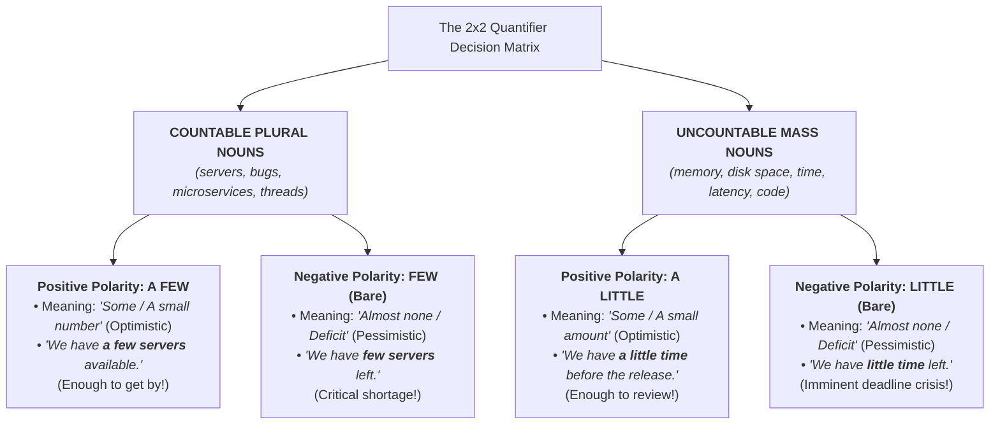

# Few / A Few vs. Little / A Little: Disambiguation Matrix ⚖️📊

> **Level:** CEFR A2–B2 (Countability Alignment & Psychological Polarity)  
> **Primary References:** Raymond Murphy (*English Grammar in Use*, Units 87–88); Michael Swan (*Practical English Usage*, §13.3)  
> **Core Conflict:** Choosing between **`few`**, **`a few`**, **`little`**, and **`a little`** requires resolving two orthogonal grammatical axes simultaneously: **Countability** (Countable Plural vs. Uncountable Mass) and **Psychological Polarity** (Negative Scarcity vs. Positive Sufficiency). The presence or absence of the tiny article **`a`** radically reverses the speaker's assessment from optimism to crisis.

---

## 1. The 2x2 Quantifier Matrix



---

## 2. Side-by-Side Semantic Contrast Matrix

| Quantifier Form | Target Noun Class | Meaning & Attitude | Connotation | Operational Tone in Tech |
| :--- | :--- | :--- | :---: | :--- |
| **`a few`** | **Countable Plural** | *Some; at least a small quantity* | **Positive / Reassuring** | *We have **a few instances** running; service is operational.* |
| **`few`** *(bare)* | **Countable Plural** | *Almost none; not nearly enough* | **Negative / Scarcity** | * **Few instances** survived the network partition; we are down.* |
| **`a little`** | **Uncountable Mass**| *Some; a modest amount* | **Positive / Reassuring** | *There is **a little memory** remaining; we can finish the job.* |
| **`little`** *(bare)*| **Uncountable Mass**| *Almost none; dangerously deficient* | **Negative / Scarcity** | *There is **little memory** remaining; an OOM panic is imminent.* |

---

## 3. High-Frequency Technical Computing Contrasts

Notice how omitting the article `a` shifts an operational status report from an all-clear into an emergency alert:

### Contrast 1: Resource Availability (Countable)
- **Positive (`A few`):**  
  *We have **a few worker threads** idle.*  
  $\rightarrow$ Good news: We have capacity to take on new tasks.
- **Negative Scarcity (`Few`):**  
  *We have **few worker threads** idle.*  
  $\rightarrow$ Warning: Thread pool exhaustion is near; we cannot handle more load.

### Contrast 2: Time and Buffer Capacity (Uncountable)
- **Positive (`A little`):**  
  *The database buffer has **a little headroom**.*  
  $\rightarrow$ Reassuring: We have sufficient buffer capacity for the current query.
- **Negative Scarcity (`Little`):**  
  *The database buffer has **little headroom**.*  
  $\rightarrow$ Critical alert: The buffer is almost full and threatens to overflow.

### Contrast 3: The Intensified Extreme Scarcity (`Very few` / `Very little`)
Prefixing *very* further accentuates the negative deficit:
- * **Very few engineers** understand the legacy Fortran codebase.* (Extremely rare).
- *The application requires **very little configuration** to boot.* (Near-zero overhead).

---

## 4. Practical Dual-Domain Examples

### Everyday Conversation

1. *A few (Positive):* *I have **a few friends** coming over for dinner tonight.* (Sociable/pleasant)
2. *Few (Negative):* *He is lonely because he has **few friends** in the city.* (Scarcity/sad)
3. *A little (Positive):* *Do you want milk in your tea? — Just **a little**, please.* (Some)
4. *Little (Negative):* *There is **little hope** of finding the missing cat.* (Almost no hope)
5. *A few (Positive):* *I need **a few minutes** to pack my suitcase.* (Manageable)
6. *Few (Negative):* * **Few people** understand the depth of quantum mechanics.* (Rarity)
7. *A little (Positive):* *She speaks **a little Italian**, so she can order food.* (Sufficient)
8. *Little (Negative):* *He knows **little English**, so he needs a translator.* (Insufficient)

### Software Engineering & Technical Documentation

9. *A few (Positive):* *The QA team discovered **a few minor UI bugs**, but the release is approved.*
10. *Few (Negative):* * **Few microservices** can tolerate complete DNS blackouts without degradation.*
11. *A little (Positive):* *With **a little caching**, query response times drop from 800ms to 20ms.*
12. *Little (Negative):* *The legacy monolithic system provides **little visibility** into transaction bottlenecks.*
13. *A few (Positive):* *We provisioned **a few additional pods** to absorb the promotional surge.*
14. *Few (Negative):* *There are **few options** remaining if the database vendor drops support.*
15. *A little (Positive):* *There is still **a little disk space** left on the root partition `/dev/sda1`.*
16. *Little (Negative):* *Because there was **little documentation**, reverse-engineering took three weeks.*
17. *Very few:* * **Very few security flaws** bypassed our automated static code analysis.*
18. *Very little:* *The revised schema uses **very little memory** for relational joins.*

---

## 5. Common Antipatterns & Diagnostic Table

| Incorrect Antipattern | Corrected Grammar | Rule & Explanation |
| :--- | :--- | :--- |
| ❌ *There are little servers active.* | ✅ *There are **few / a few servers** active.* | *Servers* is countable plural; use *few / a few*, never *little*. |
| ❌ *We have few time before release.* | ✅ *We have **little time** before release.* | *Time* (duration) is uncountable mass; use *little / a little*, never *few*. |
| ❌ *Don't worry, we have few bugs left.* | ✅ *Don't worry, we have **a few bugs** left.* / *...**only a few** bugs.* | Reassuring optimism requires *a few*, or specify *only a few*. |
| ❌ *The server has a few memory left.* | ✅ *The server has **a little memory** left.* | *Memory* (RAM) is uncountable mass; use *a little*. |
| ❌ *He wrote a few code.* | ✅ *He wrote **a little code**.* / *...a few **lines of code**.* | *Code* is uncountable mass; use *a little* or partitive *a few lines of*. |
| ❌ *Very little engineers know Rust.* | ✅ * **Very few engineers** know Rust.* | *Engineers* is countable plural; use *very few*. |

---

## 6. Self-Assessment Exercises

### Exercise 1: Countability & Polarity Discrimination
Fill in the blanks with **few**, **a few**, **little**, or **a little**:

1. Good news! We have ________ idle worker threads capable of processing the incoming webhook batch. (Countable / Positive)
2. Warning! There is ________ free disk space remaining on the primary database host. (Uncountable / Negative)
3. The legacy daemon provides ________ logging, making root cause analysis almost impossible. (Uncountable / Negative)
4. We resolved the incident quickly because ________ senior engineers were already online. (Countable / Positive)
5. ________ open-source frameworks support distributed transactions out of the box. (Countable / Negative scarcity)

### Exercise 2: Contextual Diagnostics
Correct the quantifier error in each sentence:

6. The cluster has little nodes running, so traffic is being throttled.
7. Fortunately, the incident commander has few spare minutes to review our RCA document.
8. We need to allocate a few more memory to the JVM heap before restarting.
9. There are little differences between version 2.1 and version 2.2 of the specification.
10. The security auditor noticed a few suspicious code in the pull request.

<details>
<summary>View Complete Answer Key & Diagnostic Explanations</summary>

1. **a few** (Countable plural + positive sufficiency: *a few idle worker threads*).
2. **little** (Uncountable mass + negative scarcity: *little free disk space*).
3. **little** (Uncountable mass + negative deficit: *little logging*).
4. **a few** (Countable plural + positive presence: *a few senior engineers*).
5. **Few** (Countable plural + negative scarcity: *Few open-source frameworks*).
6. The cluster has **few nodes** running, so traffic is being throttled. (*nodes* is countable $\rightarrow$ *few*).
7. Fortunately, the incident commander has **a few spare minutes** to review... (Positive sufficiency requires *a few*).
8. We need to allocate **a little more memory** to the JVM heap... (*memory* is uncountable mass $\rightarrow$ *a little*).
9. There are **few differences** (or *a few differences*) between version 2.1 and... (*differences* is countable).
10. The security auditor noticed **some suspicious code** / **a few suspicious lines of code**... (*code* is uncountable mass).

</details>

---

## 7. Revision Flashcards

```
Q: What is the grammatical difference between "few" and "little"?
A: "Few" is used with COUNTABLE PLURAL nouns ("few servers", "few bugs"). "Little" is used with UNCOUNTABLE MASS nouns ("little memory", "little time").

Q: What is the psychological difference between "a few" and "few"?
A: "A few" is POSITIVE / REASSURING (means "some / enough to get by"). "Few" (bare) is NEGATIVE / SCARCE (means "almost none / critical deficit").

Q: What is the psychological difference between "a little" and "little"?
A: "A little" is POSITIVE (means "some / a small amount"). "Little" (bare) is NEGATIVE (means "hardly any / insufficient amount").

Q: Why can't you say "We have a few memory left"?
A: "Memory" (RAM) is an uncountable mass noun. It must take "a little memory", not "a few".

Q: Why is "Very little engineers attended the talk" incorrect?
A: "Engineers" is a countable plural noun. You must use "Very FEW engineers".
```
