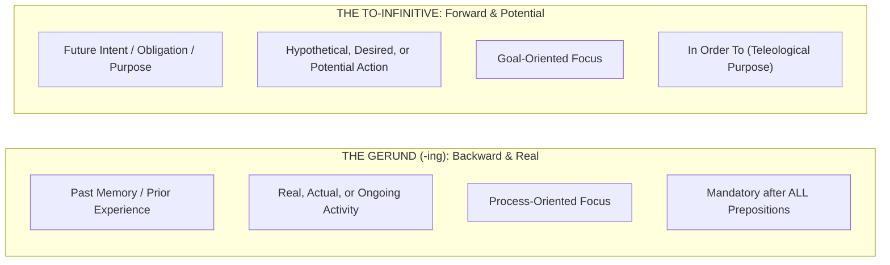

# Gerund vs. Infinitive: The Definitive Disambiguation Matrix ⚖️🔄

> **Level:** CEFR B1–C1 (Verb Complementation & Aspectual Semantics)  
> **Primary References:** Raymond Murphy (*English Grammar in Use*, Units 53–58); Michael Swan (*Practical English Usage*, §296–299)  
> **Core Conflict:** Non-finite verb complementation in English is governed by two competing forms: the **Gerund** (`Verb-ing`) and the **To-Infinitive** (`to + Verb`). While some verbs strictly take only one complement (*enjoy doing*, *decide to do*), a critical group of verbs can take **either**, with a profound, predictable shift in **temporal aspect**, **volition**, or **causal meaning**.

---

## 1. The Aspectual Polarity Principle

At an architectural level, the choice between a gerund and an infinitive reflects a fundamental semantic polarity:



---

## 2. Master Table of Verbs with Critical Semantic Shifts

These verbs change their meaning entirely depending on whether they are complemented by a gerund or a to-infinitive:

| Verb | Followed by To-Infinitive (`to + V`) | Followed by Gerund (`V-ing`) |
| :--- | :--- | :--- |
| **`Remember`** | **Forward duty / obligation:** You remember the task *first*, then execute it.<br>• *Remember to flush the Redis cache after deployment.* | **Backward memory / recollection:** You recall a past event or experience.<br>• *I remember flushing the cache, but the latency persisted.* |
| **`Forget`** | **Failure to perform a duty:** You neglected to do something.<br>• *Don't forget to renew the TLS certificate.* | **Loss of past memory:** Recalling an event (usually in negative/future).<br>• *I will never forget seeing the production database drop.* |
| **`Stop`** | **Interruption of one action to begin another:** Halt in order to do something else.<br>• *The engineers stopped to examine the latency spikes.* | **Permanent or temporary termination:** Cease the ongoing activity itself.<br>• *We must stop using deprecated v1 API endpoints.* |
| **`Regret`** | **Formal advance notice of bad news:** Delivering an unfortunate decision.<br>• *We regret to announce that the release is postponed.* | **Remorse for a past mistake:** Feeling sorrow for something already done.<br>• *I regret deploying the untested hotfix directly to master.* |
| **`Try`** | **Effort to overcome an obstacle:** Strive or attempt against difficulty.<br>• *The client tried to reconnect across the dropped network.* | **Experimental method / test:** Test an alternative method to see if it works.<br>• *If the pod hangs, try restarting the containerd daemon.* |
| **`Mean`** | **Intention or purpose:** Intend or plan to do something.<br>• *I didn't mean to overwrite your branch configuration.* | **Entailment or consequence:** Involve, require, or result in.<br>• *Adopting microservices means managing distributed transactions.* |
| **`Go on`** | **Sequential transition:** Change activity; proceed to the next item.<br>• *After explaining Docker, she went on to explain Kubernetes.* | **Continuation:** Persist in doing the exact same ongoing action.<br>• *The background worker went on consuming messages all night.* |

---

## 3. Strict Single-Complementation Classes

Many verbs permit **only one** pattern. Mixing them produces immediate grammatical failure.

### Strict Gerund-Only Verbs (`Verb + V-ing`)
*admit, avoid, consider, delay, deny, enjoy, finish, imagine, involve, postpone, practice, recommend, risk, suggest*

- *The architect **suggested refactoring** the auth controller.* (❌ NOT: *suggested to refactor*).
- *We cannot **risk deploying** on Friday afternoon.* (❌ NOT: *risk to deploy*).
- *Have you **finished benchmarking** the gRPC service?* (❌ NOT: *finished to benchmark*).

### Strict Infinitive-Only Verbs (`Verb + to + V`)
*agree, decide, demand, fail, hesitate, hope, learn, manage, offer, plan, prepare, promise, refuse, threaten*

- *The leadership team **decided to adopt** Rust for high-throughput microservices.* (❌ NOT: *decided adopting*).
- *The script **failed to establish** a TCP handshake.* (❌ NOT: *failed establishing*).
- *We **manage to sustain** 99.99% uptime with automated canary rollouts.* (❌ NOT: *manage sustaining*).

### Dual Verbs with Minimal Meaning Difference
*begin, start, continue, bother, intend*

- *The service **started logging / started to log** debug metrics.* (Both are grammatically standard).
- *Rule of Euphonic Stylistics:* Avoid two `-ing` forms together:  
  *It is **starting to fail*** (preferred over *It is starting failing* ❌).

---

## 4. The Absolute Preposition Invariant

One of the most powerful grammatical invariants in the English language:

$$\mathbf{Preposition} + \mathbf{Gerund\ (Verb\text{-}ing)} \quad \text{--- NEVER an Infinitive}$$

This rule applies to all simple prepositions (*in, on, at, by, for, about, without, before, after*) and prepositional phrases:
- *She succeeded **by optimizing** the SQL query.*
- *Never deploy **without running** automated regression suites.*
- *He is responsible **for maintaining** our cloud infrastructure.*

### The Trap: The Preposition "To" vs. The Infinitive Particle "To"
When `to` is a **preposition**, it **must** be followed by a **gerund**, not a bare or to-infinitive:

| Construction | Correct Pattern (`to + V-ing`) | ❌ Fatal Bug Pattern |
| :--- | :--- | :--- |
| **`look forward to`** | *We look forward to **collaborating** with your team.* | ❌ *look forward to collaborate* |
| **`be / get used to`** | *Engineers are used to **working** with distributed systems.* | ❌ *used to work* |
| **`object to`** | *The security team objected to **opening** port 22.* | ❌ *objected to open* |
| **`be committed to`** | *We are committed to **maintaining** backward compatibility.* | ❌ *committed to maintain* |
| **`with a view to`** | *We restructured code with a view to **improving** maintainability.* | ❌ *with a view to improve* |

---

## 5. Practical Dual-Domain Examples

### Everyday Conversation

1. *Remember to:* *Please **remember to lock** the front door when you leave.*
2. *Remember -ing:* *I clearly **remember meeting** her at the university graduation five years ago.*
3. *Stop -ing:* *You should **stop drinking** caffeinated coffee so late in the evening.*
4. *Stop to:* *On our road trip, we **stopped to take** photos of the mountain valley.*
5. *Try -ing:* *If your throat hurts, **try drinking** warm tea with honey.*
6. *Try to:* *I am **trying to lift** this heavy oak table, but it won't budge.*
7. *Regret to:* *We **regret to tell** you that all flights have been canceled due to snow.*
8. *Regret -ing:* *I **regret buying** that expensive jacket because I never wear it.*

### Software Engineering & Technical Documentation

9. *Remember to:* *Always **remember to release** acquired database mutex locks inside `finally` blocks.*
10. *Remember -ing:* *The database administrator **remembers configuring** replication, but the slave lag persisted.*
11. *Stop -ing:* *The microservice cluster **stopped accepting** inbound HTTP requests when thread pools saturated.*
12. *Stop to:* *The background processor periodically **stops to collect** garbage from detached memory segments.*
13. *Try -ing:* *If network packet drops occur during peak load, **try increasing** the kernel socket buffer size.*
14. *Try to:* *The automated circuit breaker **tried to restore** the degraded upstream connection five times.*
15. *Mean -ing:* *Migrating our relational storage to a distributed NoSQL engine **means rewriting** the entire ORM layer.*
16. *Preposition invariant:* *The incident response team focused on **mitigating** data corruption rather than **assigning** blame.*

---

## 6. Common Antipattern Diagnostic Bug-and-Patch Table

| ❌ Broken Anti-Pattern (Bug) | Corrected Idiomatic English (Patch) | Diagnostic Grammar Explanation |
| :--- | :--- | :--- |
| ❌ *The team suggested **to rewrite** the legacy API.* | ✅ *The team suggested **rewriting** the legacy API.* | *Suggest* is a strict gerund-complementation verb; it can never take a to-infinitive. |
| ❌ *We look forward to **deploy** the new architecture.* | ✅ *We look forward to **deploying** the new architecture.* | In *look forward to*, `to` is a preposition requiring a nominal gerund (`-ing`). |
| ❌ *Don't forget **locking** the staging cluster.* | ✅ *Don't forget **to lock** the staging cluster.* | Forward-looking duties and obligations require the to-infinitive (*forget to lock*). |
| ❌ *The server stopped **to serve** requests after crashing.* | ✅ *The server stopped **serving** requests after crashing.* | Cessation/termination of an ongoing operation requires the gerund (*stopped serving*). |
| ❌ *The system failed **completing** the transaction.* | ✅ *The system failed **to complete** the transaction.* | *Fail* strictly takes a to-infinitive (*failed to complete*). |
| ❌ *We decided **postponing** the quarterly release.* | ✅ *We decided **to postpone** the quarterly release.* | *Decide* strictly governs an infinitive (*decided to postpone*). |
| ❌ *He is capable to **solve** complex race conditions.* | ✅ *He is capable of **solving** complex race conditions.* | The adjective *capable* governs the preposition *of*, which strictly demands a gerund. |
| ❌ *They avoided **to expose** credentials in plain text.* | ✅ *They avoided **exposing** credentials in plain text.* | *Avoid* is a strict gerund-only verb (*avoid exposing*). |

---

## 7. Self-Assessment Practice Exercises

### Exercise 1: Gerund or Infinitive? (Select the correct form)
1. If the container keeps crashing on startup, try (to delete / deleting) the corrupted cache volume.
2. The site reliability team managed (to prevent / preventing) a complete data center blackout.
3. Don't forget (to sanitize / sanitizing) all incoming user parameters before building SQL queries.
4. The architect regrets (to announce / announcing) that support for Python 3.8 is officially discontinued.
5. We look forward to (receive / receiving) your feedback on the newly published RFC draft.

### Exercise 2: Error Correction (Identify and repair the complementation error)
6. *The engineering board recommended to migrate our monolithic services to Kubernetes.*
7. *After completing the network diagnosis, the team went on optimizing database indices.*
8. *The cron scheduler stopped to run jobs because the node ran out of disk inodes.*
9. *Developers must avoid to commit sensitive API secrets directly into git repositories.*
10. *She is thoroughly accustomed to work under high-stress production outage scenarios.*

---

## 8. Answer Key with Diagnostic Explanations

1. **deleting** — *Try doing* expresses testing an experimental solution or troubleshooting method.
2. **to prevent** — *Manage* strictly takes a to-infinitive (*managed to prevent*).
3. **to sanitize** — *Forget to do* denotes failing to perform an intended future duty or obligation.
4. **to announce** — *Regret to do* is used when formally delivering bad news in advance (*regret to announce*).
5. **receiving** — *Look forward to* ends with the preposition *to*, which strictly mandates a gerund.
6. **Correction:** *The engineering board recommended **migrating** our monolithic services to Kubernetes.*  
   *Explanation:* *Recommend* is a strict gerund-only verb (*recommend doing*).
7. **Correction:** *After completing the network diagnosis, the team went on **to optimize** database indices.*  
   *Explanation:* Shifting sequentially from one task to a distinct new task requires *go on to do*.
8. **Correction:** *The cron scheduler stopped **running** jobs because the node ran out of disk inodes.*  
   *Explanation:* Terminating or ceasing an ongoing action requires *stop doing* (*stopped running*).
9. **Correction:** *Developers must avoid **committing** sensitive API secrets directly into git repositories.*  
   *Explanation:* *Avoid* strictly governs a gerund complement (*avoid committing*).
10. **Correction:** *She is thoroughly accustomed to **working** under high-stress production outage scenarios.*  
    *Explanation:* *Be accustomed to* features prepositional *to*, demanding a gerund (*accustomed to working*).

---

## 9. High-Density Revision Flashcards

```
Q: What is the core aspectual difference between 'try to do' and 'try doing'?
A: 'Try to do' = Make an effort to overcome a difficult obstacle (attempt).
   'Try doing' = Conduct an experiment or test an alternative technique to see if it solves the problem.
```

```
Q: What is the difference between 'stop to do' and 'stop doing'?
A: 'Stop to do' = Halt one action in order to perform another (teleological purpose).
   'Stop doing' = Terminate/cease the ongoing activity itself (cessation).
```

```
Q: What is the universal rule for verb forms following prepositions?
A: Preposition + Gerund (-ing) ALWAYS. (e.g., 'interested in optimizing', 'succeeded by refactoring').
```

```
Q: Why does 'look forward to meeting' take -ing?
A: Because 'to' is a PREPOSITION in this phrasal structure, not an infinitive marker.
   Prepositions strictly demand gerund complements.
```
