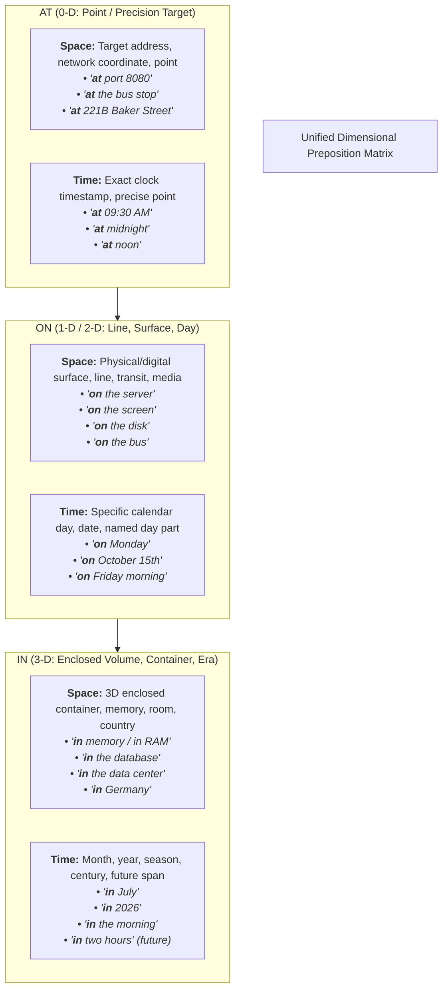
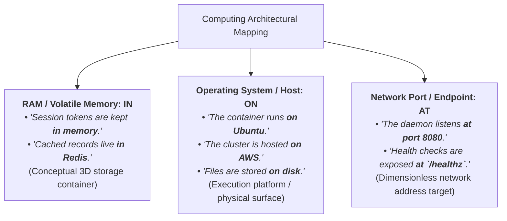

# In vs. On vs. At (Time and Place): Disambiguation Matrix ⚖️🧭

> **Level:** CEFR A1–B2 (Dimensional Topology & Geometric Symmetry)  
> **Primary References:** Raymond Murphy (*English Grammar in Use*, Units 119, 121–125); Michael Swan (*Practical English Usage*, §18.1–18.5)  
> **Core Concept:** English organizes both **Physical Space** and **Abstract Time** using the identical cognitive geometry: the **Dimensional Hierarchy**. **`At`** represents zero-dimensional points and precise milestones; **`On`** represents one/two-dimensional surfaces, lines, and calendar days; and **`In`** represents three-dimensional enclosed volumes, territories, and broad time periods.

---

## 1. The Unified Dimensional Matrix (Time & Space)



---

## 2. Side-by-Side Spatial vs. Temporal Cross-Comparison

| Dimensional Rank | Preposition | Spatial Role (Where?) | Temporal Role (When?) |
| :---: | :---: | :--- | :--- |
| **0-D**<br>*(Point / Precision)* | **`AT`** | • Exact address (*at 10 Downing St*)<br>• Discrete network port (*at port 443*)<br>• API endpoint (*at `/api/v1/auth`*)<br>• Social events (*at the conference*) | • Clock time (*at 14:00 UTC*)<br>• Fixed milestones (*at noon, at dawn*)<br>• Multi-day holidays (*at Christmas*)<br>• Temporal idioms (*at the moment, at night*) |
| **1-D / 2-D**<br>*(Surface / Line / Day)* | **`ON`** | • Hardware platform / host (*on AWS, on Linux*)<br>• Storage media surface (*on SSD, on disk*)<br>• Displays & network (*on the screen, on the internet*)<br>• Public transit (*on the train, on a plane*) | • Days of the week (*on Wednesday*)<br>• Specific dates (*on 4 July 2026*)<br>• Day parts with day (*on Friday evening*)<br>• Single-day holidays (*on Christmas Day*) |
| **3-D**<br>*(Volume / Period)* | **`IN`** | • Volatile RAM storage (*in memory, in RAM*)<br>• Data tables / files (*in the database, in `.env`*)<br>• Physical rooms (*in the server room*)<br>• Geographic territories (*in Japan, in Berlin*) | • Months (*in August*)<br>• Years & decades (*in 2026, in the 1990s*)<br>• Seasons & centuries (*in winter, in the 21st century*)<br>• Future elapsed time (*in ten minutes*) |

---

## 3. High-Frequency Technical Computing Mapping

Software architecture relies heavily on spatial metaphors. The exact choice of preposition reflects the underlying hardware model:



> [!TIP]
> - Data is stored **in** memory.
> - The binary runs **on** the server.
> - The proxy listens **at** port 443.

---

## 4. Practical Dual-Domain Examples

### Everyday Conversation

1. *Space At:* *I will meet you **at the coffee shop** on the corner.*
2. *Space On:* *Leave the keys **on the kitchen counter**.*
3. *Space In:* *She was sitting **in her office** reading a book.*
4. *Time At:* *The train arrives **at 07:45 AM**.*
5. *Time On:* *Our anniversary is **on June 12th**.*
6. *Time In:* *We are traveling to France **in the summer**.*
7. *Transit On vs In:* *He is **on the bus** (public transit), but she is **in a taxi** (private vehicle).*
8. *Future In:* *The keynote begins **in fifteen minutes**.*

### Software Engineering & Technical Documentation

9. *Space In:* *User password hashes are stored securely **in the PostgreSQL database**.*
10. *Space On:* *The microservice executes seamlessly **on ARM64 hardware**.*
11. *Space At:* *The Prometheus exporter listens for metrics scrapes **at port 9100**.*
12. *Time At:* *Automated database maintenance kicks off **at 02:00 UTC**.*
13. *Time On:* *The sprint planning session occurs **on Monday morning**.*
14. *Time In:* *We migrated our monolithic backend to Kubernetes **in 2023**.*
15. *Digital On:* *Documentation is published **on our public website** and **on GitHub**.*
16. *Physical In:* *The technician is working **in the server room**.*
17. *Punctuality On vs In:* *The release shipped **on time** (punctual) / The fix was merged **in time** (before failure).*
18. *Future In:* *The automated failover script will timeout **in 30 seconds**.*

---

## 5. Common Antipatterns & Diagnostic Table

| Incorrect Antipattern | Corrected Grammar | Rule & Explanation |
| :--- | :--- | :--- |
| ❌ *The cache lives on memory.* | ✅ *The cache lives **in memory**.* | Volatile RAM is conceived as an enclosed 3D storage container (*in*). |
| ❌ *The meeting is in Monday.* | ✅ *The meeting is **on Monday**.* | Specific days of the week strictly take *on*. |
| ❌ *I saw the tutorial in internet.* | ✅ *I saw the tutorial **on the internet**.* | Digital surfaces, networks, and media strictly take *on*. |
| ❌ *The server failed in 03:00 AM.* | ✅ *The server failed **at 03:00 AM**.* | Specific clock times are dimensionless points requiring *at*. |
| ❌ *The service listens in port 80.* | ✅ *The service listens **at port 80**.* | Network ports represent discrete target point coordinates (*at*). |
| ❌ *The company was founded on 2018.* | ✅ *The company was founded **in 2018**.* | Years and decades are broad temporal periods taking *in*. |
| ❌ *He is in the train right now.* | ✅ *He is **on the train** right now.* | Public transportation where you can stand and walk takes *on*. |

---

## 6. Self-Assessment Exercises

### Exercise 1: Space & Time Triad Selection
Fill in the blanks with **in**, **on**, or **at**:

1. The reverse proxy listens for incoming connections ________ port 443.
2. The user session metadata is cached ________ Redis.
3. The platform engineering team deployed the hotfix ________ Monday afternoon.
4. The database server crashed ________ midnight due to an unhandled kernel panic.
5. We store our configuration secrets ________ an encrypted `.env` file ________ the host filesystem.

### Exercise 2: Technical Error Diagnostics
Correct the prepositional error in each sentence:

6. The application runs containerized workloads in AWS EC2 instances.
7. I will see you on the morning before the sprint planning meeting.
8. The database engine was released on 2021 by a team of open-source engineers.
9. Is the telemetry dashboard displayed in the screen in room 4B?
10. The microservice will restart automatically at two minutes. (Meaning: two minutes from now).

<details>
<summary>View Complete Answer Key & Diagnostic Explanations</summary>

1. **at** (*at port 443* — network coordinate).
2. **in** (*in Redis* — in-memory container).
3. **on** (*on Monday afternoon* — day part specified with named day).
4. **at** (*at midnight* — precision milestone).
5. **in** an encrypted `.env` file **on** the host filesystem (*in* for file; *on* for filesystem surface).
6. The application runs containerized workloads **on** AWS EC2 instances. (Platform surface).
7. I will see you **in the morning** before... (General day part takes *in*).
8. The database engine was released **in 2021** by... (Calendar year takes *in*).
9. Is the telemetry dashboard displayed **on the screen** in room 4B? (Display surface takes *on*).
10. The microservice will restart automatically **in two minutes**. (Elapsed future duration takes *in*).

</details>

---

## 7. Revision Flashcards

```
Q: What is the unified dimensional rule for "at", "on", and "in"?
A: "At" is 0-D (dimensionless points, addresses, clock times); "On" is 1-D/2-D (surfaces, lines, media, calendar days); "In" is 3-D (enclosed volumes, containers, rooms, months, years, eras).

Q: In computing, why do we say "in memory" but "on the server"?
A: Memory (RAM) is treated conceptually as an internal container holding data ("in"); a server or operating system is treated as an execution platform or surface ("on").

Q: What preposition is used with clock time (e.g. 5:00 PM) versus calendar days (e.g. Tuesday)?
A: "At" for clock time ("at 5:00 PM"); "On" for calendar days ("on Tuesday").

Q: Why do we say "on the bus" but "in a taxi"?
A: Public transit vehicles where you can stand up and walk around take "on" (on the train, on the plane, on the bus); small enclosed personal vehicles take "in" (in a car, in a taxi).

Q: What does "in ten minutes" mean when used with future tenses?
A: It indicates elapsed time into the future ("The server will reboot in ten minutes" = ten minutes from now).
```
