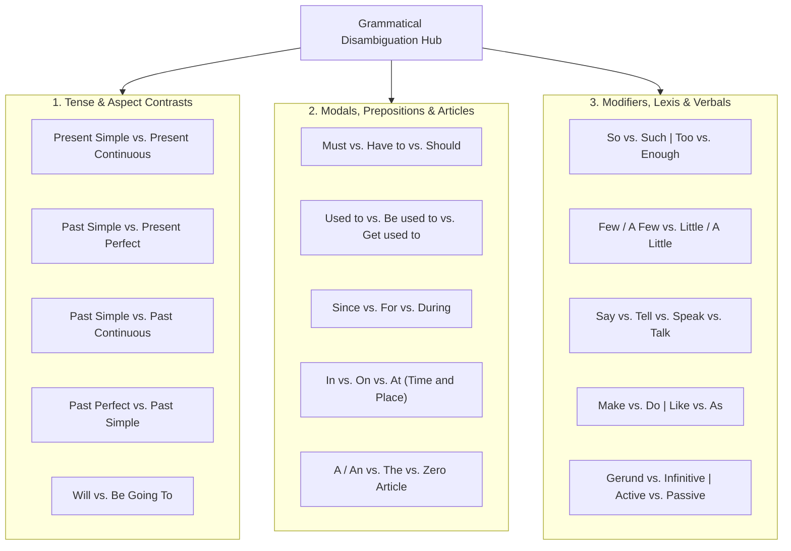

# Module 13: Comparisons and Disambiguation Matrices ⚖️🔬

> **Level:** CEFR A2–C1 (Side-by-Side Structural Disambiguation)  
> **Primary References:** Raymond Murphy (*English Grammar in Use*, Summary & Contrast Units); Michael Swan (*Practical English Usage*, Diagnostic Contrast Sections)  
> **Core Concept:** True fluency and precision in English require more than understanding individual rules in isolation—they demand the ability to **differentiate between closely related structures**. This module provides **18 side-by-side diagnostic contrast guides**, resolving the most persistent grammatical dilemmas encountered by software engineers and technical communicators.

---

## 1. The Disambiguation Decision Matrix

---

## 2. Topic Curriculum

This module contains **18 deep-dive disambiguation guides**:

| Guide | Core Contrast | Target CEFR | Authoritative Literature |
| :--- | :--- | :---: | :--- |
| **01. [Present Simple vs. Present Continuous](present-simple-vs-present-continuous.md)** | Permanent system states & cron schedules vs. active processes & temporary spikes | A2–B1 | Murphy Units 3–4; Swan §3.1–3.3 |
| **02. [Past Simple vs. Present Perfect](past-simple-vs-present-perfect.md)** | Definite finished past timestamps vs. current system state & life experience | A2–B2 | Murphy Units 13–14, 20; Swan §4.1–4.3 |
| **03. [Past Simple vs. Past Continuous](past-simple-vs-past-continuous.md)** | Completed sequential events vs. interrupted background states | A2–B1 | Murphy Unit 6; Swan §4.4 |
| **04. [Past Perfect vs. Past Simple](past-perfect-vs-past-simple.md)** | Pre-past priority & root cause causality vs. chronological narrative sequence | B1–B2 | Murphy Units 15–16; Swan §4.5 |
| **05. [Will vs. Be Going To](will-vs-be-going-to.md)** | Instant decisions, promises & predictions vs. premeditated plans & visible evidence | A2–B1 | Murphy Units 20–23; Swan §5.1–5.3 |
| **06. [Used To vs. Be Used To vs. Get Used To](used-to-vs-be-used-to-vs-get-used-to.md)** | Past abandoned habits (*used to do*) vs. familiarity (*be used to doing*) vs. adaptation (*get used to doing*) | B1–B2 | Murphy Units 18, 61; Swan §1.6 |
| **07. [Must vs. Have To vs. Should](must-vs-have-to-vs-should.md)** | Internal conviction & RFC absolute requirement vs. external compliance law vs. advisory best practice | B1–B2 | Murphy Units 31–33; Swan §7.1–7.4 |
| **08. [Since vs. For vs. During](since-vs-for-vs-during.md)** | Starting timestamp anchor vs. duration numerical quantity vs. named event window | A2–B1 | Murphy Units 12, 119–120; Swan §18.2 |
| **09. [A / An vs. The vs. Zero Article](a-an-vs-the-vs-zero-article.md)** | First mention/unspecified vs. shared context/unique vs. generic plural/uncountable classes | A2–B2 | Murphy Units 72–78; Swan §11–12 |
| **10. [In vs. On vs. At (Time and Place)](in-vs-on-vs-at-time-and-place.md)** | 3D volume/period vs. 2D surface/calendar day vs. 0D point/clock timestamp | A1–B2 | Murphy Units 119, 121–125; Swan §18.1–18.5 |
| **11. [So vs. Such](so-vs-such.md)** | Adjectival/adverbial modifier (*so slow*) vs. nominal phrase modifier (*such a slow query*) | B1–B2 | Murphy Unit 102; Swan §15.5 |
| **12. [Too vs. Enough](too-vs-enough.md)** | Prohibitive excess with negative consequence vs. sufficient threshold capability & position laws | A2–B1 | Murphy Unit 103; Swan §15.6 |
| **13. [Few / A Few vs. Little / A Little](few-a-few-vs-little-a-little.md)** | Countable vs. uncountable countability + positive attitude (*a few/a little*) vs. negative deficit (*few/little*) | A2–B2 | Murphy Units 87–88; Swan §13.3 |
| **14. [Say vs. Tell vs. Speak vs. Talk](say-vs-tell-vs-speak-vs-talk.md)** | Direct utterance (*say that*) vs. personal indirect object (*tell someone*) vs. language/formality (*speak*) vs. conversational dialogue (*talk*) | A2–B2 | Murphy Units 47–48; Swan §24, 31 |
| **15. [Make vs. Do](make-vs-do.md)** | Creation, construction & causing an effect (*make a decision*) vs. execution, tasks & processes (*do maintenance*) | A2–B2 | Swan §31 (Make/Do Collocations) |
| **16. [Like vs. As](like-vs-as.md)** | Preposition of similarity (*like a proxy*) vs. preposition of function/role (*as a proxy*) vs. conjunction (*as you know*) | B1–B2 | Murphy Unit 117; Swan §18.10 |
| **17. [Gerund vs. Infinitive](gerund-vs-infinitive.md)** | Abstract experience/experiment/termination vs. future goal/duty/attempt across 7 critical dual verbs | B1–C1 | Murphy Units 53–58; Swan §8–10 |
| **18. [Active vs. Passive Voice](active-vs-passive-voice.md)** | Accountability, direct action & commit messages vs. blameless postmortems, system events & objectivity | B1–B2 | Murphy Units 42–44; Swan §6.1–6.3 |

---

## 3. Cross-Reference Directory
- **Tenses:** [Tenses & Aspect](../03-tenses-and-aspect/) (The foundational tense guides).
- **Modifiers:** [Adjectives & Adverbs](../06-adjectives-and-adverbs/) (Gradability, comparison, and intensifiers).
- **Prepositions:** [Prepositions & Prepositional Phrases](../07-prepositions/) (Spatio-temporal dimensions).
- **Practical Writing:** [Practical Technical Communication](../15-practical-english-and-communication/) (Applying precise distinctions in PRs, postmortems, and RFCs).
