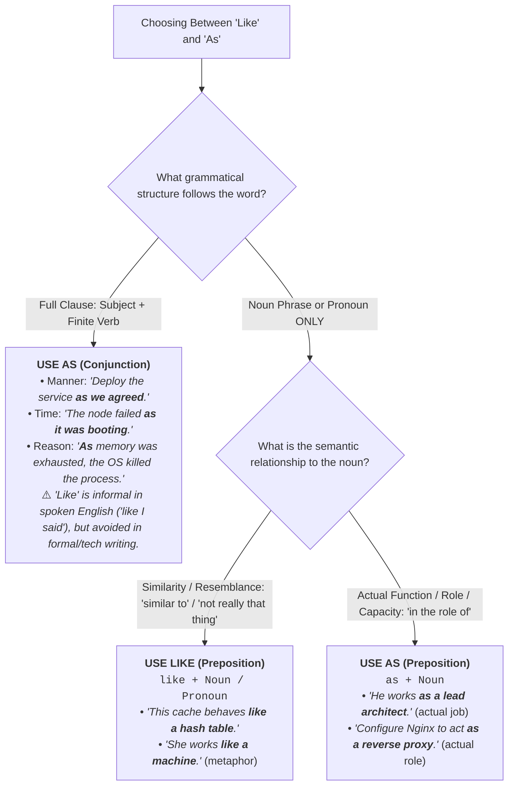

# Like vs. As: Disambiguation Matrix ⚖️🔍

> **Level:** CEFR B1–C1 (Prepositions, Conjunctions & Comparative Structures)  
> **Primary References:** Raymond Murphy (*English Grammar in Use*, Units 117–118); Michael Swan (*Practical English Usage*, §326, 327)  
> **Core Conflict:** **`Like`** and **`As`** both convey comparison, similarity, and relationships, but their **syntactic category** (preposition vs. conjunction) and **semantic function** (resemblance vs. real identity/role) differ fundamentally. In standard and formal technical English, using *like* when *as* is grammatically required—or using *like* instead of *such as* for technical exemplification—is considered a major register defect.

---

## 1. The Core Decision Architecture



---

## 2. Side-by-Side Structural & Semantic Matrix

| Dimension | `Like` (Preposition) | `As` (Preposition) | `As` (Conjunction) |
| :--- | :--- | :--- | :--- |
| **Part of Speech** | **Preposition** | **Preposition** | **Subordinating Conjunction** |
| **Complementation** | Followed by **Noun Phrase / Pronoun** (`like + NP`) | Followed by **Noun Phrase** (`as + NP`) | Followed by **Clause** (`as + Subject + Verb`) |
| **Core Meaning** | **Similarity, resemblance, analogy** (*similar to*) | **Actual function, identity, job, or role** (*in the capacity of*) | **Manner** (*in the way that*), **Reason** (*since/because*), **Time** (*while*) |
| **Pronoun Case** | Objective case: *like **him**, like **us*** | Objective case: *as a lead, as him* (rare) | Subjective case + verb: *as **he does**, as **we did*** |
| **Everyday Example** | *He sleeps **like a baby**.* (He is not a baby). | *She works **as a doctor**.* (She is a doctor). | *Do **as I say**, not **as I do**.* |
| **Technical Example** | *Redis functions **like a fast memory store**.* | *Envoy functions **as an API gateway**.* | *Configure TLS **as specified in RFC 8446**.* |

---

## 3. Critical Nuances & Technical Computing Traps

### Nuance 1: The Job / Role Test (*Like a Manager* vs. *As a Manager*)
The semantic difference between *like* and *as* before human titles is absolute:
- **`As an engineering director`**: The speaker **holds the actual position** of engineering director.  
  *Example:* *“**As an engineering director**, I must allocate budget responsibly.”*
- **`Like an engineering director`**: The speaker **is not** an engineering director, but behaves similarly or metaphorically.  
  *Example:* *“He has only three months of experience, but he talks **like an engineering director**.”*

### Nuance 2: Exemplification in Formal Technical Writing (*Such as* vs. *Like*)
In technical documentation, RFCs, and academic publications, precision in exemplification is essential:
- **`Such as` introduces inclusive examples (members of a set):**  
  *Relational databases, **such as PostgreSQL and MariaDB**, support ACID transactions.*  
  (PostgreSQL and MariaDB are actual relational databases).
- **`Like` implies resemblance, excluding the actual category:**  
  *Strict grammarians interpret “Relational databases **like** PostgreSQL” as “databases resembling PostgreSQL, but possibly not PostgreSQL itself.”*  
  $\rightarrow$ **Rule of Thumb:** Always use **`such as`** when providing representative examples in technical docs, ADRs, and README files.

### Nuance 3: Conjunction of Manner (*As* vs. *Like*)
In informal colloquial speech, native speakers frequently use *like* as a conjunction:
- Informal Spoken: *Like I mentioned in the sprint review...*
- Formal / Technical Standard: * **As** I mentioned in the sprint review...*
- Rule: Followed by a finite clause (`Subject + Verb`), use **`as`**:
  - *Run the migration script **as described in the deployment runbook**.*
  - *The system recovered automatically, **as was anticipated** by the resilience team.*

### Nuance 4: Comparative Structures (`As ... As`)
To express equality of attribute or rate:
$$\text{as} + \text{Adjective / Adverb} + \text{as} + \text{Noun / Clause}$$
- *Golang compiles **as fast as** C++ in standard benchmark suites.*
- *The failover mechanism executed **as smoothly as we had hoped**.*

---

## 4. Practical Dual-Domain Examples

### Everyday Conversation

1. *Like (Similarity):* *Your brother looks just **like your father**.*
2. *As (Role):* *Before switching to software, she worked **as a high school teacher**.*
3. *As (Manner Clause):* *You should cook the pasta **as the instructions on the box recommend**.*
4. *Like (Analogy):* *My apartment feels **like an oven** in July without air conditioning.*
5. *As (Reason Clause):* ***As it was pouring rain**, we decided to postpone the picnic.*
6. *As ... as (Comparison):* *She can run **as fast as** any professional athlete.*
7. *Like (Sensory verb):* *This soup smells **like roasted garlic and herbs**.*
8. *As (Time Clause):* ***As I was walking out the door**, the telephone rang.*

### Software Engineering & Technical Documentation

9. *Like (Analogy):* *A message broker queue operates **like a FIFO pipe**, buffering events between asynchronous services.*
10. *As (Actual Role):* *The EC2 instance is provisioned to serve **as a dedicated Redis caching replica**.*
11. *As (Conjunction of Manner):* *Deploy the Kubernetes helm chart **as documented in `DEPLOYMENT.md`**.*
12. *Such as (Technical Exemplification):* *Modern web browsers support ECMAScript features **such as async/await, optional chaining, and nullish coalescing**.*
13. *As if / As though (Hypothetical):* *The monolithic application behaves **as if it were single-threaded** whenever disk I/O bottlenecks occur.*
14. *As (Time / Process Progression):* ***As the data volume scales**, database query planners shift from nested loops to hash joins.*
15. *Like vs. As (System Function):* *Although GraphQL resolves fields **like an RPC mechanism**, it is consumed over HTTP **as a declarative data query language**.*
16. *As (Reason in Incident Postmortems):* ***As the primary database instance failed health checks**, the cluster triggered an automated replica promotion.*

---

## 5. Common Antipattern Diagnostic Bug-and-Patch Table

| ❌ Broken Anti-Pattern (Bug) | Corrected Idiomatic English (Patch) | Diagnostic Grammar Explanation |
| :--- | :--- | :--- |
| ❌ *Execute the unit tests **like it is written** in the README.* | ✅ *Execute the unit tests **as (it is) written** in the README.* | *It is written* is a finite clause (`Subject + Verb`); conjunction of manner requires *as*, not *like*. |
| ❌ *He joined Google **like a site reliability engineer**.* | ✅ *He joined Google **as a site reliability engineer**.* | Actual employment roles and job titles strictly require the preposition *as*, indicating real capacity. |
| ❌ *We evaluate NoSQL stores **like MongoDB and Cassandra**.* | ✅ *We evaluate NoSQL stores **such as MongoDB and Cassandra**.* | In formal technical writing, representative examples are introduced by *such as*, not *like*. |
| ❌ *The cache acts **like an API gateway** in our architecture.* | ✅ *The cache acts **as an API gateway** in our architecture.* | Fixed verbal collocation: *act as* denotes fulfilling a specific architectural role or operational duty. |
| ❌ *The microservice crashed **like I predicted**.* | ✅ *The microservice crashed **as I predicted**.* | *I predicted* is a clause (`Subject + Verb`); formal style requires the conjunction *as*. |
| ❌ *Our cluster is not **so reliable like** their cluster.* | ✅ *Our cluster is not **as reliable as** their cluster.* | Equal comparison uses the formula `as + adjective + as`, never `so ... like`. |
| ❌ *She speaks English **as a native speaker**.* | ✅ *She speaks English **like a native speaker**.* | Metaphorical similarity (she is not actually a native speaker, but speaks similarly) requires *like*. |

---

## 6. Self-Assessment Practice Exercises

### Exercise 1: Choose Between *Like*, *As*, or *Such As*
1. Configure Nginx to operate ________ the primary reverse proxy for ingress traffic.
2. In-memory data stores ________ Redis and KeyDB provide sub-millisecond retrieval latency.
3. This algorithm traverses the binary search tree ________ a depth-first search crawler would.
4. ________ we discussed in the sprint planning meeting, the API breaking changes will be scheduled for v2.0.
5. The backup routine runs every midnight, exactly ________ specified in the cron definition.

### Exercise 2: Antipattern Detection and Correction
6. *He works like a senior backend developer at Microsoft.*
7. *Like the database CPU reached 98%, the connection pool started rejecting incoming queries.*
8. *Deploy the microservice like you did in the staging cluster.*
9. *Relational databases like Postgres and MySQL enforce foreign key constraints.*
10. *The new junior developer codes as a senior engineer with ten years of experience.*

---

## 7. Answer Key with Diagnostic Explanations

1. **as** — Fulfilling a genuine architectural function or designated role requires prepositional *as*.
2. **such as** — Formal technical exemplification introducing members of a category (*in-memory data stores*) requires *such as*.
3. **like** (or **as** if clause is completed) — *Like a depth-first search crawler* (preposition before NP); if followed by *would*, *as a depth-first search crawler would* is the formal conjunction of manner.
4. **As** — Followed by the clause *we discussed*, conjunction of manner requires *As we discussed*.
5. **as** — Reduced clause denoting manner (*as specified*) takes *as*.
6. **Correction:** *He works **as** a senior backend developer at Microsoft.*  
   *Explanation:* Legitimate job capacity requires the preposition *as*, not *like*.
7. **Correction:** ***As** the database CPU reached 98%, the connection pool started rejecting incoming queries.*  
   *Explanation:* Conjunction of reason/time introducing a finite clause requires *As* (or *Because / When*).
8. **Correction:** *Deploy the microservice **as** you did in the staging cluster.*  
   *Explanation:* Finite clause *you did* requires the conjunction of manner *as* in formal technical writing.
9. **Correction:** *Relational databases **such as** Postgres and MySQL enforce foreign key constraints.*  
   *Explanation:* Professional documentation uses *such as* for inclusive category examples rather than *like*.
10. **Correction:** *The new junior developer codes **like** a senior engineer with ten years of experience.*  
    *Explanation:* Metaphorical comparison of resemblance (he is not actually a senior engineer) requires prepositional *like*.

---

## 8. High-Density Revision Flashcards

```
Q: What is the rule for 'like' vs. 'as' before a noun phrase?
A: Use 'LIKE' for similarity/resemblance/metaphor (X is similar to Y, but is NOT Y).
   Use 'AS' for actual role, capacity, identity, or function (X IS genuinely acting in the role of Y).
```

```
Q: What is the rule for 'like' vs. 'as' before a clause (Subject + Verb)?
A: Use 'AS' in standard/formal English (e.g., 'as we agreed', 'as specified in RFC 2119').
   'Like' as a conjunction ('like I said') is common in colloquial speech, but deprecated in formal writing.
```

```
Q: Why is 'such as' preferred over 'like' in technical documentation?
A: 'Such as' introduces inclusive, representative examples belonging to a set (e.g., 'languages such as Rust and Go').
   'Like' literally denotes resemblance and can exclude the named examples from the set.
```
