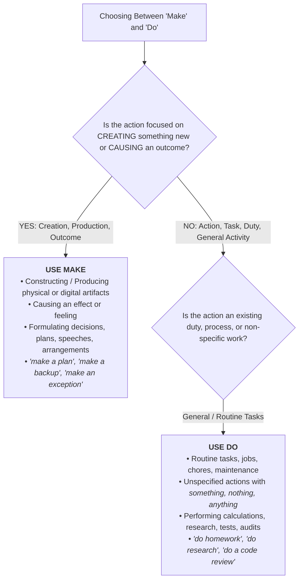

# Make vs. Do: Disambiguation Matrix ⚖️🛠️

> **Level:** CEFR A2–B2 (Lexical Selection & Collocation Systems)  
> **Primary References:** Raymond Murphy (*English Grammar in Use*, Unit 57); Michael Swan (*Practical English Usage*, §31, 335)  
> **Core Conflict:** Non-native English speakers frequently interchange **`make`** and **`do`** because many languages express both concepts with a single lexical root (e.g., Spanish *hacer*, French *faire*, German *machen/tun*, Hindi *karna*). In English, **`make`** signifies *creating, producing, building, or causing an outcome*, whereas **`do`** signifies *performing an action, completing a duty, conducting a process, or handling non-specific work*.

---

## 1. The Core Decision Architecture



---

## 2. Side-by-Side Semantic & Structural Contrast Matrix

| Dimension | `Make` (Production & Origination) | `Do` (Execution & Activity) |
| :--- | :--- | :--- |
| **Core Semantic Primitive** | **Create, produce, construct, originate, generate, cause** | **Perform, carry out, execute, fulfill, conduct** |
| **Physical Creation** | *make a prototype, make coffee, make furniture, make a cake* | *(Not used for physical building)* |
| **Digital / Conceptual Output** | *make a commit, make an API call, make a change, make a copy* | *do data processing, do maintenance, do testing* |
| **Decisions & Plans** | *make a decision, make a choice, make plans, make arrangements* | *(Not used for decisions)* |
| **Speech & Interaction** | *make a suggestion, make a comment, make an offer, make a promise* | *(Not used for speech acts)* |
| **Work / Duties / Chores** | *(Not used for general duties)* | *do work, do a job, do homework, do chores, do the dishes* |
| **Indefinite Pronouns** | *(Rarely takes indefinite pronouns)* | *do something, do nothing, do anything, do everything* |
| **Study & Investigations** | *(Not used for academic investigation)* | *do research, do an experiment, do an audit, do a degree* |
| **Causative Pattern** | `make + object + bare infinitive`: *It made us refactor.* | *(Not causative in standard syntax)* |

---

## 3. High-Frequency Technical & Engineering Collocations

Software architecture and technical operations rely on strict, immutable collocations with `make` and `do`:

### Engineering Usages of `Make` (Producing Artifacts, Decisions & Calls)
- **`make an API request / call`**: Originate an HTTP query across the network interface.
- **`make a pull request (PR)`**: Create a proposal to merge code branches.
- **`make a release / build`**: Compile artifacts and produce a shippable binary version.
- **`make a decision`**: Formulate an architectural direction (e.g., an Architecture Decision Record).
- **`make a mistake`**: Produce an error or defect in system logic.
- **`make an exception`**: Alter normal processing logic for an edge condition.
- **`make progress`**: Advance the completion metrics of an epic or sprint.
- **`make room / space`**: Reclaim disk sectors or memory heap capacity.

### Engineering Usages of `Do` (Executing Processes, Tests & Work)
- **`do code reviews`**: Perform the quality assurance evaluation on a colleague's PR.
- **`do performance benchmarking`**: Execute load tests to measure throughput and latency.
- **`do root-cause analysis (RCA)`**: Carry out the diagnostic investigation after a production incident.
- **`do system maintenance`**: Perform routine operational updates, patching, and cleaning.
- **`do research`**: Conduct investigative reading into algorithms or architectural frameworks.
- **`do an audit`**: Inspect infrastructure against SOC2 or ISO compliance criteria.
- **`do one's best`**: Apply maximum effort to resolve a sev-1 outage.
- **`do more harm than good`**: Cause unintended collateral damage through a rushed patch.

---

## 4. The Causative Structure: `Make + Object + Bare Infinitive`

`Make` functions as a powerful causative verb indicating compulsion, causation, or inevitable outcome:

$$\text{Subject} + \text{make} + \text{Noun/Pronoun Object} + \mathbf{V_{\text{base (bare infinitive)}}}$$

- *The memory leak **made the node crash** under heavy concurrency.* (NOT: *...made the node to crash* ❌).
- *Strict linting rules **make developers write** clean, idiomatic code.*
- *The incident commander **made the engineer roll back** the container deployment.*

> [!WARNING]
> In the **passive voice**, causative `make` requires the full **`to-infinitive`**:
> - Active: *The lead architect **made us rewrite** the persistence layer.*
> - Passive: *We **were made to rewrite** the persistence layer by the lead architect.*

---

## 5. Practical Dual-Domain Examples

### Everyday Conversation

1. *Make:* *Could you **make some coffee** while I set the dining table?*
2. *Do:* *I have to **do the laundry** before our guests arrive this afternoon.*
3. *Make:* *Don't **make a promise** if you aren't sure you can keep it.*
4. *Do:* *What are you **doing this weekend**? Do you have any plans?*
5. *Make:* *We need to **make a decision** regarding our summer vacation dates.*
6. *Do:* *She always **does her best** in every athletic competition.*
7. *Make:* *He **made a big mistake** by sending the private message to the group chat.*
8. *Do:* *Exercising regularly will **do wonders** for your physical health.*

### Software Engineering & Technical Documentation

9. *Make:* *Before deploying to production, ensure you **make a full snapshot backup** of the Postgres cluster.*
10. *Do:* *Our security team will **do a vulnerability scan** on all public-facing endpoints tonight.*
11. *Make:* *The front-end client **makes an asynchronous call** to the GraphQL gateway.*
12. *Do:* *Who is responsible for **doing the sprint retrospectives** every alternate Friday?*
13. *Make:* *The team **made significant progress** on migrating the auth service to OAuth2.*
14. *Do:* *We need to **do extensive load testing** before Black Friday traffic peaks.*
15. *Make:* *The high packet drop rate **made the TCP connection reset** repeatedly.*
16. *Do:* *Applying hotfixes directly to production databases **does more harm than good**.*

---

## 6. Common Antipattern Diagnostic Bug-and-Patch Table

| ❌ Broken Anti-Pattern (Bug) | Corrected Idiomatic English (Patch) | Diagnostic Grammar Explanation |
| :--- | :--- | :--- |
| ❌ *We must **make a research** before choosing a cloud vendor.* | ✅ *We must **do research** before choosing a cloud vendor.* | *Research* is an uncountable noun signifying an investigative process; it collocates strictly with *do*, never *make*. |
| ❌ *Can you **do an API call** to check the token?* | ✅ *Can you **make an API call** to check the token?* | Network requests and telephone calls are communications originated by a client; they require *make*. |
| ❌ *The intern **did a mistake** in the schema migration.* | ✅ *The intern **made a mistake** in the schema migration.* | Errors, defects, and mistakes produce an erroneous outcome; they strictly require *make a mistake*. |
| ❌ *The SRE team is **making maintenance** on the redis instances.* | ✅ *The SRE team is **doing maintenance** on the redis instances.* | Maintenance is ongoing routine servicing; tasks and routine operations take *do*. |
| ❌ *I need to **make my homework** before class.* | ✅ *I need to **do my homework** before class.* | School assignments and assigned duties collocate strictly with *do homework*. |
| ❌ *The architect **made us to redesign** the data model.* | ✅ *The architect **made us redesign** the data model.* | Causative `make` in the active voice requires an object plus a **bare infinitive** (without *to*). |
| ❌ *Could you **make me a favor** and review this PR?* | ✅ *Could you **do me a favor** and review this PR?* | Performing a helpful action for someone is an established collocation: *do someone a favor*. |
| ❌ *The query **does a lot of noise** in the log files.* | ✅ *The query **makes a lot of noise** in the log files.* | Sound, noise, and auditory disturbances are produced; they take *make noise*. |

---

## 7. Self-Assessment Practice Exercises

### Exercise 1: Collocation Precision (Fill in *make* or *do* in the correct tense)
1. The DevOps engineer ________ a great suggestion during the postmortem meeting yesterday.
2. We spent the entire morning ________ code reviews and resolving pull request comments.
3. Rapid database growth will ________ it necessary to shard the users table across multiple partitions.
4. The QA team ________ their best to reproduce the intermittent race condition in staging.
5. Have you ________ the arrangements for the international engineering summit?

### Exercise 2: Antipattern Correction
6. *The automated script does a backup archive every night at midnight.*
7. *We need to make an audit of our third-party NPM package dependencies.*
8. *The supervisor made the contractor to rewrite the bash initialization script.*
9. *Hot-reloading makes a lot of good to front-end developer velocity.*
10. *She did a strong effort to finish the migration before the sprint deadline.*

---

## 8. Answer Key with Diagnostic Explanations

1. **made** — *Make a suggestion* is a fixed collocation expressing a speech act / conceptual proposition.
2. **doing** — *Do code reviews / do reviews* refers to executing the duty or task of quality assurance.
3. **make** — *Make it + adjective + to-infinitive* is a causative preparatory structure (*make it necessary to shard*).
4. **did** — *Do one's best* is an immutable idiom meaning to apply maximum possible effort.
5. **made** — *Make arrangements* is the standard collocation for organizing logistics and plans.
6. **Correction:** *The automated script **makes** a backup archive every night at midnight.*  
   *Explanation:* Generating a physical or digital copy of data involves creating an artifact (*make a backup*).
7. **Correction:** *We need to **do** an audit of our third-party NPM package dependencies.*  
   *Explanation:* An audit is an investigative examination or inspection process; it takes *do an audit*.
8. **Correction:** *The supervisor made the contractor **rewrite** the bash initialization script.*  
   *Explanation:* Active causative *make* takes an object + bare infinitive without *to* (*made the contractor rewrite*).
9. **Correction:** *Hot-reloading **does a lot of good** to front-end developer velocity.*  
   *Explanation:* The idiom denoting beneficial effect is *do good* or *do a lot of good* (contrast: *do harm*).
10. **Correction:** *She **made** a strong effort to finish the migration before the sprint deadline.*  
    *Explanation:* Applying exertion or formulating an attempt requires *make an effort*.

---

## 9. High-Density Revision Flashcards

```
Q: What is the core semantic difference between 'make' and 'do'?
A: 'Make' focuses on CREATING, PRODUCING, or CAUSING an outcome (artifacts, decisions, speech acts).
   'Do' focuses on PERFORMING an ACTION, TASK, DUTY, or PROCESS (chores, work, research, reviews).
```

```
Q: Which verb is used with: mistake, decision, API call, suggestion, backup?
A: 'Make' -> make a mistake, make a decision, make an API call, make a suggestion, make a backup.
```

```
Q: Which verb is used with: research, homework, maintenance, favor, best?
A: 'Do' -> do research, do homework, do maintenance, do a favor, do one's best.
```

```
Q: What is the syntax for causative 'make' in active vs. passive voice?
A: Active: make + object + bare infinitive (e.g., 'They made us refactor.')
   Passive: be made + to-infinitive (e.g., 'We were made to refactor.')
```
