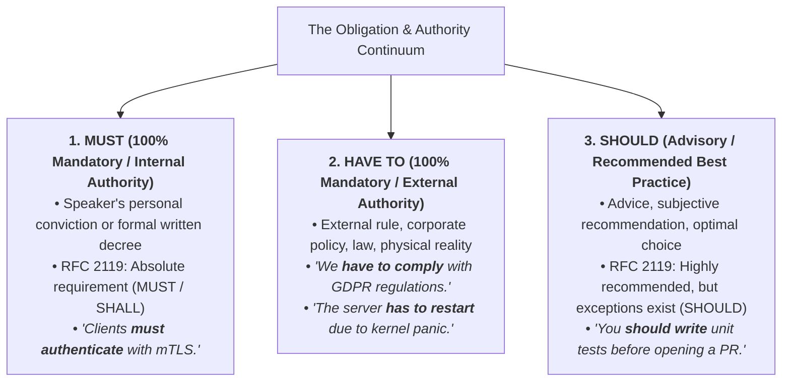
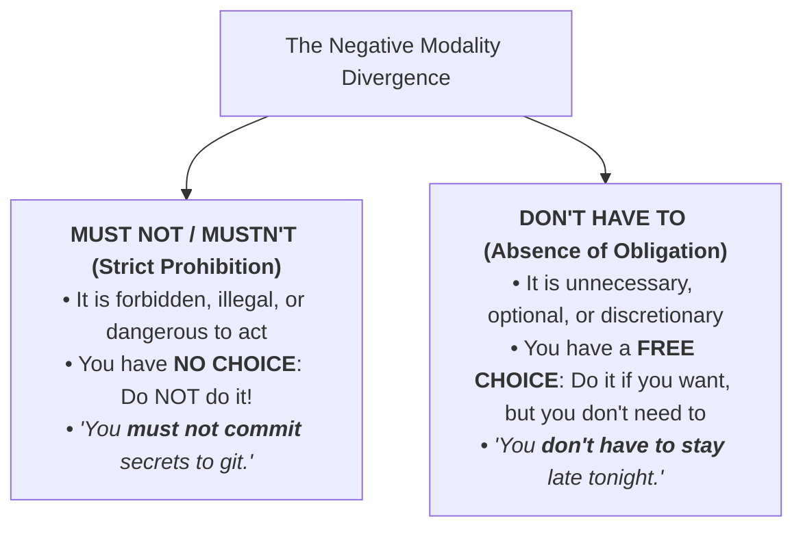
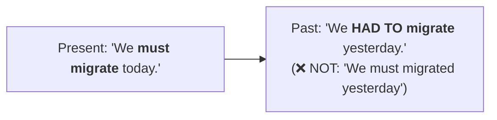

# Must vs. Have To vs. Should: Disambiguation Matrix ⚖️🛡️

> **Level:** CEFR B1–B2 (Deontic Modality, RFC 2119 & Obligation Levels)  
> **Primary References:** Raymond Murphy (*English Grammar in Use*, Units 31–33); Michael Swan (*Practical English Usage*, §7.1–7.4); IETF RFC 2119  
> **Core Conflict:** Choosing between **`must`**, **`have to`**, and **`should`** encodes the exact degree of **deontic authority, legal force, and source of obligation**. In technical specifications (such as IETF RFC 2119), confusing these modals alters contractual requirements. Furthermore, in the negative, **`must not` (strict prohibition)** and **`don't have to` (absence of obligation / optionality)** represent opposite extremes.

---

## 1. The Obligation Spectrum Architecture



---

## 2. Side-by-Side Semantic Contrast Matrix

| Dimension | `Must` (`must + V_bare`) | `Have To` (`have / has to + V_bare`) | `Should` (`should + V_bare`) |
| :--- | :--- | :--- | :--- |
| **Obligation Strength** | Absolute (100% Mandatory) | Absolute (100% Mandatory) | Advisory / Prudent (75% Recommended) |
| **Source of Authority** | **Internal** (Speaker/Author's direct mandate) | **External** (Company policy, legal law, system limit) | **Normative** (Best practice, moral advice) |
| **Negative Meaning** | **STRICT PROHIBITION** (*Must not = Do NOT do it!*) | **OPTIONALITY** (*Don't have to = Not required*) | **INADVISABLE** (*Should not = Bad idea*) |
| **Past Tense Form** | ❌ Has no past form (Use **`had to`**) | **`had to`** (*We had to rollback*) | **`should have + V3`** (*Unfulfilled duty*) |
| **IETF RFC 2119** | **MUST / REQUIRED / SHALL** | Standard prose equivalent | **SHOULD / RECOMMENDED** |

---

## 3. The Critical Negative Divergence: `Must Not` vs. `Don't Have To`

The most catastrophic error in professional communication is confusing `must not` with `don't have to`:



### Contrast Table

| Negative Form | Meaning | Operational Consequence | Example Sentence |
| :--- | :--- | :--- | :--- |
| **`must not`** | **Prohibited / Forbidden** | Violating this creates an incident or security breach | *Engineers **must not bypass** the security sandbox.* |
| **`don't have to`** | **Optional / Not required** | Doing this is fine, but skipping it is completely safe | *You **don't have to run** the full suite; smoke tests suffice.* |
| **`should not`** | **Inadvisable / Discouraged** | Doing this degrades quality or performance | *You **should not write** raw SQL without parameters.* |

> [!CAUTION]
> If an engineering manager tells an on-call engineer *"You don't have to deploy on Friday,"* it means *"You are welcome to deploy if you wish, but it is not required."*  
> If the manager says *"You **must not** deploy on Friday,"* it means *"Deploying is strictly forbidden under any circumstances."*

---

## 4. Past Obligation Mechanics: The `Had To` Invariant

The modal auxiliary `must` **has no past tense form** when expressing obligation. To express a mandatory action in the past, English **strictly requires `had to`**:



- *Present:* *We **must patch** the vulnerability immediately.*
- *Past:* *We **had to patch** the vulnerability immediately.* (❌ *We must patch yesterday*).
- *(Note: `Must have + V3` exists, but expresses past **logical deduction**, not obligation:* *The server **must have crashed** due to memory exhaustion* = I am logically certain it crashed).

---

## 5. Practical Dual-Domain Examples

### Everyday Conversation

1. *Must (Internal):* *I **must call** my mother tonight; it's her birthday.*
2. *Have to (External):* *I **have to renew** my driver's license before Friday.*
3. *Should (Advice):* *You **should get** more sleep; you look exhausted.*
4. *Must not (Prohibition):* *You **must not park** in front of the fire hydrant.*
5. *Don't have to (Optional):* *Tomorrow is a national holiday, so we **don't have to wake up** early.*
6. *Should have (Past Regret):* *I **should have studied** harder for the exam.*
7. *Had to (Past Obligation):* *I **had to take** a taxi because my car broke down.*
8. *Should not (Inadvisable):* *You **shouldn't drink** coffee right before bedtime.*

### Software Engineering & Technical Documentation (RFC Style)

9. *RFC 2119 (Must):* *A compliant server **must terminate** the TLS handshake if the cipher suite is insecure.*
10. *System Reality (Have to):* *Because AWS retired the instance type, we **have to migrate** to m6i hardware.*
11. *Architecture Best Practice (Should):* *Database queries **should utilize** indexed columns for foreign key filters.*
12. *Security Prohibition (Must not):* *Application developers **must not log** plaintext passwords or authentication tokens.*
13. *Optional Workflow (Don't have to):* *Contributors **don't have to sign** the CLA for typo fixes.*
14. *Past Obligation (Had to):* *The infrastructure team **had to rebuild** the primary index after the disk failure.*
15. *Inadvisable Pattern (Should not):* *Microservices **should not execute** distributed synchronous HTTP calls in a chain.*
16. *Past Regret (Should have):* *We **should have load-tested** the payments service before the Black Friday sale.*
17. *Compliance Obligation (Have to):* *All cloud services **have to comply** with SOC-2 type II audit standards.*
18. *Logical Deduction (Must have):* *The memory leak **must have originated** from the unclosed socket connections.*

---

## 6. Common Antipatterns & Diagnostic Table

| Incorrect Antipattern | Corrected Grammar | Rule & Explanation |
| :--- | :--- | :--- |
| ❌ *We must to deploy today.* | ✅ *We **must deploy** today.* | Modal *must* takes a bare infinitive, never *to*. |
| ❌ *You don't have to touch that wire! It's live!* | ✅ *You **must not touch** that wire! It's live!* | Dangerous actions take *must not* (prohibition), not *don't have to* (optional). |
| ❌ *Yesterday we must restart the host.* | ✅ *Yesterday we **had to restart** the host.* | *Must* has no past form for obligation; use *had to*. |
| ❌ *The spec says we have to return 400.* | ✅ *The spec states that implementations **must return** 400.* | Formal RFC/technical standards use *must / shall*, not colloquial *have to*. |
| ❌ *You mustn't come if you are busy.* | ✅ *You **don't have to come** if you are busy.* | Polite optionality takes *don't have to*, not *must not* (forbidding attendance). |
| ❌ *We should have deploy yesterday.* | ✅ *We **should have deployed** yesterday.* | Past unfulfilled duty requires *should have + V3*. |

---

## 7. Self-Assessment Exercises

### Exercise 1: Obligation & Prohibition Discrimination
Fill in the blanks with **must**, **must not**, **have to**, **don't have to**, or **should**:

1. Security Policy: Employees ________ commit AWS access keys to public GitHub repositories under any circumstances.
2. Best Practice: You ________ write descriptive commit messages so your teammates understand the changes.
3. System Constraint: The container runtime ________ allocate additional swap space because physical RAM is exhausted.
4. Optional Feature: You ________ enable telemetry tracking if you prefer a minimal lightweight setup.
5. RFC Mandate: A conformant OAuth client ________ include the `client_id` parameter in the token request.

### Exercise 2: Past Obligation & Contextual Diagnostics
Correct the modal error in each sentence:

6. Due to the catastrophic database outage last Tuesday, the engineering team must work all night.
7. You mustn't run the integration tests locally if CI will execute them automatically. (Meaning: it's optional).
8. The security auditor says that all engineers must to enable hardware security keys.
9. We should had tested the failover mechanism before launching the product.
10. The microservice didn't must to restart because the memory limit was not breached.

<details>
<summary>View Complete Answer Key & Diagnostic Explanations</summary>

1. **must not** (Strict security prohibition).
2. **should** (Advisory best practice / recommendation).
3. **has to** (External physical necessity imposed by hardware limits).
4. **don't have to** (Optionality / discretionary feature).
5. **must** (RFC absolute requirement).
6. Due to the catastrophic database outage last Tuesday, the engineering team **had to work** all night. (*Must* in past $\rightarrow$ *had to*).
7. You **don't have to run** the integration tests locally if CI will... (Optionality takes *don't have to*).
8. The security auditor says that all engineers **must enable** hardware security keys. (Bare infinitive after *must*).
9. We **should have tested** the failover mechanism... (*should have + V3*).
10. The microservice **didn't have to restart** because the memory limit... (Negative past optionality).

</details>

---

## 8. Revision Flashcards

```
Q: What is the semantic difference between "must" and "have to" in engineering contexts?
A: "Must" conveys an authoritative direct command or RFC specification rule (internal/formal authority). "Have to" conveys an external necessity imposed by laws, corporate policies, or physical system limits.

Q: What is the critical difference between "must not" and "don't have to"?
A: "Must not" means PROHIBITED / FORBIDDEN ("You must not delete production data"). "Don't have to" means OPTIONAL / NOT NECESSARY ("You don't have to run tests locally, but you can").

Q: How do you express a mandatory obligation in the past (e.g. "Yesterday we must...")?
A: You must use "had to" ("Yesterday we HAD TO restart the server"). "Must" has no past tense form for obligation.

Q: What does "should" signify in IETF RFC 2119 standards?
A: It indicates a RECOMMENDED best practice where valid reasons may exist in particular circumstances to ignore it, but the full implications must be understood.

Q: What does "should have + V3" mean in an incident postmortem?
A: An unfulfilled past duty or regret ("We should have validated inputs before executing the query").
```
