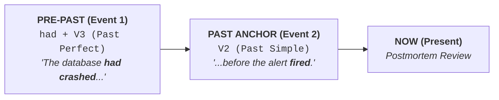

# Past Perfect vs. Past Simple: Disambiguation Matrix ⚖️⏪

> **Level:** CEFR B1–B2 (Pre-Past Priority & Chronological Non-Linearity)  
> **Primary References:** Raymond Murphy (*English Grammar in Use*, Units 15–16); Michael Swan (*Practical English Usage*, §4.5)  
> **Core Conflict:** Choosing between **Past Simple** (`V2`) and **Past Perfect** (`had + V3`) controls **chronological perspective**. Past Simple tells a story moving **forward** in time (Event 1 $\rightarrow$ Event 2). Past Perfect steps **backward** from a past anchor to reference a **pre-past event** (an earlier cause or condition that had already happened before Event 1).

---

## 1. The Pre-Past Timeline Architecture



### The Chronological Narrative Law
- If events are narrated in their natural **chronological order** (A happened, and then B happened), you do **not** need the Past Perfect:
  - *The on-call engineer **noticed** the memory spike and **restarted** the pod.* (Past Simple + Past Simple).
- If the narrative order is **reversed or non-linear** (explaining an earlier cause of a past event), the Past Perfect is **mandatory**:
  - *The on-call engineer restarted the pod because memory **had spiked**.* (Past Perfect denotes prior cause).

---

## 2. Side-by-Side Semantic Contrast Matrix

| Dimension | Past Simple (`V2`) | Past Perfect (`had + V3`) |
| :--- | :--- | :--- |
| **Temporal Focus** | A past point or sequential chain | The **"Past-before-the-Past"** (Earlier than a past anchor) |
| **Narrative Flow** | Moves **forward** chronologically | Jumps **backward** to provide context/cause |
| **Typical Markers** | *then, next, yesterday, at 02:00, when* | *already, before, by the time, previously, until then* |
| **Deadlines** | *at 5:00 PM* (Punctual timestamp) | * **by 5:00 PM** (Completed prior to that deadline) |
| **Engineering Role** | Chronological postmortem event log | Root Cause Analysis (identifying what triggered the crash) |
| **Dependency** | Can stand alone independently | Requires a **past reference anchor** to establish contrast |

---

## 3. High-Frequency Technical Computing Contrasts

Notice how the tense shifts clarify causality during systems engineering investigations:

### Contrast 1: Chronological Chain vs. Pre-Existing Fault
- **Past Simple Chain:** *The developer **merged** the pull request, and the pipeline **failed**.*  
  $\rightarrow$ The merge happened first; the failure occurred as a result.
- **Past Perfect Pre-Condition:** *When the developer merged the pull request, the pipeline **had already failed**.*  
  $\rightarrow$ The pipeline was already in a failed state *before* the merge took place!

### Contrast 2: The `By the time` Deadline Marker
`By the time` always introduces a Past Simple anchor, requiring Past Perfect in the main clause:
- *By the time the monitoring alert **fired**, the database **had corrupted** three primary partitions.*  
  (The corruption happened prior to the alert).
- *By the time we **identified** the root cause, the attacker **had exfiltrated** user credentials.*

### Contrast 3: When `Before` or `After` Makes Tense Optional
When sequential conjunctions like *after* or *before* make the chronological order unambiguous, English permits Past Simple, although Past Perfect adds formal precision:
- *Standard:* *After the container **rebooted**, traffic normalized.*
- *Formal / Emphatic:* *After the container **had rebooted**, traffic normalized.* (Emphasizes completed state).

---

## 4. Practical Dual-Domain Examples

### Everyday Conversation

1. *Simple Chain:* *He **ate** dinner and **went** to bed.* (Sequential)
2. *Past Perfect:* *When I arrived at the cinema, the film **had already started**.* (Pre-past)
3. *Past Perfect:* *She was nervous because she **had never flown** before.* (Prior experience)
4. *Simple:* *They **bought** the house after they **inspected** it.* (Unambiguous sequence)
5. *Past Perfect:* *By the time we got home, the rain **had stopped**.* (*By the time*)
6. *Simple:* *I **lost** my wallet yesterday.* (Stand-alone past)
7. *Past Perfect:* *I couldn't enter the house because I **had lost** my keys.* (Earlier cause)
8. *Past Perfect:* *He thanked me for the book I **had lent** him.* (Prior action)

### Software Engineering & Technical Documentation

9. *Simple Chain:* *The ingress gateway **received** the payload, **validated** the signature, and **routed** the request.* (Sequential)
10. *Past Perfect:* *The incident report revealed that the disk **had reached** capacity thirty minutes before the daemon crashed.* (Pre-past cause)
11. *Past Perfect:* *By the time the secondary replica took over, five hundred write transactions **had been dropped**.* (*By the time*)
12. *Past Perfect:* *The developers realized that someone **had committed** plaintext secrets to the repository.* (Prior event)
13. *Simple Chain:* *The automated script **detected** the memory leak and **killed** the process.* (Sequential reaction)
14. *Past Perfect:* *The container failed to boot because the deployment **had specified** a nonexistent Docker image.* (Root cause)
15. *Past Perfect:* *We couldn't rollback the release because the database migrations **had altered** the schema irreversibly.*
16. *Simple Chain:* *The load balancer **tripped**, and traffic **shifted** to region `us-east-1`.*
17. *Past Perfect:* *The cache **had expired** before the background worker initiated the refresh cycle.*
18. *Past Perfect:* *By 04:00 UTC, the engineering team **had completely mitigated** the DDoS attack.* (Pre-past deadline)

---

## 5. Common Antipatterns & Diagnostic Table

| Incorrect Antipattern | Corrected Grammar | Rule & Explanation |
| :--- | :--- | :--- |
| ❌ *By the time we deployed, the server crashed.* | ✅ *By the time we deployed, the server **had crashed**.* | *By the time* establishes a past reference point; prior events require Past Perfect. |
| ❌ *The app failed because it ran out of memory.* (Formal RCA) | ✅ *The app failed because it **had run out** of memory.* | Explaining the prior cause of a past failure in formal documentation requires Past Perfect. |
| ❌ *The engineer had logged in and restarted the host.* | ✅ *The engineer **logged in and restarted** the host.* | Sequential actions in chronological order use Past Simple, not Past Perfect. |
| ❌ *Before the migration, we had tested the code.* | ✅ *Before the migration, we **tested** / **had tested** the code.* | Permissible, but overusing Past Perfect for simple sequences sounds unnatural. |
| ❌ *The node crashed when the disk has filled up.* | ✅ *The node crashed when the disk **had filled up**.* | Past sequence cannot mix Past Simple with Present Perfect; use Past Perfect. |
| ❌ *We realized that we made a mistake.* (Formal) | ✅ *We realized that we **had made** a mistake.* | The mistake occurred prior to the realization; use Past Perfect. |

---

## 6. Self-Assessment Exercises

### Exercise 1: Chronological Order vs. Pre-Past Priority
Choose between the **Past Simple** and **Past Perfect** of the verb in parentheses:

1. The site reliability team deployed the hotfix after they (verify) ________ it in the staging environment.
2. By the time the incident commander joined the call, the on-call engineer (already / isolate) ________ the compromised pod.
3. The server (crash) ________ at 03:00 AM, and the automated alerting system (page) ________ the team immediately.
4. The database rejected the transaction because the foreign key (not exist) ________ in the referenced table.
5. The developers realized that a rogue script (delete) ________ three production indices.

### Exercise 2: Postmortem Tense Diagnostics
Correct the tense error in each sentence:

6. By the time the security auditor noticed the leak, the attacker exfiltrated 50 gigabytes of data.
7. The worker process had picked up the job, parsed the JSON payload, and wrote the record to disk.
8. The failover succeeded because the engineers have tested the scenario during chaos week.
9. When the lead architect arrived at the office, the team already resolved the outage.
10. The microservice threw an exception because it did not establish a connection to Redis beforehand.

<details>
<summary>View Complete Answer Key & Diagnostic Explanations</summary>

1. **had verified** (or *verified* — Past Perfect highlights prior completion).
2. **had already isolated** (*By the time* requires Past Perfect for the earlier event).
3. **crashed** ... **paged** (Sequential chronological chain: Past Simple + Past Simple).
4. **had not existed** (Prior cause of the rejection).
5. **had deleted** (Pre-past action discovered later).
6. By the time the security auditor noticed the leak, the attacker **had exfiltrated** 50 gigabytes of data. (*had exfiltrated*).
7. The worker process **picked up the job, parsed the JSON payload, and wrote** the record to disk. (Chronological sequence: Past Simple).
8. The failover succeeded because the engineers **had tested** the scenario during chaos week. (Past Perfect prior cause).
9. When the lead architect arrived at the office, the team **had already resolved** the outage. (Pre-past completion).
10. The microservice threw an exception because it **had not established** a connection to Redis beforehand. (Prior failure).

</details>

---

## 7. Revision Flashcards

```
Q: What is the primary function of the Past Perfect tense (had + V3)?
A: To step backward from a past reference point to show that an action occurred EARLIER than another past action (the "Past-before-the-Past").

Q: Do you need Past Perfect if events are narrated in natural chronological order (Event 1 then Event 2)?
A: No! If actions are described in the sequence they happened, use the Past Simple for all verbs ("The server crashed, the alert fired, and we rebooted it").

Q: What tense construction always follows "By the time [Subject + Past Simple]..."?
A: Past Perfect ("By the time the alarm sounded, the hacker HAD ALREADY LEFT").

Q: Why is "The app failed because it ran out of memory" improved by "had run out"?
A: In formal technical postmortems, the Past Perfect explicitly demarcates the pre-existing root cause ("had run out") from the resulting system failure ("failed").

Q: Can Past Simple be mixed with Present Perfect in a past narrative (e.g., "The server crashed because the disk has filled up")?
A: No! Never use Present Perfect in a past narrative. Use Past Perfect instead ("had filled up").
```
