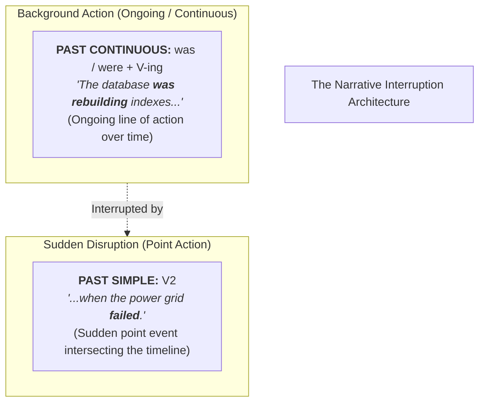

# Past Simple vs. Past Continuous: Disambiguation Matrix ⚖️🎬

> **Level:** CEFR A2–B1 (Narrative Sequencing & Interrupted Aspect)  
> **Primary References:** Raymond Murphy (*English Grammar in Use*, Unit 6); Michael Swan (*Practical English Usage*, §4.4)  
> **Core Conflict:** Choosing between **Past Simple** (`V2`) and **Past Continuous** (`was / were + V-ing`) shapes how time unfolds in narrative discourse. Past Simple represents **completed events, chronological sequences, and sudden disruptions**. Past Continuous paints the **scenic background, ongoing in-progress activities, or continuous states** during which an interruption took place.

---

## 1. The Narrative Interruption Schema



### The Invariable Conjunction Rule (`When` vs. `While`)
- **`While / As`** introduces the **longer background action (Past Continuous)**:
  - * **While we were deploying** the container, a network timeout occurred.*
- **`When`** typically introduces the **sudden interruption (Past Simple)**:
  - *We were deploying the container **when a network timeout occurred**.*

---

## 2. Side-by-Side Semantic Contrast Matrix

| Feature Dimension | Past Simple (`V2`) | Past Continuous (`was / were + V-ing`) |
| :--- | :--- | :--- |
| **Aspectual Nature** | Complete, closed, punctual, sequential | Ongoing, progressive, incomplete at reference time |
| **Discourse Role** | Pushes the story forward (Next event) | Sets the background scene / paints the context |
| **Chronological Relation**| Action B happened **after** Action A | Action B happened **in the middle of** Action A |
| **Typical Conjunction** | *when, and then, suddenly* | *while, as, all morning, during that hour* |
| **Stative Verbs** | Fully compatible (*knew, belonged, had*) | **Prohibited** (*was knowing* ❌) |
| **Engineering Role** | Sequence of incident steps (RCA log) | System state leading up to an anomaly |

---

## 3. Sequential vs. Simultaneous Causality

Understanding the difference between sequential and simultaneous past actions is vital for writing accurate incident postmortems:

### 1. Sequential Actions (Past Simple + Past Simple)
When one action happens **immediately after another in sequence**, use Past Simple for both verbs:
- *When the alarm **sounded**, the on-call engineer **logged** into the terminal.*  
  (First the alarm sounded $\rightarrow$ then the engineer logged in).
- *The broker **received** the message, **deserialized** the payload, and **stored** it in PostgreSQL.*

### 2. Simultaneous Action + Interruption (Past Continuous + Past Simple)
When an action was **already in progress** when another event occurred:
- *When the alarm sounded, the on-call engineer **was debugging** an unrelated service.*  
  (The engineer was already debugging before the alarm went off).

### 3. Dual Parallel Processes (Past Continuous + Past Continuous)
When two processes were executing **simultaneously in parallel**:
- *While the primary cluster **was draining** traffic, the standby cluster **was synchronizing** write-ahead logs.*

---

## 4. Practical Dual-Domain Examples

### Everyday Conversation

1. *Continuous + Simple:* *I **was cooking** dinner when the doorbell **rang**.* (Interrupted action)
2. *Sequential Simple:* *When the doorbell rang, I **opened** the door.* (Sequence)
3. *Dual Continuous:* *While I **was reading**, my roommate **was playing** the guitar.* (Parallel)
4. *Continuous:* *What **were you doing** at 8:00 PM last night?* (In progress at timestamp)
5. *Simple:* *What **did you do** after dinner last night?* (Completed sequence)
6. *Polite Inquiry:* *I **was wondering** if you had a few minutes to chat.* (Polite tentativeness)
7. *Stative Simple:* *He **knew** the answer immediately.* (Stative verb: not continuous)
8. *Simple:* *She **slipped** on the ice and **broke** her ankle.* (Sequence)

### Software Engineering & Technical Documentation

9. *Continuous + Simple:* *The worker thread **was processing** a batch job when the memory allocation **failed**.* (RCA timeline)
10. *Sequential Simple:* *When the memory allocation failed, the Linux kernel **invoked** the OOM killer.* (Deterministic sequence)
11. *Dual Continuous:* *While the primary node **was replicating** data, the secondary node **was handling** read queries.* (Parallel architecture)
12. *Continuous + Simple:* *We **were testing** the failover automation when an actual power cut **struck** the datacenter.*
13. *Sequential Simple:* *The deployment pipeline **built** the binary, **ran** the test suite, and **pushed** the Docker image.*
14. *Continuous:* *At 03:00 UTC, the telemetry service **was experiencing** elevated CPU throttling.* (In-progress state)
15. *Simple (Stative):* *The legacy server **contained** unencrypted credentials.* (Stative verb)
16. *Continuous + Simple:* *The automated circuit breaker **tripped** while the ingress proxy **was routing** traffic.*
17. *Sequential Simple:* *The watchdog timer **expired**, and the controller **rebooted** the pod.*
18. *Polite Inquiry:* *I **was hoping** you could review my pull request before the sprint freeze.* (Workplace communication)

---

## 5. Common Antipatterns & Diagnostic Table

| Incorrect Antipattern | Corrected Grammar | Rule & Explanation |
| :--- | :--- | :--- |
| ❌ *When the alert fired, I was restarting the server.* (meaning sequential) | ✅ *When the alert fired, I **restarted** the server.* | If you restarted the server *in response* to the alert, use Past Simple. |
| ❌ *While we deployed, the server crashed.* | ✅ *While we **were deploying**, the server crashed.* | Background actions introduced by *while* take the Past Continuous. |
| ❌ *The microservice was having three endpoints.* | ✅ *The microservice **had** three endpoints.* | Stative verbs of possession (*have*) cannot take continuous aspect. |
| ❌ *The script ran, was logging an error, and died.* | ✅ *The script ran, **logged** an error, and died.* | Parallel sequential actions require uniform Past Simple verbs. |
| ❌ *What were you doing after the incident?* | ✅ *What **did you do** after the incident?* | Sequential actions following a milestone take Past Simple. |
| ❌ *I was knowing about the bug.* | ✅ *I **knew** about the bug.* | Stative verb of cognition (*know*) strictly takes Past Simple. |

---

## 6. Self-Assessment Exercises

### Exercise 1: Sequence vs. Interruption Discrimination
Complete the sentences using the **Past Simple** or **Past Continuous** of the verb in parentheses:

1. While the storage controller (rebuild) ________ the RAID array, a secondary disk drive failed.
2. When the deployment script finished, the automated tests (begin) ________ immediately.
3. The database engine (process) ________ write transactions when the network link severed.
4. The sysadmin (notice) ________ the memory leak, (open) ________ an incident ticket, and (page) ________ the on-call engineer.
5. While the frontend team (update) ________ the UI components, the backend team (refactor) ________ the API contracts.

### Exercise 2: Contextual Bug Diagnostics
Correct the tense error in each sentence:

6. When the alarm sounded at midnight, the SRE was logging into the bastion server to investigate. (Meaning: he logged in *after* the alarm sounded).
7. The database was containing corrupted rows before the restore script ran.
8. While we verified the cryptographic signature, the container image corrupted.
9. The background worker was dequeuing the job and processed it without error.
10. What did the cluster do when the power failed at 02:00 AM? (Meaning: what action was in progress?).

<details>
<summary>View Complete Answer Key & Diagnostic Explanations</summary>

1. **was rebuilding** (Ongoing background action interrupted by disk failure).
2. **began** (Sequential action happening *after* the script finished).
3. **was processing** (Ongoing activity when the link severed).
4. **noticed** ... **opened** ... **paged** (Chronological sequence of completed actions).
5. **was updating** ... **was refactoring** (Dual parallel simultaneous actions).
6. When the alarm sounded at midnight, the SRE **logged** into the bastion server to investigate. (Sequential response).
7. The database **contained** corrupted rows before the restore script ran. (*contain* is stative).
8. While we **were verifying** the cryptographic signature, the container image corrupted. (*While* takes continuous).
9. The background worker **dequeued** the job and processed it without error. (Parallel sequential verbs).
10. What **was the cluster doing** when the power failed at 02:00 AM? (Inquiring about an in-progress state at that timestamp).

</details>

---

## 7. Revision Flashcards

```
Q: What is the main difference in narrative function between Past Simple and Past Continuous?
A: Past Simple represents completed, chronological sequence events (Action A then Action B). Past Continuous represents an ongoing background scene or state (in progress when an interruption occurred).

Q: How do "when" and "while" typically divide the two tenses?
A: "While" introduces the longer, ongoing background activity (Past Continuous: "While we WERE DEPLOYING..."); "when" introduces the sudden point event or interruption (Past Simple: "...WHEN the server CRASHED").

Q: Can stative verbs (e.g. "know", "contain", "belong") be used in the Past Continuous?
A: No! Stative verbs describe unchanging states and must always be used in the Past Simple ("The file CONTAINED errors", NOT "was containing").

Q: If two actions happened one after the other in rapid sequence, what tense should both verbs take?
A: Past Simple for both verbs ("The script DETECTED the error and HALTED the system").

Q: Why do native speakers say "I was wondering if you could help me" in work emails?
A: Using the Past Continuous creates a polite, tentative, non-demanding register for requests and inquiries.
```
