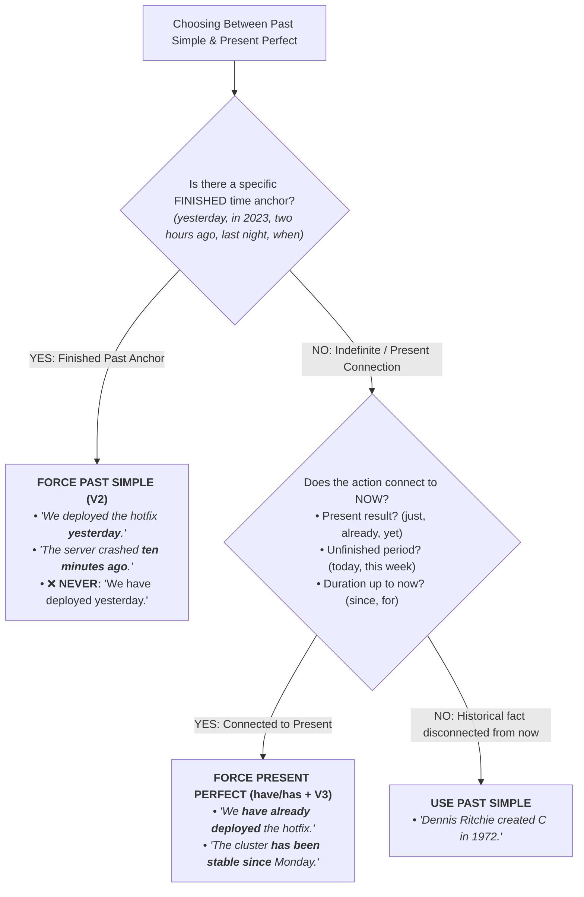

# Past Simple vs. Present Perfect: Disambiguation Matrix ⚖️🌉

> **Level:** CEFR A2–B2 (Temporal Anchoring & Aspectual Bridges)  
> **Primary References:** Raymond Murphy (*English Grammar in Use*, Units 13–14, 20); Michael Swan (*Practical English Usage*, §4.1–4.3)  
> **Core Conflict:** Choosing between **Past Simple** (`V2`) and **Present Perfect** (`have/has + V3`) is the single most pervasive grammatical challenge for non-native English speakers. Past Simple isolates an event inside a **finished, completed time period** disconnected from now. Present Perfect acts as a **temporal bridge**, connecting a past event directly to **the present system state or current reality**.

---

## 1. The Temporal Anchoring Architecture



---

## 2. Side-by-Side Semantic Contrast Matrix

| Dimension | Past Simple (`V2`) | Present Perfect (`have / has + V3`) |
| :--- | :--- | :--- |
| **Temporal Realm** | **Finished Past** (Disconnected from the present) | **Past-to-Present Bridge** (Direct present relevance) |
| **Time Period** | Complete, closed (*yesterday, in 2021*) | Incomplete, open (*this morning, today, this sprint*) |
| **Time Adverbials** | *yesterday, ago, last week, in 1995, then, when* | *just, already, yet, ever, never, since, so far, recently* |
| **Engineering Context** | Incident postmortem narrative, historical logs | Current system status, sprint progress reports |
| **Question Invariant** | * **When did** you deploy?* (Asks for a specific timestamp) | * **Have you** deployed yet?* (Asks for completion status) |
| **Focus** | **WHEN** the action occurred | **THE RESULT** that exists right now |

---

## 3. High-Frequency Technical Computing Contrasts

Notice how shifting the tense alters operational meaning in production environments:

### Contrast 1: Incident Log vs. Current System Status
- **Past Simple:** *The database **crashed** at 03:00 AM.*  
  $\rightarrow$ Historical incident narrative. It happened at a specific past timestamp (03:00 AM). It does not tell us if the database is running now.
- **Present Perfect:** *The database **has crashed**.*  
  $\rightarrow$ Current operational status! It happened recently, and the database is **currently offline right now**.

### Contrast 2: Closed Period vs. Open Period
- **Past Simple:** *We pushed three releases **this morning**.* (Spoken at 3:00 PM; the morning has finished $\rightarrow$ closed).
- **Present Perfect:** *We have pushed three releases **this morning**.* (Spoken at 10:30 AM; it is still morning $\rightarrow$ open).

### Contrast 3: Fixed History vs. Cumulative Experience
- **Past Simple:** *Dennis Ritchie **created** the C programming language.* (Dennis Ritchie is deceased; closed history).
- **Present Perfect:** *Guido van Rossum **has created** Python and **has contributed** to many other open-source projects.* (Living author; cumulative open career).

---

## 4. Practical Dual-Domain Examples

### Everyday Conversation

1. *Past Simple:* *I **lost** my keys yesterday, but I found them in my car.* (Finished past)
2. *Present Perfect:* *I **have lost** my keys! Can you help me look for them?* (Result now: I don't have them)
3. *Past Simple:* *She **lived** in Madrid for two years.* (She no longer lives there; finished)
4. *Present Perfect:* *She **has lived** in Madrid for two years.* (She still lives there today)
5. *Past Simple:* * **Did you see** the movie last night?* (Specific finished time: *last night*)
6. *Present Perfect:* * **Have you seen** that movie yet?* (Life experience up to now)
7. *Past Simple:* *He **finished** university in 2022.* (Finished year anchor)
8. *Present Perfect:* *He **has just finished** his final exams.* (Immediate recent completion: *just*)

### Software Engineering & Technical Documentation

9. *Past Simple:* *The on-call engineer **restarted** the ingress gateway at 02:14 UTC.* (Postmortem timeline)
10. *Present Perfect:* *The on-call engineer **has restarted** the ingress gateway, and traffic is normalizing.* (Status update)
11. *Past Simple:* *We **deprecated** version 1.0 of the API six months ago.* (Finished anchor: *ago*)
12. *Present Perfect:* *We **have deprecated** all legacy endpoints; please migrate to version 2.* (Current state)
13. *Past Simple:* *When **did you run** the schema migration?* (Specific inquiry: *when*)
14. *Present Perfect:* * **Have you run** the schema migration yet?* (Status inquiry: *yet*)
15. *Past Simple:* *The memory leak **caused** high latency throughout the previous sprint.* (Closed period)
16. *Present Perfect:* *The memory leak **has caused** three catastrophic outages so far.* (Cumulative up to now)
17. *Past Simple:* *The security team **patched** the OpenSSL vulnerability last Thursday.* (Finished past)
18. *Present Perfect:* *The security team **has already patched** all production worker nodes.* (Result now: *already*)

---

## 5. Common Antipatterns & Diagnostic Table

| Incorrect Antipattern | Corrected Grammar | Rule & Explanation |
| :--- | :--- | :--- |
| ❌ *We have deployed the patch yesterday.* | ✅ *We **deployed** the patch yesterday.* | Never use Present Perfect with finished past time anchors (*yesterday*). |
| ❌ *When have you committed this code?* | ✅ * **When did you commit** this code?* | *When* asks for a specific past timestamp, which strictly requires Past Simple. |
| ❌ *The server crashed since two hours.* | ✅ *The server **has been down for** two hours.* | Ongoing duration up to now requires Present Perfect + *for*. |
| ❌ *I am working here since 2018.* | ✅ *I **have worked / have been working** here since 2018.* | Preposition *since* connects past to present; it strictly requires Present Perfect. |
| ❌ *Did you finish the review yet?* (Formal/UK) | ✅ * **Have you finished** the review yet?* | In standard international and British English, *yet* pairs with Present Perfect. |
| ❌ *The cluster has failed ten minutes ago.* | ✅ *The cluster **failed** ten minutes ago.* | Time adverbial *ago* denotes a finished past timestamp; use Past Simple. |

---

## 6. Self-Assessment Exercises

### Exercise 1: Temporal Anchor Discrimination
Choose between the **Past Simple** and **Present Perfect** forms of the verb in parentheses:

1. The systems team (provision) ________ three new Redis instances yesterday afternoon.
2. We (not receive) ________ any 500 error alerts since the hotfix was merged.
3. When (you / discover) ________ the unauthorized SSH connection to the bastion host?
4. The database administrator (already / optimize) ________ the complex join queries.
5. In 2023, our engineering organization (migrate) ________ all monoliths to microservices.

### Exercise 2: Status vs. History Disambiguation
Select the correct tense to reflect the context:

6. *Context: Looking at an active outage happening right now.*  
   $\rightarrow$ The telemetry pipeline (failed / has failed); we need to page the SRE immediately!
7. *Context: Explaining yesterday's incident during a postmortem meeting.*  
   $\rightarrow$ The telemetry pipeline (failed / has failed) because the message broker ran out of disk.
8. *Context: Checking if a pull request is ready to merge.*  
   $\rightarrow$ (Did you review / Have you reviewed) my code changes yet?
9. *Context: Discussing a previous job.*  
   $\rightarrow$ I (worked / have worked) at Google for four years before joining this startup.
10. *Context: Discussing current job tenure.*  
    $\rightarrow$ I (worked / have worked) at this startup for four years, and I love the team.

<details>
<summary>View Complete Answer Key & Diagnostic Explanations</summary>

1. **provisioned** (Past Simple: finished time anchor *yesterday afternoon*).
2. **have not received** (Present Perfect: past-to-present bridge with *since*).
3. **did you discover** (Past Simple: inquiry with *when*).
4. **has already optimized** (Present Perfect: present result with *already*).
5. **migrated** (Past Simple: finished year anchor *in 2023*).
6. **has failed** (Present Perfect: current operational emergency).
7. **failed** (Past Simple: historical postmortem explanation).
8. **Have you reviewed** (Present Perfect: status inquiry with *yet*).
9. **worked** (Past Simple: finished past tenure).
10. **have worked** (Present Perfect: ongoing tenure continuing up to now).

</details>

---

## 7. Revision Flashcards

```
Q: What is the single most important rule separating Past Simple from Present Perfect?
A: Past Simple is used with FINISHED time periods and specific past anchors (yesterday, in 2021, two hours ago). Present Perfect is used for UNFINISHED periods or when connecting a past event to the PRESENT result.

Q: Why is "We have deployed the service yesterday" a grammatical error?
A: "Yesterday" is a completed, closed time period. Finished past timestamps strictly forbid the Present Perfect ("We DEPLOYED the service yesterday").

Q: Why do we say "When DID you deploy?" instead of "When HAVE you deployed?"?
A: "When" inquires about a specific point in past time, which forces the Past Simple.

Q: How does the meaning change between "The database crashed" and "The database has crashed"?
A: "The database crashed" reports an event at a past point in time (it may be fixed now). "The database has crashed" reports a present operational status (it is currently offline right now).

Q: What tenses must be used with "since" when describing an ongoing state?
A: Present Perfect or Present Perfect Continuous (e.g., "The server HAS BEEN running SINCE Monday", NOT "is running since Monday").
```
