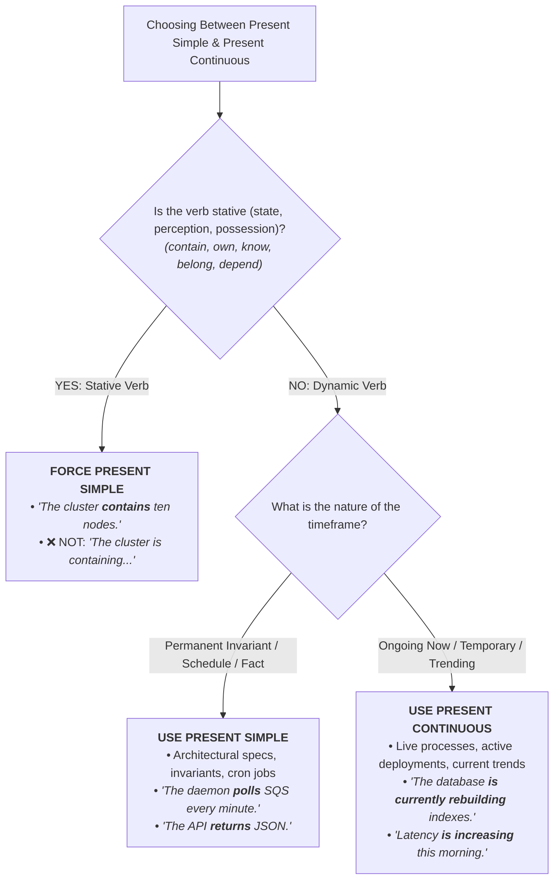

# Present Simple vs. Present Continuous: Disambiguation Matrix ⚖️⏱️

> **Level:** CEFR A2–B1 (Aspectual Disambiguation)  
> **Primary References:** Raymond Murphy (*English Grammar in Use*, Units 3–4); Michael Swan (*Practical English Usage*, §3.1–3.3)  
> **Core Conflict:** Choosing between **Present Simple** (`V1 / -s`) and **Present Continuous** (`be + V-ing`) represents a fundamental choice of **grammatical aspect**. Present Simple frames an action as an **enduring invariant, permanent system state, scheduled timetable, or general truth**. Present Continuous frames an action as **ongoing in real time, temporary, progressive, or currently in flux**.

---

## 1. The Aspectual Decision Architecture



---

## 2. Side-by-Side Semantic Contrast Matrix

| Feature Dimension | Present Simple (`V1 / -s`) | Present Continuous (`am / is / are + V-ing`) |
| :--- | :--- | :--- |
| **Core Nature** | Permanent, timeless, factual, habitual | Temporary, ongoing, uncompleted, changing |
| **Timeframe** | All time; permanent baseline | Right now; around now; limited duration |
| **Architectural Role** | System specifications, API contracts, RFC laws | Live telemetry, incident debugging, active rollout |
| **Typical Adverbs** | *always, usually, regularly, hourly, every day* | *now, right now, currently, at the moment, these days* |
| **Future Usage** | Fixed scheduled timetables (*The train leaves at 9*) | Definite planned future arrangements (*We are deploying tonight*) |
| **Stative Verbs** | Fully compatible (*know, belong, need, cost*) | **Strictly prohibited** (*is needing* ❌) |

---

## 3. High-Frequency Technical Computing Contrasts

Notice how shifting the aspect alters the engineering reality being described:

### Contrast 1: System Capability vs. Live Execution
- **Present Simple:** *The background worker **processes** incoming image uploads.*  
  $\rightarrow$ Architectural fact: That is its permanent responsibility and functional capability.
- **Present Continuous:** *The background worker **is processing** incoming image uploads.*  
  $\rightarrow$ Runtime observation: It is actively executing that workload right now at this second.

### Contrast 2: Permanent Location vs. Temporary Failover
- **Present Simple:** *Our payment gateway **runs** on AWS in region `us-east-1`.*  
  $\rightarrow$ Permanent corporate infrastructure deployment.
- **Present Continuous:** *Our payment gateway **is running** in region `us-west-2` this afternoon.*  
  $\rightarrow$ Temporary routing while the primary region is undergoing maintenance.

### Contrast 3: Stative Traps in Architecture Documentation
Certain verbs in software documentation describe **possession, composition, or state** and can **never** be continuous:
- ❌ *The microservice is consisting of three Docker containers.*
- ✅ *The microservice **consists of** three Docker containers.*
- ❌ *This configuration is depending on environment variables.*
- ✅ *This configuration **depends on** environment variables.*

---

## 4. Practical Dual-Domain Examples

### Everyday Conversation

1. *Simple:* *I **live** in London.* (Permanent home)
2. *Continuous:* *I **am living** with my brother until I find an apartment.* (Temporary arrangement)
3. *Simple:* *She **speaks** four languages fluently.* (Permanent capability)
4. *Continuous:* *Listen! She **is speaking** Italian on the phone.* (Active right now)
5. *Simple:* *The train **departs** at 08:30 AM tomorrow.* (Scheduled timetable)
6. *Continuous:* *We **are meeting** the project sponsors tonight.* (Arranged appointment)
7. *Simple:* *He **drinks** black coffee every morning.* (Habit)
8. *Continuous:* *Why **are you drinking** decaf today?* (Exception to habit)

### Software Engineering & Technical Documentation

9. *Simple:* *The API gateway **authenticates** each inbound request before routing.* (System specification)
10. *Continuous:* *The ingress proxy **is currently dropping** unauthenticated requests.* (Active runtime observation)
11. *Simple:* *PostgreSQL **stores** write-ahead logs in `/var/lib/postgresql/wal`.* (Permanent design)
12. *Continuous:* *The storage volume **is running** dangerously low on disk space.* (Temporary progressive trend)
13. *Simple:* *The cron daemon **executes** the backup script every midnight.* (Timetable/schedule)
14. *Continuous:* *The SRE team **is migrating** the database cluster to version 16.* (Ongoing project)
15. *Simple:* *This data structure **requires** $O(1)$ lookup time.* (Mathematical invariant: stative)
16. *Continuous:* *The garbage collector **is causing** periodic 200ms latency spikes.* (Active runtime behavior)
17. *Simple:* *The telemetry service **emits** heartbeats every 5 seconds.* (Invariant rule)
18. *Continuous:* *Engineers **are noticing** higher error rates after the latest release.* (Current trend)

---

## 5. Common Antipatterns & Diagnostic Table

| Incorrect Antipattern | Corrected Grammar | Rule & Explanation |
| :--- | :--- | :--- |
| ❌ *The system is containing three nodes.* | ✅ *The system **contains** three nodes.* | *Contain* is a stative verb of composition; it cannot take continuous aspect. |
| ❌ *Every day the backup is running at 2 AM.* | ✅ *Every day the backup **runs** at 2 AM.* | Scheduled habits and automated timetables require Present Simple. |
| ❌ *Look at Grafana, CPU spikes.* | ✅ *Look at Grafana, CPU **is spiking**.* | Events happening right now before the speaker's eyes take Present Continuous. |
| ❌ *The application is depending of Redis.* | ✅ *The application **depends on** Redis.* | Stative verb (*depend*) takes Present Simple and dependent preposition *on*. |
| ❌ *I am working here since 2020.* | ✅ *I **have been working** here since 2020.* | Actions starting in the past and continuing up to now require Present Perfect Continuous. |
| ❌ *The endpoint is returning always JSON.* | ✅ *The endpoint **always returns** JSON.* | Universal system behavior + frequency adverb (*always*) requires Present Simple. |

---

## 6. Self-Assessment Exercises

### Exercise 1: Aspect Selection
Choose between the **Present Simple** and **Present Continuous** form of the verb in parentheses:

1. The reverse proxy (listen) ________ on port 443 for incoming HTTPS traffic. (Architectural design)
2. Be quiet; the database administrator (investigate) ________ the outage in the war room right now.
3. Every Sunday evening, the scheduler (recalculate) ________ user engagement statistics.
4. Memory consumption (climb) ________ steadily; we might need to restart the container soon.
5. This encrypted payload (belong) ________ to an authenticated corporate session.

### Exercise 2: Error Diagnostics
Correct the aspectual or stative bugs in the following sentences:

6. The application configuration is consisting of four distinct YAML files.
7. Why do you debug this service right now when the release is postponed?
8. The caching proxy is always checking the expiration header before returning responses. (As invariant specification)
9. At the moment, our platform experiences an unexpected surge in network traffic.
10. The microservice is needing additional worker threads to handle peak load.

<details>
<summary>View Complete Answer Key & Diagnostic Explanations</summary>

1. **listens** (Present Simple: permanent architectural specification).
2. **is investigating** (Present Continuous: happening right now).
3. **recalculates** (Present Simple: recurring schedule).
4. **is climbing** (Present Continuous: ongoing progressive trend).
5. **belongs** (Present Simple: *belong* is a stative verb).
6. The application configuration **consists of** four distinct YAML files. (*consist* is stative).
7. Why **are you debugging** this service right now... (Action happening at the present moment).
8. The caching proxy **always checks** the expiration header... (System specification invariant).
9. At the moment, our platform **is experiencing** an unexpected surge... (*At the moment* triggers continuous).
10. The microservice **needs** additional worker threads... (*need* is a stative verb).

</details>

---

## 7. Revision Flashcards

```
Q: What is the fundamental aspectual distinction between Present Simple and Present Continuous?
A: Present Simple expresses permanent invariants, habits, system specs, and scheduled truths ("The API returns JSON"). Present Continuous expresses temporary, active, ongoing processes in real time ("The server is rebuilding indexes").

Q: Why can't you say "The database is containing 50 tables"?
A: "Contain" is a stative verb expressing composition. Stative verbs describe static states, not dynamic actions, and cannot take continuous aspect ("The database CONTAINS 50 tables").

Q: In API documentation, should you write "The endpoint returns JSON" or "The endpoint is returning JSON"?
A: "The endpoint returns JSON". Architectural documentation describes permanent system behavior and contracts, which require the Present Simple.

Q: When does Present Simple refer to the future?
A: For fixed, scheduled timetables and public itineraries (e.g., "The maintenance window starts at 22:00").

Q: When does Present Continuous refer to the future?
A: For definite personal or team arrangements already planned for a specific future time (e.g., "We are deploying the patch tonight").
```
