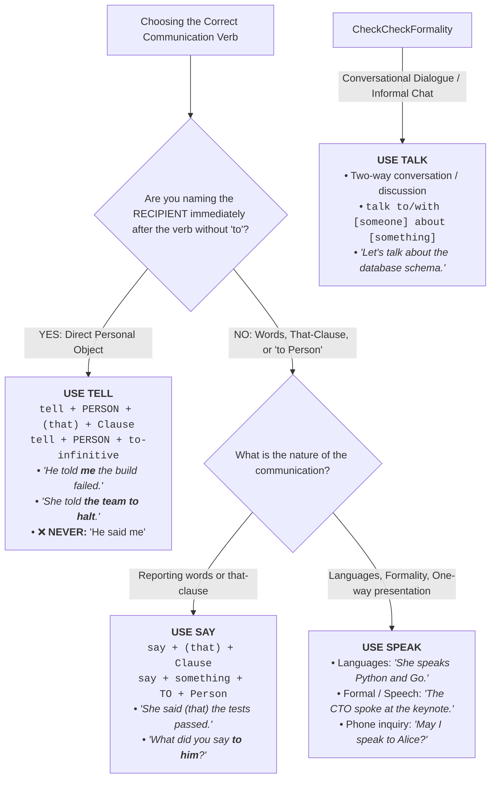

# Say vs. Tell vs. Speak vs. Talk: Disambiguation Matrix ⚖️🗣️

> **Level:** CEFR A2–B2 (Communication Verbs & Complementation Regimens)  
> **Primary References:** Raymond Murphy (*English Grammar in Use*, Units 47–48); Michael Swan (*Practical English Usage*, §24, 31)  
> **Core Conflict:** **`Say`**, **`Tell`**, **`Speak`**, and **`Talk`** all convey verbal communication, but they adhere to strictly segregated **syntactic complementation rules** and **discourse registers**. The most critical syntactic division lies between **`say` (which cannot take a direct personal object)** and **`tell` (which strictly demands a personal recipient object)**.

---

## 1. The Communication Complementation Architecture



---

## 2. Side-by-Side Structural Contrast Matrix

| Verb | Mandatory Complementation Pattern | Focus of Meaning | Fixed Collocations & Idioms | ❌ Fatal Bug Pattern |
| :--- | :--- | :--- | :--- | :--- |
| **`Say`** | `say + (that) + Clause`<br>`say + something + to + Person` | The **exact words** or proposition uttered | *say hello, say yes/no, say a word, say thank you* | ❌ *He said me that...*<br>❌ *Say him to stop.* |
| **`Tell`** | `tell + PERSON + (that) + Clause`<br>`tell + PERSON + to-infinitive` | **Informing or instructing** a specific recipient | *tell the truth, tell a lie, tell a story, tell the difference* | ❌ *He told that...*<br>❌ *Tell to me.* |
| **`Speak`** | `speak + Language`<br>`speak to / with + Person` | **Formality, authority, capability**, or speech act | *speak fluently, speak publicly, strictly speaking* | ❌ *She talks French.*<br>❌ *I spoke him.* |
| **`Talk`** | `talk to / with + Person`<br>`talk about + Topic` | **Two-way conversational dialogue** or chat | *talk business, talk shop, talk sense, baby talk* | ❌ *He talked that...*<br>❌ *Talk me the story.* |

---

## 3. High-Frequency Technical Computing Contrasts

Notice how engineering communications require precise selection among these four verbs:

### Contrast 1: `Say` vs. `Tell` in Standup Meetings & PRs
- **With `Say` (Focus on the message):**  
  *The technical lead **said that** the release was postponed.*  
  (❌ NOT: *The technical lead said me that...*).
- **With `Tell` (Focus on the recipient):**  
  *The technical lead **told the team that** the release was postponed.*  
  (❌ NOT: *The technical lead told that the release...*).
- **Instruction with `Tell`:**  
  *The incident commander **told the SRE to roll back** the Helm deployment.*

### Contrast 2: `Speak` vs. `Talk` in Team Collaboration
- **Formal Address (`Speak`):**  
  *The VP of Engineering will **speak** about our 2026 AI roadmap at the all-hands meeting.*  
  $\rightarrow$ Formal, one-way presentation to an audience.
- **Informal Collaborative Dialogue (`Talk`):**  
  *Let's **talk about** how to decouple the monolithic billing controller during 1-on-1s.*  
  $\rightarrow$ Two-way conversational discussion and brainstorming.

### Contrast 3: Fixed Idioms (`Tell the difference`)
- *It is difficult to **tell the difference** between genuine API traffic and sophisticated botnets.* (Meaning: distinguish).
- *Strictly **speaking**, the consensus protocol is non-blocking.* (Adverbial participle: *speaking*).

---

## 4. Practical Dual-Domain Examples

### Everyday Conversation

1. *Say:* *What did you **say**? I couldn't hear you.*
2. *Tell:* *She **told me** a fascinating story about her travels.*
3. *Speak:* *Does anyone here **speak** Spanish?*
4. *Talk:* *We stayed up late **talking about** our favorite movies.*
5. *Say to:* *Did you **say goodbye to** your grandparents?*
6. *Tell to:* *He **told me to wait** outside the office.*
7. *Speak:* *May I **speak to** the manager, please?* (Phone / formal)
8. *Tell (Idiom):* *I can never **tell whether** he is telling the truth or lying.*

### Software Engineering & Technical Documentation

9. *Say:* *The documentation **says that** the endpoint accepts JSON payloads.*
10. *Tell:* *The compiler error message **tells us which line** failed syntax validation.*
11. *Speak:* *Our backend engineers **speak** Python, Rust, and Go fluently.*
12. *Talk:* *The architects scheduled a meeting to **talk through** the microservice dependency graph.*
13. *Say:* *The release engineer **said to the team that** all staging tests had passed.*
14. *Tell:* *The monitoring alert **told us to check** the disk space on partition `/dev/sda1`.*
15. *Speak:* *The lead cryptographer will **speak on** post-quantum encryption at the security conference.*
16. *Tell (Idiom):* *It is hard to **tell the difference** between network jitter and server latency without distributed tracing.*
17. *Talk:* *Can we **talk about** updating our continuous integration pipeline during retrospective?*
18. *Speak:* *Strictly **speaking**, this breaking change requires a major semantic version bump.*

---

## 5. Common Antipatterns & Diagnostic Table

| Incorrect Antipattern | Corrected Grammar | Rule & Explanation |
| :--- | :--- | :--- |
| ❌ *He said me that the build failed.* | ✅ *He **told me** that the build failed.* / *He **said that**...* | *Say* cannot take a personal object directly; use *tell someone*. |
| ❌ *The manager told that we must deploy.* | ✅ *The manager **told us** that we must deploy.* / *...**said that**...* | *Tell* strictly requires a personal recipient object. |
| ❌ *She talks four foreign languages.* | ✅ *She **speaks** four foreign languages.* | Fluency in languages strictly takes *speak*, never *talk*. |
| ❌ *Can I talk to the customer service?* (Phone) | ✅ *May I **speak to** customer service?* | Professional telephone inquiries standardly use *speak to*. |
| ❌ *He told to me to restart.* | ✅ *He **told me** to restart.* | *Tell* takes a direct personal object without *to*. |
| ❌ *Let's speak about the PR.* | ✅ *Let's **talk about** the PR.* | Casual collaborative discussions use *talk about*. |
| ❌ *The logs say us to reboot.* | ✅ *The logs **tell us** to reboot.* | Giving instructions to a recipient uses *tell someone to do*. |

---

## 6. Self-Assessment Exercises

### Exercise 1: Verb Selection (Say, Tell, Speak, Talk)
Fill in the blanks with the correct form of **say**, **tell**, **speak**, or **talk**:

1. The systems architect ________ the team that the migration was scheduled for midnight.
2. The compiler warning ________ that the variable is never read.
3. Can we set up a quick 10-minute huddle to ________ through this merge conflict?
4. How many programming languages do you ________ fluently?
5. The incident commander ________ the on-call engineer to initiate manual failover.

### Exercise 2: Contextual Diagnostics
Correct the communication verb error in each sentence:

6. The tech lead said us to write comprehensive unit tests for the authentication module.
7. She told that the database query performance was acceptable for beta release.
8. Can you talk me how this distributed consensus algorithm works?
9. It is impossible to say the difference between the two network topologies.
10. Did you say to the manager about your upcoming vacation days?

<details>
<summary>View Complete Answer Key & Diagnostic Explanations</summary>

1. **told** (*tell + person + that-clause*).
2. **says** (*say that* — documentation or text "says").
3. **talk** (*talk through* — collaborative discussion).
4. **speak** (Languages take *speak*).
5. **told** (*tell + person + to-infinitive*).
6. The tech lead **told us to write** comprehensive unit tests... (*tell someone to do*).
7. She **told us that** (or *She **said that***) the database query performance was... (Provide recipient or use *said*).
8. Can you **tell me** how this distributed consensus algorithm works? (Informing takes *tell me*).
9. It is impossible to **tell the difference** between the two network topologies. (Fixed idiom: *tell the difference*).
10. Did you **talk to the manager about** (or *speak to the manager about*) your upcoming vacation days?

</details>

---

## 7. Revision Flashcards

```
Q: What is the most critical grammatical difference between "say" and "tell"?
A: "Tell" MUST be followed by a personal object without "to" ("He told ME that..."). "Say" CANNOT take a personal object directly ("He said that...", or "He said TO me that...").

Q: Which verb is used for knowing or using languages (e.g. "She ___ three languages")?
A: "Speak" ("She SPEAKS three languages", NEVER "talks three languages").

Q: What is the difference between "speak" and "talk" in a meeting context?
A: "Speak" implies a formal, one-way presentation or address ("The CTO will speak at the all-hands"). "Talk" implies an informal, two-way conversational discussion ("Let's talk about the bug").

Q: What is the fixed idiom for distinguishing between two things using "tell"?
A: "Tell the difference" (e.g., "It is hard to tell the difference between these two algorithms").

Q: Why is "The documentation tells that..." incorrect?
A: "Tell" requires a recipient ("tells US that"). Without a recipient, you must say "The documentation SAYS that...".
```
