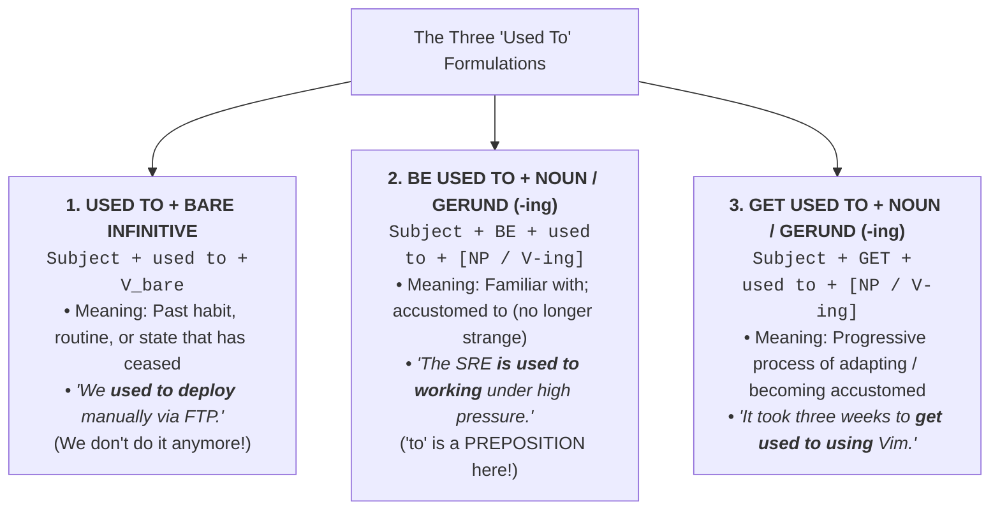
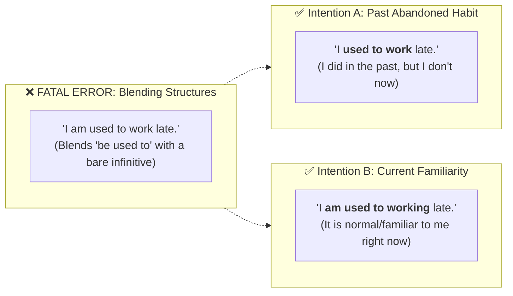

# Used To vs. Be Used To vs. Get Used To: Disambiguation Matrix ⚖️🔄

> **Level:** CEFR B1–B2 (Habitual Past vs. Familiarity & Adaptation)  
> **Primary References:** Raymond Murphy (*English Grammar in Use*, Units 18, 61); Michael Swan (*Practical English Usage*, §1.6)  
> **Core Conflict:** Non-native speakers frequently conflate **`used to do`** (a modal-like past habitual verb meaning "formerly did, but no longer do") with **`be used to doing`** (an adjectival state meaning "accustomed to / familiar with") and **`get used to doing`** (a transitional process meaning "becoming accustomed to"). The most critical structural pitfall is confusing the bare infinitive with the gerund.

---

## 1. The Tripartite Morphological Matrix



### Side-by-Side Structural Matrix

| Construction | Grammatical Category of *Used* | Complement Form | Meaning & Temporal Realm | Technical Example Sentence |
| :--- | :--- | :--- | :--- | :--- |
| **`used to`** | Past tense semi-modal verb | **Bare Infinitive (`V_bare`)** | **Abandoned past habit/state** (Past only) | *We **used to host** our database on-premise.* |
| **`be used to`** | Predicative adjective (*accustomed*) | **Noun Phrase or Gerund (`-ing`)** | **Present/past familiarity** (State of mind) | *The DevOps team **is used to handling** outages.* |
| **`get used to`**| Predicative adjective (*accustomed*) | **Noun Phrase or Gerund (`-ing`)** | **Process of adaptation** (Change over time)| *Engineers quickly **get used to peer reviews**.* |

---

## 2. The Fatal Infinitival Bug

The single most common error is mixing up the complements:



> [!CAUTION]
> In `be used to` and `get used to`, the word **`to` is a preposition**, NOT an infinitive marker. All prepositions must be followed by a **noun phrase or gerund (`-ing`)**:
> - ❌ *I am used to write unit tests.*
> - ✅ *I am used to **writing** unit tests.*
> - ❌ *He got used to wake up early.*
> - ✅ *He got used to **waking** up early.*

---

## 3. Negative & Interrogative Syntax of Past Habit `Used to`

In standard English, the negative and question forms of past habit `used to` use dummy auxiliary **`did`**, which drops the final `-d`:

### 1. Interrogative Questions
$$\mathbf{Did} + \text{Subject} + \mathbf{\text{use to}} + \mathbf{V_{\text{bare}}}$$
- * **Did you use to work** at Google before joining our startup?* (❌ NOT: *Did you used to...*)
- *What database **did the company use to run**?*

### 2. Negative Statements
$$\text{Subject} + \mathbf{\text{didn't use to}} + \mathbf{V_{\text{bare}}}$$
- *We **didn't use to have** automated linting checks.*
- *(Formal British alternative:* *We **used not to have**...*).

---

## 4. Practical Dual-Domain Examples

### Everyday Conversation

1. *Past Habit:* *I **used to play** tennis every Saturday, but I quit.*
2. *Familiarity:* *Living in London, I **am used to the rain**.*
3. *Adaptation:* *It took me six months to **get used to driving** on the left side of the road.*
4. *Past Habit:* *Did you **use to have** long hair when you were a teenager?*
5. *Familiarity:* *She **is used to waking up** at 5:00 AM every morning.*
6. *Adaptation:* *You will soon **get used to your new colleagues**.*
7. *Past Negative:* *We **didn't use to travel** much when we were children.*
8. *Past State:* *There **used to be** a bookstore on this corner.*

### Software Engineering & Technical Documentation

9. *Past Habit:* *Our engineering team **used to deploy** software releases manually over FTP.* (Ceased practice)
10. *Familiarity:* *Senior engineers **are used to reviewing** thousands of lines of code daily.* (Comfortable state)
11. *Adaptation:* *Junior developers take several weeks to **get used to writing** idiomatic Rust.* (Process of learning)
12. *Past Habit:* *The monolithic backend **used to crash** every time traffic exceeded 5,000 req/sec.*
13. *Familiarity:* *Our site reliability engineers **are used to being paged** during overnight shifts.*
14. *Adaptation:* *Once you **get used to using** terminal multiplexers, productivity climbs dramatically.*
15. *Past Question:* *Which cloud provider **did the startup use to deploy** on before migrating to GCP?*
16. *Past State:* *There **used to be** significant network latency between our US and European data centers.*
17. *Familiarity:* *We **are not used to operating** distributed databases without automated failover.*
18. *Adaptation:* *The team is gradually **getting used to trunk-based development**.*

---

## 5. Common Antipatterns & Diagnostic Table

| Incorrect Antipattern | Corrected Grammar | Rule & Explanation |
| :--- | :--- | :--- |
| ❌ *I am used to deploy code on Friday.* | ✅ *I **am used to deploying** code on Friday.* | *Be used to* requires a gerund (`-ing`), because *to* is a preposition. |
| ❌ *Did you used to live in Tokyo?* | ✅ *Did you **use to live** in Tokyo?* | After auxiliary *did*, *used* reverts to base *use*. |
| ❌ *We used to have automated tests now.* | ✅ *We **have** automated tests now.* | *Used to* refers ONLY to past ceased states, never present routines. |
| ❌ *He didn't used to like TypeScript.* | ✅ *He **didn't use to like** TypeScript.* | After *didn't*, use base *use to*. |
| ❌ *I am getting used to work remotely.* | ✅ *I am getting used to **working** remotely.* | *Get used to* takes a gerund (`-ing`). |
| ❌ *I used to drinking coffee.* (meaning past habit)| ✅ *I **used to drink** coffee.* | Past ceased habit requires a bare infinitive, never a gerund. |

---

## 6. Self-Assessment Exercises

### Exercise 1: Form Discrimination
Complete each sentence with **used to**, **is/are used to**, or **get used to** plus the appropriate form of the verb:

1. Before we adopted containerization, we ________ (run) our microservices on physical bare-metal servers.
2. The sysadmin works the night shift; she ________ (sleep) during the daylight hours.
3. It takes several sprints for new hires to ________ (navigate) our massive monorepo.
4. Did your organization ________ (enforce) mandatory code reviews before the security audit?
5. Our team ________ (receive) hundreds of automated security alerts every week, so we built a triaging filter.

### Exercise 2: Contextual Diagnostics
Correct the grammatical error in each sentence:

6. The development team is used to deploy hotfixes without running integration tests.
7. We didn't used to have a dedicated staging environment in 2021.
8. How long did it take you to get used to use the Linux terminal?
9. I am used to work in an agile scrum framework.
10. There used to being a separate QA department before we shifted to DevOps.

<details>
<summary>View Complete Answer Key & Diagnostic Explanations</summary>

1. **used to run** (Past ceased habit: *used to + bare infinitive*).
2. **is used to sleeping** (Present familiarity: *be used to + gerund*).
3. **get used to navigating** (Process of adaptation: *get used to + gerund*).
4. **use to enforce** (Question form with *did*: base *use to*).
5. **is used to receiving** (Familiarity with routine load: *be used to + gerund*).
6. The development team is used to **deploying** hotfixes... (Gerund required).
7. We didn't **use to have** a dedicated staging environment... (Base *use* after *didn't*).
8. How long did it take you to get used to **using** the Linux terminal? (Gerund required).
9. I am used to **working** in an agile scrum framework. (Gerund required).
10. There **used to be** a separate QA department... (*used to + bare infinitive be*).

</details>

---

## 7. Revision Flashcards

```
Q: What is the meaning and formula for "used to"?
A: Formula: "Subject + used to + bare infinitive". It expresses a past habit, routine, or state that has ceased and is no longer true today ("We used to deploy manually").

Q: What is the meaning and formula for "be used to"?
A: Formula: "Subject + BE + used to + noun / gerund (-ing)". It expresses that something is familiar, normal, and no longer strange ("I am used to working under pressure").

Q: What is the meaning and formula for "get used to"?
A: Formula: "Subject + GET + used to + noun / gerund (-ing)". It expresses the progressive process of becoming accustomed to something ("You will get used to the new IDE").

Q: Why is "I am used to wake up early" ungrammatical?
A: In "be used to", the word "to" is a preposition, which MUST be followed by a gerund ("I am used to WAKING up early").

Q: What is the question and negative form of past habit "used to"?
A: "Did you USE to...?" and "We didn't USE to..." (dropping the final "-d" after auxiliary "did").
```
