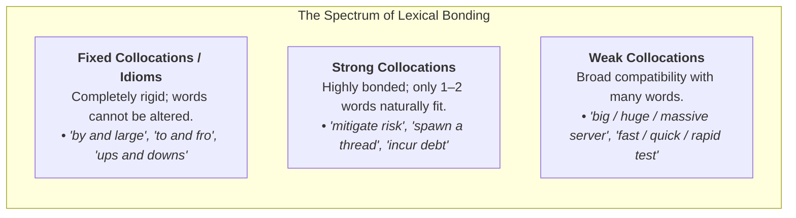

# Collocations & Word Partnerships: The Architecture of Idiomatic Phrasing 🔗🧩

> **Level:** CEFR B1–C1 (Lexical Selection & Collocational Competence)  
> **Primary References:** Michael Swan (*Practical English Usage*, §28–31); *Oxford Collocations Dictionary for Students of English*  
> **Core Premise:** A **collocation** is a predictable, natural pairing or grouping of words that native speakers habitually co-locate. Words with identical dictionary definitions cannot simply be swapped: we say *“heavy rain”* (never *“thick rain”*), *“fast car”* (never *“quick car”*), and *“make a decision”* (never *“do a decision”*). In software engineering, using non-standard word combinations (e.g., *“throw an alert”* instead of *“trigger an alert”*) marks writing as unnatural and unidiomatic.

---

## 1. The Collocation Spectrum



---

## 2. Core Syntactic Categories of Collocations

Collocations adhere to specific grammatical patterns:

| Pattern | Everyday English Example | Software Engineering / Computing Collocation |
| :--- | :--- | :--- |
| **Verb + Noun** | *make a promise, break a habit, pay attention* | *execute a query, spawn a process, invoke a method, allocate memory* |
| **Adjective + Noun** | *heavy rain, golden opportunity, deep sleep* | *transient error, breaking change, high availability, race condition* |
| **Adverb + Adjective** | *highly recommended, completely exhausted, bitterly cold* | *mutually exclusive, highly scalable, inherently unsafe, strictly monotonic* |
| **Verb + Adverb** | *whisper softly, run quickly, argue vehemently* | *scale horizontally, fail gracefully, terminate abruptly, compile cleanly* |
| **Noun + Noun** | *coffee cup, traffic jam, credit card* | *buffer overflow, connection pool, thread starvation, single point of failure* |
| **Verb + Prepositional Phrase** | *depend on, insist on, believe in* | *adhere to standards, listen on port 8080, fallback to cache* |

---

## 3. High-Frequency Technical & Engineering Collocation Catalog

Mastering these established engineering collocations eliminates non-idiomatic translations:

### 1. High-Value Verb + Noun Pairs
- **`allocate / deallocate memory`**: Reserve or free RAM sectors (NOT: *give / take memory*).
- **`spawn / fork a process / thread`**: Create a child execution thread (NOT: *birth / start up*).
- **`invoke / call a method`**: Trigger function execution via its programmatic signature.
- **`throw / raise an exception`**: Signal an error condition in code runtime.
- **`catch / handle an exception`**: Intercept and resolve a thrown error boundary.
- **`trigger / fire an alert`**: Dispatch an automated incident notification from monitoring telemetry.
- **`enforce a constraint / policy`**: Apply a mandatory schema validation rule or database check.
- **`provision an instance / server`**: Spin up cloud infrastructure via code or console.
- **`terminate / abort a connection`**: Sever a TCP socket handshake cleanly or forcibly.
- **`establish / negotiate a handshake`**: Form an active TLS or network connection.

### 2. High-Value Adjective + Noun Pairs
- **`transient error`**: A temporary glitch that resolves itself automatically on retry (NOT: *passing / short error*).
- **`breaking change`**: An API alteration that invalidates downstream client implementations.
- **`backward compatibility`**: Ensuring legacy systems continue operating against new versions.
- **`graceful degradation`**: Maintaining core system functionality when peripheral subsystems fail.
- **`race condition`**: A concurrency defect where timing affects execution state.
- **`single point of failure (SPOF)`**: A solitary system component whose failure halts the entire cluster.
- **`idempotent operation`**: An operation producing identical results regardless of execution count.

### 3. High-Value Adverb + Adjective Pairs
- **`mutually exclusive`**: Events or options that cannot occur simultaneously.
- **`inherently unsafe`**: Systems or memory pointers containing built-in risk.
- **`strictly monotonic`**: Counters or IDs that only increase, never decrease or repeat.
- **`horizontally scalable`**: Architectures capable of handling increased load by adding more nodes.
- **`tightly coupled`**: Modules that exhibit high interdependence, reducing maintainability.

---

## 4. Practical Dual-Domain Examples

### Everyday Conversation & General Writing

1. *Verb + Noun:* *We must **make a decision** before the end of the business day.*
2. *Adjective + Noun:* *It was a **bitter disappointment** when our vacation was canceled.*
3. *Adverb + Adjective:* *The novel was **widely acclaimed** by literary critics around the world.*
4. *Verb + Adverb:* *The children **slept soundly** through the thunderstorms.*
5. *Noun + Noun:* *Severe **traffic congestion** delayed our arrival at the concert.*
6. *Verb + Noun:* *Please **pay close attention** to the safety briefing.*
7. *Adjective + Noun:* *She possesses a **wealth of experience** in international trade.*
8. *Adverb + Adjective:* *I am **deeply grateful** for your assistance during our move.*

### Software Engineering & Systems Architecture

9. *Verb + Noun:* *The database query planner failed to **choose an efficient index**, triggering a full table scan.*
10. *Adjective + Noun:* *Always implement circuit breakers to insulate microservices from **transient downstream failures**.*
11. *Adverb + Adjective:* *In distributed consensus algorithms, replica states must remain **eventually consistent**.*
12. *Verb + Adverb:* *When memory thresholds are breached, the container should **fail gracefully** and log diagnostic traces.*
13. *Compound Noun:* *Unsynchronized access to shared global variables is the root cause of this **race condition**.*
14. *Verb + Noun:* *Our platform team automated the pipeline to **provision cloud infrastructure** using Terraform.*
15. *Adverb + Adjective:* *The microservices in our mesh are **loosely coupled**, allowing independent continuous delivery.*
16. *Verb + Noun:* *The ingress controller **terminates the TLS connection** at the edge before forwarding unencrypted traffic internally.*

---

## 5. Common Antipattern Diagnostic Bug-and-Patch Table

| ❌ Broken Anti-Pattern (Bug) | Corrected Idiomatic English (Patch) | Diagnostic Grammar Explanation |
| :--- | :--- | :--- |
| ❌ *The monitoring system **threw an alert**.* | ✅ *The monitoring system **triggered / fired an alert**.* | Exceptions are *thrown*; alerts and notifications are *triggered* or *fired*. |
| ❌ *We must **make a thread start**.* | ✅ *We must **spawn / spin up a thread**.* | Technical creation of execution threads collocates strictly with *spawn* or *spin up*. |
| ❌ *The system has **heavy latency**.* | ✅ *The system experiences **high / severe latency**.* | Latency is measured in altitude/degree (*high/low*), not weight (*heavy*). |
| ❌ *This change has **backwards harmony**.* | ✅ *This change maintains **backward compatibility**.* | The standard technical collocation for legacy support is *backward compatibility*. |
| ❌ *The process **died suddenly** without logs.* | ✅ *The process **terminated abruptly** without logs.* | Formal systems documentation uses *terminated abruptly* rather than anthropomorphic *died suddenly*. |
| ❌ *The two options are **deeply exclusive**.* | ✅ *The two options are **mutually exclusive**.* | The established philosophical and logical collocation is *mutually exclusive*. |
| ❌ *We need to **do an API call**.* | ✅ *We need to **make an API call / invoke an API endpoint**.* | Requests and calls are originated; they take *make* or *invoke*, never *do*. |

---

## 6. Self-Assessment Practice Exercises

### Exercise 1: Collocation Matching
Pair each technical verb with its most natural, idiomatic noun complement:
1. `Allocate` $\rightarrow$ (a) a thread / (b) memory / (c) an exception
2. `Spawn` $\rightarrow$ (a) memory / (b) a process / (c) an alert
3. `Throw` $\rightarrow$ (a) a query / (b) an exception / (c) a handshake
4. `Trigger` $\rightarrow$ (a) an alert / (b) a constraint / (c) backward compatibility
5. `Enforce` $\rightarrow$ (a) a connection pool / (b) an index / (c) a schema constraint

### Exercise 2: Antipattern Correction
Identify the unnatural collocation in each sentence and substitute the correct idiomatic phrase:
6. *The background worker died with a big exception during deserialization.*
7. *Our architecture is tightly joined, making it difficult to refactor components.*
8. *The payment service handles transient bugs by retrying three times.*
9. *Deploying this database migration will cause a tearing change to client applications.*
10. *The edge gateway ends the TLS connection before routing traffic to the origin.*

---

## 7. Answer Key with Diagnostic Explanations

1. **(b) memory** — *Allocate memory* is the standard system programming collocation.
2. **(b) a process** (or thread) — *Spawn a process* refers to initiating a child task.
3. **(b) an exception** — Runtime errors are *thrown* by execution engines.
4. **(a) an alert** — Observability events *trigger* or *fire* alerts.
5. **(c) a schema constraint** — Rules and invariants are *enforced*.
6. **Correction:** *The background worker **threw an unhandled exception (or crashed with a fatal exception)** during deserialization.*  
   *Explanation:* Exceptions are *thrown* or *unhandled*, not *big*.
7. **Correction:** *Our architecture is **tightly coupled**, making it difficult to refactor components.*  
   *Explanation:* The structural opposite of *loosely coupled* is *tightly coupled*.
8. **Correction:** *The payment service handles **transient errors (or transient failures)** by retrying three times.*  
   *Explanation:* Software bugs are logic flaws in code; intermittent network glitches are *transient errors*.
9. **Correction:** *Deploying this database migration will cause a **breaking change** to client applications.*  
   *Explanation:* The standard collocation for non-backward-compatible modifications is *breaking change*.
10. **Correction:** *The edge gateway **terminates the TLS connection** before routing traffic to the origin.*  
    *Explanation:* Sockets and cryptographic handshakes are *terminated*, not *ended*.

---

## 8. High-Density Revision Flashcards

```
Q: What is a collocation?
A: A natural, habitual co-occurrence of words (e.g., 'heavy rain', 'make a decision', 'allocate memory')
   that cannot be substituted with arbitrary synonyms without sounding unnatural.
```

```
Q: What are the correct technical verbs for: memory, processes, exceptions, alerts?
A: • Memory: ALLOCATE / DEALLOCATE memory
   • Processes: SPAWN / FORK a process
   • Exceptions: THROW / CATCH an exception
   • Alerts: TRIGGER / FIRE an alert
```

```
Q: What is the difference between a 'transient error' and a 'bug'?
A: A 'transient error' is a temporary, intermittent runtime issue (e.g., network packet drop) that self-heals.
   A 'bug' is a permanent defect or logic error in source code requiring a patch.
```
