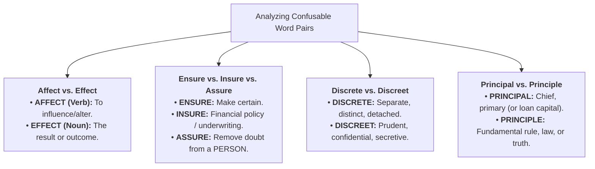

# Confusing Word Pairs & False Friends: High-Impact Lexical Disambiguation ⚖️🪞

> **Level:** CEFR B1–C1 (Lexical Disambiguation & Homophone Precision)  
> **Primary References:** Michael Swan (*Practical English Usage*, §31, *“Confusable Words”*); *Merriam-Webster’s Dictionary of English Usage*  
> **Core Premise:** The English lexicon contains numerous pairs of **homophones** (words pronounced identically but spelled differently) and **near-synonyms** that diverge sharply in syntax and semantics. In software engineering, confusing *affect* with *effect*, *discrete* with *discreet*, or *ensure* with *insure* in RFCs, pull requests, and customer documentation damages credibility and introduces technical ambiguity.

---

## 1. The High-Impact Lexical Disambiguation Matrix



---

## 2. Deep-Dive Lexical Disambiguation Catalog

### 1. `Affect` vs. `Effect`
- **`Affect` (Verb):** To act upon, influence, or cause a change in state:  
  *“Network jitter directly **affects** packet delivery times.”*
- **`Effect` (Noun):** The result, consequence, or outcome of an action:  
  *“The deployment had an immediate positive **effect** on response times.”*
- *The Rare Inversion Exceptions (Formal):*
  - *Effect* as a verb = to bring about / execute: *“The CEO **effected** major policy changes.”*
  - *Affect* as a noun (psychology) = emotional state: *“The patient displayed a flat **affect**.”*
- **Memory Hook (RAVEN):** **R**emember **A**ffect is a **V**erb, **E**ffect is a **N**oun.

---

### 2. `Ensure` vs. `Insure` vs. `Assure`
- **`Ensure`:** To guarantee, make certain, or secure an event or state:  
  *“Implement mutex locks to **ensure** thread safety during concurrent writes.”*
- **`Insure`:** To protect against monetary loss through a commercial insurance policy:  
  *“The enterprise **insured** its cloud infrastructure against catastrophic outages.”*
- **`Assure`:** To remove doubt or give confidence to a **person / human recipient**:  
  *“The CTO **assured the stakeholders** that all customer data was safe.”*
  $$\text{Assure} + \mathbf{\text{PERSON (direct recipient)}} + (\text{that}) + \text{Clause}$$

---

### 3. `Discrete` vs. `Discreet`
- **`Discrete` (spelled with `e` separated by `t`):** Distinct, separate, individual, non-continuous:  
  *“The monolith was decomposed into twelve **discrete** microservices.”*  
  *(Think: the two `e`s are kept **separate** by the letter `t`).*
- **`Discreet` (spelled with `ee` together):** Tactful, cautious, prudent, keeping secrets:  
  *“Please be **discreet** when discussing confidential acquisition talks.”*

---

### 4. `Principal` vs. `Principle`
- **`Principal` (Noun or Adjective):**
  - Adjective: Chief, main, primary (*“The **principal** architect approved the RFC.”*).
  - Noun: Head of a school; primary participant; original loan amount without interest.
  - *Memory Hook:* The princi**pal** is your **pal** (person/main).
- **`Principle` (Noun strictly):** A fundamental rule, law, architectural axiom, or ethical doctrine:  
  *“Always adhere to the **Single Responsibility Principle** in OOP design.”*  
  *(Think: both princi**ple** and ru**le** end in **-le**).*

---

### 5. `Complement` vs. `Compliment`
- **`Complement` (with `e`):** To complete, supplement, or enhance harmoniously:  
  *“Redis and PostgreSQL **complement** each other in our caching architecture.”*  
  *(Think: compl**e**ment **c**ompl**e**tes).*
- **`Compliment` (with `i`):** Praise, admiration, or polite flattery:  
  *“The team received a glowing **compliment** from the customer for resolving the bug.”*  
  *(Think: **I** like to receive a compl**i**ment).*

---

### 6. `Loose` vs. `Lose`
- **`Loose` (Adjective, rhymes with *goose*):** Unbound, not tight, free:  
  *“Our architecture favors **loosely** coupled microservices.”*
- **`Lose` (Verb, rhymes with *snooze*):** To misplace, suffer loss, or fail to retain:  
  *“Without persistent volumes, containers **lose** their state upon restart.”*

---

### 7. `Precede` vs. `Proceed`
- **`Precede` (with `e`):** To come before in time, order, or rank:  
  *“Database schema migrations must **precede** application container deployments.”*
- **`Proceed` (with `ee`):** To go forward, continue after an interruption, or carry on:  
  *“Once the staging smoke tests pass, you may **proceed with** the production rollout.”*

---

### 8. `Historic` vs. `Historical`
- **`Historic`:** Famous, momentous, landmark, having great importance in history:  
  *“The moon landing in 1969 was a **historic** milestone for humanity.”*
- **`Historical`:** Pertaining to, based on, or dealing with the past:  
  *“We analyze **historical** time-series metrics to forecast server capacity needs.”*

---

### 9. `Economic` vs. `Economical`
- **`Economic`:** Pertaining to the economy, trade, finance, or macro-markets:  
  *“The country faces severe **economic** challenges due to inflation.”*
- **`Economical`:** Thrifty, cost-effective, efficient with money or resources:  
  *“Spot instances are a highly **economical** way to run batch training jobs.”*

---

## 3. Practical Dual-Domain Examples

### Everyday Conversation & General Writing

1. *Affect:* *Lack of sleep seriously **affects** your mental alertness.*
2. *Effect:* *The medication had an immediate calming **effect** on the patient.*
3. *Assure:* *I **assure you** that the train will arrive on schedule.*
4. *Complement:* *A squeeze of fresh lemon **complements** grilled salmon perfectly.*
5. *Compliment:* *She paid him a wonderful **compliment** on his presentation skills.*
6. *Principle:* *He refused to compromise his moral **principles** for personal gain.*
7. *Discreet:* *She asked the hotel concierge to be **discreet** about her stay.*
8. *Loose:* *The screw on this chair leg is **loose**; bring me a screwdriver.*

### Software Engineering & Technical Documentation

9. *Affect (Verb):* *The memory leak **affects** only worker threads handling websocket connections.*
10. *Effect (Noun):* *Enabling Gzip compression had a noticeable **effect** on network throughput.*
11. *Ensure (System guarantee):* *Use transactional outbox patterns to **ensure** reliable message dispatch.*
12. *Assure (Human recipient):* *We **assured our enterprise clients** that their data remained encrypted at rest.*
13. *Discrete (Separate):* *The system splits audio streams into 20ms **discrete** packet frames.*
14. *Principle (Rule):* *The Open/Closed **Principle** states that software entities should be open for extension.*
15. *Precede (Sequence):* *Sanitization of user input must **precede** SQL query construction.*
16. *Economical (Cost-effective):* *Serverless functions are more **economical** for unpredictable, low-traffic APIs.*

---

## 4. Common Antipattern Diagnostic Bug-and-Patch Table

| ❌ Broken Anti-Pattern (Bug) | Corrected Idiomatic English (Patch) | Diagnostic Grammar Explanation |
| :--- | :--- | :--- |
| ❌ *This bug will **effect** our production users.* | ✅ *This bug will **affect** our production users.* | Influencing or changing an external entity requires the verb *affect*. |
| ❌ *We must **insure** that the tests pass.* | ✅ *We must **ensure** that the tests pass.* | Making certain of an outcome is *ensure*; *insure* refers to financial underwriting. |
| ❌ *The architect broke the **principals** of clean code.* | ✅ *The architect broke the **principles** of clean code.* | Core architectural doctrines and rules are *principles*, not *principals*. |
| ❌ *The microservices operate as **discreet** units.* | ✅ *The microservices operate as **discrete** units.* | Distinct, individual, separate items are *discrete*; *discreet* means secretive/prudent. |
| ❌ *We cannot afford to **loose** customer records.* | ✅ *We cannot afford to **lose** customer records.* | Misplacing or forfeiting possession is the verb *lose* (rhymes with *snooze*). |
| ❌ *The cache **compliments** the database.* | ✅ *The cache **complements** the database.* | Enhancing or completing another system is *complement*; *compliment* is verbal praise. |
| ❌ *Check the **historic** telemetry data.* | ✅ *Check the **historical** telemetry data.* | Data recorded in the past is *historical data*; *historic* denotes a famous, epoch-making event. |

---

## 5. Self-Assessment Practice Exercises

### Exercise 1: Pair Selection (Choose the correct lexical word)
1. The outage did not (affect / effect) the authentication service.
2. We need to (ensure / insure / assure) that all database migrations run inside transactions.
3. The CTO (ensured / insured / assured) the engineering team that no layoffs were planned.
4. The monolithic application was refactored into fifteen (discrete / discreet) serverless endpoints.
5. In object-oriented programming, Liskov substitution is a core design (principal / principle).

### Exercise 2: Error Identification & Correction
6. *Spot compute instances are an economic alternative to on-demand virtual machines.*
7. *Security scans must proceed the deployment phase.*
8. *Without persistent disk volumes, the pod will loose all state on restart.*
9. *Our OAuth integration had an immediate positive affect on user conversion.*
10. *The frontend and backend designs compliment each other wonderfully.*

---

## 6. Answer Key with Diagnostic Explanations

1. **affect** — Verb meaning to influence or alter the state of the auth service.
2. **ensure** — Verb meaning to make certain that transactions are utilized.
3. **assured** — Verb followed by a personal human recipient (*the engineering team*) meaning to remove doubt.
4. **discrete** — Adjective meaning distinct, separate, detached units.
5. **principle** — Noun denoting a fundamental design rule or axiom.
6. **Correction:** *Spot compute instances are an **economical** alternative to on-demand virtual machines.*  
   *Explanation:* Cost-effective/thrifty is *economical*; *economic* relates to macro-financial systems.
7. **Correction:** *Security scans must **precede** the deployment phase.*  
   *Explanation:* To come before in chronological order is *precede*; *proceed* means to go forward.
8. **Correction:** *Without persistent disk volumes, the pod will **lose** all state on restart.*  
   *Explanation:* Forfeiting data is the verb *lose*, not the adjective *loose*.
9. **Correction:** *Our OAuth integration had an immediate positive **effect** on user conversion.*  
   *Explanation:* The noun meaning outcome or result is *effect* (RAVEN rule).
10. **Correction:** *The frontend and backend designs **complement** each other wonderfully.*  
    *Explanation:* Enhancing or fitting together harmoniously is *complement*, not *compliment* (praise).

---

## 7. High-Density Revision Flashcards

```
Q: What is the RAVEN mnemonic for affect vs. effect?
A: Remember: Affect is a Verb, Effect is a Noun.
   (e.g., 'The outage affects users' vs. 'The effect of the outage was severe').
```

```
Q: What is the difference between 'ensure', 'assure', and 'insure'?
A: • ENSURE = Make certain that an outcome happens (system focus).
   • ASSURE = Remove doubt from a PERSON (takes a human object: 'assure them').
   • INSURE = Protect financially via insurance policy.
```

```
Q: How do you remember the difference between 'discrete' and 'discreet'?
A: • DISCRETE = Separate / distinct (the two 'e's are separated by the 't').
   • DISCREET = Secretive / prudent (the two 'e's are huddled discreetly together).
```
