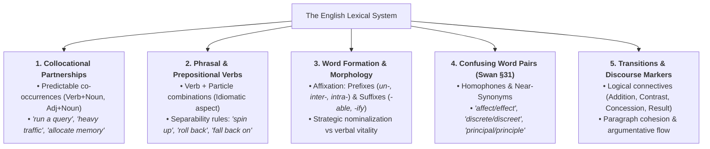

# Module 14: Vocabulary, Word Formation & Lexical Usage 📚🧬

> **Level:** CEFR B1–C2 (Lexical Mechanics, Collocations & Morphology)  
> **Primary References:** Michael Swan (*Practical English Usage*, §28–31); Paul Nation (*Learning Vocabulary in Another Language*)  
> **Core Premise:** Grammar provides the structural skeleton of the English language, but **lexical competence** determines idiomatic fluency, natural phrasing, and professional credibility. Knowing dictionary definitions of isolated words is insufficient; words exist in **collocational partnerships**, undergo **morphological derivations (affixation)**, combine into **phrasal verbs with non-compositional aspect**, and form subtle **confusable pairs** (e.g., *affect* vs. *effect*, *ensure* vs. *assure*).

---

## 1. The Lexical Systems Architecture



---

## 2. Curated Curriculum of Topic Guides

| Guide | Core Linguistic Focus | Primary Technical & Professional Application | CEFR Level |
| :--- | :--- | :--- | :--- |
| **[Collocations & Word Partnerships](./collocations-and-word-partnerships.md)** | Fixed & semi-fixed lexical chunks (Verb+Noun, Adj+Noun, Adv+Adj) | Production system phrasing (*spawn a thread, invoke an API, establish a connection*) | B1–C1 |
| **[Phrasal Verbs High-Frequency Guide](./phrasal-verbs-high-frequency-guide.md)** | Particle semantics, transitivity, and separability rules | Operational runbooks (*spin up pods, roll back deploys, tear down clusters*) | B1–C1 |
| **[Prefixes, Suffixes & Word Formation](./prefixes-suffixes-and-word-formation.md)** | Morphological derivations, Latin/Greek roots, nominalization | Vocabulary expansion, technical compounding, avoiding zombie nouns | B2–C2 |
| **[Confusing Word Pairs & False Friends](./confusing-word-pairs-and-false-friends.md)** | Swan §31 confusable homophones & near-synonyms | Eliminating embarrassing lexical errors (*affect/effect, ensure/insure*) | B1–C1 |
| **[Transition Words & Discourse Markers](./transition-words-and-discourse-markers.md)** | Conjunctive adverbs & transitional signposts | Writing cohesive technical proposals, whitepapers, and reports | B2–C2 |

---

## 3. The Lexical Chunking Invariant

Natural language fluency is not built by stringing isolated words together through abstract grammar rules; it is produced by recalling **pre-assembled lexical chunks**:

```
┌──────────────────────────────┬──────────────────────────────┬────────────────────────────────────────┐
│ Broken Word-for-Word Assembly│ Idiomatic Lexical Chunk      │ Collocational Category                 │
├──────────────────────────────┼──────────────────────────────┼────────────────────────────────────────┤
│ ❌ "open the database"        │ ✅ "connect to the database"  │ Verb + Prepositional Noun              │
│ ❌ "make a thread start"      │ ✅ "spawn / spin up a thread" │ Technical Verb + Noun                  │
│ ❌ "do a query"              │ ✅ "execute / run a query"    │ Standard Verb + Noun Collocation       │
│ ❌ "big latency"             │ ✅ "high / severe latency"    │ Adjective + Noun Collocation           │
│ ❌ "deeply inspect"          │ ✅ "scrutinize / audit"       │ Concise Lexical Precision              │
│ ❌ "throw an alert"          │ ✅ "trigger / fire an alert"  │ Event-driven Verb + Noun               │
└──────────────────────────────┴──────────────────────────────┴────────────────────────────────────────┘
```

---

## 4. Navigation & Next Steps

Select a guide from the curriculum above to master specific lexical domains, or proceed directly to:
- ➡️ **[1. Collocations & Word Partnerships](./collocations-and-word-partnerships.md)**
- 🔙 **[Module 15: Practical English & Engineering Communication](../15-practical-english-and-communication/index.md)**
- 🏠 **[Master Knowledge Base Index](../index.md)**
